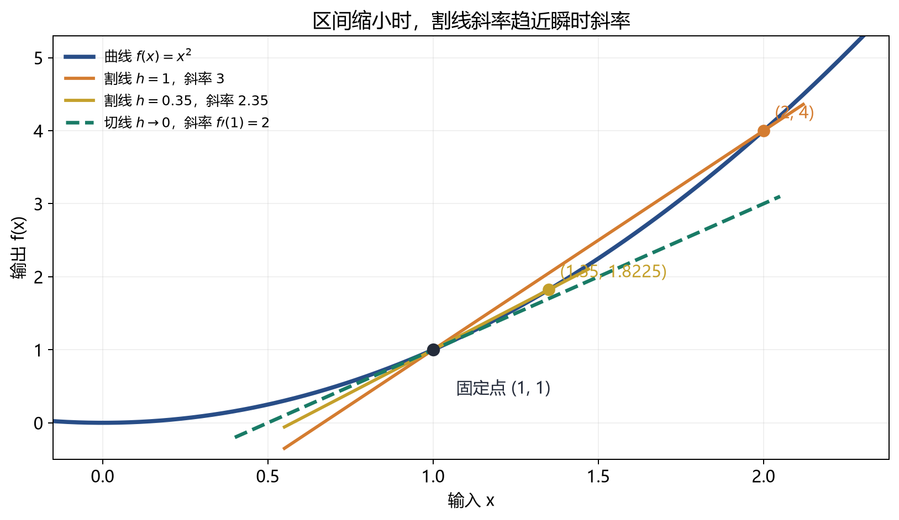
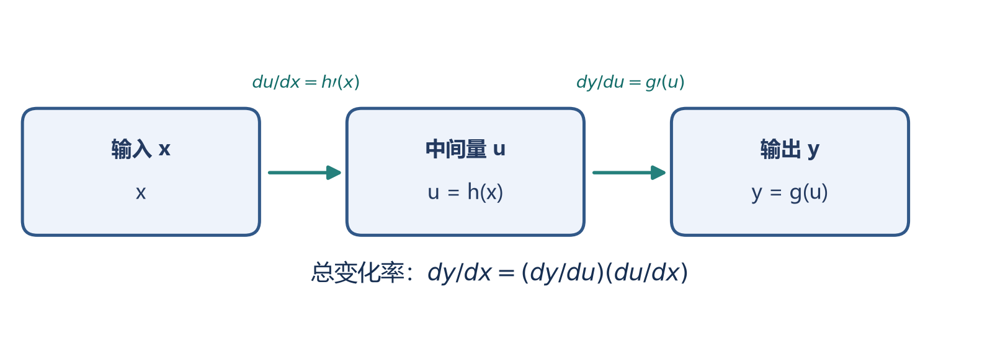
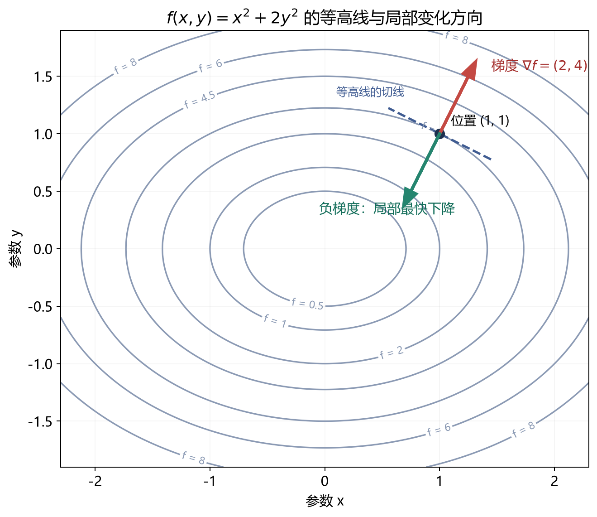

# [AI入门-微积分]1.导数、偏导数与链式法则

在机器学习中，模型训练的本质就是“调参”：我们给模型一组参数，让它做出预测，再用损失函数衡量它错得有多离谱。接下来最关键的问题是：**如果把某个参数调大一点点，损失到底会变大还是变小？变动的幅度有多猛？**

回答这个问题的工具就是**导数**与**偏导数**。而当模型层层叠加时，**链式法则**则像一条传导链，把最终的误差精准拆解并反传给每一个参数。

本文从最基础的瞬时变化率讲起，逐步拆解单变量求导、多变量偏导与梯度，最后落地到神经网络反向传播的核心机制——计算图与链式法则。

---

## 1 从平均变化率到导数与切线

### 1.1 变化率的极限就是瞬时速度

对于函数 $y = f(x)$，如果输入从 $a$ 变到 $a+h$，输出的变化量就是 $f(a+h) - f(a)$。将两者相比，得到的是这段区间的**平均变化率**：

$$
\frac{f(a+h) - f(a)}{h}, \qquad h \ne 0
$$

物理直觉非常直接：如果在 $t$ 到 $t+h$ 时间内跑了某段距离，上式就是这段时间的平均速度。

但要了解车辆在**时刻 $t$ 的瞬时速度**，就必须让观测区间无限缩短，令 $h \to 0$。若这个极限存在，它就是点 $a$ 处的**导数**：

$$
f'(a) = \lim_{h \to 0} \frac{f(a+h) - f(a)}{h}
$$

**几何直觉**：平均变化率是连接曲线两点的**割线斜率**；当两点无限贴近时，割线最终演变为该点切线的形态，**导数即为切线的斜率**。

以 $f(x) = x^2$ 为例，计算 $a=1$ 处的导数：

$$
\frac{(1+h)^2 - 1}{h} = \frac{1 + 2h + h^2 - 1}{h} = 2 + h \xrightarrow{h \to 0} 2
$$

因此 $f'(1) = 2$。若把 $a$ 换为通用的变量 $x$，就得到导函数 $f'(x) = 2x$。

---

### 1.2 局部线性近似：把弯曲的曲线当直线看

导数最实用的工程价值之一在于**局部线性近似**：在极小的局部范围内，复杂的弯曲函数可以用该点的切线直线来代替：

$$
f(a+h) \approx f(a) + f'(a)h
$$

- $f(a)$：当前的立足点；
- $f'(a)h$：斜率 $\times$ 步长，即预期的输出变化量。

例如在 $x=1$ 处估算 $f(1.1)$：切线估算为 $1 + 2(0.1) = 1.2$，真实值为 $1.1^2 = 1.21$，误差仅为 $h^2 = 0.01$。当步长极小时，高阶误差可以忽略不计。

> **记号说明**：导数常记作 $f'(x)$ 或 $\frac{dy}{dx}$。$\frac{dy}{dx}$ 是莱布尼茨记号，直观体现了“微小输出变动 / 微小输入变动”的比值关系，后文的链式法则正是借此展开。

---

## 2 用导数判断增减、极值与不可导点

### 2.1 增减性与驻点

导数的正负直接指示了函数的走向：
- **$f'(x) > 0$**：函数单调递增，输入增大，输出跟着上升；
- **$f'(x) < 0$**：函数单调递减，输入增大，输出反而下降；
- **优化直觉**：若损失函数关于参数的导数 $L'(w) > 0$，说明把 $w$ 调大损失会增加；要想降低损失，就必须**反向减少 $w$**。

若可导函数在内部取得极值，该点的切线必然水平，即**导数为零**：$f'(a) = 0$。导数为零的点称为**驻点（平稳点）**。

**关键警示**：驻点只是极值的候选点，并不一定是极值！
- $f(x) = x^2$ 在 $x=0$ 处导数为 0，且两侧导数“由负变正”，是真正的极小值点；
- $f(x) = x^3$ 在 $x=0$ 处导数也是 0，但两侧均在上升，该点既非极大也非极小，纯粹只是一个平坦过渡点（拐点）。

---

### 2.2 什么时候函数不可导？

连续只是可导的必要前提，**连续并不代表可导**。常见不可导的三类几何形态：
1. **尖角（折点）**：如 $f(x) = |x|$ 在 $x=0$ 处，左边趋近斜率为 $-1$，右边趋近斜率为 $+1$，左右极限不相等，导数不存在。
2. **断裂（不连续点）**：跳跃点或无穷间断点均不可导。
3. **垂直切线**：如 $f(x) = \sqrt[3]{x}$ 在 $x=0$ 处切线竖直，差商趋向无穷大，没有有限导数。

在深度学习中，ReLU 激活函数 $\max(0, x)$ 在 $x=0$ 处也是尖角不可导。工程框架（如 PyTorch）会在实现中人为给 $x=0$ 赋一个默认子梯度（通常设为 0），以确保程序稳定运行，但从严格数学定义上该点并不存在经典导数。

---

## 3 常见函数、自然对数与反函数的导数

掌握基础积木的求导公式，才能推导由它们搭成的复杂网络。

| 函数 $f(x)$ | 导数 $f'(x)$ | 直觉与核心意义 |
|---|---|---|
| 常数 $c$ | $0$ | 静态基准，不随输入变动而产生响应 |
| 线性项 $ax+b$ | $a$ | 斜率处处恒定为 $a$ |
| 幂函数 $x^n$ | $nx^{n-1}$ | 指数落下来，幂次减 1（负数与分数指数亦通用） |
| 正弦 $\sin x$ | $\cos x$ | 波动变化率（需使用弧度制） |
| 余弦 $\cos x$ | $-\sin x$ | 波动变化率（注意负号） |
| 指数 $e^x$ | $e^x$ | **导数等于自身**：当前体量越大，增长速度越恐怖 |
| 自然对数 $\ln x$ | $1/x$ | 压制大数值的增长，斜率随 $x$ 变大而迅速变缓（$x>0$） |

### 自然底数 $e$ 与反函数求导

- **自然底数 $e$**：定义自复利极限 $e = \lim_{n \to \infty} (1 + 1/n)^n \approx 2.71828$。$e^x$ 是数学中唯一求导后形式完全不变的函数。
- **自然对数 $\ln x$**：是 $e^x$ 的逆运算。在机器学习的交叉熵损失中经常遇到对数项，它能将复杂的“概率连乘”转化为“对数相加”，大幅简化求导链条。
- **反函数求导法则**：若原函数把输入放大 2 倍，其逆运算必然把输入压缩为 $1/2$ 倍。因此**反函数的导数就是原函数导数的倒数**（前提是 $f'(x) \ne 0$）：

$$
(f^{-1})'(y) = \frac{1}{f'(x)} = \frac{1}{f'(f^{-1}(y))}
$$

典型例子：$y = e^x$ 的反函数是 $x = \ln y$。由公式可知 $(\ln y)' = \frac{1}{(e^x)'} = \frac{1}{e^x} = \frac{1}{y}$，优雅地印证了对数的求导法则。

---

## 4 把基本导数组合起来：线性与乘积规则

### 4.1 线性性质（可加性与数乘）

函数的相加与倍数缩放，求导时直接逐项相加并保留倍数：

$$
(f + g)' = f' + g', \qquad (cf)' = c f'
$$

如果总损失是多个分项损失的累加（例如：预测误差 + 正则化惩罚），对参数求导时只需分别求导再求和。

---

### 4.2 乘积法则（积的导数不是导数的积）

当两个都在变化的量相乘时，任何一方的微动都会引起乘积的改变：

$$
(fg)' = f'g + fg'
$$

**记忆抓手**：“前导后不导 + 前不导后导”。  
例如求 $x^2 e^x$ 的导数：先导 $x^2$ 得 $2x e^x$，再导 $e^x$ 得 $x^2 e^x$，最终合并为 $(2x + x^2)e^x$。

---

## 5 链式法则：沿依赖路径连接变化率

### 5.1 齿轮传动直觉

如果齿轮 A 转 1 圈带动齿轮 B 转 2 圈，齿轮 B 转 1 圈带动齿轮 C 转 3 圈，那么齿轮 A 每转 1 圈，齿轮 C 就会转 $2 \times 3 = 6$ 圈。

这就是**复合函数求导的链式法则**：若输入 $x$ 驱动中间量 $u = h(x)$，中间量再驱动输出 $y = g(u)$，则总变化率是**各级局部变化率的连乘**：

$$
\frac{dy}{dx} = \frac{dy}{du} \cdot \frac{du}{dx} = g'(h(x)) \cdot h'(x)
$$

### 5.2 逐步计算范例

求 $y = (3x^2 + 1)^4$ 在 $x=1$ 处的导数：
1. **设中间量**：令 $u = 3x^2 + 1$，则外层为 $y = u^4$；
2. **算外层导数**：$\frac{dy}{du} = 4u^3$；
3. **算内层导数**：$\frac{du}{dx} = 6x$；
4. **链式连乘**：$\frac{dy}{dx} = 4u^3 \cdot 6x = 24x(3x^2 + 1)^3$。

代入 $x=1$：$u = 4$，总导数 $\frac{dy}{dx} = 24(1)(4)^3 = 1536$。  
这说明在 $x=1$ 处微增 $0.001$，$y$ 将暴涨约 $1.536$。链式法则绝不能漏掉任何内层导数因子。

---

## 6 偏导数与切平面：一次改变一个输入

真实模型往往有成千上万个参数。在多元函数中，如何单独剥离出某一个参数的贡献？

### 6.1 偏导数：控制变量法

对于二元函数 $z = f(x, y)$，**对 $x$ 的偏导数**定义为：**强行固定 $y$ 为常数，只观察 $x$ 变动带来的瞬时变化率**：

$$
\frac{\partial f}{\partial x}(a, b) = \lim_{h \to 0} \frac{f(a+h, b) - f(a, b)}{h}
$$

**计算口诀**：求谁的偏导，就把谁当变量，其余所有字母全部当成普通数字常数看待。  
例如 $f(x, y) = x^2 y$：
- 对 $x$ 求偏导：$y$ 是常数因子，结果为 $2xy$；
- 对 $y$ 求偏导：$x^2$ 是常数因子，结果为 $x^2$。

---

### 6.2 切平面：多变量的局部线性拟合

在一元函数中，局部近似是一条切线；在二元曲面上，局部近似则是一个**切平面**：

$$
f(a+\Delta x, b+\Delta y) \approx f(a, b) + \frac{\partial f}{\partial x}\Delta x + \frac{\partial f}{\partial y}\Delta y
$$

它清晰地揭示了复合变动的底层逻辑：**两个输入同时微调时，输出的总变化量，等于各方向偏导数与步长乘积的直接累加**。

例如曲面 $f(x, y) = x^2 + y^2$ 在点 $(2, 3)$ 处：
- $\frac{\partial f}{\partial x} = 2x = 4$，$\frac{\partial f}{\partial y} = 2y = 6$；
- 若设置步长 $\Delta x = 0.01, \Delta y = -0.02$，则输出变化预估为：$4(0.01) + 6(-0.02) = -0.08$（曲面高度整体下降）。

---

## 7 梯度与方向导数：把所有偏导数放到一起

### 7.1 梯度向量

将多元函数对各个参数的偏导数按序排成一个列向量，就构成了**梯度（Gradient）**：

$$
\nabla f(\boldsymbol\theta) = \begin{bmatrix} \frac{\partial f}{\partial \theta_1} \\ \vdots \\ \frac{\partial f}{\partial \theta_n} \end{bmatrix} \in \mathbb R^n
$$

多变量的切平面近似因此可以极简地写成**内积形式**：

$$
f(\boldsymbol\theta + \Delta\boldsymbol\theta) \approx f(\boldsymbol\theta) + \nabla f(\boldsymbol\theta)^\mathsf T \Delta\boldsymbol\theta
$$

---

### 7.2 方向导数与最速下降

如果我们不局限于沿着坐标轴走，而是沿着任意指定的单位方向 $\mathbf u$（$\lVert \mathbf u \rVert_2 = 1$）迈步，输出的变化率就是**方向导数**：

$$
D_{\mathbf u}f(\boldsymbol\theta) = \nabla f(\boldsymbol\theta)^\mathsf T \mathbf u = \lVert \nabla f \rVert_2 \lVert \mathbf u \rVert_2 \cos\phi = \lVert \nabla f \rVert_2 \cos\phi
$$

其中 $\phi$ 是行进方向与梯度向量的夹角。分析 $\cos\phi$ 即可得出微积分中最核心的几何定理：
- 当 $\phi = 0^\circ$（与梯度同向，$\cos\phi = 1$）时，方向导数取最大正值——**梯度向量 $\nabla f$ 指向函数增长最快的方向**；
- 当 $\phi = 180^\circ$（与梯度反向，$\cos\phi = -1$）时，方向导数取最小负值——**负梯度 $-\nabla f$ 指向函数下降最快的方向**；
- 梯度向量在几何上**严格垂直于该点所处的等高线（等值面）**。

**驻点与鞍点**：  
极值点的必要条件同样是梯度清零：$\nabla f = \mathbf 0$。但对于形如 $f(x, y) = x^2 - y^2$ 的函数，在原点梯度虽为零，但在 $x$ 方向是波谷、在 $y$ 方向是波峰，形状宛如马鞍，这种点被称为**鞍点（Saddle Point）**。高维深度学习优化中，识别并跳出鞍点是一个核心课题。

---

## 8 多输入链式法则与计算图中的梯度

### 8.1 多路径汇聚的链式法则

如果一个变量通过多条路径同时影响最终目标，各条路径的边际贡献必须**全部累加**。

若 $u = u(x), v = v(x)$，且最终损失 $L = L(u, v)$，则链式法则表现为：

$$
\frac{dL}{dx} = \frac{\partial L}{\partial u} \frac{du}{dx} + \frac{\partial L}{\partial v} \frac{dv}{dx}
$$

**核心法则**：**沿路径相乘，在分叉节点相加**。

---

### 8.2 单神经元前向计算与反向梯度推导

看一个最经典的单神经元线性回归结构：
- **前向计算**：
  1. 仿射组合：$z = wx + b$
  2. 平方损失：$L = \frac{1}{2}(z - y)^2$

- **反向传播计算梯度**（从损失 $L$ 出发向后倒推）：
  1. 损失对预测值的敏感度：
     $$
     \frac{\partial L}{\partial z} = z - y \quad (\text{误差差值})
     $$
  2. 误差对权重 $w$ 的梯度（乘上内层局部导数 $\frac{\partial z}{\partial w} = x$）：
     $$
     \frac{\partial L}{\partial w} = \frac{\partial L}{\partial z} \frac{\partial z}{\partial w} = (z - y)x
     $$
  3. 误差对偏置 $b$ 的梯度（乘上内层局部导数 $\frac{\partial z}{\partial b} = 1$）：
     $$
     \frac{\partial L}{\partial b} = \frac{\partial L}{\partial z} \frac{\partial z}{\partial b} = z - y
     $$

**具体代数代入直觉**：  
设输入 $x=2$、权重 $w=3$、偏置 $b=1$、真实标签 $y=5$。
- 前向预测：$z = 3(2) + 1 = 7$，预测比目标高了 2，损失 $L = \frac{1}{2}(7 - 5)^2 = 2$。
- 反向回传：敏感度 $\frac{\partial L}{\partial z} = 2$；
- 权重梯度：$\frac{\partial L}{\partial w} = 2 \times 2 = 4$；
- 偏置梯度：$\frac{\partial L}{\partial b} = 2 \times 1 = 2$。  
两个梯度都是正值，表明当前把 $w$ 或 $b$ 稍微调小一点，就能有效降低整体误差！

---

### 8.3 计算图与反向传播的自动化

现代深度学习框架（如 PyTorch）的自动求导引擎（`torch.autograd`），本质就是在内存中动态构建一张**计算图（DAG）**：
- **前向传播（Forward Pass）**：按图的拓扑顺序，由叶子节点向根节点推进，计算中间激活值与最终 Loss；
- **反向传播（Backward Pass）**：从 Loss 开始逆向执行链式法则，将外层传来的梯度与当前运算节点的局部导数相乘；当遇到一个变量被多个后续算子引用的分叉时，自动将其累加。

反向传播负责**精准高效地求出所有参数的梯度**；而梯度下降等优化器随后才根据这些梯度去**执行参数更新**。搞清这种分工，就彻底掌握了神经网络训练的底层基石。