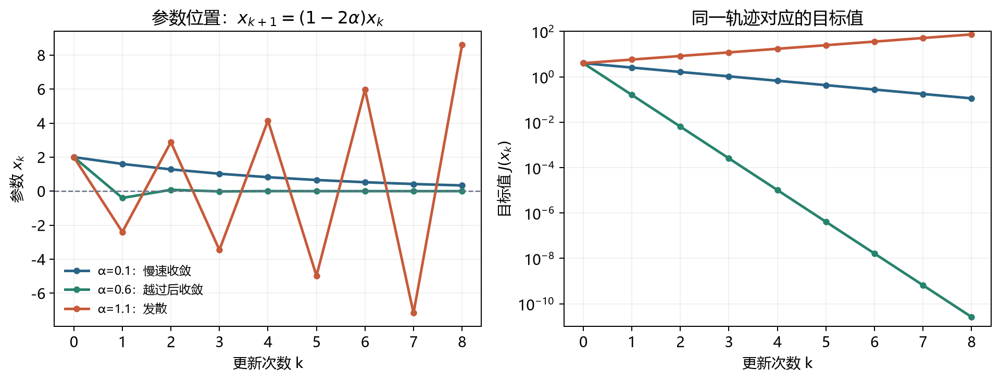
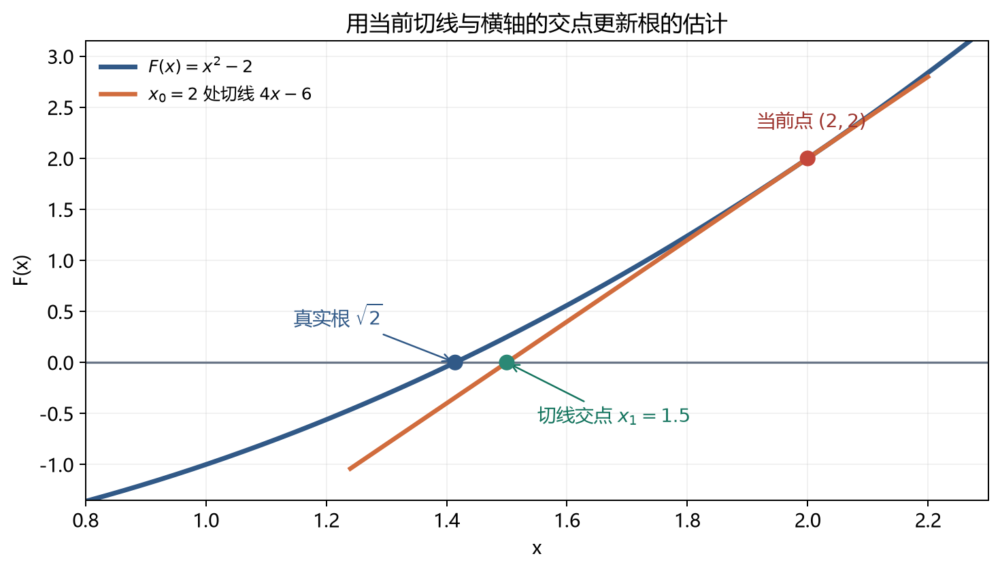
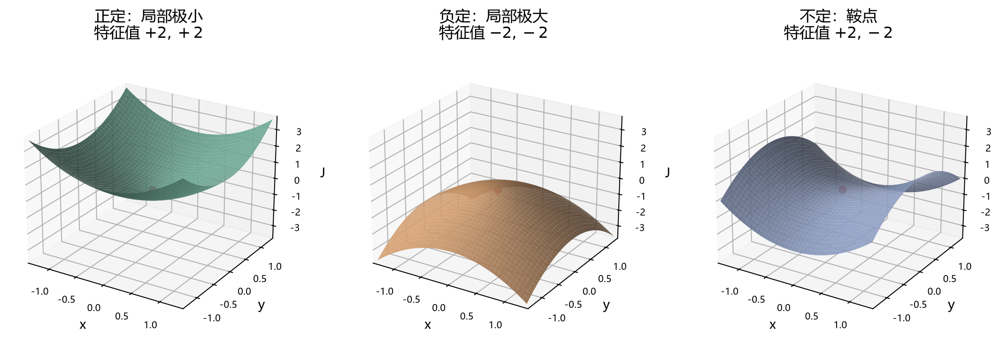

# [AI入门-微积分]2.梯度下降、曲率与数值优化

有了梯度工具，我们便能看清当前参数周围的坡度走向。在机器学习中，下一步的核心任务就是：**如何驱动参数，一步步滚到损失函数的谷底？**

寻找最优点通常有两条路径：
1. **解析法（一步到位）**：直接求解导数/梯度为零的方程。
2. **数值迭代法（小步快跑）**：顺着梯度的反方向逐步挪动（梯度下降），或者利用二阶曲率加速逼近（牛顿法）。

本文将对比直接求驻点与逐步迭代的本质差异，通过最小二乘问题打通两条路径的联系，最后剖析二阶导数、Hessian 矩阵与曲率如何决定数值优化的成败。

---

## 1 从损失函数到驻点：解析求解能做什么

优化问题的数学本质：给定目标函数 $J(\boldsymbol\theta)$，寻找一组参数 $\boldsymbol\theta^*$，使得损失值达到最小。

在平滑且无边界约束的场景下，极小值点必须满足坡度彻底平坦，即**梯度向量为零**：

$$
\nabla J(\boldsymbol\theta^*) = \mathbf 0
$$

满足该条件的点统称为**驻点（平稳点）**。梯度指向函数上升最快的方向，而**负梯度 $-\nabla J$ 则是最陡峭的局部下降方向**。当梯度清零时，一阶坡度无法再提供任何移动指引。

- **简单凸问题解析求解**：  
  对于 $J(x, y) = (x-1)^2 + 2(y+2)^2$，令梯度 $\begin{bmatrix} 2(x-1) \\ 4(y+2) \end{bmatrix} = \begin{bmatrix} 0 \\ 0 \end{bmatrix}$，直接解出 $(x, y) = (1, -2)$。两项平方和必定非负，该点使得 $J=0$，毫无疑问是全局最小值点。
- **解析法的致命瓶颈**：  
  $\nabla J = \mathbf 0$ **只是必要条件，不是充分条件**！它抓出来的可能是极小值，也可能是极大值甚至马鞍面（鞍点）。面对非线性复合法则（如 $J(x) = e^x - \ln x$ 导数置零得到 $xe^x = 1$），我们往往根本求不出初等解析解；更别说在深度学习中，参数量常达数亿维，联立解高维非线性方程组在计算上是天方夜谭。

因此，计算机更擅长采取**数值迭代**：从某个初始猜测出发，看一眼周围坡度，往前挪一步，逐步逼近最优解。

---

## 2 梯度下降：用局部斜率逐步调整参数

梯度下降的核心逻辑只有一句话：**既然梯度指向最陡上升方向，那我们就反其道而行之，朝负梯度方向迈步。**

对于单变量函数 $J(x)$，参数更新规则为：

$$
x_{k+1} = x_k - \alpha J'(x_k), \qquad \alpha > 0
$$

- $J'(x_k)$：当前位置的斜率；
- 负号：斜率为正（向右上升）就向左退，斜率为负（向右下降）就向右进；
- $\alpha$（学习率/步长）：控制单步跨度的大小。

推广到高维参数空间 $\boldsymbol\theta \in \mathbb R^n$：

$$
\boldsymbol\theta_{k+1} = \boldsymbol\theta_k - \alpha \nabla J(\boldsymbol\theta_k)
$$

> **关键原则**：所有参数分量必须基于**当前轮次的同一组参数**同步求偏导并统一更新，绝不能算完一个分量立刻覆盖、再带入算下一个分量。

### 二元手算演练

目标函数为 $J(x, y) = x^2 + 2y^2$，其梯度为 $\nabla J = \begin{bmatrix} 2x \\ 4y \end{bmatrix}$。  
设初始点 $(x_0, y_0) = (2, 1)$，学习率 $\alpha = 0.1$：
1. **第 1 轮**：当前梯度 $\nabla J(2, 1) = \begin{bmatrix} 4 \\ 4 \end{bmatrix}$。  
   $$
   \begin{bmatrix} x_1 \\ y_1 \end{bmatrix} = \begin{bmatrix} 2 \\ 1 \end{bmatrix} - 0.1 \begin{bmatrix} 4 \\ 4 \end{bmatrix} = \begin{bmatrix} 1.6 \\ 0.6 \end{bmatrix}
   $$
   损失由 $J(2, 1) = 6$ 下降到 $J(1.6, 0.6) = 3.28$。
2. **第 2 轮**：在新位置求梯度 $\nabla J(1.6, 0.6) = \begin{bmatrix} 3.2 \\ 2.4 \end{bmatrix}$。  
   $$
   \begin{bmatrix} x_2 \\ y_2 \end{bmatrix} = \begin{bmatrix} 1.6 \\ 0.6 \end{bmatrix} - 0.1 \begin{bmatrix} 3.2 \\ 2.4 \end{bmatrix} = \begin{bmatrix} 1.28 \\ 0.36 \end{bmatrix}
   $$
   损失进一步降至 $1.8976$。参数在参数空间中平滑滑向原点谷底。

---

## 3 学习率、曲面形状与停止条件

### 3.1 学习率大小的精确收敛界

学习率 $\alpha$ 决定了迭代的命运。以极简的一维二次函数 $J(x) = x^2$ 为例（$J'(x) = 2x$）：

$$
x_{k+1} = x_k - \alpha(2x_k) = (1 - 2\alpha)x_k \implies x_k = (1 - 2\alpha)^k x_0
$$

要想保证序列 $x_k \to 0$，公比绝对值必须严格小于 1，即 $|1 - 2\alpha| < 1 \implies \mathbf{0 < \alpha < 1}$：

- **$\alpha$ 过小（如 $0.1$）**：因子 $0.8 > 0$，单调且平缓地向谷底逼近，耗时漫长；
- **$\alpha$ 适中偏大（如 $0.6$）**：因子 $-0.2$，在谷底两侧来回穿梭振荡，但幅值迅速衰减，极快收敛；
- **$\alpha$ 过大（如 $1.1$）**：因子 $-1.2$，步子迈得太大直接扯翻，在谷底两侧剧烈震荡并彻底发散！

对于二维函数 $J(x, y) = x^2 + 2y^2$，两个方向的收敛因子分别为 $(1-2\alpha)$ 与 $(1-4\alpha)$。为了照顾更陡峭的 $y$ 方向（要求 $\alpha < 0.5$），整个系统必须迁就选择更小的学习率。此时较平缓的 $x$ 方向迭代就会极其拖沓，并在等高线狭长的“峡谷地形”中频繁来回横跳。

### 3.2 什么时候停止迭代？

常用的停止判定（满足其一即终止）：
1. **梯度模长极小**：$\|\nabla J\|_2 < \epsilon$（说明已经逼近坡度极平的驻点区）；
2. **参数位移极小**：$\|\boldsymbol\theta_{k+1} - \boldsymbol\theta_k\|_2 < \epsilon$（参数几乎不再变动）；
3. **损失改变量极小**：$|J_{k+1} - J_k| < \epsilon$；
4. **达到最大预设轮数**（防止无限死循环）。

> **避坑警示**：参数位移极小有时仅仅是因为学习率设置得过分微弱，并不代表已经找到最优解。对于非凸复杂目标，停止迭代也绝不能视为找到了“全局最优”。此外，在 Mini-batch 随机梯度下降中，梯度自带样本采样的随机噪声，单步损失出现上下波动是完全正常的现象。

---

## 4 最小二乘：同一目标可以直接求解或迭代求解

最小二乘法是对比“解析法”与“梯度迭代法”最经典的标准范例。

设每个样本预测值为 $\hat y_i$，真实值为 $y_i$，定义误差残差为 $r_i = \hat y_i - y_i$。平方和损失函数为：

$$
E = \sum_{i=1}^{N} r_i^2
$$

### 单参数对比

若要求参数 $w$ 同时拟合两个观测值 1 和 3（模型 $\hat y = w$）：
$$
E(w) = (w - 1)^2 + (w - 3)^2 = 2(w - 2)^2 + 2
$$
- **解析法**：令 $E'(w) = 4(w - 2) = 0 \implies w^* = 2$，一步得到精确解。
- **梯度下降**：从 $w_0 = 0$ 启动（$\alpha = 0.1$），迭代式 $w_{k+1} = w_k - 0.4(w_k - 2)$，得到 $w_1 = 0.8, w_2 = 1.28 \ldots \to 2$。两者殊途同归。

### 矩阵形式与正规方程

推广到矩阵：设计矩阵 $X \in \mathbb R^{N \times p}$，标签向量 $\mathbf y \in \mathbb R^N$，权重 $\mathbf w \in \mathbb R^p$：

$$
E(\mathbf w) = \|X\mathbf w - \mathbf y\|_2^2, \qquad \nabla E(\mathbf w) = 2X^\mathsf T(X\mathbf w - \mathbf y)
$$

令梯度为零，推导出著名的**正规方程（Normal Equation）**：

$$
X^\mathsf T X \mathbf w = X^\mathsf T \mathbf y \implies \mathbf w = (X^\mathsf T X)^{-1} X^\mathsf T \mathbf y
$$

**工程避坑要点**：
在实际代码中，**永远不要手写 `inv(X.T @ X)` 去求逆矩阵**！形成 $X^\mathsf T X$ 会使条件数被平方放大，引发极其严重的数值精度灾难。工程上统一调用经过 QR 分解或 SVD 优化的稳健接口，如 [NumPy 的 lstsq](https://numpy.org/doc/stable/reference/generated/numpy.linalg.lstsq.html)。当数据量过于庞大导致矩阵无法装入内存时，梯度下降则成为唯一的通用利器。

---

## 5 二阶导数：斜率如何随位置改变

梯度只告诉我们“当前脚下的坡有多陡”，而**二阶导数**则进一步刻画了“往前走的时候，坡度变陡还是变缓”——即**曲率（Curvature）**。

在点 $x_k$ 附近，函数的二阶泰勒局部近似展开为：

$$
J(x_k + p) \approx J(x_k) + J'(x_k)p + \frac{1}{2}J''(x_k)p^2
$$

- $J'(x_k)p$：一阶项，顺着当前切线斜率走；
- $\frac{1}{2}J''(x_k)p^2$：二阶修正项，修正弯曲曲率带来的偏差。

**曲率的几何本质**：
- **$J''(x) > 0$**：斜率随 $x$ 增大而变大，函数图像**向上弯曲（凹状、下凸杯形）**；
- **$J''(x) < 0$**：斜率随 $x$ 增大而减小，函数图像**向下弯曲（凸状、上凸伞形）**。

**二阶极值判别法**：
必须**在驻点（$J'(x^*) = 0$）的前提下**，二阶导数的正负才有直接裁决权：
- $J''(x^*) > 0$：局部极小值（碗底）；
- $J''(x^*) < 0$：局部极大值（山顶）；
- $J''(x^*) = 0$：无法判定（如 $x^4$ 是极小值，$x^3$ 则是非极值的平坦拐点，需看更高阶导数）。

---

## 6 一元牛顿法：先求根，再寻找极值

### 6.1 从切线求根出发

牛顿法最早是用来求解非线性方程 $F(x) = 0$ 的数值算法。  
在当前点 $x_k$，用切线方程近似代替曲线：$F(x_k) + F'(x_k)(x - x_k) = 0$，解得切线与横轴的交点，以此作为下一次的近似解：

$$
x_{k+1} = x_k - \frac{F(x_k)}{F'(x_k)}
$$

### 6.2 迁移到极值优化

在优化问题中，寻找极小值点本质就是寻找使导数为零的根，即求解 $J'(x) = 0$。  
直接将 $F(x)$ 替换为一阶导数 $J'(x)$，切线求根公式秒变**牛顿优化步**：

$$
x_{k+1} = x_k - \frac{J'(x_k)}{J''(x_k)}
$$

**直觉剖析**：
分子是当前一阶斜率，分母是二阶曲率。这相当于用一个抛物线去拟合当前曲面，然后**直接跳到该抛物线的最低点**！

以凸函数 $J(x) = e^x - \ln x$（$x>0$）为例：$J' = e^x - 1/x$，$J'' = e^x + 1/x^2 > 0$。从 $x_0 = 0.5$ 出发，一次牛顿步即可计算出 $x_1 \approx 0.5622$，极其逼近真实极值点 $0.5671$。

**牛顿法的风险与缺陷**：
1. **若曲率不正（$J'' < 0$）**：局部抛物线向下开口，牛顿法会直接把你“抛向极大值点”！
2. **若曲率接近零（$J'' \approx 0$）**：分母极小，会导致步长发生灾难性暴涨，直接飞向无穷远。
3. 实际工程中必须配合**线搜索（Line Search）**或**信赖域（Trust Region）**来约束牛顿步长，详情可参阅 [SciPy minimize 文档](https://docs.scipy.org/doc/scipy/reference/generated/scipy.optimize.minimize.html)。

---

## 7 Hessian：多变量目标的曲率矩阵与驻点分类

多变量情况下，不仅每个变量自身有曲率，变量之间还会互相扭曲牵制。这种全方位的二阶偏导排布成了 **Hessian 矩阵** $H_J = \nabla^2 J \in \mathbb R^{n \times n}$：

$$
(H_J)_{ij} = \frac{\partial^2 J}{\partial \theta_i \partial \theta_j}
$$

对于二元函数 $J(x, y)$：

$$
H_J = \begin{bmatrix} J_{xx} & J_{xy} \\ J_{yx} & J_{yy} \end{bmatrix}
$$

根据二阶混合偏导对称定理，当偏导连续时，$J_{xy} = J_{yx}$，**Hessian 矩阵是对称矩阵**。

### Hessian 特征值决定多维驻点类型

单纯看对角线元素正负是无法判断曲面全貌的，必须看 **Hessian 矩阵的所有特征值**：

| Hessian 特征值特征 | 局部几何曲面形态 | 驻点类型决断 |
|---|---|---|
| **全部特征值严格为正**（正定矩阵） | 沿任意方向切开全是向上弯的抛物线 | **严格局部极小值点** |
| **全部特征值严格为负**（负定矩阵） | 沿任意方向切开全是向下弯的伞形 | **严格局部极大值点** |
| **正负特征值同时存在**（不定矩阵） | 某些方向上升，某些方向下降（马鞍面） | **鞍点（Saddle Point）** |
| **存在零特征值且其余同号**（半定矩阵） | 出现完全平坦的槽状方向 | **二阶失效，无法判定** |

例如 $J(x, y) = x^2 - y^2$ 在原点驻点处的 Hessian 为 $\operatorname{diag}(2, -2)$，一正一负，在几何上板上钉钉判定为鞍点。

---

## 8 多变量牛顿步与数值求解方法的边界

### 8.1 多变量牛顿法公式

在多维空间中，二阶泰勒展开为向量形式：

$$
J(\boldsymbol\theta_k + \mathbf p) \approx J(\boldsymbol\theta_k) + \nabla J(\boldsymbol\theta_k)^\mathsf T \mathbf p + \frac{1}{2} \mathbf p^\mathsf T H_J(\boldsymbol\theta_k) \mathbf p
$$

对该二次型模型求极小值点，两边求导置零，得到多变量牛顿步的核心线性方程组：

$$
H_J(\boldsymbol\theta_k) \mathbf p_k = -\nabla J(\boldsymbol\theta_k) \implies \mathbf p_k = -H_J^{-1}(\boldsymbol\theta_k)\nabla J(\boldsymbol\theta_k)
$$

参数更新为 $\boldsymbol\theta_{k+1} = \boldsymbol\theta_k + \mathbf p_k$。

**经典计算范例**：  
对于 $J(x, y) = 2x^2 + 3y^2 - xy$，求得 Hessian 矩阵 $H = \begin{bmatrix} 4 & -1 \\ -1 & 6 \end{bmatrix}$。  
从 $(4, 4)$ 点出发（该处梯度为 $\begin{bmatrix} 12 \\ 20 \end{bmatrix}$），联立求解线性方程组：

$$
\begin{bmatrix} 4 & -1 \\ -1 & 6 \end{bmatrix} \begin{bmatrix} p_x \\ p_y \end{bmatrix} = -\begin{bmatrix} 12 \\ 20 \end{bmatrix} \implies \mathbf p = \begin{bmatrix} -4 \\ -4 \end{bmatrix}
$$

更新参数：$\begin{bmatrix} 4 \\ 4 \end{bmatrix} + \begin{bmatrix} -4 \\ -4 \end{bmatrix} = \begin{bmatrix} 0 \\ 0 \end{bmatrix}$，直接一步精准跨入全局谷底！  
这里能一步到位的根本原因在于目标本身恰好就是完美的二次函数。

---

### 8.2 优化算法的大图景与选型权衡

| 算法类型 | 单步计算开销 | 收敛步数 | 核心适用场景 |
|---|---|---|---|
| **一阶梯度下降** | 低（只需算一阶梯度 $\mathcal{O}(n)$） | 多（狭长峡谷易震荡） | **深度学习标配**（参数量超大场景） |
| **标准牛顿法** | 极高（需计算并求解 $n \times n$ 的 Hessian 逆，复杂度 $\mathcal{O}(n^3)$） | 极少（二次收敛速率，近最优区极快） | 小规模光滑凸优化 |
| **拟牛顿法（如 BFGS/L-BFGS）** | 中等（用历史梯度变化近似曲率，避免算二阶导） | 较少（超线性收敛） | 中等规模无约束凸优化 |

在 [SciPy optimize 优化工具箱](https://docs.scipy.org/doc/scipy/reference/generated/scipy.optimize.minimize.html) 中，提供了包含一阶梯度、拟牛顿法（BFGS）和牛顿共轭梯度等完备算法，工程实现中可依据参数规模灵活选型。

---

### 8.3 有限差分：数值梯度检验的兜底标尺

当我们手写了一个极其复杂的解析求导函数，如何确信自己的梯度代码完全没写错？

可以使用**有限差分法（Finite Difference）**进行数值比对校验。最常用的对称中心差分为：

$$
J'(x) \approx \frac{J(x + \varepsilon) - J(x - \varepsilon)}{2\varepsilon}
$$

例如核验 $J(x) = x^2$ 在 $x=2$ 处的导数：设微小扰动 $\varepsilon = 0.1$，差分估算为 $\frac{2.1^2 - 1.9^2}{0.2} = \frac{4.41 - 3.61}{0.2} = 4.0$，与解析解 $2(2)=4$ 完美契合。

- **工程意义**：有限差分不依赖任何求导推导，只看黑盒函数的输出，是**验证反向传播代码是否存在 Bug（Gradient Check）的终极金标准**。
- **局限**：对 $n$ 维参数求一次差分梯度需要评估 $2n$ 次网络前向传播，计算极其昂贵，因此它绝不能用于常规模型训练，常规训练依然由计算图与链式法则驱动的自动微分统领。