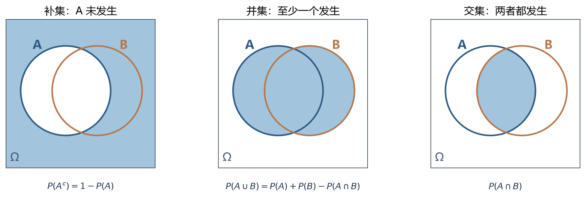
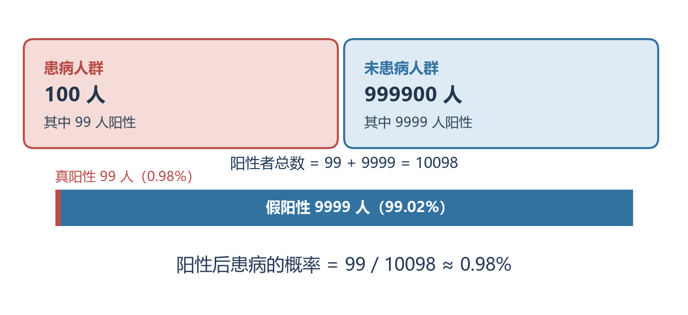
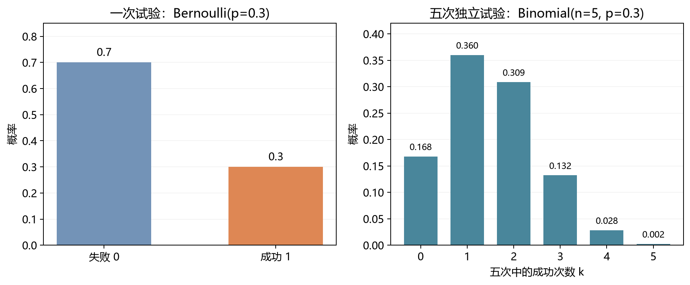
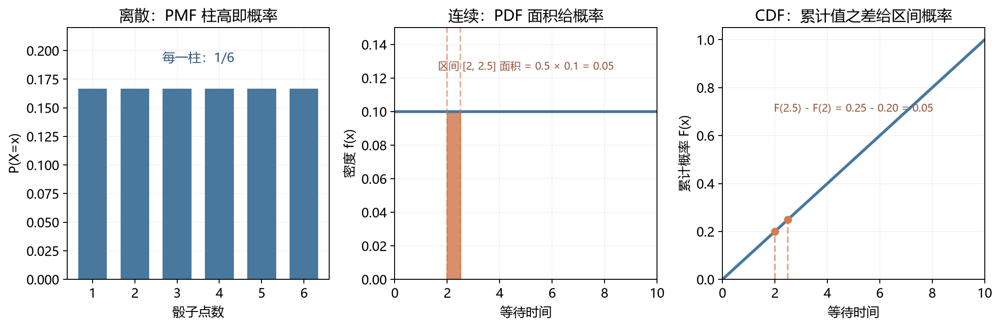
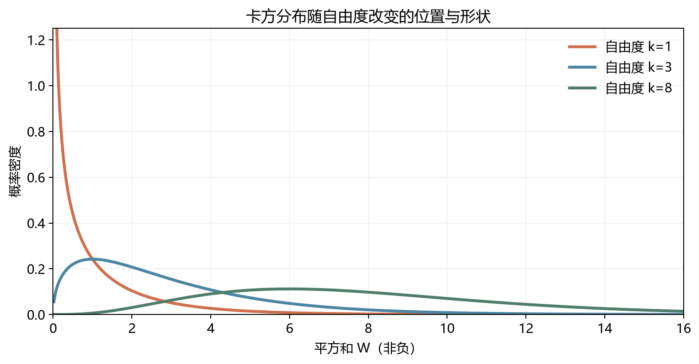

# [AI入门-概率统计]1.概率、条件概率与常用分布

在现实世界与机器学习任务中，不确定性无处不在。

概率论提供了一套严密量化“不确定性”的逻辑系统。整套学习逻辑可以清晰地划分为两条线：
1. **事件与逻辑推演**：从基础的随机事件出发，搞懂多事件并存、互斥、独立的关系，以及核心的**条件概率**与**贝叶斯定理**（新证据如何修正旧判断）。
2. **随机变量与概率分布**：把抽象事件转变为具体的数字，剖析离散分布（投硬币、分类）与连续分布（正态、卡方）的底层规律，打通数据采样与统计推断的基础。

---

## 1 随机试验、事件与概率的适用条件

### 1.1 试验、样本空间与事件

- **随机试验**：操作规则明确，但在结果发生前无法 100% 确定到底出现哪一个的动作（如掷骰子、随机抽取样本）。
- **样本空间 $\Omega$**：试验可能产生的所有基本结果的集合。例如一枚六面骰子：$\Omega=\{1,2,3,4,5,6\}$。
- **事件**：我们所关心的某些特定结果的子集。例如事件 $A=\text{“结果为偶数”}=\{2,4,6\}$。

任何事件的概率均有严格的物理边界：$0 \le P(A) \le 1$，且整个样本空间的概率必为 $P(\Omega) = 1$。

---

### 1.2 古典概型与频率极限

当样本空间只包含有限个结果，且每个基本结果出现的可能性完全均等时，这就是最基础的**古典概型（等可能计数）**：

$$
P(A) = \frac{|A|}{|\Omega|} = \frac{\text{事件 } A \text{ 包含的结果数}}{\text{总结果数}}
$$

例如质地均匀的骰子掷出偶数：$P(A) = 3 / 6 = 1/2$。  
若骰子被灌了铅，各面概率不再相等，就不能单纯数个数，而必须将事件中各结果的真实发生概率逐项累加。

在长期的物理世界中，理论概率体现为**大数定律下的相对频率极限**：在相同条件下独立重复试验，事件发生的频率会无限逼近其理论概率。但必须谨记：有限次的随机试验可能存在抽样波动（例如抛 10 次硬币只出 3 次正面），绝不能用少数几次的实际频率直接等同于理论真值。

> **连续分布中的概率反直觉**：在连续型变量中，**单个具体点发生的理论概率恒为 0**（$P(X=x)=0$），但并不代表该值在物理上不可能出现。概率为 0 绝不等于逻辑不可能，这在讨论连续概率密度时至关重要。

---

## 2 事件的补集、并集、交集与独立性

把事件映射成集合，就能将复杂的自然语言转化为严谨的集合代数：

- **补集（逆事件）$A^c$**：“事件 $A$ 不发生”。
- **并集 $A \cup B$**：“事件 $A$ 或 $B$ 至少有一个发生”（允许两者同时发生）。
- **交集（联合事件）$A \cap B$**：“事件 $A$ 与 $B$ 同时发生”。

基本运算公式：

$$
P(A^c) = 1 - P(A), \qquad P(A \cup B) = P(A) + P(B) - P(A \cap B)
$$

计算并集概率时，若两事件有重叠，直接相加会导致重叠部分被重复计算，因此**必须减去交集部分**。

- **正难则反（补集思想）**：在遇到“至少发生一次”的提问时，最简洁的做法是先算“全部都不发生”，再用 1 扣除。例如独立抛 3 次硬币，至少出一次正面的概率为：$1 - (1/2)^3 = 7/8$。

---

### 2.3 互斥 vs 独立（极易混淆的本质区别）

这是初学者最容易栽跟头的概念对立：

| 关系概念 | 数学本质定义 | 几何直觉 | 核心本质 |
|---|---|---|---|
| **互斥（互不相容）** | $A \cap B = \varnothing \implies P(A \cap B) = 0$ | 两个集合完全分离，没有任何交集 | 两个事件**绝不可能同时出现** |
| **独立** | $P(A \cap B) = P(A)P(B)$ | 发生与否互不干扰 | **得知 $A$ 的结果，丝毫不改变 $B$ 发生的概率** |

**致命易错点**：若两个事件发生概率都大于 0 且彼此**互斥**，那么它们**绝对不独立**！因为一旦得知 $A$ 发生了，你就立刻能 100% 确定 $B$ 绝不会发生（$B$ 的概率被强行降为 0，信息被彻底改变了）。

---

### 2.4 经典案例：生日悖论

假设一年有 365 天，各人生日相互独立且等可能分布。一个由 $n$ 个人构成的房间中，**至少有两人同一天生日**的概率是多少？

直接正向讨论极其繁琐，我们利用补集先求“$n$ 个人的生日**全部互不相同**”的概率：

$$
P(\text{全不同}) = \prod_{j=0}^{n-1}\frac{365-j}{365} = \frac{365}{365} \times \frac{364}{365} \times \cdots \times \frac{365 - n + 1}{365}
$$

则至少两人同生日的概率为：

$$
P(\text{至少两人同生日}) = 1 - P(\text{全不同})
$$

当 $n=23$ 人时，该概率就飙升到了 **50.7%**。直觉上觉得“365 天很多人才可能重合”，但本质上 23 个人之间任意两两组合共有 $\binom{23}{2} = 253$ 对可能，重合的比对基数极大。

---

## 3 条件概率：把范围缩到已知事件里

### 3.1 条件概率的几何本质：样本空间缩水

所谓条件概率 $P(A \mid B)$，本质就是：**由于已经确认 $B$ 必定发生，世界被强行缩小到了 $B$ 的范围内，原本 $B$ 之外的全部可能性被瞬间抹杀**。

因此，$B$ 成为了全新的分母基准：

$$
P(A \mid B) = \frac{P(A \cap B)}{P(B)}, \qquad P(B) > 0
$$

例如 100 人中，有 40 人参加了训练（事件 $B$），其中 30 人最终通过了考试（同时处于 $A$ 和 $B$ 中）。
- 随机抽一人，“既参加训练又通过”的总体联合概率为 $30/100 = 0.3$；
- 若**已知此人参加了训练**，分母立即收缩为 40，其通过概率变为 $P(A \mid B) = 30 / 40 = 0.75$。

---

### 3.2 概率乘法公式

将定义式移项，即可得到通用的**乘法法则**：

$$
P(A \cap B) = P(A) P(B \mid A) = P(B) P(A \mid B)
$$

若要多件事情同时成立，只需顺着事件发生的依赖链条，将前置概率与各步条件概率顺次相乘。只有当 $A, B$ **相互独立**时，$P(B \mid A) = P(B)$，乘法公式才退化为 $P(A \cap B) = P(A)P(B)$。

**特别注意**：条件符号的前后顺序绝不能混淆。$P(A \mid B)$（得知阳性后真患病的概率）与 $P(B \mid A)$（真患病后检测出阳性的准确率）完全是两码事。

---

## 4 全概率与贝叶斯：先汇总证据，再更新判断

### 4.1 全概率公式：化整为零，分流求和

如果一个复杂事件 $B$ 的发生受制于多种互斥且穷尽的潜在原因 $A_1, A_2, \ldots, A_K$（原因的并集覆盖整个可能空间 $\Omega$），那么要算 $B$ 出现的总概率，只需将各条路径的贡献全部累加：

$$
P(B) = \sum_{i=1}^{K} P(A_i) P(B \mid A_i)
$$

这就是**全概率公式**。在最简单的二元划分（生病 $D$ 与未生病 $D^c$）下，任意检测阳性（$+$）的总概率即为：

$$
P(+) = P(D)P(+\mid D) + P(D^c)P(+\mid D^c)
$$

---

### 4.2 贝叶斯定理：从结果倒推原因

全概率公式负责“由因推果”，而**贝叶斯定理（Bayes' Theorem）**则实现了**“由果溯因”**——当我们观察到了证据/结果 $B$ 之后，反推它到底是由哪一种原因 $A_i$ 引起的概率：

$$
P(A_i \mid B) = \frac{P(A_i) P(B \mid A_i)}{P(B)} = \frac{P(A_i) P(B \mid A_i)}{\sum_{j=1}^{K} P(A_j) P(B \mid A_j)}
$$

- **先验概率 $P(A_i)$**：在看到任何新证据之前，根据历史经验得出的基础判断；
- **似然度 $P(B \mid A_i)$**：在假设原因 $A_i$ 成立的前提下，观察到证据 $B$ 的合理程度；
- **边际总概率 $P(B)$**：证据在所有可能路径下的全概率总和（归一化分母）；
- **后验概率 $P(A_i \mid B)$**：融合了最新证据后，对原本判断做出的更新。

---

### 4.3 经典案例剖析：为什么罕见病检测阳性，患病率依然很低？

设某种罕见病的患病率极低：$P(D) = 0.01\% = 1/10000$。
某种检测手段看似极为精准：
- 真实患者的检出率（敏感度）：$P(+\mid D) = 99\%$
- 健康人群的假阳性率（误诊率）：$P(+\mid D^c) = 1\%$

如果一个人去检测呈现阳性，他真正患病的概率是多少？

代入贝叶斯公式推导：
- 先验患病：$P(D) = 0.0001$，未患病：$P(D^c) = 0.9999$；
- 分子（真阳性路径）：$P(D)P(+\mid D) = 0.0001 \times 0.99 = 0.000099$；
- 分母（所有阳性可能）：
  $$
  P(+) = 0.0001 \times 0.99 + 0.9999 \times 0.01 = 0.000099 + 0.009999 = 0.010098
  $$
- 最终后验患病概率：
  $$
  P(D \mid +) = \frac{0.000099}{0.010098} \approx 0.98\%
  $$

直观的人群分解：假设有 100 万人接受筛查：
- 真实患者只有 100 人，其中 99 人呈阳性；
- 未患病的健康人有 999,900 人，即使仅有 1% 的误诊率，也会产生 **9,999 名假阳性者**！

在所有呈阳性的 $99 + 9999 = 10098$ 人中，真正的病患仅占 99 人。  
**核心启示（基率谬误）**：**当基础发病率极低时，极小比例的健康人假阳性群体，在数量上会彻底淹没真正的阳性病患**。

---

## 5 朴素贝叶斯：用条件独立拆开高维似然
### 5.1 从贝叶斯分类到朴素贝叶斯

在文本分类（如垃圾邮件识别）中，我们的目标是：根据一封邮件中出现的特征词 $\mathbf x = (x_1, x_2, \ldots, x_d)$，判断它属于哪个类别 $C$（比如类别分为垃圾邮件 $S$ 和正常邮件 $H$）。

这里记号的含义非常直观：
- **类别变量 $C$**：代表邮件的分类标签（Category），例如 $C = S$（垃圾邮件）或 $C = H$（正常邮件）；
- **特征向量 $\mathbf x$**：代表这封邮件包含的词汇特征，由各个具体的单词特征 $(x_1, x_2, \ldots, x_d)$ 组成；
- **$P(C)$**：**类别的先验概率**，即在还没看这封邮件的具体内容前，根据历史统计已知的整体比例（例如历史数据里有 20% 的邮件是垃圾邮件，则 $P(C = S) = 0.2$）；
- **$P(C \mid \mathbf x)$**：**后验概率**，即“在看到了这封邮件包含特征词 $\mathbf x$ 的前提下，它属于类别 $C$ 的概率”。我们的分类决策就是看哪个类别的后验概率更高。

#### 1. 为什么直接用贝叶斯定理会遇到计算瓶颈？

根据贝叶斯定理，计算后验概率的公式为：

$$
P(C \mid \mathbf x) = \frac{P(C) P(\mathbf x \mid C)}{P(\mathbf x)} = \frac{P(C) P(x_1, x_2, \ldots, x_d \mid C)}{P(\mathbf x)}
$$

因为分母 $P(\mathbf x)$ 是所有类别下产生这组特征的总概率（对所有候选分类都是完全相同的常数），所以在比较哪个类别胜出时，只需看分子即可：

$$
P(C \mid \mathbf x) \propto P(C) P(x_1, x_2, \ldots, x_d \mid C)
$$

此时问题来了：**联合似然度 $P(x_1, x_2, \ldots, x_d \mid C)$ 极难统计**！  
假设字典里有 1,000 个词汇，这些词可能同时出现、可能部分出现，不同词汇组合的情况数量是 $2^{1000}$，这是一个天文数字。现实中我们不可能收集到涵盖所有单词搭配的训练样本，直接去数“同时包含这一整组词的垃圾邮件有几封”，绝大多数情况频数都会是 0，导致联合似然根本无法精准估计。

#### 2. 朴素贝叶斯的“朴素”假设：化整为零

为了彻底解决高维组合爆炸的问题，**朴素贝叶斯（Naive Bayes）**做出了一个大胆且极简的假设：  
**假设在已知类别 $C$ 的前提下，各个特征词之间互不影响，彼此条件独立！**

有了这个条件独立假设，原本错综复杂的高维联合概率，就可以直接拆解为每个特征词独立似然度的**连乘**：

$$
P(x_1, x_2, \ldots, x_d \mid C) \approx P(x_1 \mid C) \times P(x_2 \mid C) \times \cdots \times P(x_d \mid C) = \prod_{j=1}^{d} P(x_j \mid C)
$$

后验概率的计算公式因此变得极为简单：

$$
P(C \mid \mathbf x) \approx \frac{P(C) \prod_{j=1}^d P(x_j \mid C)}{\sum_{c'} P(C=c') \prod_{j=1}^d P(x_j \mid C=c')}
$$

其中分母是对所有候选类别 $c'$ 的得分求和归一化。

#### 3. 用一个具体数值算一遍

假设训练集统计出：
- 垃圾邮件占 20%（$P(S) = 0.2$），正常邮件占 80%（$P(H) = 0.8$）；
- 垃圾邮件中出现“lottery（彩票）”的概率是 0.7，出现“winning（中奖）”的概率是 0.75；
- 正常邮件中出现“lottery”的概率只有 0.125，出现“winning”的概率只有 0.1。

现在来了一封同时包含这两个词的邮件，我们分别计算两个类别的分子得分：
- **垃圾邮件分子得分**：$P(S) \times P(\text{lottery}\mid S) \times P(\text{winning}\mid S) = 0.2 \times 0.7 \times 0.75 = 0.105$
- **正常邮件分子得分**：$P(H) \times P(\text{lottery}\mid H) \times P(\text{winning}\mid H) = 0.8 \times 0.125 \times 0.1 = 0.010$

归一化后计算出这封邮件是垃圾邮件的概率：

$$
P(S \mid \text{lottery, winning}) \approx \frac{0.105}{0.105 + 0.010} = \frac{0.105}{0.115} \approx 91.3\%
$$

在现实中，“彩票”和“中奖”往往经常同时出现，特征之间显然不是完全独立的，因此这个“条件独立”假设在现实中往往并不成立。但正因为它把指数级的高维问题拆解成了单特征的独立计数，模型训练极快、无需复杂优化，在文本分类等很多实际任务中依然表现出非常强劲的基线效果。

### 5.2 工程实战中的两大数值陷阱

1. **零概率陷阱与拉普拉斯平滑（Laplace Smoothing）**：  
   如果某个特征单词在训练集的垃圾邮件中从未出现过，其估计概率直接为 0。一旦带入连乘，会导致整个类别的联合得分被瞬间归零，抹杀所有其他特征的有效信息。  
   针对具有 $V$ 种取值的离散特征，引入平滑参数 $\alpha$（通常 $\alpha=1$）：
   $$
   \widehat P(X_j = v \mid C = c) = \frac{N_{jvc} + \alpha}{N_c + \alpha V}
   $$
   为分子补加伪计数，分母补齐总偏置，既消除了 0 概率，又保持了总概率为 1。

2. **浮点数下溢与对数空间转换**：  
   成百上千个小于 1 的概率直接在计算机中做浮点连乘，会迅速逼近机器精度下限，造成严重的数值下溢（变为 `0.0`）。  
   在实际代码中，统一将概率取对数，将**连乘转变为数值稳定的对数求和**：
   $$
   \log P(C) + \sum_{j=1}^d \log P(x_j \mid C)
   $$
   由于对数函数单调递增，排序对比结果完全不受影响。

在工业库如 [scikit-learn 朴素贝叶斯模块](https://scikit-learn.org/stable/modules/naive_bayes.html) 中，分别提供了适配布尔文本特征的 `BernoulliNB`、适配词频计数的 `MultinomialNB` 以及适配连续数值特征的 `GaussianNB`。

---

## 6 随机变量、分布与离散概率质量

### 6.1 什么是随机变量？

在数学本质上，**随机变量 $X$ 不是一个单纯的数值，而是一个确定性的映射函数 $X: \Omega \to \mathbb R$**。  
它将原本五花八门的随机试验结果（如“正面/反面”、“红球/绿球”），规范映射为计算机可以处理的数字。试验结果是随机的，导致映射出来的数字带有随机性。

---

### 6.2 离散型随机变量与 PMF

如果随机变量的所有可能取值是有限的，或者可以逐一数出来（可数无限个），它就是**离散型随机变量**。

描述其概率规律的工具是**概率质量函数（Probability Mass Function, PMF）**：

$$
p_X(x) = P(X = x), \qquad p_X(x) \ge 0, \quad \sum_x p_X(x) = 1
$$

PMF 是一张完整的概率对照表，所有可能取值的概率累加严格为 1。

---

## 7 伯努利与二项分布：一次结果和多次计数

### 7.1 伯努利分布：单次抛硬币

**伯努利分布（Bernoulli Distribution）**描述的是最简单的“非此即彼”二元试验。通常将关注的结果记为 1（成功，概率为 $p$），对立结果记为 0（失败，概率为 $1-p$）：

$$
X \sim \operatorname{Bernoulli}(p), \qquad P(X=x) = p^x (1-p)^{1-x}, \quad x \in \{0, 1\}
$$

在分类模型（如逻辑回归）中，二分类标签的概率建模底座就是条件伯努利分布。

---

### 7.2 二项分布：独立重复多次的成功计数

将上述伯努利试验在相同条件下**独立重复进行 $n$ 次**，记录总成功次数 $K$，则 $K$ 服从**二项分布（Binomial Distribution）**：

$$
K \sim \operatorname{Binomial}(n, p), \qquad P(K=k) = \binom{n}{k} p^k (1-p)^{n-k}, \quad k = 0, 1, \ldots, n
$$

- $p^k (1-p)^{n-k}$：代表某一种特定排列路径（前 $k$ 次成功、后续全失败）的概率；
- 组合数 $\binom{n}{k} = \frac{n!}{k!(n-k)!}$：代表在这 $n$ 次试验中，$k$ 次成功可以分布在不同的位置组合数。

柱状图的柱高就是每个整数 $k$ 对应的精准发生概率，所有柱高之和为 1。

---

## 8 连续变量、密度与累积分布函数

### 8.1 连续变量与概率密度函数（PDF）

对于时间和空间坐标这类连续取值的变量，任意两个数字之间都存在无限个点，因此**连续随机变量落在某个绝对精确单点上的概率恒为 0**（$P(X=x) = 0$）。我们只能度量它落在一个区间范围内的概率。

**概率密度函数（Probability Density Function, PDF）$f_X(x)$** 满足：

$$
f_X(x) \ge 0, \qquad \int_{-\infty}^{\infty} f_X(x)\,dx = 1, \qquad P(a \le X \le b) = \int_a^b f_X(x)\,dx
$$

- **PDF 的纵坐标高度是“密度”而非“概率”**：曲线下的**区间积分面积**才代表真实概率；
- 密度的取值完全可以大于 1（例如在长度为 0.1 的区间内均匀分布，其密度高达到 10，但总面积依然为 $10 \times 0.1 = 1$）。

---

### 8.2 累积分布函数（CDF）

无论是离散还是连续变量，**累积分布函数（Cumulative Distribution Function, CDF）**都是完全通用的统一工具：

$$
F_X(x) = P(X \le x)
$$

它记录从 $-\infty$ 往右一路累加到点 $x$ 的总概率。
- $F_X(x)$ 单调不减，取值区间严格位于 $[0, 1]$；
- 任何区间概率都可以直接用两端的 CDF 做差秒算：$P(a < X \le b) = F_X(b) - F_X(a)$；
- 对于连续分布，CDF 的导数就是密度函数：$F_X'(x) = f_X(x)$。

---

## 9 均匀分布与正态分布：范围、中心和尺度

### 9.1 连续均匀分布 $U(a, b)$

区间 $[a, b]$ 内每一点的概率密度完全相同，宛如平整的长方形：

$$
f_X(x) = \begin{cases} \frac{1}{b-a}, & a \le x \le b \\ 0, & \text{其他} \end{cases}, \qquad F_X(x) = \frac{x-a}{b-a} \quad (x \in [a, b])
$$

常用于计算机生成基础随机数或表示没有任何先验偏好的无信息状态。

---

### 9.2 正态分布（高斯分布）$N(\mu, \sigma^2)$

自然界与机器学习中最核心的钟形分布，其概率密度函数为：

$$
f_X(x) = \frac{1}{\sigma\sqrt{2\pi}} \exp\left(-\frac{(x-\mu)^2}{2\sigma^2}\right)
$$

- **均值 $\mu$**：决定钟形曲线的中心对称轴位置；
- **标准差 $\sigma$（方差 $\sigma^2$）**：控制曲线的胖瘦宽窄。$\sigma$ 越大，数据越分散，曲线越扁平；$\sigma$ 越小，数据越集中，尖峰越陡峭。

**标准正态变换（$Z$-Score 归一化）**：  
若 $X \sim N(\mu, \sigma^2)$，通过平移缩放变换：

$$
Z = \frac{X - \mu}{\sigma} \sim N(0, 1)
$$

即可将其转化为均值为 0、方差为 1 的标准正态分布，这是数据预处理与特征工程的经典基石。

---

## 10 卡方分布：独立标准正态量的平方和

### 10.1 卡方分布的定义

设 $Z_1, Z_2, \ldots, Z_k$ 是 $k$ 个**相互独立**且均服从标准正态分布 $N(0, 1)$ 的随机变量，将它们的**平方进行累加**：

$$
W = \sum_{i=1}^{k} Z_i^2 \sim \chi^2(k)
$$

所得的新变量 $W$ 服从**自由度为 $k$ 的卡方分布（Chi-Square Distribution）**。

- 由于是平方项求和，变量取值永远非负（$W \ge 0$）；
- 自由度 $k$ 是参与求和的独立正态变量个数，分布的均值为 $k$，方差为 $2k$；
- $k$ 较小时图像严重右偏，随着 $k$ 逐渐增大，根据中心极限定理，曲线逐渐向右平移并对称化，逼近正态分布。

---

### 10.2 在统计推断中的两大应用场景

1. **正态总体样本方差的分布**：  
   从 $N(\mu, \sigma^2)$ 总体中独立抽样 $n$ 个样本，样本方差 $S^2 = \frac{1}{n-1}\sum (X_i - \bar X)^2$ 满足：
   $$
   \frac{(n-1)S^2}{\sigma^2} \sim \chi^2(n-1)
   $$
   因为计算均值消耗了 1 个自由度，剩余的自由度为 $n-1$。这是构建方差置信区间与假设检验的理论基石。

2. **拟合优度与独立性检验（皮尔逊卡方检验）**：  
   统计观测频数 $O_i$ 与理论期望频数 $E_i$ 的偏差：
   $$
   \sum_{i} \frac{(O_i - E_i)^2}{E_i} \approx \chi^2(\text{自由度})
   $$
   该统计量衡量了实际数据与理论假定之间的偏离程度，广泛用于分类特征的独立性检验与特征筛选。

---

## 11 从已知分布采样：把概率规则变成随机结果

### 11.1 逆变换采样：从均匀分布撬动任意连续分布

计算机底层只能高效生成 $[0, 1)$ 区间内的均匀随机数 $U \sim U(0, 1)$。如何用它生成服从任意目标分布 $F(x)$ 的样本？

若连续变量的 CDF 函数 $F(x)$ 严格单调递增且存在反函数 $F^{-1}$，只需执行**逆变换采样（Inverse Transform Sampling）**：

$$
X = F^{-1}(U)
$$

**数学机理**：  
由于 $F^{-1}$ 单调递增，其累计概率满足：

$$
P(X \le x) = P(F^{-1}(U) \le x) = P(U \le F(x)) = F(x)
$$

生成的 $X$ 其分布函数与目标分布 $F(x)$ 严密契合！

---

### 11.2 蒙特卡洛方法：用大量采样求解复杂问题

当某个连续随机变量的期望 $\mathbb E[g(X)] = \int g(x)f(x)\,dx$ 过于复杂无法求出解析积分时，我们可以借助计算机从该分布中生成海量独立样本 $x_1, x_2, \ldots, x_N$，直接计算样本均值：

$$
\mathbb E[g(X)] \approx \frac{1}{N} \sum_{i=1}^{N} g(x_i)
$$

这就是**蒙特卡洛估计（Monte Carlo Estimation）**。  
根据大数定律，随着采样量 $N$ 的成倍增加，样本均值会以标准差 $\mathcal{O}(1/\sqrt{N})$ 的速率稳步收敛到真实的理论积分值。

在 Python 数据科学栈中，通过 [NumPy random 模块](https://numpy.org/doc/stable/reference/random/index.html) 可以直接调用 `Generator.choice`（离散加权采样）与 `Generator.normal`（正态采样）。熟练掌握概率分布的生成与模拟，是迈向现代机器学习、马尔可夫链蒙特卡洛（MCMC）及深度生成模型的必备敲门砖。

### 11.3 完整实战案例：用蒙特卡洛投点法估算圆周率 $\pi$

为了彻底搞懂蒙特卡洛“用大量随机抽样近似真实数学值”的核心本质，我们来看一个最直观的经典范例：**投点法估算圆周率 $\pi$**。

#### 1. 问题设定与几何直觉
在平面直角坐标系中，考虑一个边长为 1 的正方形区域 $[0, 1] \times [0, 1]$，其面积为：
$$
S_{\text{正方形}} = 1 \times 1 = 1
$$
在这个正方形内部，放置一个以原点 $(0, 0)$ 为圆心、半径 $R = 1$ 的 $1/4$ 圆弧扇形。该扇形的理论面积为：
$$
S_{\text{扇形}} = \frac{1}{4} \pi R^2 = \frac{\pi}{4}
$$
若我们在正方形区域内随机、均匀地撒下大量点，那么一个点恰好落在 $1/4$ 圆弧内的理论概率，等于两者面积之比：
$$
P(\text{落在扇形内}) = \frac{S_{\text{扇形}}}{S_{\text{正方形}}} = \frac{\pi / 4}{1} = \frac{\pi}{4}
$$
因此，只要能估计出这个概率值，两边同乘 4，就能倒推出 $\pi$ 的近似值：
$$
\pi \approx 4 \times P(\text{落在扇形内})
$$

#### 2. 蒙特卡洛模拟实验步骤
1. **独立均匀采样**：从标准均匀分布 $U(0, 1)$ 中独立抽取两个坐标值 $X, Y \sim U(0, 1)$，构成正方形内的随机点 $(X, Y)$。
2. **落在圆内的条件判断**：根据圆的方程，若点到原点的距离平方小于等于 1，即满足 $X^2 + Y^2 \le 1$，则该点落在扇形内部。
3. **统计发生频率**：独立重复生成 $N$ 个随机点，统计其中满足 $X^2 + Y^2 \le 1$ 的总点数 $M$。
4. **频率逼近概率**：根据大数定律，当 $N$ 足够大时，落在圆内的频率 $M / N$ 无限逼近理论概率 $\pi / 4$，从而求得估算值：
$$
\hat{\pi} = 4 \times \frac{M}{N}
$$

#### 3. 数值结果与收敛规律
假设我们分别进行不同采样量 $N$ 的模拟实验：
- 当 $N = 100$ 时：可能投中 $M = 78$ 个点，估算值 $\hat{\pi} = 4 \times \frac{78}{100} = 3.12$；
- 当 $N = 10,000$ 时：投中 $M = 7,859$ 个点，估算值 $\hat{\pi} = 4 \times \frac{7859}{10000} = 3.1436$；
- 当 $N = 1,000,000$ 时：投中 $M = 785,394$ 个点，估算值 $\hat{\pi} = 4 \times \frac{785394}{1000000} = 3.141576$。

这个例子清晰展现了蒙特卡洛的核心思想：**即使面对无法手算解析积分的复杂高维区域，只要能定义边界判定规则并大量随机采样，就能用简单的离散统计（样本均值/频率）高效求解连续的积分与概率问题**。误差随着样本量按 $\mathcal{O}(1/\sqrt{N})$ 的规律稳步缩小。