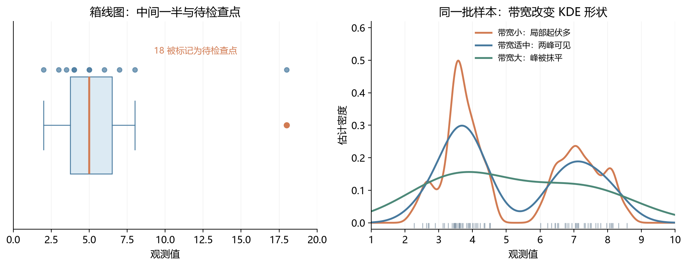
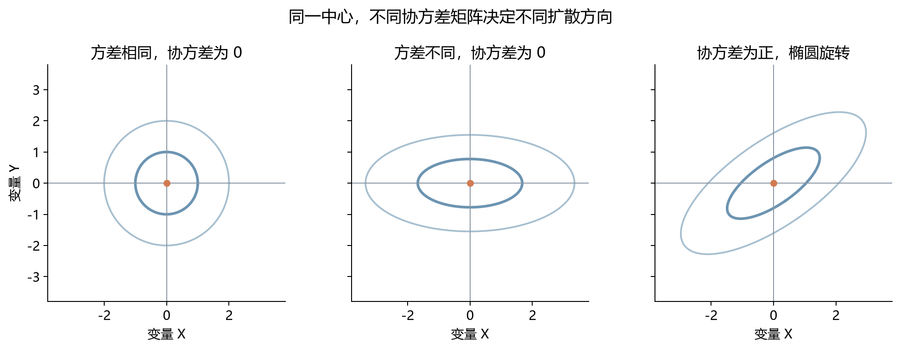
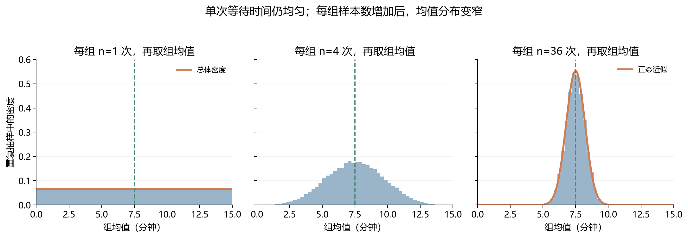
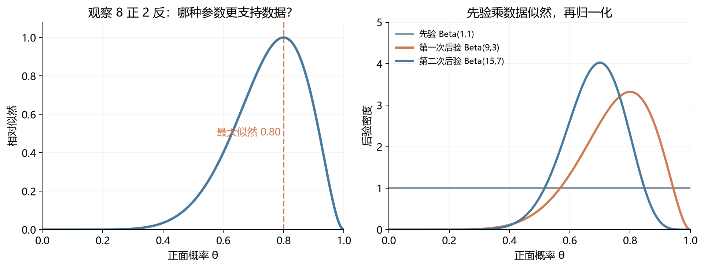

# [AI入门-概率统计]2.期望、方差、抽样与参数估计

在概率统计中，所有知识点其实都在回答两个层面的问题：
1. **理论分布本身长什么样？**（中心在哪里？波动有多大？变量之间如何联动？）
2. **只拿到有限样本时，如何反推真实世界？**（样本均值靠不靠谱？如何估计未知参数？）

前半篇聚焦于**总体分布的数学特征**（期望、方差、协方差、高斯模型），后半篇聚焦于**统计推断与参数估计**（抽样分布、中心极限定理、MLE、MAP）。搞清这两个层次，统计学的大厦就建牢了。

---

## 1 期望：对所有可能结果按概率加权

### 1.1 什么是期望？

如果一个六面骰子是公平的，点数 1 到 6 的概率各是 $1/6$，长期平均值是 $(1+2+3+4+5+6)/6 = 3.5$。但如果骰子被灌了铅，各面概率不同，就不能直接算术平均，必须**按发生的概率加权求和**。

**数学定义**：

$$
\mathbb E[X] = \sum_x x \, p_X(x) \quad \text{（离散）}, \qquad \mathbb E[X] = \int_{-\infty}^{\infty} x f_X(x) \, dx \quad \text{（连续）}
$$

- 期望是分布的**物理重心（平衡位置）**；
- **核心认知**：**期望值不一定是实际可能出现的值**。掷骰子永远掷不出 3.5 点；抽奖游戏有 90% 概率得 0 元、10% 概率得 100 元，单局期望是 10 元，但任意单局你只能拿到 0 或 100。

如果对随机变量做了函数变换 $g(X)$，求期望只需把每个结果值变换后按原概率加权：$\mathbb E[g(X)] = \sum_x g(x)p(x)$。注意 $\mathbb E[X^2] \ne (\mathbb E[X])^2$，这两者的差值正好通向方差。

### 1.2 期望的线性性质（极其强大的性质）

无论变量之间是否独立，期望永远满足线性叠加：

$$
\mathbb E[aX + b] = a\mathbb E[X] + b, \qquad \mathbb E\left[\sum_{i=1}^n X_i\right] = \sum_{i=1}^n \mathbb E[X_i]
$$

> **关键提醒**：第二条式子**完全不需要各变量相互独立**！哪怕变量之间错综复杂地相互牵制，总期望依旧等于各分项期望的直接累加。

---

## 2 均值、中位数与众数：三个不同的中心

在描述一批数据的中心位置时，有三种不同的视角：

| 指标 | 计算方式 | 核心优势 | 致命短板 / 适用场景 |
|---|---|---|---|
| **均值（Mean）** | 所有数值加和除以总数 | 充分利用了每一个样本的数值大小 | **对极端异常值极度敏感**（极易被拉偏） |
| **中位数（Median）** | 从小到大排序后排在最中间的值 | **极其稳健（抗干扰）**，不受极端大数影响 | 忽略了极端值的实际距离，适合收入、房价等偏斜数据 |
| **众数（Mode）** | 出现频次最高的值 | 适用于无大小关系的类别数据（如最畅销颜色） | 数据分散时可能无代表性，或存在多个峰值 |

**直观对比**：  
若某小组 5 人的年收入为：`[4, 5, 5, 6, 30]` 万元：
- 均值为 $10$ 万元（被 30 万元拉高，脱离大众）；
- 中位数为 $5$ 万元（最贴近普通个体）；
- 众数为 $5$ 万元。

对于标准对称的单峰分布（如正态分布），三者完全重合；而在现实中带有长拖尾的数据里，它们会明显分离。

---

## 3 方差与标准差：描述结果围绕中心的波动

### 3.1 为什么需要方差？

两个赌局的平均收益都是 0 元：
- 赌局 A：50% 赢 1 元，50% 输 1 元；
- 赌局 B：50% 赢 100 元，50% 输 100 元。

光看期望完全看不出风险区别。为了度量“离中心的散开程度”，我们不能直接平均离差（因为 $\mathbb E[X - \mu] \equiv 0$，正负偏差抵消为零），而是**将离差平方后再加权平均**，这就是**方差（Variance）**：

$$
\operatorname{Var}(X) = \mathbb E[(X - \mu)^2] = \mathbb E[X^2] - \mu^2
$$

- 方差永远非负（$\ge 0$）；
- 偏离中心越远的点，平方后的惩罚权重呈二次方飙升。

### 3.2 标准差与线性缩放

由于方差带上了原单位的平方（如“元²”），为了还原为物理意义可解释的尺度，对方差开根号得到**标准差（Standard Deviation）**：$\sigma = \sqrt{\operatorname{Var}(X)}$。

对于线性变换 $Y = aX + b$：
- 均值随着平移与缩放同步变化：$\mathbb E[Y] = a\mu + b$；
- **常数平移不影响波动**，但系数缩放会平方影响方差：$\operatorname{Var}(Y) = a^2 \operatorname{Var}(X)$；
- 标准差受绝对值缩放：$\operatorname{SD}(Y) = |a|\sigma$。

### 3.3 总体方差 vs 样本方差

- **总体方差 $\sigma^2$**：面对已知全部数据的总体，分母除以总数 $N$：$\frac{1}{N}\sum (x_i - \mu)^2$；
- **样本方差 $S^2$**：从未知总体中抽取的 $n$ 个样本，用于估计总体波动时，**分母必须除以 $n-1$**：
  $$
  S^2 = \frac{1}{n-1}\sum_{i=1}^n (x_i - \bar x)^2
  $$
  （除以 $n-1$ 是为了修正用样本均值代替总体均值带来的系统性低估，详见第 11 节）。

---

## 4 标准化与独立高斯变量相加

### 4.1 Z-Score 标准化

身高比平均高 8 厘米，与考试比平均高 8 分，哪一个更不寻常？直接比数值毫无意义，必须看各自维度的离散程度。

**Z-Score 标准化**将数据消除量纲，统一度量衡：

$$
Z = \frac{X - \mu}{\sigma}
$$

- $Z$ 的物理含义非常明确：**该数值距离均值偏离了几个标准差**；
- 标准化后的变量恒有：$\mathbb E[Z] = 0$，$\operatorname{Var}(Z) = 1$；
- **注意**：标准化只做线性平移和缩放，**绝不会把原本偏斜的数据变成正态分布**。只有当原始变量服从正态分布时，转换后的 $Z$ 才服从标准正态分布 $N(0, 1)$。

### 4.2 独立高斯变量的可加性

高斯分布拥有极其优美的代数封闭性：若 $X \sim N(\mu_X, \sigma_X^2)$ 与 $Y \sim N(\mu_Y, \sigma_Y^2)$ **相互独立**，则它们的任意线性组合依然是严格的正态分布：

$$
aX + bY \sim N(a\mu_X + b\mu_Y, \; a^2\sigma_X^2 + b^2\sigma_Y^2)
$$

独立变量相加，**方差直接相加，标准差开根相加**（$\sigma_{\text{总}} = \sqrt{\sigma_X^2 + \sigma_Y^2}$）。

---

## 5 矩、偏度与峰度：均值和方差之外的形状

如果两个分布的均值相同、方差也相同，它们就一定长得一样吗？不一定。

- **一阶原点矩 $\mathbb E[X]$**：决定中心位置（均值）；
- **二阶中心矩 $\mathbb E[(X-\mu)^2]$**：决定胖瘦离散（方差）；
- **三阶标准化矩（偏度 Skewness）**：刻画不对称性：
  $$
  \gamma_1 = \mathbb E\left[\left(\frac{X-\mu}{\sigma}\right)^3\right]
  $$
  三次方保留了正负号。$\gamma_1 > 0$ 表示右侧拖着长尾巴（右偏/正偏）；$\gamma_1 < 0$ 表示左偏。
- **四阶标准化矩（峰度 Kurtosis）**：刻画尾部的极端厚重程度：
  $$
  \text{超额峰度} = \mathbb E\left[\left(\frac{X-\mu}{\sigma}\right)^4\right] - 3
  $$
  正态分布的四阶矩基准为 3，扣减后得到超额峰度。超额峰度 $> 0$ 说明存在**厚尾**，代表极端黑天鹅事件出现的概率远高于正态分布预估。

---

## 6 分位数与分布图：先看数据形状再选摘要

### 6.1 分位数与四分位距（IQR）

$p$ 分位数是指排在累计概率达到 $p$ 位置的数值：
- $q_{0.5}$：中位数；
- $Q_1 = q_{0.25}$（下四分位数）、$Q_3 = q_{0.75}$（上四分位数）；
- **四分位距 $\mathrm{IQR} = Q_3 - Q_1$**：圈出了中间 50% 核心数据的宽度跨度。

### 6.2 常见数据诊断可视化

- **箱线图（Box Plot）**：利用 $Q_1, \text{中位数}, Q_3$ 形成箱体，围栏设为 $[Q_1 - 1.5\mathrm{IQR}, \; Q_3 + 1.5\mathrm{IQR}]$，超出围栏的点打上标记作为潜在离群点。
- **核密度估计（KDE）**：用平滑核函数堆叠拟合出经验密度曲线。带宽过大会抹平双峰，过小会产生伪噪声波纹。
- **Q-Q 图（Quantile-Quantile Plot）**：将样本分位数与理论分布分位数做散点对比。若各点紧贴对角对齐直线，说明分布假设成立；呈现弯曲则说明存在偏斜或厚尾。

> **方法论纠偏**：并非所有机器学习算法都要求特征符合正态分布。逻辑回归、树模型、普通最小二乘求解对特征本身的正态性均无硬性要求，只有高斯朴素贝叶斯或某些参数假设检验才需检验特征条件分布。

---

## 7 联合、边际与条件分布：从两个变量读出不同问题

当同时研究两个变量 $X$ 和 $Y$ 时，有三种切片视角：

1. **联合分布 $P(X=x, Y=y)$**：两件事同时发生的概率（表格中每一个具体的单元格）；
2. **边际分布 $P(X=x)$**：完全不理会 $Y$，把 $Y$ 的所有可能全加起来求行和/列和（化整为零）；
3. **条件分布 $P(Y=y \mid X=x)$**：已知 $X$ 发生的前提下，$Y$ 的概率切片，其计算必须**除以该行的边际概率重新归一化**：
   $$
   P(Y \mid X) = \frac{P(X, Y)}{P(X)}
   $$

若对所有格点均满足 $P(X, Y) = P(X)P(Y)$，说明两者**相互独立**；否则它们之间存在某种统计关联。

---

## 8 协方差与相关系数：衡量线性共同变化

### 8.1 协方差：同向还是反向？

为了定量衡量两变量是否“步调一致”，定义**协方差（Covariance）**：

$$
\operatorname{Cov}(X, Y) = \mathbb E[(X - \mu_X)(Y - \mu_Y)] = \mathbb E[XY] - \mu_X\mu_Y
$$

- 两者同时高于均值（正乘正）或同时低于均值（负乘负）：积为正，**正相关（同涨同跌）**；
- 一个高于均值另一个低于均值：积为负，**负相关（一涨一跌）**；
- 协方差的缺点：带有两变量的量纲乘积，数值大小受单位影响极大。

### 8.2 Pearson 相关系数：剔除量纲的纯粹线性度量

将协方差除以两者的标准差乘积，彻底去除量纲：

$$
\rho_{X, Y} = \frac{\operatorname{Cov}(X, Y)}{\sigma_X \sigma_Y}, \qquad -1 \le \rho \le 1
$$

- $\rho = 1$：严格处在同一条右上斜线上；
- $\rho = -1$：严格处在同一条右下斜线上；
- **避坑警示**：
  1. **相关性不等于因果性**；
  2. **$\rho = 0$ 仅代表没有“线性关系”，并不代表相互独立！** 例如 $Y = X^2$（$X$ 对称分布在 $[-1, 0, 1]$），两者的相关系数 $\rho = 0$，但 $Y$ 完全由 $X$ 确定，两者高度非线性依赖。

---

## 9 协方差矩阵：把多个变量的波动放到一起

对于高维随机向量 $\mathbf X = (X_1, \ldots, X_d)^\mathsf T$，所有变量两两之间的方差与协方差排成 $d \times d$ 的**协方差矩阵 $\boldsymbol\Sigma$**：

$$
\boldsymbol\Sigma = \mathbb E[(\mathbf X - \boldsymbol\mu)(\mathbf X - \boldsymbol\mu)^\mathsf T] = \begin{bmatrix} \operatorname{Var}(X_1) & \operatorname{Cov}(X_1, X_2) \\ \operatorname{Cov}(X_2, X_1) & \operatorname{Var}(X_2) \end{bmatrix}
$$

- **主对角线**：每个特征自身的方差；
- **非对角线**：特征之间的两两协方差（矩阵关于主对角线对称）；
- **半正定性**：对于任意投影权重向量 $\mathbf a$，投影后的方差为 $\mathbf a^\mathsf T \boldsymbol\Sigma \mathbf a \ge 0$。方差绝不可能为负，因此协方差矩阵必定半正定（特征值全非负），这是 PCA 能提取最大方差主方向的理论基础。

---

## 10 多元高斯：协方差决定椭圆的方向和宽度

多元正态分布 $\mathbf X \sim N(\boldsymbol\mu, \boldsymbol\Sigma)$ 的概率密度函数为：

$$
f(\mathbf x) = \frac{1}{(2\pi)^{d/2}|\boldsymbol\Sigma|^{1/2}} \exp\left( -\frac{1}{2}(\mathbf x - \boldsymbol\mu)^\mathsf T \boldsymbol\Sigma^{-1} (\mathbf x - \boldsymbol\mu) \right)
$$

指数内部的二次型即为**马氏距离的平方（Mahalanobis Distance）**：

$$
D^2 = (\mathbf x - \boldsymbol\mu)^\mathsf T \boldsymbol\Sigma^{-1} (\mathbf x - \boldsymbol\mu)
$$

普通欧氏距离把各个方向等同对待，而马氏距离则通过 $\boldsymbol\Sigma^{-1}$ 对每个方向的自然波动幅度进行了归一化除权，自动抵消了相关性与不同尺度的干扰。

- **协方差为零且方差相等**：等高线呈现完美的正圆；
- **协方差为零但方差不等**：等高线为坐标轴对齐的椭圆；
- **协方差不为零**：等高线呈现倾斜旋转的椭圆。  
只有在高斯分布体系下，“协方差为零”才与“相互独立”互为充要条件。

---

## 11 从总体抽样：参数、估计量与三个基础统计量

现实中无法遍历总体，只能抽取 $n$ 个样本 $X_1, \ldots, X_n$。

- **总体参数（如 $\mu, \sigma^2$）**：客观存在但未知的确定常量；
- **统计量 / 估计量（如 $\bar X, S^2$）**：由样本计算出来的函数。样本会随抽样发生随机涨落，因此**估计量本身也是随机变量**！

### 1. 样本均值 $\bar X = \frac{1}{n}\sum X_i$
- **期望（无偏性）**：$\mathbb E[\bar X] = \mu$。多次独立抽样的平均估计绝不会系统性跑偏。
- **方差与标准误**：
  $$
  \operatorname{Var}(\bar X) = \frac{\sigma^2}{n}, \qquad \operatorname{SE}(\bar X) = \frac{\sigma}{\sqrt{n}}
  $$
  $\operatorname{SE}$ 称为**标准误**，它反映了样本均值在重复抽样中的波动大小。随着样本量 $n$ 增加，标准误以 $1/\sqrt{n}$ 的速率稳步收缩。

### 2. 样本比例 $\hat p$
处理二分类时，成功率的估计量即为指示变量的均值：$\mathbb E[\hat p] = p$，$\operatorname{Var}(\hat p) = \frac{p(1-p)}{n}$。

### 3. 样本方差 $S^2$ 与无偏修正
如果用样本均值代替总体均值直接除以 $n$，会系统性低估真实方差。因为 $\bar X$ 永远处在当前样本的最核心位置，样本点到 $\bar X$ 的平方和天然小于到真实 $\mu$ 的平方和。

代数推导表明：$\mathbb E\left[\sum (X_i - \bar X)^2\right] = (n - 1)\sigma^2$。  
因此分母必须除以自由度 $n - 1$：

$$
S^2 = \frac{1}{n-1}\sum_{i=1}^n (X_i - \bar X)^2 \implies \mathbb E[S^2] = \sigma^2
$$

这就是自由度修正的来源。

---

## 12 抽样分布与大数定律：估计量会怎样变化

必须区分三个容易混淆的分布：
1. **总体分布**：现实客观世界本身的分布（可能极其怪异、偏斜）；
2. **样本经验分布**：当前手中这一批样本的直方图；
3. **抽样分布**：**将“抽样 $n$ 个数算均值”这一实验反复做无穷次，所有算出来的均值 $\bar X$ 构成的概率分布**。

**大数定律（Law of Large Numbers）**：  
只要变量独立同分布且均值有限，当抽样量 $n \to \infty$ 时，样本均值 $\bar X_n$ 以概率收敛于总体真实均值 $\mu$：

$$
P(|\bar X_n - \mu| > \varepsilon) \longrightarrow 0 \quad (n \to \infty)
$$

大数定律说明只要样本够大，均值最终必定贴近真实，但它没有说明在有限样本下偏离的具体概率形态。

---

## 13 中心极限定理：样本均值的正态近似及其边界

### 13.1 卷积与累加效应：为什么很多随机量最终会长成正态？

大数定律只回答了“样本均值最终会落在真值附近”，但没有解释**偏离真值的误差以何种形态分布**。要理解中心极限定理（CLT），先要从最简单的“独立变量相加（卷积）”看起。

以抛硬币为例（正面记 1，反面记 0）：
- **抛 1 次**：可能结果是 0 或 1，分布是两根平齐的柱子，完全不呈正态。
- **抛 2 次求和**：总和可能为 0、1、2。组合路径分别为：
  - 和为 0：只有 $TT$（1 条路径）；
  - 和为 1：有 $HT, TH$（2 条路径）；
  - 和为 2：只有 $HH$（1 条路径）。
  此时中间结果的可能路径已经开始多于两端。
- **抛 10 次求和**：极端的 0 次或 10 次正面依然只有 1 条路径，而恰好 5 次正面有 $\binom{10}{5} = 252$ 种排列组合。

独立随机变量求和的概率分布在数学上对应**卷积（Convolution）运算**：

$$
P(X + Y = s) = \sum_x P(X = x) P(Y = s - x)
$$

每一个能凑成总和 $s$ 的可能路径概率都要累加起来。因为处于中间的平均状态总能由极其庞大的微观组合拼凑出来，而极端状态的达成条件极其严苛，多次独立累加后的概率质量自然而然地向中心汇聚，形成中间隆起、两侧平滑跌落的对称钟形形态。

---

### 13.2 中心极限定理的标准形式

**中心极限定理的核心表述**：  
设 $X_1, X_2, \ldots, X_n$ 为独立同分布（i.i.d.）的随机变量，拥有有限的数学期望 $\mu$ 和有限的方差 $0 < \sigma^2 < \infty$。令总和为 $S_n = \sum_{i=1}^n X_i$，样本均值为 $\bar X_n = \frac{1}{n} S_n$。

随着样本容量 $n$ 趋近于无穷大，对总和或均值进行标准正态化后，其分布弱收敛于标准正态分布：

$$
\frac{S_n - n\mu}{\sigma\sqrt{n}} = \frac{\bar X_n - \mu}{\sigma / \sqrt{n}} \xrightarrow{d} N(0, 1)
$$

在实际工程应用中，只要 $n$ 足够大，直接使用以下近似形式：

$$
S_n \approx N(n\mu, \; n\sigma^2), \qquad \bar X_n \approx N\left(\mu, \; \frac{\sigma^2}{n}\right)
$$

> **辨析记忆**：
> - **样本总和 $S_n$ 的方差随 $n$ 成倍放大**（$n\sigma^2$）：累加的独立不确定性越来越多。
> - **样本均值 $\bar X_n$ 的方差随 $n$ 成倍缩小**（$\frac{\sigma^2}{n}$）：随机波动在取平均的过程中被相互冲抵抹平。

---

### 13.3 经典数值演练：从均匀等待时间到正态平均

设地铁的进站等待时间服从区间 $[0, 15]$ 分钟的**连续均匀分布** $X \sim U(0, 15)$。
- 原始分布是完全平直的矩形，毫无正态特征；
- 单次等待的总体期望：$\mu = \frac{0 + 15}{2} = 7.5$ 分钟；
- 单次等待的总体方差：$\sigma^2 = \frac{(15 - 0)^2}{12} = \frac{225}{12} = 18.75$。

现在独立记录某乘客 36 次乘车的平均等待时间 $\bar X_{36}$：
根据 CLT，$\bar X_{36}$ 近似服从正态分布，其均值为 $7.5$ 分钟，抽样标准误为：

$$
\operatorname{SE}(\bar X_{36}) = \sqrt{\frac{\sigma^2}{n}} = \sqrt{\frac{18.75}{36}} \approx 0.722 \text{ 分钟}
$$

如果要计算“这 36 次的平均等待时间超过 9 分钟”的概率，直接做标准化变换：

$$
Z = \frac{9 - 7.5}{0.722} \approx 2.08
$$

查标准正态分布表可知 $P(Z > 2.08) \approx 0.019$（约 1.9% 的发生概率）。  
这个计算体现了 CLT 的本质：**单次等待时间永远是平直的均匀分布，绝不会因为抽了 36 次就变成正态；真正服从正态钟形分布的，是这 36 次抽样的“均值在重复实验中的变化轨迹”**。

---

### 13.4 中心极限定理的适用边界与常见误区

1. **误区一：混淆“总体分布”与“抽样分布”**  
   抽样样本量 $n$ 再大，原始数据本身的直方图也只会越来越逼近其真实的原始形态（原本双峰依然是双峰，原本偏斜依然是偏斜）。变正态的只有统计量 $\bar X$ 本身。
2. **误区二：盲目死记“$n > 30$ 就一定正态”**  
   收敛到正态的速度与原始分布本身的对称性息息相关。
   - 若原始分布本身是对称的单峰分布，只需 $n = 5 \sim 10$ 均值就高度接近正态；
   - 若面对二项极罕见事件（如 $n=1000, p=0.0001$），预期成功次数仅 $np = 0.1$，绝大多数抽样全为 0，即便样本量达 1000 也严重不符合正态分布，此时应使用泊松分布进行近似。
3. **破除前提：无有限方差或不独立**  
   - **柯西分布（Cauchy Distribution）**：尾部衰减极慢，其数学期望和方差均不存在，独立柯西变量求平均后的分布依然是原汁原味的柯西分布，CLT 彻底失效。
   - **数据强相关**：如果抽取的数据彼此高度绑定（例如 100 条数据全是同一病患在同一时刻的血压复制值），实际独立信息量并没有增加，方差项包含复杂的协方差和 $2\sum_{i<j}\operatorname{Cov}(X_i, X_j)/n^2$，不能简单套用 $\sigma^2/n$。

---

## 14 点估计与最大似然：选择能解释观测数据的参数

### 14.1 点估计的本质与评估标准

在真实业务场景中，真实总体的参数 $\theta$（如总体的真实患病率、用户的真实点击率）是客观存在却永远无法全知全能的隐变量。

**点估计（Point Estimation）**就是用从样本中算出的一个单一数值 $\hat\theta$，作为未知总体参数 $\theta$ 的最佳猜测值。  
评估一个点估计量好坏，最基础的两个准则是：
- **无偏性（Unbiasedness）**：在无限次重复抽样实验中，估计量的数学期望严格等于真实参数值（$\mathbb E[\hat\theta] = \theta$），平均意义上不系统性高估也不低估。
- **有效性（Efficiency / 最小方差）**：在同样无偏的候选估计量中，估计量自身的抽样方差 $\operatorname{Var}(\hat\theta)$ 越小越好（围绕真实值的摆动幅度最小）。

---

### 14.2 最大似然估计（MLE）的核心逻辑

如果说无偏性是从“重复抽样的全局统计特性”来评价估计量，那么**最大似然估计（Maximum Likelihood Estimation, MLE）**则是站在“手头已经发生的既定事实”视角出发的实用构造法则。

**MLE 的底层哲学**：  
**“这个世界可能有无数种候选的参数模型。但既然这批具体的样本数据已经被我们实实在在地观测到了，那么在所有可能的候选参数中，能够让这批数据出现概率（似然度）达到最大的那个参数，就是最合理的估计值！”**

数学表达：设未知参数为 $\theta$，固定已观测到的样本向量为 $x = (x_1, x_2, \ldots, x_n)$。定义**似然函数（Likelihood Function）** $L(\theta; x)$：

$$
L(\theta; x) = p(x_1, x_2, \ldots, x_n \mid \theta)
$$

在样本独立同分布（i.i.d.）的前提下，联合概率等于各样本独立概率的连乘：

$$
L(\theta; x) = \prod_{i=1}^n p(x_i \mid \theta)
$$

最大似然估计的任务就是解一个最优化问题：

$$
\hat\theta_{\mathrm{MLE}} = \arg\max_\theta L(\theta; x)
$$

> **关键认知澄清（似然 vs 概率）**：
> - 概率 $P(\text{数据} \mid \theta)$：参数 $\theta$ 确定，研究数据出现的可能性大小（所有可能数据的概率和为 1）。
> - 似然 $L(\theta; \text{数据})$：数据已经敲定，将数据视作常数，把 $\theta$ 作为自变量（对所有候选 $\theta$ 积分不要求为 1）。$L(\theta)=0.8$ 绝不代表“参数等于该值的概率是 80%”，它只衡量数据对该参数取值的支持相对强度。

---

### 14.3 对数似然：从连乘到求和的工程与数学必然

在实际推导和程序运算中，极少直接对原始似然函数 $L(\theta)$ 进行求导，而是统一对其取自然对数，构建**对数似然函数（Log-Likelihood）** $\ell(\theta)$：

$$
\ell(\theta) = \log L(\theta; x) = \sum_{i=1}^n \log p(x_i \mid \theta)
$$

转为对数似然具备不可替代的优势：
1. **单调性保持极值点不变**：自然对数函数 $y = \log(t)$ 在 $(0, +\infty)$ 上严格单调递增，令 $\ell(\theta)$ 取最大的 $\theta^*$，必然也是使原似然函数 $L(\theta)$ 达到最大的点（$\arg\max L = \arg\max \ell$）。
2. **将复杂的求导乘法法则化为简便的加法法则**：微积分中，乘积的导数计算极其繁复，而对数求和的导数可以直接逐项线性累加，极大降低求驻点的解析难度。
3. **防止浮点数计算下溢（Arithmetic Underflow）**：在机器学习训练中，几万个样本概率（如 $0.01$）连续相乘，结果会迅速跌破现代计算机的 64 位浮点数下限（直接截断坍塌为 `0.0`），取对数后乘法变加法，数值稳定维持在正常负数区间。

在深度学习与机器学习代码中，优化算法默认以“最小化目标”进行梯度下降，因此通常在对数似然前加一个负号，定义为**负对数似然（Negative Log-Likelihood, NLL）**：

$$
\mathcal{L}_{\mathrm{NLL}}(\theta) = -\sum_{i=1}^n \log p(x_i \mid \theta)
$$

**最大化样本数据的似然概率，与最小化负对数似然损失函数完全等价**。通过求导置零或梯度下降更新求得的极小值点，就是全剧终点的 MLE 估计值。
---

## 15 伯努利、高斯与线性回归的最大似然估计

### 1. 伯努利试验的 MLE
抛硬币 $n$ 次出现 $k$ 次正面，似然为 $L(p) = p^k(1-p)^{n-k}$。  
对数似然对 $p$ 求导置零：$\frac{k}{p} - \frac{n-k}{1-p} = 0 \implies \hat p_{\mathrm{MLE}} = \frac{k}{n}$。  
频率学派“正面出现频次 / 总次数”的朴素直觉与 MLE 严格一致。

### 2. 正态分布参数的 MLE
对高斯对数似然求偏导置零：
- 均值估计：$\hat\mu_{\mathrm{MLE}} = \bar x$；
- 方差估计：$\hat\sigma^2_{\mathrm{MLE}} = \frac{1}{n}\sum (x_i - \bar x)^2$。  
注意 MLE 自然求导给出的方差分母是 $n$，它是**有偏的**（样本较小时低估总体方差），这直观印证了最大似然只对当前手头数据负责、而不考虑抽样分布平均偏差的特性。

### 3. 线性回归最小二乘的概率本质
设数据满足 $y_i = f_\theta(\mathbf x_i) + \varepsilon_i$，其中噪声 $\varepsilon_i \sim N(0, \sigma^2)$。  
写出其负对数似然函数：

$$
-\ell(\theta) = \frac{n}{2}\log(2\pi\sigma^2) + \frac{1}{2\sigma^2} \sum_{i=1}^n (y_i - f_\theta(\mathbf x_i))^2
$$

**核心洞见**：**在同方差高斯白噪声假定下，最大化似然与最小化平方残差和（MSE）在数学上完全等价！** 最小二乘法由此获得了严谨的概率学派背书。

---

## 16 正则化：让拟合目标考虑模型复杂度

如果样本量过小而特征维度过多，纯粹追求“让当前样本似然最大化”的模型会不可避免地把噪声强行拟合，导致泛化性能崩溃（过拟合）。

**正则化（Regularization）**通过在经验损失上增加对参数复杂度的惩罚，压制过大的系数：

$$
J(\theta) = \mathcal L_{\text{data}}(\theta) + \lambda \sum_{j=1}^d \theta_j^2 \qquad (\lambda \ge 0)
$$

$\lambda$ 权衡了“贴合训练数据”与“保持模型平滑简单”之间的天平。在概率统计中，正则化项并非凭空捏造，它有着极为优雅的贝叶斯先验根源。

---

## 17 频率与贝叶斯估计：从后验分布到 MAP

### 17.1 两大流派的思想分野

- **频率学派**：认为真实参数 $\theta$ 是客观存在、确定不变的常量，我们的目标是通过大量重复试验的样本去逼近它（如 MLE）；
- **贝叶斯学派**：认为未知的参数 $\theta$ 本身也是一个随机变量，由于信息不完全，我们用**先验概率分布 $p(\theta)$** 表达最初的不确定性，观察到数据后，通过贝叶斯定理更新为**后验概率分布 $p(\theta \mid x)$**：

$$
p(\theta \mid x) = \frac{p(x \mid \theta) p(\theta)}{p(x)} \propto \text{似然} \times \text{先验}
$$

### 17.2 共轭先验与更新演练

当先验分布与后验分布属于同一函数族时，称为**共轭分布**。  
例如对于伯努利抛硬币参数 $p$，选用 Beta 分布作为先验：$p \sim \operatorname{Beta}(\alpha, \beta)$。  
若实际观察到 $h$ 次正面、$t$ 次反面，后验分布直接平滑更新为：

$$
p \mid x \sim \operatorname{Beta}(\alpha + h, \; \beta + t)
$$

先验参数 $\alpha, \beta$ 相当于在做实验之前人为注入的“虚拟正面与反面计数”，这在数据极度稀缺时能起到至关重要的平滑保护。

### 17.3 最大后验估计（MAP）与正则化统一

如果一定要从贝叶斯的后验分布中挑选一个最有可能的单点数值，这就是**最大后验估计（Maximum A Posteriori, MAP）**：

$$
\hat\theta_{\mathrm{MAP}} = \arg\max_\theta p(\theta \mid x) = \arg\min_\theta \{ -\log p(x \mid \theta) - \log p(\theta) \}
$$

对比目标函数的拆解：
- $-\log p(x \mid \theta)$：样本数据负对数似然（经验数据损失）；
- $-\log p(\theta)$：**参数先验的惩罚项（正则化项）**！

**大一统结论**：
1. **若给参数施加零均值的高斯先验**（$\theta \sim N(0, \tau^2)$），取负对数后对应 $\frac{1}{2\tau^2}\|\theta\|_2^2$，**精准推导出 $L_2$ 正则化（Ridge 岭回归）**；
2. **若给参数施加拉普拉斯先验**，取负对数后对应绝对值惩罚，**精准推导出 $L_1$ 正则化（Lasso 回归）**。

至此，频率学派的“损失 + 惩罚”与贝叶斯学派的“似然 + 先验”，在数学最底层实现了完美的闭环统一。