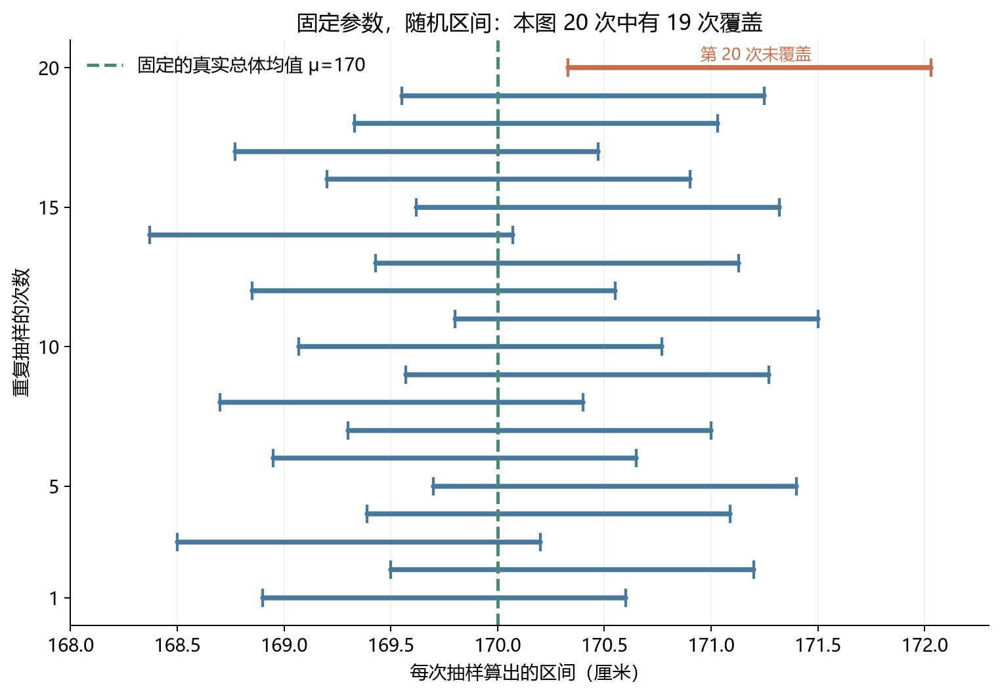
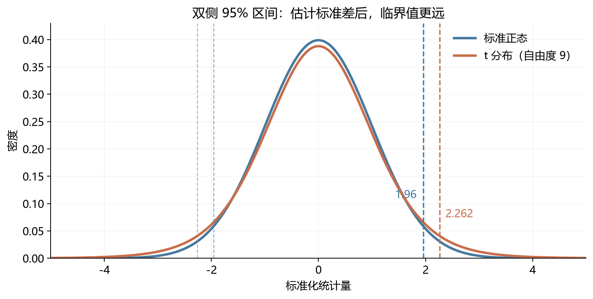
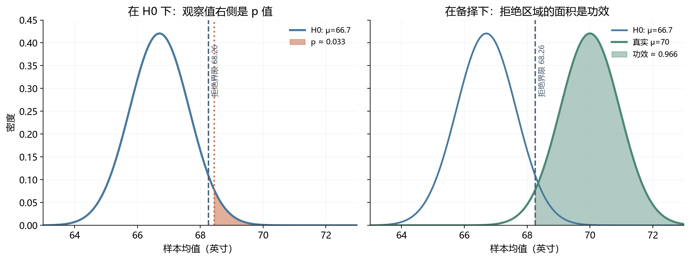
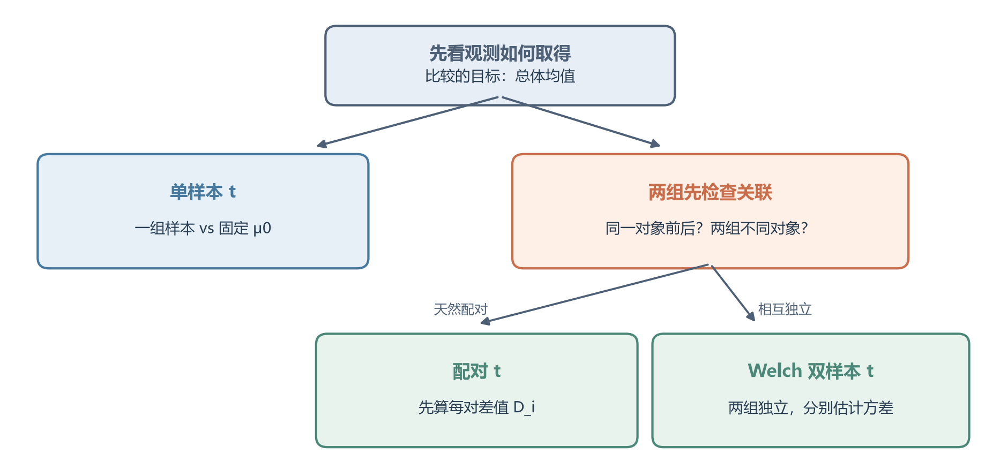
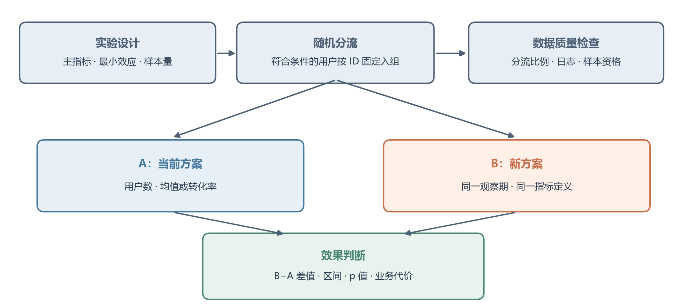

# [AI入门-概率统计]3.置信区间、假设检验与AB测试

在真实业务与实验中，我们手头永远只有有限的抽样数据。仅凭样本算出一个均值或转化率，只是一次具体的观测结果。

基于这批数据，统计推断核心要解答两个根本问题：
1. **不确定性有多大？** 这个样本指标距离总体的真实情况究竟可能差多远？（**置信区间**）
2. **两组差异是真的还是巧合？** 观察到的微弱提升，究竟是新策略真的起效，还是纯随机波动撞大运？（**假设检验与 A/B 测试**）

本文沿统计推断的自然认知链条展开：先从点估计走向置信区间，拆解 z/t 统计量的本质与适用场景，再理清假设检验中的两类错误与 p 值真相，最后完整复盘工业级 A/B 测试从设计、评估到避坑的全流程。

---

## 1 点估计、置信区间与 95% 覆盖率

### 1.1 从单点猜测走向区间量化

假设想了解全国 App 用户的平均在线时长，全量测量所有用户既不现实也无必要。我们抽取 $n$ 个人测得样本均值 $\bar x = 170$ 分钟。

- **点估计**：用这个已知的样本平均数 $\bar x$，直接充当未知总体真实均值 $\mu$ 的单点代表值。
- **点估计的致命短板**：它无法表达自身的**不确定性**。抽 3 个人算出的 170 分钟，与抽 30000 个人算出的 170 分钟，背后的可信底气天差地别。在频率学派体系下，总体真值 $\mu$ 是一个客观存在但未知的**确定固定值**，而每次抽样重新算出的 $\bar X$ 才是**随实验波动跳变的随机变量**。

为了给猜测附上精确的误差范围，我们需要构造**置信区间（Confidence Interval, CI）**，其经典形态为：

$$
\text{置信区间} = \text{点估计} \pm \text{误差界（Margin of Error, MOE）}
$$

### 1.2 95% 置信度的真正含义：是尺子的性能，不是参数在跳动

**高频认知误区**：算出的区间是 $[163, 177]$，很多人会脱口而出：“真实均值 $\mu$ 落在 163 到 177 之间的概率是 95%。”  
**这是完全错误的！** 在经典统计学中，真实均值 $\mu$ 是一个固定的常量，它要么在区间里，要么在区间外。一旦当前这组数据被采出并算好了端点，包含与否已成 100% 确定事实，不存在随机概率。

**95% 置信度的正确定义**：  
它描述的是**这套区间生成规则（制作尺子的流水线）在重复实验下的长期捕获能力**。如果按完全相同的抽样与计算法则，独立进行 100 次抽样并算出 100 个不同的置信区间，在方法前提满足的前提下，长期来看约有 95 个区间能成功兜住那个固定的真值 $\mu$，约有 5 个区间会脱靶漏掉。

> 若想讨论“给定手头数据后，真实参数落在区间内的概率”，必须引入参数先验与后验分布，转入贝叶斯学派的**可信区间（Credible Interval）**体系，不可将两套哲学的定义张冠李戴。

### 1.3 总体标准差 $\sigma$、标准误 $\operatorname{SE}$ 与误差界 $\operatorname{MOE}$

必须彻底厘清这三个衡量“波动”的指标：
- **总体标准差 $\sigma$**：衡量**群体内单个个体之间的天然离散度**（如人与人之间的身材高矮胖瘦差距）；
- **标准误（Standard Error, SE）**：衡量**统计量在重复抽样时的随机跳变幅度**。若样本独立同分布，均值的方差为 $\operatorname{Var}(\bar X) = \sigma^2/n$，则标准误为：
  $$
  \operatorname{SE}(\bar X) = \frac{\sigma}{\sqrt n}
  $$
- **误差界（Margin of Error, MOE）**：由置信水平决定的临界系数放大后的最终半宽：
  $$
  \operatorname{MOE} = \text{临界分位数} \times \operatorname{SE}
  $$

> **关键提醒**：误差界只负责量化纯随机抽样导致的统计波动。如果一开始抽样逻辑就存在系统性偏差（例如只想统计全国平均身高却只在篮球队内部发问卷），哪怕样本量 $n$ 高达数百万让区间收得极窄，估计值也会彻底失真。统计公式无法自动消除选择偏差。

---

## 2 已知标准差时的均值 z 区间、宽度与样本量

### 2.1 均值的双侧 z 区间推导

当总体标准差 $\sigma$ 已知，且满足总体服从正态分布或样本量 $n$ 足够大（根据中心极限定理）时，样本均值标准化后服从标准正态分布：

$$
Z = \frac{\bar X - \mu}{\sigma / \sqrt n} \sim N(0, 1)
$$

设允许犯错的脱靶概率为 $\alpha$（置信度为 $1 - \alpha$）。对于双侧对称检验，两端各分摊 $\alpha/2$ 的尾部面积，记临界值为 $z_{1-\alpha/2}$。当置信度为 95% 时，$\alpha = 0.05$，单侧尾部面积为 $0.025$，查标准正态分布表得 $z_{0.975} \approx 1.96$。

$$
P\left( -z_{1-\alpha/2} \le \frac{\bar X - \mu}{\sigma / \sqrt n} \le z_{1-\alpha/2} \right) = 1 - \alpha
$$

将不等式内侧移项，分离出未知参数 $\mu$，即可推导出经典的**双侧 z 区间**：

$$
\boxed{\bar X \pm z_{1-\alpha/2} \frac{\sigma}{\sqrt n}}, \qquad \operatorname{MOE} = z_{1-\alpha/2} \frac{\sigma}{\sqrt n}
$$

**计算范例**：  
随机抽样 $n = 49$ 人，测得均值 $\bar x = 170$ 厘米，已知总体标准差 $\sigma = 25$ 厘米。
- 均值标准误：$\operatorname{SE} = \frac{25}{\sqrt{49}} = \frac{25}{7} \approx 3.571$ 厘米；
- 95% 误差界：$\operatorname{MOE} = 1.96 \times 3.571 \approx 7.00$ 厘米；
- 最终置信区间为 $[170 - 7, 170 + 7] = [163, 177]$ 厘米。  
（注意：这是对全体总体的平均身高范围做出的推断，决不代表该人群中有 95% 的个人的身高落在 163 到 177 之间）。

### 2.2 影响区间宽度的三大杠杆与实验样本量规划

区间总宽度为 $2 \times \operatorname{MOE} = 2 z_{1-\alpha/2} \frac{\sigma}{\sqrt n}$。由公式可直接总结出工程调控的三大杠杆：
1. **样本量 $n$ 呈开方倍反比收缩**：想让误差界缩小到原本的一半，样本量必须强行翻 4 倍；
2. **总体固有离散度 $\sigma$**：数据越噪、差异越大，求出的区间越宽；
3. **置信度要求 $1 - \alpha$**：要求越有把握（如从 95% 提升到 99%），临界系数 $z$ 越大，区间被迫撑得更宽。

**样本量提前规划（Sample Size Sizing）**：  
在实验上线或调研启动前，如果业务指标要求最终估计的误差界绝对不能超过预设的容许限度 $E$（即 $\operatorname{MOE} \le E$），代入公式移项即得所需的最少样本量：

$$
z_{1-\alpha/2} \frac{\sigma}{\sqrt n} \le E \implies \boxed{n \ge \left( \frac{z_{1-\alpha/2} \, \sigma}{E} \right)^2}
$$

若仍要求 95% 置信度且 $\sigma = 25$，但业务要求将误差收紧在 $E = 3$ 厘米内：
$$
n \ge \left( \frac{1.96 \times 25}{3} \right)^2 \approx 266.78 \implies \text{至少需要采 } 267 \text{ 人}
$$

---

## 3 总体标准差未知时的 Student t 区间

### 3.1 现实困境：用样本 $S$ 估计 $\sigma$ 会引入额外的不确定性

在绝大多数实际业务中，我们根本不可能未卜先知总体的真实波动 $\sigma$。只能利用当前抽出的这批数据，计算**样本标准差**来替代估计：

$$
S = \sqrt{\frac{1}{n-1}\sum_{i=1}^n (X_i - \bar X)^2}
$$

这里存在一层关键的统计学差异：$S$ 本身也是一个随抽样而随机波动的随机变量，小样本下其估计容易忽大忽小。如果依然强行沿用正态分布的临界值（如 1.96），就会低估整体系统的波动风险，导致区间的实际覆盖率达不到 95%。

若样本独立且来自**正态总体**，当分母用随机变量 $S$ 替换常量 $\sigma$ 后，构造的统计量不再服从标准正态分布，而是精确服从自由度为 $n-1$ 的 **Student t 分布**：

$$
T = \frac{\bar X - \mu}{S / \sqrt n} \sim t_{n-1}
$$

- **自由度（Degrees of Freedom, $df = n - 1$）**：计算样本离差平方和时，必须先扣除一个用于估计样本均值的自由维度，只剩 $n-1$ 个独立离差；
- **t 分布形态特征**：对称钟形，但由于分母引入了 $S$ 的波动，**尾部比标准正态分布更厚、更平摊**。自由度越小，尾部越厚，所需的临界值越大；随着 $n \to \infty$，$S$ 逐渐逼近常数 $\sigma$，$t$ 分布平滑收敛为标准正态分布。

均值的双侧 t 置信区间公式为：

$$
\boxed{\bar X \pm t_{1-\alpha/2, \; n-1} \frac{S}{\sqrt n}}
$$

### 3.2 完整手算范例与参数对比

**案例 1：完整小样本手动演算**  
抽取 5 位用户的排队等待时长数据：`[8, 9, 10, 11, 12]` 分钟（$n=5$）。
1. 均值：$\bar x = \frac{8+9+10+11+12}{5} = 10$ 分钟；
2. 离差平方和：$(-2)^2 + (-1)^2 + 0^2 + 1^2 + 2^2 = 10$；
3. 样本方差与标准差：$s^2 = \frac{10}{5-1} = 2.5 \implies s = \sqrt{2.5} \approx 1.581$ 分钟；
4. 均值估计标准误：$\operatorname{SE} = \frac{s}{\sqrt n} = \frac{1.581}{\sqrt 5} \approx 0.707$ 分钟；
5. 查自由度 $df = 5 - 1 = 4$ 的双侧 95% t 临界值：$t_{0.975, 4} \approx 2.776$（相比正态分布的 1.96 明显放大）；
6. 误差界：$\operatorname{MOE} = 2.776 \times 0.707 \approx 1.963$ 分钟；
7. 最终置信区间：$[10 - 1.963, 10 + 1.963] \approx [8.04, 11.96]$ 分钟。

**案例 2：身高数据对比**  
设 $n=10, \bar x = 68.442, s = 3.113$ 英寸。
- 估计标准误 $\operatorname{SE} = \frac{3.113}{\sqrt{10}} \approx 0.9844$ 英寸；
- 查自由度 $df = 9$ 的双侧 95% 临界值：$t_{0.975, 9} \approx 2.262$；
- 误差界 $\operatorname{MOE} = 2.262 \times 0.9844 \approx 2.227$ 英寸；
- 最终区间为 $[68.442 - 2.227, 68.442 + 2.227] = [66.215, 70.669]$ 英寸。若错误套用已知 $\sigma$ 的 z 公式，会算出过窄的不合理区间。

---

## 4 总体比例区间：Wald 近似与 Wilson 修正

针对诸如转化率、点击率（CTR）等 0-1 二元指标，设样本量为 $n$，成功次数为 $k$，样本比例即为 $\hat p = k/n$。

### 4.1 传统 Wald 区间及其致命缺陷

由于伯努利分布的理论方差为 $p(1-p)$，直接用 $\hat p$ 代替未知 $p$，得到样本比例的标准误估计为 $\sqrt{\frac{\hat p(1-\hat p)}{n}}$。  
直接利用大样本正态近似构建的区间被称为 **Wald 区间**：

$$
\hat p \pm z_{1-\alpha/2} \sqrt{\frac{\hat p(1-\hat p)}{n}}
$$

**计算范例**：  
调查 30 人，其中 24 人有车（$n=30, k=24$），样本拥有率 $\hat p = 0.8$。  
- 估计标准误：$\sqrt{\frac{0.8 \times 0.2}{30}} \approx 0.0730$；  
- 95% Wald 区间：$0.8 \pm 1.96(0.0730) = [0.657, 0.943]$。

**Wald 区间的两大致命硬伤**：
1. **边界溢出与虚假确定**：当 $k=0$ 时，$\hat p = 0$，算出的标准误直接塌陷为 0，区间退化为荒谬的 $[0, 0]$（仅仅试验 10 次全失败，绝不代表真实世界的成功率是绝对的 0）；
2. **极端比例下覆盖率崩塌**：当 $p$ 极度接近 0 或 1 时，二项分布呈现极度严重的偏斜，正态对称近似严重失效，95% 标称置信度的实际覆盖概率往往远低于 95%。

### 4.2 工业推荐：Wilson 得分区间（Score Interval）

为了根治 Wald 区间在小样本和极端比例下的退化问题，现代工业界与统计库统一优先推荐 **Wilson 得分区间**。其推导不直接将 $\hat p$ 代入方差，而是求解满足二次不等式包含关系的解集。

记 $z = z_{1-\alpha/2}$，Wilson 区间的中心与半宽公式为：

$$
\text{中心} = \frac{\hat p + \frac{z^2}{2n}}{1 + \frac{z^2}{n}}, \qquad \text{半宽} = \frac{z}{1 + \frac{z^2}{n}} \sqrt{\frac{\hat p(1-\hat p)}{n} + \frac{z^2}{4n^2}}
$$

- 当 $n=30, k=24$ 时：95% Wilson 区间约为 $[0.627, 0.905]$；
- 当 $n=10, k=0$ 时：Wald 给出 $[0, 0]$，而 Wilson 给出的 95% 区间约为 $[0, 0.278]$，既没有击穿 $[0, 1]$ 的概率物理边界，又保留了对未来潜在成功率的合理不确定性量化。

---

## 5 假设检验：基准假设、错误类型与检验方向

### 5.1 假设的对立统一与证伪逻辑

假设检验的核心逻辑遵循**反证法（无罪推定）**：
- **原假设（Null Hypothesis, $H_0$）**：默认基准，通常代表“现状无变化”、“策略无效果”、“两组无差异”；
- **备择假设（Alternative Hypothesis, $H_1$）**：研究者真正希望用数据支持的新发现（“有差异”、“显著提高”）。

> **核心原则**：所有假设针对的必须是**未知的总体参数**（如 $\mu, p$），绝不能对已经算出来的样本值下断言（严禁写出 $H_0: \bar x = 66.7$ 这种错误语法）。

最终决策结果只有两种严谨措辞：
- **拒绝 $H_0$**：数据展示了极强的不相容证据，选择相信备择假设 $H_1$；
- **不拒绝 $H_0$**：证据不足以推翻原假设。**“不拒绝 $H_0$”绝不等于“证明了 $H_0$ 是真理”**，这往往只是因为当前数据量太小、方差太大，导致微弱的提升被噪声掩盖。

### 5.2 决策矩阵与两类错误

| 决策 \ 真实物理世界 | $H_0$ 实际上为真（无效果） | $H_0$ 实际上为假（确实有效果） |
|---|---|---|
| **拒绝 $H_0$（判定有效）** | **第一类错误（Type I Error, $\alpha$）** 假阳性，虚警误报（本没用却宣布有效） | **正确决策（统计功效 Power, $1 - \beta$）** 真阳性，精准检出突破 |
| **不拒绝 $H_0$（判定无有效证据）** | **正确决策（$1 - \alpha$）** 真阴性，克制审慎 | **第二类错误（Type II Error, $\beta$）** 假阴性，漏检遗珠（真有用却未测出） |

- **显著性水平 $\alpha$**：人为划定的第一类错误容忍上限（通常严格设为 0.05 或 0.01）。
- **第二类错误概率 $\beta$**：漏报的概率，其大小严重取决于真实世界的效应到底有多强；
- **统计功效（Power = $1 - \beta$）**：当真实世界确实存在改动效果时，实验能把这个效果成功测出来的概率（工业界基准通常要求达到 80% 或 90%）。

### 5.3 检验方向的预设性

根据备择假设的形态分为：
- **双尾检验**（$H_1: \mu \ne \mu_0$）：关注是否有变动（变好变坏都算）；
- **右尾检验**（$H_1: \mu > \mu_0$）：明确只追求单向提升；
- **左尾检验**（$H_1: \mu < \mu_0$）：明确只追求单向下降（如降低故障率）。

**严苛铁律**：检验方向**必须在实验开启前根据业务问题敲定**。绝不能在看到采集回来的样本数据展现出正向提升后，偷偷把原本的双尾检验改成单尾检验——这种做法会凭空将名义假阳性率凭空翻倍，属于典型的“P-hacking 数据操纵”。

---

## 6 p 值与临界值：同一个拒绝规则的两种读法

### 6.1 到底什么是 p 值？

**p 值的严格定义**：  
**在假定原假设 $H_0$ 为真的前提下，抽样检验统计量出现“比当前观测到的结果更为极端”的概率。**

$$
p\text{-value} = P(\text{更极端的检验统计量} \mid H_0 \text{ 为真})
$$

**绝对严禁的认知混淆（必须牢记）**：
1. **$p$ 值不是原假设为真的概率**（即 $p \ne P(H_0 \mid \text{数据})$）；
2. **$p$ 值不是观测差异纯属随机巧合的概率**；
3. **$p$ 值极小并不代表业务效应巨大**。只要样本量 $n$ 膨胀到数千万，微不足道甚至毫无现实意义的 0.0001% 差异也会对应极小的 $p < 0.00001$。

### 6.2 临界值法 vs p 值法的判定等价性

设总体标准差已知 $\sigma = 3, n = 10, \bar x = 68.442$，检验基准 $H_0: \mu = 66.7$，对立面为右尾 $H_1: \mu > 66.7$，显著性水平 $\alpha = 0.05$。

计算标准化检验统计量：

$$
z_{\mathrm{obs}} = \frac{68.442 - 66.7}{3 / \sqrt{10}} \approx \frac{1.742}{0.9487} \approx 1.836
$$

**两种等价判定视角**：
- **临界值法**：将 $\alpha = 0.05$ 对应的拒绝边界算出来。标准正态单侧临界值为 $z_{0.95} \approx 1.645$。由于观测值 $z_{\mathrm{obs}} = 1.836 > 1.645$，落在拒绝域内，**拒绝 $H_0$**。
- **p 值法**：计算处于 $1.836$ 及其更右侧极端区域的概率。查表得 $p = P(Z \ge 1.836) \approx 0.0332$。因为 $p = 0.0332 < \alpha = 0.05$，同样作出**拒绝 $H_0$** 的决断。

如果上述问题在事前定义的是双尾检验（$H_1: \mu \ne 66.7$），则双尾对称 $p = 2 \times 0.0332 = 0.0664$。此时由于 $0.0664 > 0.05$，结论将瞬间反转为**无法拒绝 $H_0$**。

---

## 7 检验功效与事先设计：不显著可能意味着检不出来

### 7.1 功效的数学推演

检验功效（Power = $1 - \beta$）绝不是空中楼阁，它**必须锚定一个具体的真实目标效应值**才有明确的数值意义。

沿用上述参数设定（$\sigma = 3, n = 10, \alpha = 0.05$，右尾临界值 $1.645$）。  
在 $H_0: \mu = 66.7$ 下，触发拒绝的临界样本均值门槛为：

$$
\bar X_{\text{crit}} = 66.7 + 1.645 \times \frac{3}{\sqrt{10}} \approx 68.26 \text{ 英寸}
$$

只要样本均值 $\bar X > 68.26$ 就推翻 $H_0$。

现在假设真实世界的策略确实发生了质的飞跃，**真实均值已经提升到了 $\mu_{\text{true}} = 70$ 英寸**。此时样本均值的真实抽样分布为 $\bar X \sim N(70, \; 3^2/10)$。  
第二类错误 $\beta$ 就是“尽管均值已是 70，但样本均值却意外落在了拒绝线 68.26 之下”：

$$
\beta = P(\bar X \le 68.26 \mid \mu = 70) = P\left( Z \le \frac{68.26 - 70}{3/\sqrt{10}} \right) = P(Z \le -1.834) \approx 0.0333
$$

因此，针对“提升至 70”这一特定目标，该设计的统计功效为：

$$
\text{Power} = 1 - \beta = 1 - 0.0333 \approx 0.9667 \ (96.67\%)
$$

**核心规律**：
- 如果真实提升幅度极小（例如真实均值仅从 66.7 微增至 67），这套样本量下的功效将暴跌至不足 15%——这意味着即使策略真的有效，实验也有超过 85% 的概率得出“不显著”并惨遭废弃；
- **业务启示**：当看到一次 A/B 测试得出“不显著”时，必须反查该实验在**最小有意义效应（Minimum Detectable Effect, MDE）**下的检验功效。缺乏功效的实验，“不显著”仅仅意味着**实验盲区根本测不出来**，绝不证明新版本与旧版本毫无差距。

---

## 8 单样本 t 检验：一个均值与固定基准比较

当总体标准差未知、仅有一组独立样本需要与已知理论常数基准 $\mu_0$ 进行比对时，使用**单样本 t 检验**。

检验统计量为：

$$
H_0: \mu = \mu_0, \qquad T = \frac{\bar X - \mu_0}{S / \sqrt n} \sim t_{n-1}
$$

**实战案例演算**：  
已知历史工业基准为 $\mu_0 = 66.7$ 英寸。新抽样 10 名员工数据（$n=10$），测得 $\bar x = 68.442, s = 3.113$ 英寸。检验新批次是否显著高于基准（右尾）：

$$
t_{\mathrm{obs}} = \frac{68.442 - 66.7}{3.113 / \sqrt{10}} \approx \frac{1.742}{0.9844} \approx 1.770
$$

自由度 $df = 10 - 1 = 9$。查 t 分布表求单尾尾部面积：$p = P(t_9 \ge 1.770) \approx 0.055$。  
在 $\alpha = 0.05$ 的判别线下，由于 $p = 0.055 > 0.05$，决策结果为：**在 5% 的显著性水平下，无法拒绝原假设，没有足够证据表明该群体均值显著高于 66.7**。

> **对比反思**：在第 6 节中，假定已知 $\sigma = 3$ 时算出 $p = 0.033$（显著拒绝）；而此处引入 $S$ 的未知波动后，t 分布尾部变厚导致 $p$ 升至 $0.055$（不拒绝）。严谨使用与已知条件相符的统计模型，是避免实验得出伪结论的底线。

---

## 9 独立双样本 Welch t 检验：两组均值之差

在大部分对比实验中，面对的是互相独立的两个样本群体（控制组与实验组）。此时待估核心参数为两组总体均值之差 $\Delta = \mu_X - \mu_Y$。

### 9.1 放弃传统 Student 双样本，拥抱 Welch t 检验

传统双样本 t 检验强行假定两组总体的方差严格相等（方差齐性），采用“合并方差（Pooled Variance）”。但在真实复杂业务场景中，实验组与对照组的用户表现往往波动各异，等方差假设极易被击碎。

**Welch t 检验（不假设方差齐性）**是鲁棒性更强的工业标准。两组均值差的估计标准误公式为各自方差分量直接相加：

$$
H_0: \mu_X - \mu_Y = 0, \qquad T = \frac{(\bar X - \bar Y) - 0}{\sqrt{\frac{S_X^2}{n_X} + \frac{S_Y^2}{n_Y}}}
$$

其参考的 t 分布采用 **Welch–Satterthwaite 近似自由度 $\nu$**（允许为连续小数）：

$$
\nu \approx \frac{\left( \frac{S_X^2}{n_X} + \frac{S_Y^2}{n_Y} \right)^2}{\frac{(S_X^2 / n_X)^2}{n_X - 1} + \frac{(S_Y^2 / n_Y)^2}{n_Y - 1}}
$$

### 9.2 双样本案例演练

设 $X$ 组样本 $n_X = 10, \bar x = 68.442, s_X = 3.113$；$Y$ 组样本 $n_Y = 9, \bar y = 65.949, s_Y = 3.106$。
1. 均值差：$\bar x - \bar y = 68.442 - 65.949 = 2.493$；
2. 差值的标准误：
   $$
   \operatorname{SE}_{\Delta} = \sqrt{\frac{3.113^2}{10} + \frac{3.106^2}{9}} = \sqrt{0.9691 + 1.072} = \sqrt{2.041} \approx 1.429
   $$
3. 检验统计量：$t_{\mathrm{obs}} = \frac{2.493}{1.429} \approx 1.745$；
4. 代入公式算得近似自由度 $\nu \approx 16.8$；
5. 若事先设定单尾右偏研究（$X$ 是否高于 $Y$），查得单侧 $p \approx 0.0496 < 0.05$（刚好压线拒绝）；若事先设定双尾研究，双尾 $p \approx 0.099 > 0.05$（无法拒绝）。

---

## 10 配对 t 检验与三类均值检验的选择

### 10.1 配对数据的本质：消除个体间差异基准

如果让同一批用户分别在改版前与改版后各测一次指标（如健身减重前 vs 减重后），或者针对双胞胎、同一对匹配样本做实验，数据之间存在天然的**强关联绑定**。

如果把前后两组当成两批毫无关联的陌生人做独立双样本检验，由于个体天然的基准高矮胖瘦差异极大，会引入巨大的背景噪声。**配对 t 检验（Paired t-test）**通过计算每对数据的**内部差值** $D_i = X_i - Y_i$，将复杂的多样本问题瞬间降维转化为**对差值 $D$ 做的单样本 t 检验**：

$$
H_0: \mu_D = 0, \qquad T = \frac{\bar D - 0}{S_D / \sqrt n} \sim t_{n-1}
$$

**计算范例**：  
$n=10$ 位学员训练前后体重差值均值 $\bar d = 1.09$ 千克，差值的样本标准差 $s_D = 1.485$ 千克：

$$
t_{\mathrm{obs}} = \frac{1.09}{1.485 / \sqrt{10}} \approx \frac{1.09}{0.4696} \approx 2.321
$$

自由度 $df = 9$，单尾 $p \approx 0.0227 < 0.05$，显著推翻“平均无变化”的原假设。

### 10.2 三类均值 t 检验的选型决策树

1. **只有一个样本组，对比外部已知常数标准** $\implies$ **单样本 t 检验**；
2. **两组互不相关的独立群体**（如两批完全随机分配的不同受众） $\implies$ **独立双样本 Welch t 检验**；
3. **同一批对象在不同条件下的前后对比** $\implies$ **配对 t 检验**。

---

## 11 置信区间与双侧检验的对应关系

双侧假设检验与置信区间，本质上是对同一个抽样分布模型的**双向等价读取**：

> **黄金对偶准则**：  
> **在显著性水平 $\alpha$ 下，进行双侧假设检验 $H_0: \theta = \theta_0$ 并做出“拒绝 $H_0$”的决策，当且仅当该参数的 $100(1-\alpha)\%$ 双侧置信区间“完全不包含 $\theta_0$”。**

- 若计算均值差 $\mu_B - \mu_A$ 的 95% 置信区间为 $[+1.2, \; +5.8]$，由于**数值 0 完全在区间外侧**，无需计算具体 p 值即可 100% 断定：双侧检验在 $\alpha = 0.05$ 下必然拒绝 $H_0$；
- 若区间为 $[-1.5, \; +4.2]$，由于**区间跨越了 0**（差值可能为负也可能为正），双侧检验在 5% 水平下必然无法拒绝 $H_0$。

**置信区间的降维打击优势**：  
单纯汇报一个 $p = 0.03$，只能说明差异统计显著，却完全看不出差异到底有多大；而汇报置信区间 $[+1.2, +5.8]$，不仅瞬间同步完成了假设检验判定，还清晰地呈现了可能带来的业务收益上限与下限，信息量远比一个单一的 p 值丰满。

---

## 12 A/B 测试：随机分流、两类指标与实验质量

A/B 测试是现代互联网与算法落地迭代的黄金准绳，其核心是控制变量与因果推断。

### 12.1 连续型指标实战：每用户平均购买金额（ARPU）

设对照组 A 与实验组 B 分别收集到数据：
- A 组（对照组）：$n_A = 80, \bar x_A = 50, s_A = 10$
- B 组（实验组）：$n_B = 20, \bar x_B = 55, s_B = 15$

表面上看，B 组平均值高达 55，比 A 组高出 5 个金额单位（表面提升 10%）。这究竟是不是真实的突破？

按两组独立方差不齐，计算 Welch 标准误：

$$
\operatorname{SE}_{\Delta} = \sqrt{\frac{15^2}{20} + \frac{10^2}{80}} = \sqrt{11.25 + 1.25} = \sqrt{12.5} \approx 3.536
$$

检验统计量为：

$$
t_{\mathrm{obs}} = \frac{55 - 50}{3.536} \approx 1.414
$$

对应单侧 $p \approx 0.085$。  
因为 $p = 0.085 > 0.05$，在统计学上**无法拒绝原假设，本次实验不能证明 B 方案有显著提升**！  
双侧 95% 置信区间大约为 $5 \pm (2.086 \times 3.536) = [-2.37, \; 12.37]$。由于 B 组样本量太小且波动大，误差范围极大，我们无法排除真实效果甚至为负的可能性。

### 12.2 比率型指标实战：转化率的双样本 z 检验

设对照组 A 组 80 人中有 20 人转化（$\hat p_A = 20/80 = 0.25$）；实验组 B 组 20 人中有 8 人转化（$\hat p_B = 8/20 = 0.40$）。  
表面绝对转化率暴增 15 个百分点（相对提升高达 60%）。

在原假设 $H_0: p_A = p_B$ 成立的前提下，两组应当共享同一个合并基准转化率 $\hat p_{\text{pool}}$：

$$
\hat p_{\text{pool}} = \frac{20 + 8}{80 + 20} = \frac{28}{100} = 0.28
$$

计算联合标准误并推导两比例 z 统计量：

$$
Z = \frac{\hat p_B - \hat p_A}{\sqrt{\hat p_{\text{pool}}(1 - \hat p_{\text{pool}})\left(\frac{1}{n_A} + \frac{1}{n_B}\right)}} = \frac{0.40 - 0.25}{\sqrt{0.28 \times 0.72 \left(\frac{1}{80} + \frac{1}{20}\right)}} = \frac{0.15}{\sqrt{0.2016 \times 0.0625}} = \frac{0.15}{0.1122} \approx 1.336
$$

单侧 $p = P(Z \ge 1.336) \approx 0.0908$。  
由于 $0.0908 > 0.05$，结论同样是：**样本量过小，无法排除是小样本随机波动所致，不能草率认定新版本转化率更高**。

### 12.3 严防工业实验中的典型“死因”

在真实的 A/B 测试体系中，统计公式往往是最简单的一步，90% 的实验崩溃源于以下流程陷阱：

1. **样本比例不匹配（Sample Ratio Mismatch, SRM）**：  
   若实验设计为 50/50 均匀分流，上线后却发现 A 组收集了 10 万人，B 组只收集了 9.2 万人。此时必须先做卡方拟合优度检验。若 SRM 检验显著，说明底层分流引擎存在严重 Bug（如某版本发生崩溃闪退导致日志无法上传，或某些特征人群被系统性过滤）。**在 SRM 报错未彻底排查修复前，任何后续的业务效果分析均毫无意义**。
2. **偷窥数据与提前叫停（Peeking Problem）**：  
   实验原本计划运行 14 天，业务方在第 3 天看后台发现 $p = 0.03 < 0.05$ 便兴奋叫停上线。由于时间序列上极值的随机游走，这种“一显著就刹车”的操作会使真实第一类错误率（假阳性率）从预设的 5% 剧烈膨胀到 30% 以上。如需支持动态早停，必须引入严格的**序贯检验（Sequential Testing）**阿尔法消耗算法。
3. **多重假设检验陷阱（Multiple Testing）**：  
   如果同时上线 20 个策略版本，或者盯着 20 个细分业务指标（留存、时长、点击、客单价等）分析，哪怕所有改动全都毫无作用，至少有一个指标纯凭运气“达到 $p < 0.05$ 显著”的概率高达 $1 - (1-0.05)^{20} \approx 64\%$！实验必须提前锁定唯一的核心 OEC（整体评估指标），非主要指标必须施加严谨的族错误率校正（如 Bonferroni 校正或 FDR 控制）。
4. **网络溢出与新奇效应（Spillover & Novelty Effect）**：  
   用户在社交网络或双边市场中相互影响，导致实验组的处理溢出感染到对照组；新功能上线初期用户因好奇尝鲜导致短期活跃暴增，但在两周后迅速跌回原型。因此实验必须预留充足的稳定运行周期，以捕捉经过时间沉淀后的真实长期稳定因果效应。