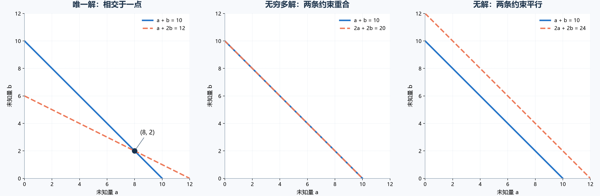
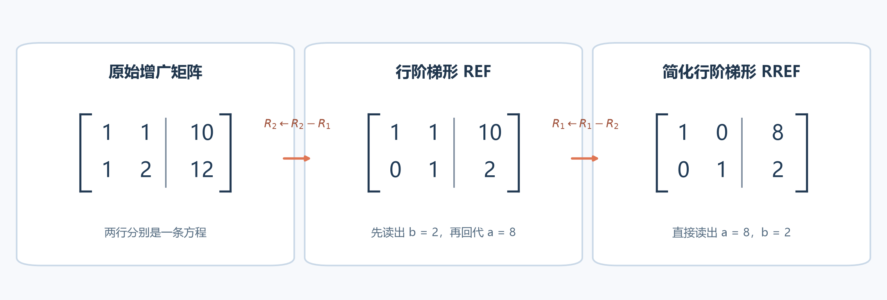

# [AI入门-线性代数]1.线性方程组、消元与秩

线性方程组，本质上就是给多个未知量戴上了一组“必须同时满足的紧箍咒”。

面对这组约束，我们关心的核心问题永远只有两个：
1. **到底有没有解？**（约束之间打不打架？）
2. **如果有解，解是否唯一？**（约束够不够把未知量定死，还是留下了自由空间？）

消元法是帮我们把错综复杂的方程拆解、化简、直接看透结构的计算工具；而**秩**则是衡量方程组到底包含了多少“真正有效且不重复的独立信息”的终极指标。

本文按学习进阶路径展开：先建立几何直觉，再掌握增广矩阵与消元技巧，最后吃透秩与解的本质。本文用小写字母 $a, b$ 代表简单未知量；在一般方程组 $Ax=\mathbf b$ 中，粗体 $\mathbf b$ 表示右侧常数向量，以此区分。

---

## 1 线性约束与方程组的解

### 1.1 什么样的关系是线性的

理解“线性”，最直观的模型就是日常购物结账：
两种商品的未知单价分别是 $a$ 和 $b$。总价永远是“买几件乘以单价，再加和”。未知量之间绝不发生交叉纠缠。

如果有 $n$ 个未知量 $x_1, x_2, \ldots, x_n$，线性方程的标准形式就是**加权求和**：

$$
a_1x_1 + a_2x_2 + \cdots + a_nx_n = c
$$

- **权重系数 $a_i$**：衡量 $x_i$ 每变动 1 个单位，等式左侧跟着变动多少。若 $a_i=0$，说明该约束与 $x_i$ 无关。
- **目标总量 $c$**：右侧给定的目标基准。
- **线性的核心特征**：每个未知量都只能被常数缩放并直接相加，不能出现变量相乘（$x_1x_2$）、高次项（$x_1^2$）或非线性函数（$\sin x_1$）。

例如采购场景：
- 买 1 件 A、1 件 B 花费 10 元；
- 买 1 件 A、2 件 B 花费 12 元。

列成方程组即为：

$$
\begin{cases}
a + b = 10 \\
a + 2b = 12
\end{cases}
$$

单个方程只给出了两个变量的联动关系（无数种组合都能凑出 10 元）；只有引入第二个约束，两者同时生效，数值才会被进一步锁定。后续所有的消元和秩，核心都在剖析**“新加入的方程到底有没有提供新信息”**。

在机器学习中，多元线性回归的底层公式也是这种加权求和：把特征乘以权重得到预测值。唯一的不同在于，真实数据往往充满噪声，我们很难让每个样本方程严格成立，而是通过最小二乘法让预测值“尽量贴合”真实标签。

---

### 1.2 独立、重复和冲突的约束

固定基准约束 $a + b = 10$，我们看看加入不同的第二条约束会发生什么：

| 方程组合 | 第二条约束的本质 | 最终结果 | 核心直觉 |
|---|---|---|---|
| $a+b=10$ $a+2b=12$ | 提供了全新的独立信息 | **唯一解**：$a=8, b=2$ | 约束充足且相容，变量被完全锁死 |
| $a+b=10$ $2a+2b=20$ | 只是第一条两边同乘 2（废话约束） | **无穷多解** | 表面两条方程，实际只有一条有效约束，存在自由度 |
| $a+b=10$ $2a+2b=24$ | 关系与第一条重合，但目标数值矛盾 | **无解** | 左侧推导应为 20，右侧却强求 24，产生逻辑冲突 |

**记忆要点**：
**方程的行数，绝不等于独立约束的数量！**
- 冗余方程只是增加了冗余字符，毫无实质约束力；
- 目标常数若产生冲突，无论未知量有多少，解空间瞬间坍塌为零。

---

## 2 矩阵形式 $Ax=\mathbf b$ 与几何交集

### 2.1 把全部系数放进矩阵

当变量和方程成百上千时，把符号逐个写出来不仅繁琐，还容易看漏。矩阵就是将方程结构紧凑打包的容器。

把每一条方程写成一行，每一个未知量的系数排成一列：
- **系数矩阵** $A \in \mathbb{R}^{m \times n}$：$m$ 行（方程数），$n$ 列（未知量数）。
- **未知量向量** $x \in \mathbb{R}^n$：待求解的变量列表。
- **常数向量** $\mathbf b \in \mathbb{R}^m$：每条方程对应的目标值。

方程组整合成简洁的矩阵乘法：

$$
Ax = \mathbf b
$$

展开形式对应每一条具体方程：

$$
(Ax)_i = \sum_{j=1}^{n} A_{ij}x_j = b_i, \qquad i=1,\ldots,m
$$

前述的商品标价方程转为矩阵：

$$
\underbrace{\begin{bmatrix}1 & 1 \\ 1 & 2\end{bmatrix}}_{A \in \mathbb{R}^{2 \times 2}}
\underbrace{\begin{bmatrix}a \\ b\end{bmatrix}}_{x \in \mathbb{R}^2}
=
\underbrace{\begin{bmatrix}10 \\ 12\end{bmatrix}}_{\mathbf b \in \mathbb{R}^2}
$$

---

### 2.2 解是所有约束的公共部分

在几何空间中，线性方程的解就是约束集合的**公共交集**：
- 在 2 维平面上，一条非退化二元线性方程是一条**直线**；
- 在 3 维空间中，一个三元线性方程是一个**平面**；
- 在更高维空间中，则对应**超平面**。

前面三种情况的几何图像极其直观：

1. **唯一解**：两条直线斜率不同，相交于唯一的交点 $(8, 2)$。
2. **无穷多解**：两条直线完全重合，整条线上的所有点都是解。
3. **无解**：两条直线斜率相同但截距不同，彼此平行，永不相交。

维度再高，无法作图也没关系，矩阵代数就是我们高维世界里的“眼睛”，它能自动判断这些超平面是否相交、交集是一个点、一条线还是空集。

---

## 3 齐次方程组、线性相关与奇异矩阵

### 3.1 用 $Ax=0$ 单独观察系数矩阵

研究未知数之间是否存在内在冗余时，右侧的具体数值 $\mathbf b$ 往往会干扰视线。我们可以把右端全置为零，得到**齐次方程组**：

$$
Ax = 0
$$

显然，$x = 0$（零向量）永远是一个解（称为平凡解）。
所以齐次方程组真正要问的是：**除了全为 0 之外，是否存在非零向量 $h \neq 0$，使得 $Ah=0$？**

看这个例子：

$$
A = \begin{bmatrix}1 & 1 \\ 2 & 2\end{bmatrix}, \qquad h = \begin{bmatrix}1 \\ -1\end{bmatrix}
$$

做矩阵乘法：

$$
Ah = \begin{bmatrix}1(1) + 1(-1) \\ 2(1) + 2(-1)\end{bmatrix} = \begin{bmatrix}0 \\ 0\end{bmatrix}
$$

向量 $h=[1, -1]^\mathsf{T}$ 告诉我们：只要把第一个变量增加 1、第二个变量减少 1，两项影响在方程内部就会完全相互抵消！

这带来了极为关键的推论：
若某个非齐次方程 $Ax = \mathbf b$ 已经拥有了一个特解 $x_0$（即 $Ax_0 = \mathbf b$），那么只要叠加任意比例的 $h$，都有：

$$
A(x_0 + t h) = Ax_0 + t(Ah) = \mathbf b + 0 = \mathbf b
$$

**结论**：一旦存在能被矩阵“压缩为零”的非零方向 $h$，只要该方程组有解，就必然沿着 $h$ 方向延伸出**无穷多个解**。

---

### 3.2 线性相关说明方向没有增加

如果一组向量中，某些向量能够被其余向量线性组合出来，说明它没有开拓出任何新的几何维度。

数学定义：对于向量组 $v_1, \ldots, v_k$，若存在**不全为零**的标量系数 $\alpha_1, \ldots, \alpha_k$，满足：

$$
\alpha_1 v_1 + \cdots + \alpha_k v_k = 0
$$

则称这组向量**线性相关**；反之，若要使上式成立必须全部 $\alpha_i=0$，则称它们**线性无关**。

将矩阵乘法按列展开：

$$
Ah = h_1 A_{:,1} + h_2 A_{:,2} + \cdots + h_n A_{:,n} = 0
$$

存在非零解 $h$，本质上就是**矩阵各列向量线性相关**的直接体现。

- **奇异矩阵（针对方阵 $n \times n$）**：若方阵 $A$ 满足 $Ax=0$ 存在非零解，则称 $A$ 是**奇异矩阵**（非满秩）。此时它的行或列存在信息重叠，无法实现输入到输出的一对一完美映射。
- 奇异方阵面对 $Ax=\mathbf b$ 时，要么因 $\mathbf b$ 超出可覆盖范围而**无解**，要么陷入**无穷多解**，绝不可能拥有唯一解。

---

## 4 初等行变换、增广矩阵与矛盾行

### 4.1 消元为什么不改变解

消元的终极目的，是通过**完全可逆、保真**的等价变换，把互相耦合的方程组逐层剥开，直接暴露出未知量的数值。

允许的 3 种**初等行变换**：
1. **交换两行**（$R_i \leftrightarrow R_j$）：仅仅调换罗列顺序。
2. **非零常数缩放一行**（$R_i \leftarrow \lambda R_i, \lambda \ne 0$）：两边同乘非零数，等价性不变（严禁乘 0，乘 0 会彻底丢失方程约束）。
3. **将一行的倍数加到另一行**（$R_i \leftarrow R_i + \lambda R_j, i \ne j$）：用已知等式抵消其他方程中的特定变量。

因为每一步操作都可以做逆操作完美复原，所以**初等行变换绝不会增删任何解**。

---

### 4.2 增广矩阵必须保留右端

为了彻底摆脱反复书写未知量字母的繁琐，我们将系数矩阵 $A$ 与目标常数列 $\mathbf b$ 拼接在一起，构成**增广矩阵** $[A \mid \mathbf b]$：

$$
[A \mid \mathbf b] = \left[\begin{array}{cc|c} 1 & 1 & 10 \\ 1 & 2 & 12 \end{array}\right]
$$

执行消元变换 $R_2 \leftarrow R_2 - R_1$：

$$
\left[\begin{array}{cc|c} 1 & 1 & 10 \\ 1 & 2 & 12 \end{array}\right]
\longrightarrow
\left[\begin{array}{cc|c} 1 & 1 & 10 \\ 0 & 1 & 2 \end{array}\right]
$$

**铁律**：右侧常数列是方程等号不可分割的一部分，行变换必须左右同步计算（$12 - 10 = 2$），遗漏右侧将导致方程体系彻底畸变。

---

### 4.3 零系数行怎样区分重复与冲突

化简到最后，若某一行左边全部变成了 0，如何一眼看穿方程组的命运？

**情况 A：全零行（冗余重复）**
$$
\left[\begin{array}{cc|c} 1 & 1 & 10 \\ 0 & 0 & 0 \end{array}\right]
$$
第二行翻译为数学语言是 $0=0$。这是一句绝对正确的“废话”，它说明第二条约束纯属重复。此时有效约束少于变量数，留下自由变量，方程组有**无穷多解**。

**情况 B：矛盾行（致命冲突）**
$$
\left[\begin{array}{cc|c} 1 & 1 & 10 \\ 0 & 0 & 4 \end{array}\right]
$$
第二行翻译出来是 $0 \cdot a + 0 \cdot b = 4$，即 $0 = 4$！这是逻辑不可调和的谬误，直接判定方程组**无解**。

**避坑警示**：
看到形如 $[0 \ \cdots \ 0 \mid 0]$ 的全零行，**绝不能武断判定为无穷多解**！
例如：
$$
\begin{cases} x = 1 \\ 2x = 2 \end{cases} \longrightarrow \left[\begin{array}{c|c} 1 & 1 \\ 0 & 0 \end{array}\right]
$$
虽然第二行消成了全 0，但变量只有一个 $x$，且已被第一行锁定为 $x=1$。解的数量必须综合“自由变量”是否存在来最终敲定。

---

## 5 行阶梯形、简化行阶梯形与主元

### 5.1 行阶梯形支持从下向上回代

经过正向高斯消元后，若矩阵满足：
1. 全零行（如果有）统一沉在矩阵最底部；
2. 每一行从左往右数第一个非零元素（称为**主元 Pivot**），其所在的列位置严格位于上一行主元的右侧；
3. 主元下方的所有元素全为 0。

此时矩阵形态宛如阶梯，称为**行阶梯形（REF）**：

$$
\left[\begin{array}{cc|c}
\mathbf{1} & 1 & 10 \\
0 & \mathbf{1} & 2
\end{array}\right]
$$

此时结构极其清晰：由第二行直接读出 $b=2$；向上代入第一行（回代），即可解得 $a = 10 - 2 = 8$。主元不强制要求必须为 1，哪怕是 $[0 \ 3 \mid 6]$ 同样能顺畅回代。

---

### 5.2 简化行阶梯形能直接读取结果

若在 REF 的基础上追求极致：
1. 将每个主元本身都缩放化为 1；
2. 向上消元，让**主元所在列的其他上下所有元素全部变为 0**。

得到的矩阵称为**简化行阶梯形（RREF）**：

$$
\left[\begin{array}{cc|c}
1 & 1 & 10 \\
0 & 1 & 2
\end{array}\right]
\xrightarrow{R_1 \leftarrow R_1 - R_2}
\left[\begin{array}{cc|c}
\mathbf{1} & 0 & 8 \\
0 & \mathbf{1} & 2
\end{array}\right]
$$

此时完全无需任何回代计算，第一行即 $a=8$，第二行即 $b=2$，解向量一目了然！

**两者对比与核心特性**：
- **REF 不唯一**：根据行变换策略不同，化出的阶梯形态数值可能不同；
- **RREF 具有唯一性**：任何矩阵对应的 RREF 都是独一无二的最终形态；
- **主元判据**：若增广矩阵的**最后一列（常数列）出现了主元**，意味着该行出现了 $[0 \ \cdots \ 0 \mid \text{非零}]$，即可斩钉截铁判定系统**无解**。

---

## 6 秩、零空间与解的数量

### 6.1 秩记录多少个独立方向

消元化简后，留存下来的非零行数量，就是矩阵真正立得住的骨架。

**矩阵的秩（Rank）**：
- **可操作定义**：行化简至阶梯形后，**非零主元的总个数**，记作 $\operatorname{rank}(A)$。
- **几何与空间本质**：矩阵中极大线性无关行向量（或列向量）的最大数量。

对于任意 $m \times n$ 矩阵，主元个数绝不可能超过行数或列数：

$$
0 \le \operatorname{rank}(A) \le \min(m, n)
$$

**满秩的两种维度（针对长方矩阵）**：
- **满行秩（$\operatorname{rank}(A)=m$）**：所有行均独立（必有 $m \le n$），约束完全相容，对任意右侧向量 $\mathbf b$ **至少有一个解**。
- **满列秩（$\operatorname{rank}(A)=n$）**：所有列均独立（必有 $n \le m$），未知数没有任何内在冗余，方程组**至多有一个解**（如果有解，则必然唯一；但仍可能因行冲突而无解）。

---

### 6.2 零空间说明还可以自由改变什么

当方程有解时，我们能在多大范围内自由游走而不破坏等式？这由**零空间**决定。

**零空间（Null Space）** 是所有能被 $A$ 彻底映射归零的输入向量集合：

$$
\mathcal{N}(A) = \{h \in \mathbb{R}^n \mid Ah = 0\}
$$

若矩阵有 $n$ 个未知量，化简后锁定了 $r = \operatorname{rank}(A)$ 个主元变量，那么剩下的 $n - r$ 个变量就可以随意任选取值，称为**自由变量**。

**秩—零化度定理（主元变量 + 自由变量 = 总变量数）**：

$$
\operatorname{rank}(A) + \dim\mathcal{N}(A) = n
$$

> **严禁踩坑**：等号右边的 $n$ **永远是未知量数（列数）**，绝不能写成方程数 $m$！

**解析结构展示**：
设有方程组：
$$
\begin{cases}
x_1 + x_2 = 3 \\
x_2 + x_3 = 4
\end{cases}
$$
未知量 $n=3$，独立方程数 $r=2$，自由变量数量为 $3 - 2 = 1$ 个。
设自由变量 $x_2 = t$，则 $x_1 = 3 - t, x_3 = 4 - t$。写成向量形态：

$$
x = \underbrace{\begin{bmatrix}3 \\ 0 \\ 4\end{bmatrix}}_{\text{特解 } x_p} + t \underbrace{\begin{bmatrix}-1 \\ 1 \\ -1\end{bmatrix}}_{\text{零空间基底 } h}, \qquad t \in \mathbb{R}
$$

**通解结构公式**：

$$
x = x_p + h \quad (h \in \mathcal{N}(A))
$$

- 如果零空间只有零向量（$\dim\mathcal{N}(A)=0$），自由度为 0，解唯一；
- 如果零空间包含非零向量（$\dim\mathcal{N}(A)>0$），解集将沿着零空间基底无限延伸。

---

### 6.3 同时比较系数矩阵和增广矩阵的秩

要全面裁决解的状况，只需对比两个数字：
- $r = \operatorname{rank}(A)$：系数自带的独立约束能力；
- $r_{\mathrm{aug}} = \operatorname{rank}([A \mid \mathbf b])$：把常数目标并入后的总秩。

| 秩的关系 | 解的裁决 | 底层机制剖析 |
|---|---|---|
| $r < r_{\mathrm{aug}}$ | **无解** | 常数列 $\mathbf b$ 增加了新的主元（出现 $0 = d$），目标向量根本无法由列向量组合得出 |
| $r = r_{\mathrm{aug}} = n$ | **唯一解** | 目标可达，且所有未知数列均有主元锁定，没有自由变量（$n - r = 0$） |
| $r = r_{\mathrm{aug}} < n$ | **无穷多解** | 目标可达，但存在 $n - r$ 个自由变量可以任意滑移 |

回顾二元几何直线：
- **相交（唯一解）**：$r = r_{\mathrm{aug}} = 2 = n$；
- **重合（无穷多解）**：$r = r_{\mathrm{aug}} = 1 < n=2$；
- **平行（无解）**：$r = 1 < r_{\mathrm{aug}} = 2$。

代数判定与几何直观在此完美统一。

---

## 7 高斯消元、Gauss–Jordan 消元与实际求解

### 7.1 标准求解算法流程

将消元固化为确定性算法步骤：
1. **构造增广矩阵**：将方程组统一转为 $[A \mid \mathbf b]$。
2. **主元选取与下消**：从左至右选取主元。遇 0 则与下方非零行调换，利用初等行变换将主元下方元素全归零，得到 **REF**。
3. **相容性验证**：检查是否产生 $[0 \ \cdots \ 0 \mid d \ (d \neq 0)]$ 的矛盾行，若有则立即报“无解”并终止。
4. **求解收尾**：
   - **高斯消元法**：在 REF 基础上，自由变量赋参数，自底向上逐步**回代**求解；
   - **Gauss–Jordan 消元法**：主元归一化，自下而上继续消除主元**上方**的所有元素化至 **RREF**，直接读取数值。

---

### 7.2 工程与数值计算中的实践考量

在计算机与 AI 实际落地中，理论数学与浮点计算存在关键差异：

1. **数值稳定性与主元选择（Partial Pivoting）**：
   计算机使用有限精度浮点数。若主元接近于 0，用它除其他数会极大放大舍入误差，导致结果崩溃。工程库（如 LAPACK）通常会搜寻该列绝对值最大的元素交换上来作为主元。
2. **数值秩判别**：
   由于浮点噪声，计算机很难出现绝对的 `0.0`。因此判断是否为 0 需要引入阈值容差（Tolerance）。详情可参考 [NumPy matrix_rank 官方文档](https://numpy.org/doc/stable/reference/generated/numpy.linalg.matrix_rank.html)。
3. **求解 API 的选择**：
   - 对于满秩方阵的标准系统 $Ax=\mathbf b$：直接调用高效稳定的求解器，如 [NumPy linalg.solve](https://numpy.org/doc/stable/reference/generated/numpy.linalg.solve.html)；
   - 对于超定系统（方程多于变量，常无精确解）或求最小误差：调用最小二乘接口 [NumPy linalg.lstsq](https://numpy.org/doc/stable/reference/generated/numpy.linalg.lstsq.html)，寻找使残差平方和 $\|Ax - \mathbf b\|_2^2$ 最小化的最佳近似解。
4. **求逆矩阵的误区**：
   在数学推演中我们常写 $x = A^{-1}\mathbf b$，但在实际写代码时，**绝对不要显式计算逆矩阵 $A^{-1}$ 再做乘法**！直接对增广系统消元或使用 LU 分解求解速度更快、占用内存更小、数值精度显著更高。