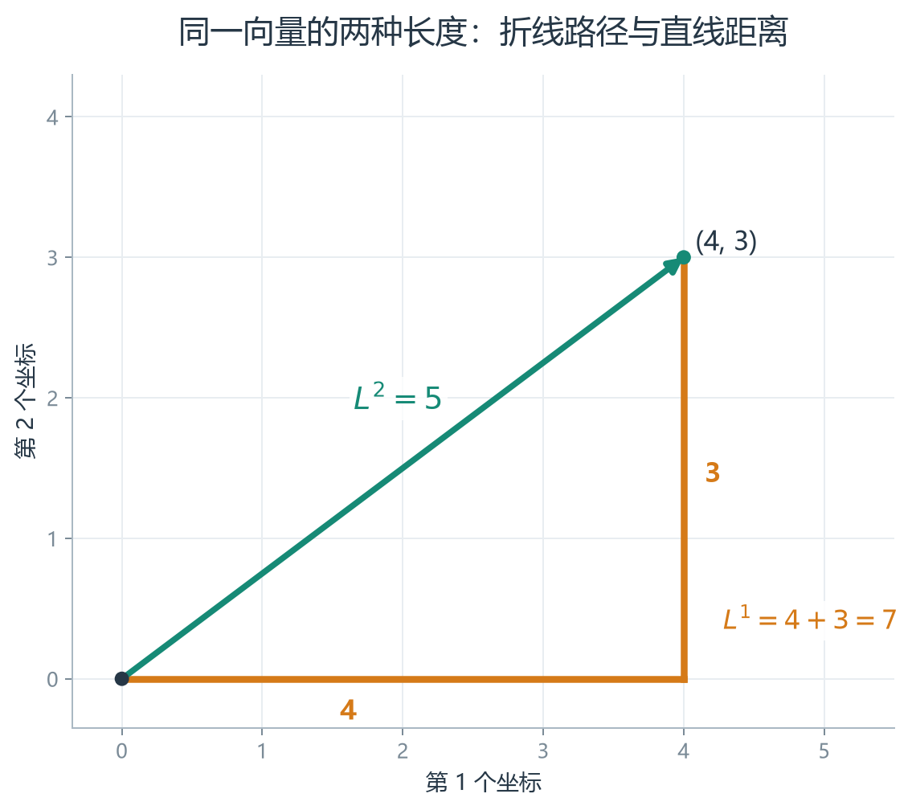
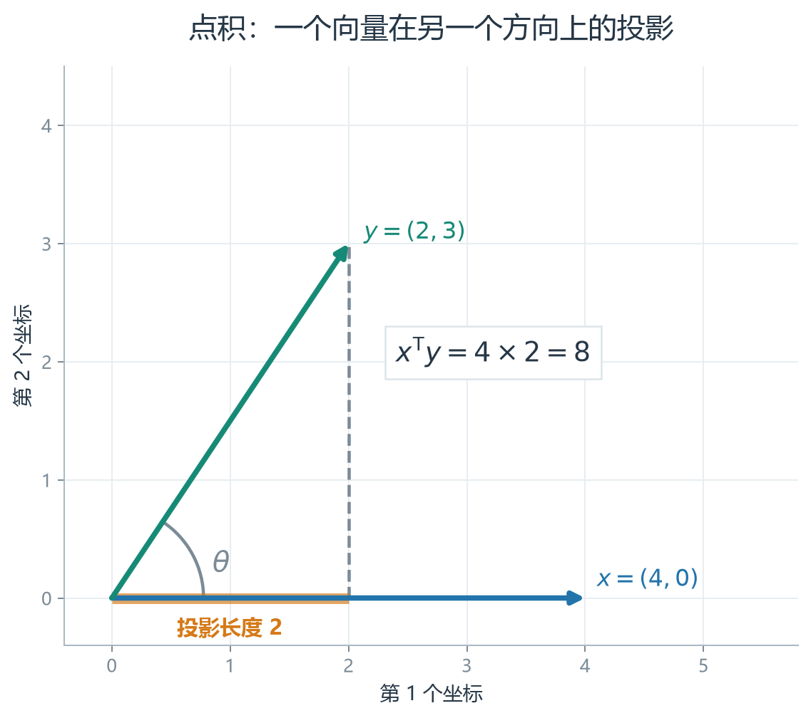
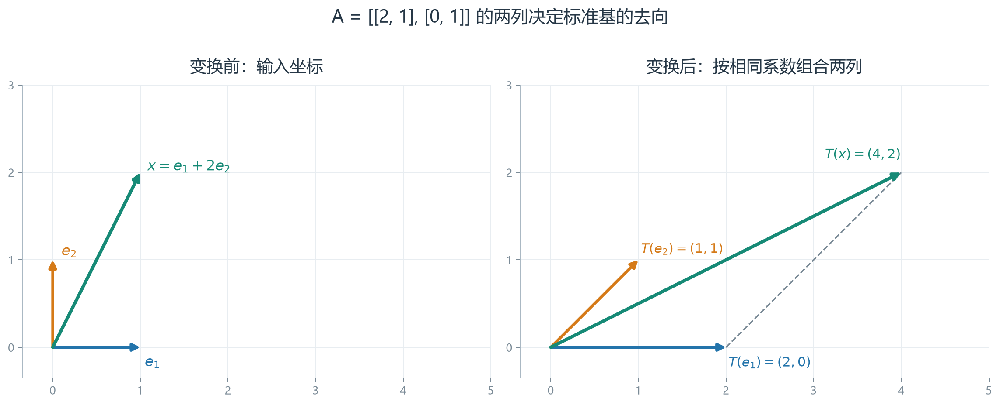
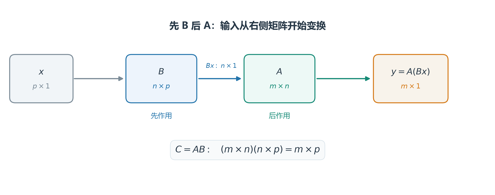

# [AI入门-线性代数]2.向量、矩阵与线性变换

在机器学习与几何学中：
- **向量**负责将属于同一对象的多个属性或空间坐标打包成一个有序整体；
- **矩阵**则充当“转换器”，将一个向量加工、变换成另一个向量。

搞懂向量与矩阵的运算逻辑，是看透机器学习线性预测、神经网络层前向传播，以及理解“空间变换为什么等价于矩阵乘法”的基础。

本文按线性代数的核心逻辑展开：从向量的度量与投影讲起，再到矩阵乘法的本质、线性变换的几何图像、可逆性判据，最后落脚到深度学习中的神经网络层计算。

---

## 1 向量：表示数据、位移和方向

### 1.1 一个向量中的数属于同一个对象

现实中的对象通常具有多个维度。例如记录一件商品，包含单价、重量、体积三个指标，将它们按序写成一个列向量 $x = (x_1, x_2, x_3)^{\mathsf T}$，就牢固地绑定了这三个属性的归属关系与顺序。

在几何中同样如此：$x = (4, 3)^{\mathsf T}$ 既可以代表平面直角坐标系中的一个**静态点** $(4, 3)$，也可以表示从原点出发“向右 4 单位、向上 3 单位”的**动态位移（箭头）**。具体如何解释取决于应用场景，其底层的代数运算法则完全一致。

在数学表示上，我们将包含 $n$ 个分量的实数向量统一记作列向量：

$$
x = \begin{bmatrix} x_1 \\ x_2 \\ \vdots \\ x_n \end{bmatrix} \in \mathbb R^n
$$

其中 $n$ 称为向量的**维度**。当两个向量进行计算时，分量对应的属性顺序必须严格一致。全 0 的向量称为**零向量**，它的长度为 0，没有具体的指向。

---

### 1.2 范数衡量长度，相减给出两点之间的位移

面对一个向量，最基础的两个度量问题是：“这个向量有多长？”以及“两个向量相距多远？”

**范数（Norm）**就是度量向量“大小/长度”的标尺，常用的有两种：

$$
\lVert x\rVert_1 = \sum_{i=1}^{n}|x_i|, \qquad \lVert x\rVert_2 = \sqrt{\sum_{i=1}^{n}x_i^2}
$$

- **$L^1$ 范数（曼哈顿距离）**：各坐标分量绝对值的直接累加。以 $x = (4, 3)^{\mathsf T}$ 为例，必须沿着网格坐标轴走 4 步再走 3 步，总路径为 $4 + 3 = 7$。
- **$L^2$ 范数（欧氏距离）**：两点之间的直线欧几里得距离。由勾股定理算出 $\sqrt{4^2 + 3^2} = 5$。

同维度的向量支持**加减法**与**数乘**（对应元素逐项计算）：
- **向量加法 $x + y$**：物理上相当于位移的接续首尾相连；
- **向量减法 $x - y$**：几何上表示**从点 $y$ 指向点 $x$** 的位移向量；
- **数乘 $\lambda x$**：仅对向量长度进行缩放；若 $\lambda < 0$ 则反向。

两点之间的距离，即先求差向量再计算范数：

$$
d_1(x, y) = \lVert x - y\rVert_1, \qquad d_2(x, y) = \lVert x - y\rVert_2
$$

例如 $x = (4, 3)^{\mathsf T}$ 与 $y = (1, 1)^{\mathsf T}$ 相减得到差向量 $(3, 2)^{\mathsf T}$，则 $L^1$ 距离为 $3 + 2 = 5$，欧式距离为 $\sqrt{3^2 + 2^2} = \sqrt{13}$。  
在实际做聚类（如 KNN）或计算损失时，**特征量纲至关重要**：若某一维度以“毫米”为单位，其数值会比以“米”为单位大数千倍，直接求距离会导致该特征主导整个距离计算，因此实操前务必进行特征归一化。

---

## 2 点积、夹角与投影

### 2.1 点积把一组对应分量合成一个数

范数只描述单个向量的绝对大小，而**点积（内积）**则用来衡量两个向量之间的综合关联度。

对于向量 $x, y \in \mathbb R^n$，点积定义为对应元素相乘后求和，结果为一个标量：

$$
x^{\mathsf T}y = x \cdot y = \sum_{i=1}^{n}x_i y_i \in \mathbb R
$$

其中 $x^{\mathsf T}$ 代表将 $n \times 1$ 的列向量转置为 $1 \times n$ 的行向量。若 $x = (2, 1)^{\mathsf T}, y = (3, 4)^{\mathsf T}$，则 $x^{\mathsf T}y = 2 \times 3 + 1 \times 4 = 10$。当 $x$ 是特征向量、$y$ 是对应权重时，点积就是我们最熟悉的**加权得分**。

对于一般的矩阵 $A \in \mathbb R^{m \times n}$，转置 $A^{\mathsf T} \in \mathbb R^{n \times m}$ 遵循行变列、列变行的规则（$(A^{\mathsf T})_{ij} = A_{ji}$），仅改变排列形状，内部数值保持不变。

---

### 2.2 点积怎样反映夹角和投影

点积在几何上蕴含了向量的方向关系，其代数结果等价于：

$$
x^{\mathsf T}y = \lVert x\rVert_2 \lVert y\rVert_2 \cos\theta
$$

其中 $\theta$ 是两向量之间的夹角。

直观来看，$\lVert y\rVert_2 \cos\theta$ 就是**向量 $y$ 在向量 $x$ 方向上的投影长度（带正负号）**；点积本质上就是“$x$ 的长度 $\times$ $y$ 落在 $x$ 上的投影长度”。

由 $\cos\theta$ 的符号即可判断两者的朝向关系：
- **点积 $> 0$**：$\theta < 90^\circ$，两者朝向大致同向；
- **点积 $= 0$**：$\theta = 90^\circ$，两者互相垂直，代数上称两向量**正交**；
- **点积 $< 0$**：$\theta > 90^\circ$，两者朝向背离。

为了彻底排除向量自身长度的影响、单纯衡量两者的“方向一致性”，我们将点积除以各自的模长，得到**余弦相似度（Cosine Similarity）**：

$$
\cos\theta = \frac{x^{\mathsf T}y}{\lVert x\rVert_2 \lVert y\rVert_2}
$$

余弦相似度在 $[-1, 1]$ 之间变动：同向为 1，正交为 0，反向为 $-1$。若向量在输入前已经做过单位化（模长化为 1），此时**点积就等于余弦相似度**，这也是推荐系统和图像向量检索中最高频的计算模式。

---

## 3 矩阵与向量相乘：一次得到多个线性组合

### 3.1 按行看，每个输出分量是一次点积

当我们需要对同一个输入向量 $x \in \mathbb R^n$ 同时计算 $m$ 个不同的加权汇总时，把 $m$ 组权重横排为矩阵的每一行，就得到了矩阵乘法：

$$
y = Ax \in \mathbb R^m, \qquad y_i = \sum_{j=1}^{n}A_{ij}x_j
$$

这里要求**矩阵 $A$ 的列数必须与输入 $x$ 的行数严格相等**，否则无法完成逐行点积。

- **行视角（Row Picture）**：输出向量的第 $i$ 个数字 $y_i$，等于**矩阵 $A$ 的第 $i$ 行与向量 $x$ 的内积**。

例如：

$$
A = \begin{bmatrix} 2 & 1 \\ 1 & -1 \\ 0 & 3 \end{bmatrix} \in \mathbb R^{3 \times 2}, \qquad x = \begin{bmatrix} 2 \\ 1 \end{bmatrix} \in \mathbb R^2
$$

按行计算：
- 第一行内积：$2 \times 2 + 1 \times 1 = 5$；
- 第二行内积：$1 \times 2 + (-1) \times 1 = 1$；
- 第三行内积：$0 \times 2 + 3 \times 1 = 3$。

最终输出为三维向量 $y = (5, 1, 3)^{\mathsf T}$。两维输入经过矩阵映射到了三维空间。

---

### 3.2 按列看，输入分量决定怎样组合输出方向

除了按行做点积，矩阵相乘还有一个在几何上更深刻的理解方式——**列视角（Column Picture）**。

将矩阵 $A$ 拆成两列向量 $a_1 = (2, 1, 0)^{\mathsf T}$ 和 $a_2 = (1, -1, 3)^{\mathsf T}$，则乘法可以改写为：

$$
Ax = x_1 a_1 + x_2 a_2 = 2 \begin{bmatrix} 2 \\ 1 \\ 0 \end{bmatrix} + 1 \begin{bmatrix} 1 \\ -1 \\ 3 \end{bmatrix} = \begin{bmatrix} 5 \\ 1 \\ 3 \end{bmatrix}
$$

- **列视角核心**：**$Ax$ 本质上就是矩阵各个列向量的线性组合，输入分量 $x_i$ 就是组合的配比权重。**
- 这清晰地解释了一个几何事实：即使输出位于三维空间，但由于输入只有两个自由系数，所能组合出的所有可能输出，永远只能局限在 $a_1$ 与 $a_2$ 张成的二维平面内，不可能填满整个三维空间。

---

## 4 线性变换与标准基

### 4.1 矩阵给空间中的每个输入规定一个输出

给定矩阵 $A \in \mathbb R^{m \times n}$，运算 $T(x) = Ax$ 实际上定义了一种空间映射。输入空间中的每一个向量（箭头），都在变换后被送往输出空间中的新位置。

这种映射之所以被称为**线性变换**，是因为它严格遵守两条核心约束：
1. **加法保持**：$T(u + v) = T(u) + T(v)$（先相加再变换 = 先变换再相加）；
2. **数乘保持**：$T(\lambda u) = \lambda T(u)$（缩放倍数可随意移出变换）。

由性质可知，$T(0) = 0$，即**线性变换必须将原点固定映射到原点**，不能产生平移。如果附加了平移偏置 $b \neq 0$，写成 $T(x) = Ax + b$，这种运算则被称为**仿射变换（Affine Transformation）**。

---

### 4.2 矩阵的列就是标准基向量的去向

在二维空间中，任何向量 $x = (x_1, x_2)^{\mathsf T}$ 都可以用标准基向量 $e_1 = (1, 0)^{\mathsf T}$ 和 $e_2 = (0, 1)^{\mathsf T}$ 组合而成：$x = x_1 e_1 + x_2 e_2$。

根据线性变换的性质展开：

$$
T(x) = x_1 T(e_1) + x_2 T(e_2)
$$

这个公式给出了一个极其强大的洞察：**要想知道一个线性变换把空间变成了什么样，完全不需要追踪空间里的所有向量，只需要看标准基向量落在哪里即可！**

而 $T(e_1), T(e_2)$ 正好就是矩阵的第 1 列和第 2 列：

$$
A = \begin{bmatrix} T(e_1) & T(e_2) & \cdots & T(e_n) \end{bmatrix}
$$

例如矩阵：

$$
A = \begin{bmatrix} 2 & 1 \\ 0 & 1 \end{bmatrix}
$$

它把 $e_1$ 变换到了 $(2, 0)^{\mathsf T}$，把 $e_2$ 变换到了 $(1, 1)^{\mathsf T}$。那么对于任意向量如 $x = (1, 2)^{\mathsf T} = e_1 + 2e_2$，变换后的结果直接就是 $1 \times (2, 0)^{\mathsf T} + 2 \times (1, 1)^{\mathsf T} = (4, 2)^{\mathsf T}$。

如果变换将不同的输入压缩成了相同的输出，即 $A(x_1 - x_2) = 0$ 且 $x_1 - x_2 \neq 0$，说明空间发生了降维塌缩，非零向量被压到了原点。所有满足 $Ah = 0$ 的非零向量 $h$ 构成了矩阵的**零空间（Null Space）**。零空间一旦存在，信息就会丢失，原始输入便无法完全复原。

---

## 5 矩阵乘法与变换复合

### 5.1 先做哪个变换，由靠近输入的矩阵决定

如果一个向量 $x$ 先经过矩阵 $B$ 变换，再经过矩阵 $A$ 变换，其运算链条为 $A(Bx)$。为了用一个综合矩阵一步搞定这两步操作，我们定义矩阵乘法为复合映射：

$$
Cx = (AB)x = A(Bx)
$$

**变换执行顺序**：**从右向左**。在表达式 $ABx$ 中，离 $x$ 最近的矩阵 $B$ 先发生作用，然后才是外层的 $A$。

在几何中，**变换的先后顺序是不能随意颠倒的**。例如“先沿 X 轴拉伸 2 倍再逆时针旋转 90 度”，与“先逆时针旋转 90 度再沿 X 轴拉伸 2 倍”，得到的终点完全不同。因此在代数上：
**矩阵乘法一般不满足交换律，即 $AB \neq BA$**。

---

### 5.2 行乘列的公式来自逐列执行复合变换

矩阵乘法“第 $i$ 行乘第 $j$ 列”的经典计算口诀，其逻辑根源在于：复合矩阵 $AB$ 的第 $j$ 列，就是输入基向量 $e_j$ 依次通过 $B$ 和 $A$ 变换后的落点位置。

其通用标量计算公式为：

$$
(AB)_{ij} = \sum_{k=1}^{n} A_{ik}B_{kj}
$$

即输出结果的第 $i$ 行第 $j$ 列，等于 **$A$ 的第 $i$ 行与 $B$ 的第 $j$ 列的点积**。这也要求前者的列数必须等于后者的行数：

$$
(m \times n) \times (n \times p) \longrightarrow (m \times p)
$$

例如：

$$
A = \begin{bmatrix} 1 & 1 \\ 0 & 1 \end{bmatrix}, \qquad B = \begin{bmatrix} 2 & 0 \\ 0 & 1 \end{bmatrix}
$$

计算复合矩阵：

$$
AB = \begin{bmatrix} 2 & 1 \\ 0 & 1 \end{bmatrix}
$$

若测试向量 $x = (1, 1)^{\mathsf T}$：先经过 $B$ 变为 $(2, 1)^{\mathsf T}$，再经过 $A$ 变为 $(3, 1)^{\mathsf T}$，完全符合 $ABx$ 的一步计算结果。若反向相乘得到 $BA = \begin{bmatrix} 2 & 2 \\ 0 & 1 \end{bmatrix}$，作用于同一向量得到 $(4, 1)^{\mathsf T}$，直观印证了 $AB \neq BA$。

矩阵乘法虽然不满足交换律，但满足**结合律**：$(AB)C = A(BC)$。连续多次变换时，可以根据计算效率优先合并某一部分，而不改变最终变换效果。同时需要注意：矩阵乘法绝不能与编程语言中的“逐元素相乘（Hadamard 积）”混淆。

---

## 6 单位矩阵、逆矩阵与可恢复性

### 6.1 单位矩阵表示保持原样

在代数中，数字 1 乘以任何数都保持不变。在线性代数中，充当这个角色的矩阵就是**单位矩阵（Identity Matrix）** $I$。

$n$ 阶单位矩阵 $I_n$ 对角线全为 1，其余全为 0：它把每个基向量都留在原位，因此对任意向量 $x$ 都有 $I_n x = x$。对于符合乘法维度的任意矩阵 $A \in \mathbb R^{m \times n}$，始终满足：

$$
I_m A = A = A I_n
$$

---

### 6.2 逆变换把输出恢复为原输入

如果我们已知变换后的输出 $y$，想要退回原点求输入 $x$，就需要寻找该变换的“撤销操作”——**逆矩阵（Inverse Matrix）**。

对于方阵 $A \in \mathbb R^{n \times n}$，若存在一个矩阵 $A^{-1}$ 使得：

$$
A^{-1}A = AA^{-1} = I_n
$$

则称 $A$ 是**可逆矩阵**。已知 $y = Ax$，两边左乘逆矩阵即可瞬间还原输入：$A^{-1}y = A^{-1}Ax = x$。

**可逆的几何本质**：
变换过程中**没有任何信息被压缩丢失**（空间没有降维，零空间内只有零向量自身，矩阵满秩 $\operatorname{rank}(A) = n$）。如果矩阵把平面压成了一条线，那么线上的每一个点原本都对应原平面上无数个点，此时信息已被破坏，无法定义单向还原的逆变换。

对于二阶方阵：

$$
M = \begin{bmatrix} a & b \\ c & d \end{bmatrix}
$$

当行列式 $ad - bc \neq 0$ 时，其逆矩阵有现成的解析式：

$$
M^{-1} = \frac{1}{ad - bc} \begin{bmatrix} d & -b \\ -c & a \end{bmatrix}
$$

以矩阵 $A = \begin{bmatrix} 2 & 1 \\ 0 & 1 \end{bmatrix}$ 为例，由于 $ad - bc = 2 \times 1 - 1 \times 0 = 2 \neq 0$，其逆矩阵为：

$$
A^{-1} = \begin{bmatrix} \frac{1}{2} & -\frac{1}{2} \\ 0 & 1 \end{bmatrix}
$$

验证：若原向量 $(1, 2)^{\mathsf T}$ 经 $A$ 变换为 $(4, 2)^{\mathsf T}$，代入 $A^{-1}(4, 2)^{\mathsf T} = (\frac{1}{2} \times 4 - \frac{1}{2} \times 2, 0 \times 4 + 1 \times 2)^{\mathsf T} = (1, 2)^{\mathsf T}$，完美还原。

> **工程注意**：在实际求解 $Ax = y$ 时，**千万不要在代码中显式求出整个 $A^{-1}$ 再做乘法**！直接对增广矩阵进行高斯消元（如 LU 分解）速度更快、占用内存更低，且能有效规避严重的浮点数舍入误差。

---

## 7 仿射计算、批量样本与神经网络层

### 7.1 从一个点积到一个分类分数

在机器学习中，处理单条拥有 $n$ 个特征的样本 $x \in \mathbb R^n$ 时，为每个特征分配一个权重参数 $w \in \mathbb R^n$，再加一个标量偏置 $b$，就得到了单神经元的输出得分：

$$
z = w^{\mathsf T}x + b
$$

- $w^{\mathsf T}x$ 负责对各项输入打分加权；
- 偏置 $b$ 负责将整体输出上下平移，打破必须经过原点的局限；
- $w^{\mathsf T}x + b = 0$ 构成了空间中的超平面决策边界。当预测分数 $z > 0$ 时判定为正类，反之为负类。

例如布尔逻辑中的 AND 门，两个输入特征 $x_1, x_2 \in \{0, 1\}$，设置权重 $w = (1, 1)^{\mathsf T}$、偏置 $b = -1.5$，即可完美实现逻辑分类（仅有 $(1, 1)$ 输出正值 0.5，其余均为负值）。然而，单条直线无法解决异或（XOR）分类，这也是单层线性分类器必须向多层网络演进的根本原因。经典感知机模型在 [scikit-learn 文档](https://scikit-learn.org/stable/modules/generated/sklearn.linear_model.Perceptron.html) 中依然作为基础线性分类器存在。

---

### 7.2 一批样本共享权重，多个输出共享一次矩阵运算

单条样本的串行计算效率极低，现代深度学习都采用**批量处理（Batching）**。

将 $N$ 个样本水平堆叠，每行放一条样本的特征向量，拼成特征数据矩阵 $X \in \mathbb R^{N \times n}$：

$$
X = \begin{bmatrix} (x^{(1)})^{\mathsf T} \\ \vdots \\ (x^{(N)})^{\mathsf T} \end{bmatrix} \in \mathbb R^{N \times n}
$$

若网络层需要输出 $q$ 个神经元特征，我们将 $q$ 个输出单元对应的权重行向量组合成权重矩阵 $W \in \mathbb R^{q \times n}$，偏置向量为 $\beta \in \mathbb R^q$。

对比单样本与批量的张量计算形态：

- **单样本输入**：
  $$
  z_{\mathrm{single}} = Wx + \beta \in \mathbb R^q
  $$
- **批量输入**：
  $$
  Z = XW^{\mathsf T} + \mathbf 1_N \beta^{\mathsf T} \in \mathbb R^{N \times q}
  $$

其中 $\mathbf 1_N \beta^{\mathsf T}$ 代表利用广播机制将偏置向量复制加到每一行。

维度核验非常清晰：
$$(N \times n) \times (n \times q) \longrightarrow (N \times q)$$

输出矩阵 $Z$ 的第 $i$ 行，完完全全就是第 $i$ 条样本对应的 $q$ 个输出得分。矩阵乘法在底层并行完成了所有样本的特征加权，样本与样本之间互不干扰。在工程框架如 PyTorch 中，[torch.nn.functional.linear 文档](https://docs.pytorch.org/docs/stable/generated/torch.nn.functional.linear.html) 的计算公式正是 $y = xA^{\mathsf T} + b$。

---

### 7.3 非线性激活让层的组合超出单个仿射变换

纯粹的仿射运算 $Z = XW^{\mathsf T} + b$ 只是线性组合。为了赋予网络拟合任意复杂函数的能力，必须在每个神经元输出后引入非线性的**激活函数** $\phi$：

$$
H = \phi(Z) \in \mathbb R^{N \times q}
$$

例如 ReLU 激活函数将负数截断为 0，保留正数原值。这一步不改变数据的行数与列数，但打破了线性约束。

**为什么必须加非线性激活？**  
试想如果去掉激活函数，将两个仿射层直接连写：

$$
W_2(W_1 x + \beta_1) + \beta_2 = (W_2 W_1)x + (W_2 \beta_1 + \beta_2)
$$

令 $W_{\mathrm{new}} = W_2 W_1$，$\beta_{\mathrm{new}} = W_2 \beta_1 + \beta_2$，整个多层网络在数学上瞬间退化成了等价的单层仿射变换！**无论堆叠多少层没有非线性激活的网络，其表达能力永远受限于单层线性变换。**

因此，通过在层与层之间加入非线性激活（如 [PyTorch 中的 ReLU 激活函数](https://docs.pytorch.org/docs/stable/generated/torch.nn.ReLU.html)），神经网络才能打破单层仿射变换的几何边界，从而具备拟合任意高维复杂曲面的能力。这种“仿射计算 $\rightarrow$ 非线性激活 $\rightarrow$ 传递给下一层”的流水线，正是现代深度学习前向传播的标准范式。