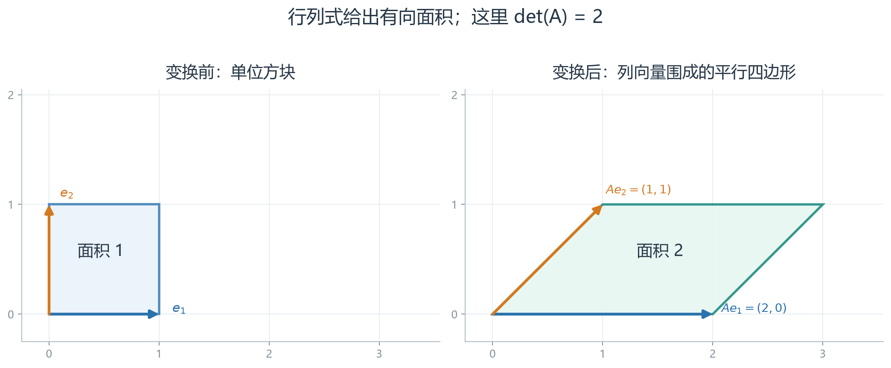
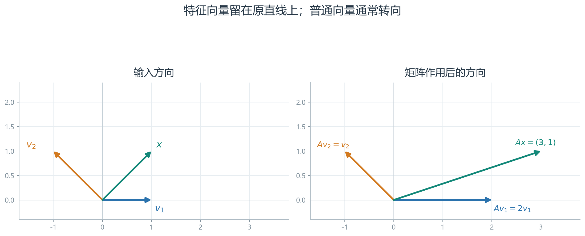
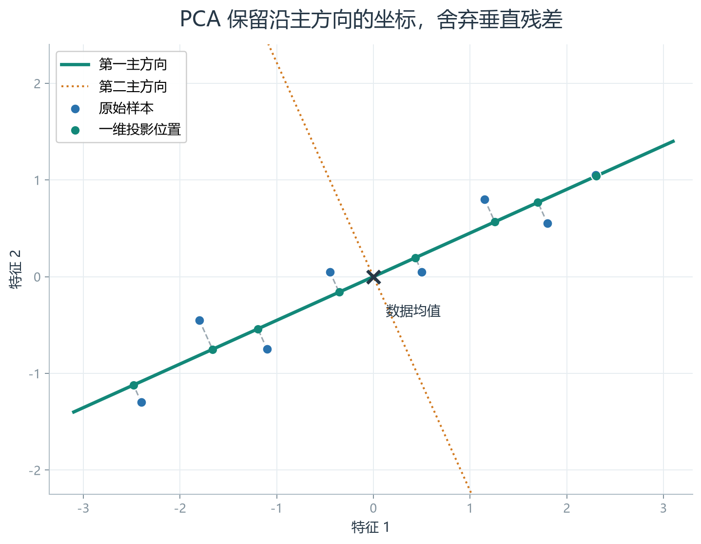
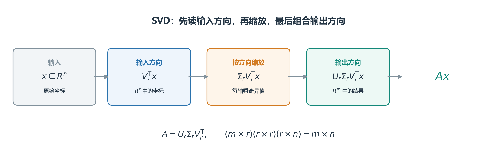

# [AI入门-线性代数]3.行列式、特征分解与奇异值分解

矩阵本质上就是空间的“变形器”。面对一个变换，我们最关心的有三件事：
1. **空间被压缩了吗？体积放大了多少？**（行列式）
2. **有没有哪些特殊方向在变换中不歪不倒，只被拉伸？**（特征值与特征向量）
3. **如果变换不是方阵（跨越不同维度），还能拆解出核心骨架吗？**（奇异值分解 SVD）

搞懂这三者，你就能彻底理解主成分分析（PCA）是如何降维压缩数据的，以及离散动力系统与马尔可夫链为什么能预测长期稳态。

---

## 1 像、秩与奇异性：变换保留多少方向

评价一个变换好不好，关键看它**是否丢掉了维数**。

对于矩阵 $A \in \mathbb R^{m \times n}$，所有可能的输出构成了它的**像空间（Image）**，也叫**列空间（Column Space）**：

$$
\operatorname{Im}(A) = \{Ax : x \in \mathbb R^n\} = \operatorname{span}\{a_1, \ldots, a_n\}
$$

因为输出就是矩阵各列的线性组合：$Ax = x_1a_1 + \cdots + x_na_n$。**矩阵的秩（Rank），就是像空间里真正独立的方向数**：$\operatorname{rank}(A) = \dim\operatorname{Im}(A)$。

看一个典型的空间压扁案例：

$$
A = \begin{bmatrix}1 & 1 \\ 0 & 0\end{bmatrix}, \qquad Ax = \begin{bmatrix}x_1 + x_2 \\ 0\end{bmatrix}
$$

无论输入的 $x$ 在二维平面上怎么跑，输出的纵坐标恒为 0，只能在横轴这一条线上滑移。整个平面被硬生生压成了一条线，秩只有 1。

此时，任何满足 $x_1 + x_2 = 0$ 的非零输入（例如 $h = [1, -1]^\mathsf T$）都会被矩阵彻底抹杀为零向量（$Ah = 0$）。只要有非零方向被压成零，原输入就永远无法通过输出还原（因为 $A(x+h) = Ax$）。这种“不可逆、丢维度”的方阵，就叫做**奇异矩阵**。

---

## 2 行列式：面积、体积与可逆性的数值

### 2.1 二阶行列式计算有向面积

如果二维平面上的一个单位小方格，经过矩阵变换后被拉扯成一个平行四边形，它的面积变成了几倍？

**行列式（Determinant）衡量的正是这种体积/面积的缩放比例**，正负号则记录了空间是否发生了镜像翻转。

对于二阶矩阵 $A = \begin{bmatrix}a & b \\ c & d\end{bmatrix}$，它的两列就是变换后两个基向量的新位置。它们张成的平行四边形面积公式正是 $ad - bc$：

$$
\det(A) = ad - bc
$$

- **绝对值 $|\det(A)|$**：面积缩放倍数。
- **正负号**：正号表示手性不变，负号表示空间发生了镜像翻转。
- **$\det(A) = 0$**：意味着平行四边形被压成了一条线甚至一个点，面积彻底为 0。此时空间降维、信息丢失，矩阵**不可逆**（逆矩阵公式的分母为 $\det(A)$，分母为 0 无法计算）。

这一结论可直接推广到高维：$n$ 阶方阵的 $|\det(A)|$ 就是 $n$ 维超体积的缩放倍数。

---

### 2.2 复合变换与行变换怎样改变行列式

多个变换依次执行时，体积缩放具有乘法性：

$$
\det(AB) = \det(A)\det(B)
$$

由于单位矩阵保持空间不变（$\det(I_n) = 1$），可直接推出逆矩阵的体积缩放是倒数关系：

$$
\det(A^{-1}) = \frac{1}{\det(A)}
$$

这也再次证明：**矩阵可逆 $\iff \det(A) \neq 0$**。

消元法中的三种初等行变换对行列式的影响极其直观：
- **交换两行**：相当于镜像翻转一次，**行列式变号**；
- **某行乘常数 $\lambda$**：相当于沿该轴拉伸 $\lambda$ 倍，**行列式乘以 $\lambda$**；
- **某行加上另一行的倍数（剪切变形）**：就像把一摞扑克牌推斜，底面积与高都没变，**行列式保持不变**！

因此，通过初等行变换将矩阵化为上三角矩阵后，行列式就是对角线元素的简单连乘。在数值编程中，超大或超小矩阵直接求行列式容易造成浮点溢出，通常使用 [NumPy 的 slogdet](https://numpy.org/doc/stable/reference/generated/numpy.linalg.slogdet.html) 分别获取符号与对数值。

---

## 3 张成、线性无关、基与维数

这些概念是搭建一切线性空间的四块基石：

- **张成（Span）**：一组向量通过任意伸缩、相加组合，能够抵达的全部势力范围。
- **线性无关（Linearly Independent）**：向量组里没有任何“吃闲饭的冗余”。即不存在任何非零组合能抵消回原点；没有任何一个向量可以被其他人代替。
- **基（Basis）**：能够撑起整个空间的**极简骨架**——既能张成整个空间，自身又没有任何多余冗余（线性无关）。
- **维数（Dimension）**：基里面包含的向量个数，即这个空间真正自由维度的数量。矩阵的秩就是列空间的维数。

---

## 4 特征值与特征向量：不偏离原直线的方向

当一个矩阵作用在向量上时，绝大多数向量都会既被拉伸又被旋转偏离原方向。

但总有一些极特殊的“硬骨头”向量：**变换后它们依然待在原来的直线上，方向不拐弯，纯粹只发生长度缩放**。

$$
Av = \lambda v \qquad (v \neq 0)
$$

- **特征向量 $v$**：保持共线不变的特殊轴向（必须非零）。
- **特征值 $\lambda$**：在该特殊轴向上的缩放倍率。
  - $\lambda > 1$：纯拉伸放大；
  - $0 < \lambda < 1$：压缩缩小；
  - $\lambda < 0$：反向拉伸；
  - $\lambda = 0$：该轴向直接被拍成 0，矩阵必定奇异。

满足 $(A - \lambda I)v = 0$ 的所有向量（包含零向量）张成的空间，称为该特征值对应的**特征空间**。

---

## 5 特征方程与特征空间的求法

求解特征值与特征向量的逻辑极其严密：

1. **求特征值**：将等式移项得 $(A - \lambda I)v = 0$。因为要求非零解 $v \neq 0$，意味着矩阵 $(A - \lambda I)$ 必须丢失维度、必须奇异，即**行列式必为 0**：
   $$
   \det(A - \lambda I) = 0
   $$
   解这个关于 $\lambda$ 的多项式方程，就能敲定特征值。
2. **求特征向量**：将每个求出的 $\lambda$ 重新代入 $(A - \lambda I)v = 0$，解齐次方程求出其零空间的基，即为该特征值对应的特征向量。

对于机器学习中极其常见的**实对称矩阵**（如协方差矩阵），其特征值必定全部为实数，特征向量必定可以两两正交，NumPy 提供了专门优化的接口 [linalg.eigh](https://numpy.org/doc/stable/reference/generated/numpy.linalg.eigh.html)。

---

## 6 特征基、重数与对角化

### 6.1 一组完整的特征方向让重复变换变简单

如果一个 $n \times n$ 矩阵能找到 $n$ 个线性无关的特征向量，把它们拼成矩阵 $P = [v_1, \ldots, v_n]$，并将特征值排成对角阵 $D = \operatorname{diag}(\lambda_1, \ldots, \lambda_n)$，就可以完成**矩阵对角化**：

$$
A = PDP^{-1}
$$

对角化的几何直觉极其美妙：
1. $P^{-1}x$：把普通坐标系切换到“特征向量基底”下；
2. $D$：在这些特征轴上，各个方向互不干扰地独立缩放 $\lambda_i$ 倍；
3. $P$：再把结果换回原始坐标系。

这种解耦在面对矩阵高次幂 $A^t$ 时极为强大：

$$
A^t = (PDP^{-1})(PDP^{-1})\cdots = P D^t P^{-1}
$$

原来繁重的连乘，瞬间简化成对角线数字的标量乘方 $D^t = \operatorname{diag}(\lambda_1^t, \ldots, \lambda_n^t)$！

---

### 6.2 重复特征值未必给出足够多的方向

- **代数重数**：特征方程中根出现的重数。
- **几何重数**：该特征值实际能找出的线性无关特征向量个数（特征空间的维数）。

**能否对角化的铁律**：几何重数永远 $\le$ 代数重数。**只有当每一个特征值的几何重数都拉满（等于代数重数）时，矩阵才能对角化**。如果独立特征向量不够用，矩阵就无法对角化（例如剪切矩阵 $\begin{bmatrix}1&1\\0&1\end{bmatrix}$）。

**实对称矩阵的黄金优待**：
实对称矩阵不仅必定能对角化，而且其特征向量必然可以选为标准正交基：
$$
A = Q\Lambda Q^{\mathsf T} \qquad (Q^{\mathsf T}Q = I)
$$
此时求逆直接简化为转置（$Q^{-1} = Q^{\mathsf T}$），这也是 PCA 能将特征彻底正交解耦的数学底气。

---

## 7 正交投影：在少数方向上保留坐标

如果我们想用一个低维方向 $v$（单位向量，$\lVert v\rVert = 1$）来近似表示高维点 $x$：

- **投影标量坐标**（沿该轴走了多远）：$z = v^{\mathsf T}x$
- **空间中的投影点**：$\hat x = z v = (vv^{\mathsf T})x$
- **丢弃的误差残差**：$e = x - \hat x$

**投影的核心性质**：误差向量 $e$ 与投影方向 $v$ **绝对垂直（正交）**，这保证了 $\hat x$ 是该直线上距离原点 $x$ 最近的点，信息损失最小。

若保留 $k$ 个互相垂直的单位方向 $V = [v_1, \ldots, v_k]$（满足 $V^{\mathsf T}V = I_k$），投影公式为：

$$
z = V^{\mathsf T}x \in \mathbb R^k, \qquad \hat x = V z = VV^{\mathsf T}x \in \mathbb R^n
$$

---

## 8 协方差矩阵：记录数据沿各方向的变化

要想找到保留信息最多的降维方向，必须先量化数据本身的波动与关联。

设有中心化后的数据矩阵 $X_c \in \mathbb R^{N \times n}$（每行一个样本，各列均值已归零），其**样本协方差矩阵**为：

$$
C = \frac{1}{N-1}X_c^{\mathsf T}X_c \in \mathbb R^{n \times n}
$$

展开形式为：

$$
C = \begin{bmatrix}
\operatorname{Var}(x_1) & \operatorname{Cov}(x_1, x_2) \\
\operatorname{Cov}(x_2, x_1) & \operatorname{Var}(x_2)
\end{bmatrix}
$$

- **对角线**：每个特征自身的方差（波动大小）；
- **非对角线**：两两特征之间的协方差（正相关、负相关还是不相关）；
- **半正定性**：对于任意方向 $v$，数据在该方向上的投影方差为 $v^{\mathsf T}Cv \ge 0$。方差不可能是负数，因此协方差矩阵的特征值必定全是非负实数。

---

## 9 PCA：保留最大方差的正交方向

### 9.1 从一个最佳方向推广到多个主成分

**PCA（主成分分析）的核心直觉**：
一个方向上方差越大，说明数据沿着这个方向拉得越开，包含的区分信息就越丰富；垂直于它的残差越小，丢弃它造成的重构误差就越小。

**PCA 的标准流水线**：
1. **去中心化**：计算每列均值 $\mu$，得到 $X_c = X - \mathbf 1 \mu^\mathsf T$（保留 $\mu$ 用于后续还原）。
2. **算协方差**：计算 $C = \frac{1}{N-1}X_c^{\mathsf T}X_c$。
3. **特征分解**：求出 $C$ 的特征值与单位特征向量，并按特征值**从大到小**排列（特征值的大小严格对应着沿该轴的方差大小）！
4. **截断投影**：取前 $k$ 个特征向量组成投影矩阵 $V_k \in \mathbb R^{n \times k}$：
   - 降维编码：$Z = X_c V_k \in \mathbb R^{N \times k}$
   - 近似重构：$\hat X = Z V_k^{\mathsf T} + \mathbf 1 \mu^\mathsf T \in \mathbb R^{N \times n}$

前 $k$ 个主成分的**解释方差比**为：

$$
\frac{\sum_{i=1}^k \lambda_i}{\sum_{j=1}^n \lambda_j}
$$

> **避坑警示**：NumPy 的 `np.linalg.eigh` 默认按特征值**升序**输出！手写 PCA 时一定要手动倒序切片成从大到小，否则会误保留方差最小的废弃方向。

---

### 9.2 最大方差准则的数学边界

PCA 是**无监督**的，它只看数据自身展开的几何散度，完全不理会任务标签。某些极端情况下，两类样本恰好沿着方差极小的微弱方向区分，PCA 降维反而可能会把这一判别特征抹杀。

---

### 9.3 完整实战案例：用手算走通 PCA 降维与重构

为了彻底把 PCA 的每一步在脑海中跑通，我们用一个最精简的三样本、二维特征数据集来手算全流程。

#### 1. 原始数据与中心化
设原始数据矩阵 $X \in \mathbb R^{3 \times 2}$（3 行样本，2 列特征）为：
$$X = \begin{bmatrix} 0 & 0 \\ 1 & 2 \\ 2 & 1 \end{bmatrix}$$
- 计算各特征的列均值：$\mu_1 = \frac{0+1+2}{3} = 1$，$\mu_2 = \frac{0+2+1}{3} = 1$，即均值向量 $\mu = [1, 1]^\mathsf T$。
- 中心化（每行减去 $\mu^\mathsf T$）：
$$X_c = X - \mathbf 1_3 \mu^\mathsf T = \begin{bmatrix} 0-1 & 0-1 \\ 1-1 & 2-1 \\ 2-1 & 1-1 \end{bmatrix} = \begin{bmatrix} -1 & -1 \\ 0 & 1 \\ 1 & 0 \end{bmatrix}$$

#### 2. 计算样本协方差矩阵
样本数 $N = 3$，分母取无偏估计 $N - 1 = 2$：
$$C = \frac{1}{2} X_c^\mathsf T X_c = \frac{1}{2} \begin{bmatrix} -1 & 0 & 1 \\ -1 & 1 & 0 \end{bmatrix} \begin{bmatrix} -1 & -1 \\ 0 & 1 \\ 1 & 0 \end{bmatrix} = \frac{1}{2} \begin{bmatrix} 2 & 1 \\ 1 & 2 \end{bmatrix} = \begin{bmatrix} 1 & 0.5 \\ 0.5 & 1 \end{bmatrix}$$

#### 3. 特征分解与主成分排序
求解特征方程 $\det(C - \lambda I) = 0$：
$$\det\begin{bmatrix} 1-\lambda & 0.5 \\ 0.5 & 1-\lambda \end{bmatrix} = (1-\lambda)^2 - 0.25 = 0 \implies 1-\lambda = \pm 0.5$$
- 特征值按降序排列：$\lambda_1 = 1.5$，$\lambda_2 = 0.5$。
- 求解 $\lambda_1 = 1.5$ 对应的单位特征向量（解 $(C - 1.5I)v_1 = 0$）：
$$\begin{bmatrix} -0.5 & 0.5 \\ 0.5 & -0.5 \end{bmatrix} \begin{bmatrix} v_{11} \\ v_{12} \end{bmatrix} = 0 \implies v_{11} = v_{12} \implies v_1 = \begin{bmatrix} 1/\sqrt{2} \\ 1/\sqrt{2} \end{bmatrix}$$
第一主成分的解释方差比为 $\frac{1.5}{1.5 + 0.5} = 75\%$。我们选择降到 1 维（$k=1$），保留投影方向 $v_1$。

#### 4. 降维编码与数据重构
- **低维编码**（将中心化数据投影到 $v_1$ 上）：
$$Z = X_c v_1 = \begin{bmatrix} -1 & -1 \\ 0 & 1 \\ 1 & 0 \end{bmatrix} \begin{bmatrix} 1/\sqrt{2} \\ 1/\sqrt{2} \end{bmatrix} = \begin{bmatrix} -\sqrt{2} \\ 1/\sqrt{2} \\ 1/\sqrt{2} \end{bmatrix} \in \mathbb R^{3 \times 1}$$
每个样本原本的两个坐标，被压缩成了一个沿主轴的标量坐标。

- **近似重构**（从 1 维恢复回 2 维空间）：
$$\hat{X} = Z v_1^\mathsf T + \mathbf 1_3 \mu^\mathsf T = \begin{bmatrix} -\sqrt{2} \\ 1/\sqrt{2} \\ 1/\sqrt{2} \end{bmatrix} \begin{bmatrix} 1/\sqrt{2} & 1/\sqrt{2} \end{bmatrix} + \begin{bmatrix} 1 & 1 \\ 1 & 1 \\ 1 & 1 \end{bmatrix} = \begin{bmatrix} -1 & -1 \\ 0.5 & 0.5 \\ 0.5 & 0.5 \end{bmatrix} + \begin{bmatrix} 1 & 1 \\ 1 & 1 \\ 1 & 1 \end{bmatrix} = \begin{bmatrix} 0 & 0 \\ 1.5 & 1.5 \\ 1.5 & 1.5 \end{bmatrix}$$
对比原样本：第二条原样本 $(1, 2)$ 重建为 $(1.5, 1.5)$，第三条原样本 $(2, 1)$ 也重建为 $(1.5, 1.5)$。由于丢掉了垂直于主方向的第二特征方向，沿垂直方向的细节差异被抹去，但数据的主要轮廓与均值位置被成功保留。
---

## 10 奇异值分解：为矩形矩阵寻找输入与输出方向

### 10.1 任意矩阵都能分成三个有明确作用的部分

特征分解只对方阵有效，但现实中绝大多数数据（如 $N \times n$ 的样本矩阵）都是长方阵。

**奇异值分解（SVD）是真正通用的万能分解**，适用于任意实数长方矩阵 $A \in \mathbb R^{m \times n}$（设秩为 $r$）：

$$
A = U_r \Sigma_r V_r^{\mathsf T}
$$

- $V_r \in \mathbb R^{n \times r}$：**右奇异向量**（输入空间的标准正交基）；
- $\Sigma_r \in \mathbb R^{r \times r}$：**奇异值对角阵**（对角线全是正数 $\sigma_1 \ge \sigma_2 \ge \cdots > 0$）；
- $U_r \in \mathbb R^{m \times r}$：**左奇异向量**（输出空间的标准正交基）。

变换机制一清二楚：**正交旋转（$V_r^\mathsf T$） $\to$ 沿新坐标轴拉伸（$\Sigma_r$） $\to$ 输出空间正交旋转（$U_r$）**。

---

### 10.2 特征值、低秩近似与 PCA 的连接

SVD 与特征分解在数学上存在直接血缘：

$$
A^{\mathsf T}A = (V\Sigma U^{\mathsf T})(U\Sigma V^{\mathsf T}) = V \Sigma^2 V^{\mathsf T}
$$

- $A^{\mathsf T}A$ 的特征向量，就是 $A$ 的右奇异向量 $V$；
- $A$ 的奇异值平方除以 $N-1$，就是协方差矩阵的特征值：$\lambda_i = \frac{\sigma_i^2}{N-1}$！

这意味着做 PCA 时，**可以直接对中心化数据 $X_c$ 做 SVD 分解，取右奇异向量 $V$ 作为主成分，完全不需要大费周章去显式乘出巨大的协方差矩阵 $X_c^\mathsf T X_c$**！这在样本或维度极高时具有极大的数值稳定性和效率优势（可参阅 [scikit-learn PCA 求解器文档](https://scikit-learn.org/stable/modules/generated/sklearn.decomposition.PCA.html)）。

同时，SVD 展开为外积形式：

$$
A = \sum_{i=1}^r \sigma_i u_i v_i^{\mathsf T}
$$

每一项都是一个秩为 1 的矩阵。只保留前 $k$ 个最大的奇异值，就得到了原矩阵的最佳**低秩近似（图像压缩、降噪的基础）**。在调用 [NumPy 的 svd](https://numpy.org/doc/stable/reference/generated/numpy.linalg.svd.html) 时，设置 `full_matrices=False` 可以返回精简的紧凑形式。

---

### 10.3 完整实战案例：用手算走通 SVD 分解与秩-1 近似

特征分解只能处理方阵，现在我们用一个跨维度的长方矩阵，演示奇异值分解的完整求解和低秩压缩机制。

#### 1. 目标矩阵与对称化
设有一个 $2 \times 3$ 的矩阵（如 2 个用户对 3 部电影的评分）：
$$
A = \begin{bmatrix} 3 & 2 & 2 \\ 2 & 3 & -2 \end{bmatrix} \in \mathbb R^{2 \times 3}
$$
我们希望求出它的紧致 SVD：$A = U_r \Sigma_r V_r^\mathsf T$。

#### 2. 计算左奇异向量 $U$ 与奇异值 $\Sigma$
利用关系式 $A A^\mathsf T = U \Sigma^2 U^\mathsf T$，先求出较小的 $2 \times 2$ 矩阵：
$$
A A^\mathsf T = \begin{bmatrix} 3 & 2 & 2 \\ 2 & 3 & -2 \end{bmatrix} \begin{bmatrix} 3 & 2 \\ 2 & 3 \\ 2 & -2 \end{bmatrix} = \begin{bmatrix} 9+4+4 & 6+6-4 \\ 6+6-4 & 4+9+4 \end{bmatrix} = \begin{bmatrix} 17 & 8 \\ 8 & 17 \end{bmatrix}
$$
- 求特征值：
$$
\det\begin{bmatrix} 17-\lambda & 8 \\ 8 & 17-\lambda \end{bmatrix} = (17-\lambda)^2 - 64 = 0 \implies 17-\lambda = \pm 8
$$
解得 $\lambda_1 = 25$，$\lambda_2 = 9$。
- **奇异值**为特征值的算术平方根：
$$
\sigma_1 = \sqrt{25} = 5, \qquad \sigma_2 = \sqrt{9} = 3
$$
奇异值对角阵为 $\Sigma = \begin{bmatrix} 5 & 0 \\ 0 & 3 \end{bmatrix}$。
- 求特征向量（即左奇异向量 $u_1, u_2$）：
  - 代入 $\lambda_1 = 25$：$\begin{bmatrix} -8 & 8 \\ 8 & -8 \end{bmatrix} u_1 = 0 \implies u_1 = \begin{bmatrix} 1/\sqrt{2} \\ 1/\sqrt{2} \end{bmatrix}$
  - 代入 $\lambda_2 = 9$：$\begin{bmatrix} 8 & 8 \\ 8 & 8 \end{bmatrix} u_2 = 0 \implies u_2 = \begin{bmatrix} 1/\sqrt{2} \\ -1/\sqrt{2} \end{bmatrix}$
得到正交矩阵 $U = \begin{bmatrix} 1/\sqrt{2} & 1/\sqrt{2} \\ 1/\sqrt{2} & -1/\sqrt{2} \end{bmatrix}$。

#### 3. 求解右奇异向量 $V$
由 SVD 基础关系式 $A v_i = \sigma_i u_i \implies v_i = \frac{1}{\sigma_i} A^\mathsf T u_i$：
- 计算 $v_1$（对应 $\sigma_1 = 5$）：
$$
v_1 = \frac{1}{5} \begin{bmatrix} 3 & 2 \\ 2 & 3 \\ 2 & -2 \end{bmatrix} \begin{bmatrix} 1/\sqrt{2} \\ 1/\sqrt{2} \end{bmatrix} = \frac{1}{5\sqrt{2}} \begin{bmatrix} 5 \\ 5 \\ 0 \end{bmatrix} = \begin{bmatrix} 1/\sqrt{2} \\ 1/\sqrt{2} \\ 0 \end{bmatrix}
$$
- 计算 $v_2$（对应 $\sigma_2 = 3$）：
$$
v_2 = \frac{1}{3} \begin{bmatrix} 3 & 2 \\ 2 & 3 \\ 2 & -2 \end{bmatrix} \begin{bmatrix} 1/\sqrt{2} \\ -1/\sqrt{2} \end{bmatrix} = \frac{1}{3\sqrt{2}} \begin{bmatrix} 1 \\ -1 \\ 4 \end{bmatrix} = \begin{bmatrix} 1/(3\sqrt{2}) \\ -1/(3\sqrt{2}) \\ 4/(3\sqrt{2}) \end{bmatrix}
$$

#### 4. 外积展开与低秩近似（矩阵压缩）
将 $A$ 写成外积加权求和形式：$A = \sigma_1 u_1 v_1^\mathsf T + \sigma_2 u_2 v_2^\mathsf T$。
- **第一骨架矩阵（秩-1 核心成分）**：
$$
A_1 = \sigma_1 u_1 v_1^\mathsf T = 5 \begin{bmatrix} 1/\sqrt{2} \\ 1/\sqrt{2} \end{bmatrix} \begin{bmatrix} 1/\sqrt{2} & 1/\sqrt{2} & 0 \end{bmatrix} = 5 \begin{bmatrix} 0.5 & 0.5 & 0 \\ 0.5 & 0.5 & 0 \end{bmatrix} = \begin{bmatrix} 2.5 & 2.5 & 0 \\ 2.5 & 2.5 & 0 \end{bmatrix}
$$
- **第二微调矩阵（秩-1 次要细节）**：
$$
A_2 = \sigma_2 u_2 v_2^\mathsf T = 3 \begin{bmatrix} 1/\sqrt{2} \\ -1/\sqrt{2} \end{bmatrix} \begin{bmatrix} \frac{1}{3\sqrt{2}} & -\frac{1}{3\sqrt{2}} & \frac{4}{3\sqrt{2}} \end{bmatrix} = \begin{bmatrix} 0.5 & -0.5 & 2 \\ -0.5 & 0.5 & -2 \end{bmatrix}
$$
两者相加正好完美还原：$A_1 + A_2 = \begin{bmatrix} 2.5+0.5 & 2.5-0.5 & 0+2 \\ 2.5-0.5 & 2.5+0.5 & 0-2 \end{bmatrix} = \begin{bmatrix} 3 & 2 & 2 \\ 2 & 3 & -2 \end{bmatrix} = A$。

在图像压缩或推荐算法中，如果我们截断丢弃较小的 $\sigma_2$ 这一项，仅保留 $A_1$，矩阵的秩从 2 降为了 1。此时只需存储 5 个数（$u_1$ 的 2 个数、$\sigma_1$ 的 1 个数、$v_1$ 的 2 个有效非零数），就能在极大程度上逼近原本需要 6 个数存储的原矩阵 $A$，这正是**SVD 图像压缩与截断低秩近似**的数学底层。

---

## 11 离散动力系统与稳态

### 11.1 迭代系统与特征值的裁决

当系统按 $x_{t+1} = P x_t$ 反复迭代时，初态在特征基展开下的长期演变由 $\lambda_i^t$ 掌控：
- $|\lambda_i| > 1$：分量无限爆炸发散；
- $|\lambda_i| < 1$：分量指数级衰减至 0；
- $|\lambda_i| = 1$：决定了系统长期留存的稳定基底。

---

### 11.2 马尔可夫链与稳态收敛

马尔可夫链建模的是“未来只取决于当前状态”的离散概率跃迁。

以两状态（状态 1 正常、状态 2 故障）转移矩阵为例：

$$
P = \begin{bmatrix}0.9 & 0.2 \\ 0.1 & 0.8\end{bmatrix}
$$

- **列向量约定**：**第 $j$ 列表示从状态 $j$ 出发转移到各状态的概率，每列和严格为 1**。
- 第一列：今天正常时，明天仍正常的概率 0.9，故障的概率 0.1；
- 第二列：今天故障时，明天康复的概率 0.2，仍故障的概率 0.8。

**求解稳态分布 $\pi$**：
所谓稳态，就是系统历经迭代后概率分布不再改变：$P\pi = \pi$。
这在数学上等价于：**稳态向量 $\pi$ 是特征值 $\lambda = 1$ 对应的特征向量，且分量非负、总和归一为 1**！

对上述方程求解：
$$
\begin{cases}
0.9\pi_1 + 0.2\pi_2 = \pi_1 \implies 0.1\pi_1 = 0.2\pi_2 \\
\pi_1 + \pi_2 = 1
\end{cases}
\implies
\pi = \begin{bmatrix}2/3 \\ 1/3\end{bmatrix}
$$

这意味着无论初态如何，长期来看系统将恒定维持在 2/3 正常、1/3 故障的稳定比例。
该矩阵的第二特征值 $\lambda_2 = 0.7 < 1$，控制了系统从扰动**收敛回稳态的速度**（每步误差缩小为原来的 0.7 倍）。

**稳态必收敛的充要前提**：
单纯存在 $\lambda=1$ 并不保证任意初态都能收敛（例如振荡置换矩阵 $\begin{bmatrix}0&1\\1&0\end{bmatrix}$ 会无限死循环交替）。只有当马尔可夫链满足**不可约**（任意状态皆可互达）且**非周期**（不陷入固定步数震荡）时，系统才保证从任意初态必然收敛于唯一的终极稳态。