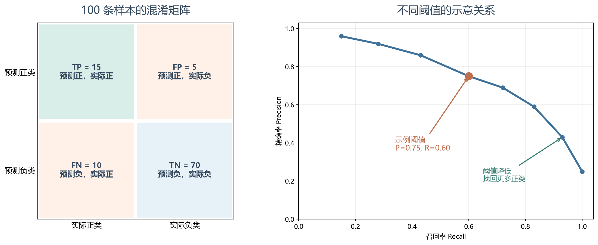
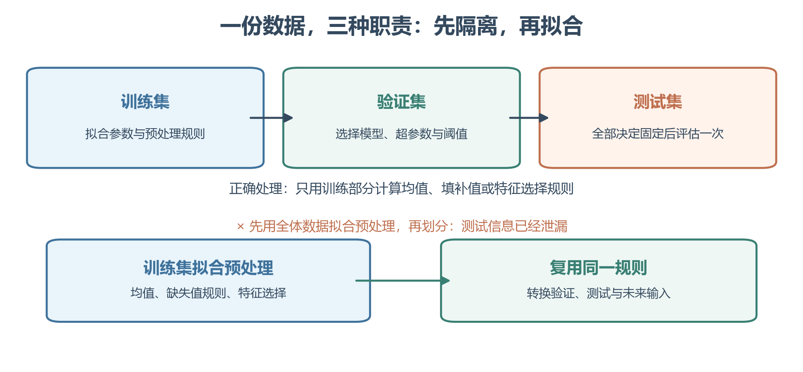
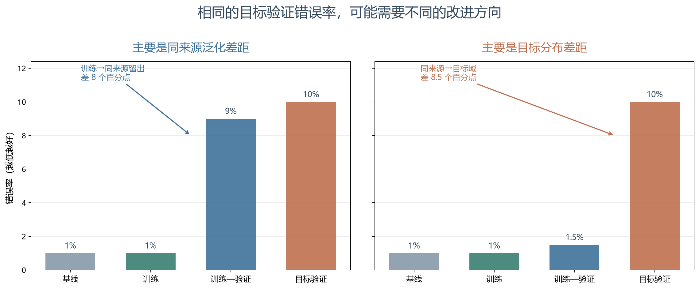
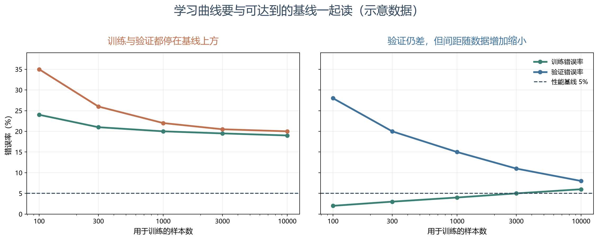

# [AI基础-机器学习]1.数据划分、模型评估与项目诊断

拿到一批数据后，很多人的第一反应是挑模型：用随机森林还是上神经网络？但工程经验告诉我们，模型结构往往是最后才需要纠结的事。

一个机器学习项目能否成功，核心先看四件事：
1. **任务与目标**：模型输入什么、输出什么？做出的预测要驱动什么业务决策？
2. **数据分布**：我们手头的数据，能否真正代表未来在线上遇到的真实情况？
3. **评价尺度**：什么才叫“好”？单纯看准确率会带来哪些隐患？
4. **项目诊断**：当模型表现不及预期时，究竟是没学会、死记硬背了，还是两边数据根本不一样？

本篇按照从“明确任务”到“设定评估”，再到“系统诊断与迭代”的完整链路，理清数据划分、评价指标、偏差与方差、错误分析等最关键的底层逻辑。

---

## 1 从任务与样本开始：模型到底要学什么

**机器学习的本质**，是用历史数据沉淀的“经验”来提升某项明确任务的表现。所谓“经验”绝不单纯等于数据条数；数据的标注质量、是否覆盖实际场景、面对从未见过的新样本时能否稳定发挥，才是决定模型价值的关键。

### 监督学习的数据表示

在**监督学习**中，训练样本成对出现，包含输入特征与期望的真实标签 $(x^{(i)},y^{(i)})$。若共有 $m$ 条样本，数据集与模型预测分别记为：

$$
\mathcal D=\{(x^{(i)},y^{(i)})\}_{i=1}^{m},
\qquad
\hat y^{(i)}=f_\theta(x^{(i)})
$$

- $x^{(i)}$：第 $i$ 个样本的输入特征向量。
- $y^{(i)}$：对应的真实标签。
- $\theta$：模型需要通过训练学习的参数。
- $\hat y^{(i)}$：模型对该样本的输出预测值。

在代码与工程落地中，如果有 $m$ 个样本、每个样本具有 $d$ 个数值特征，通常组织为设计矩阵 $X \in \mathbb R^{m \times d}$：
- **行（第 1 维）代表样本**（共 $m$ 行）。
- **列（第 2 维）代表特征**（共 $d$ 列）。

以最简单的线性预测层为例，权重列向量为 $w \in \mathbb R^{d \times 1}$，整体预测通过矩阵乘法一次完成：

$$
\hat{Y} = Xw \quad \in \mathbb{R}^{m \times 1}
$$

维度运算为 $(m \times d) \times (d \times 1) = (m \times 1)$。这背后的物理意义非常直观：**第 $i$ 个样本的预测值，仅由第 $i$ 行特征与权重相乘累加而来，不同样本之间绝不发生串扰**。

> **直观算例**：
> 预测房价，特征为 `[面积, 卧室数]`，两套房构成矩阵 $X = \begin{bmatrix}50 & 2 \\ 80 & 3\end{bmatrix}$。若权重 $w = \begin{bmatrix}1 \\ 10\end{bmatrix}$，则：
> - 房子 1 预测：$50 \times 1 + 2 \times 10 = 70$
> - 房子 2 预测：$80 \times 1 + 3 \times 10 = 110$
> 
> 矩阵运算结果直接输出 $\begin{bmatrix}70 \\ 110\end{bmatrix}$。权重项变大，对应特征对最终预测的影响就线性放大。
> 
> *注意：部分深度学习推导习惯将样本排成列，即 $X_{\mathrm{course}} \in \mathbb{R}^{d \times m}$，计算写成 $w^{\mathsf T} X_{\mathrm{course}}$。这只是转置写法，本质完全相同，但在推导时千万不可混用。*

### 任务类型界定

1. **回归任务（Regression）**：预测目标是**连续数值**（如房价、气温、销售额）。误差通常用差值的数值大小来衡量。
2. **分类任务（Classification）**：预测目标是**离散类别**（如垃圾邮件识别、疾病诊断）。哪怕类别用 0 和 1 编码，也不代表它是数值连续量。分类模型通常先输出连续的置信度/概率分数，再结合决策阈值判定具体类别。
3. **无监督学习（Unsupervised Learning）**：没有人工标注的 $y^{(i)}$。例如**聚类**（发现未知客群）、**异常检测**（排查罕见入侵流量）、**降维**（提取紧凑表征）。评估无监督任务不能生搬硬套分类指标，其评价重点在于分布特性与下游任务收益。

---

## 2 正交化与评价目标：先决定要朝哪里改进

在实际模型调优中，我们经常遇到相互交织的痛点：
- 模型在训练集上没学会；
- 换了新数据立刻崩盘；
- 刷榜把验证集“看穿了”导致线上失灵；
- 算法离线指标提升了，产品核心业务指标反而下降了。

为了不乱阵脚，工程实践中非常强调**正交化（Orthogonalization）**原则：**拆解目标，一次改动只聚焦解决一个明确维度的瓶颈，并通过严格的单一变量对照实验确认效果**。如果一次实验同时调整了数据清洗逻辑、替换了骨干网络并改动了损失权重，一旦指标变化，将无法定位究竟是哪部分起效。

### 优化指标（Optimizing Metric）与满足约束（Satisficing Metric）

评价模型不能靠一个笼统的“准确率”。当项目存在多个追求方向时，最佳实践是：**设立 1 个主要优化指标 + 若干满足约束**。
- **满足约束（门槛）**：例如“模型端到端推理延迟 $\le 100\text{ ms}$”、“在高危样本上的漏诊率 $\le 0.1\%$”。未达标者直接淘汰。
- **优化指标（排序）**：在所有满足硬性约束的模型中，按该指标决出最优（如最大化整体 F1-Score 或 PR-AUC）。

### 错误代价不对等与加权评估

普通错误率默认所有样本代价相同，但在实际业务中往往非对称：漏判一笔诈骗交易的损失，远大于把正常用户误拦一次后的核实成本。此时可使用**加权错误率**：

$$
E_w = \frac{\sum_{i=1}^{m} w_i \mathbf 1(\hat y^{(i)} \ne y^{(i)})}{\sum_{i=1}^{m} w_i}
$$

其中 $w_i$ 代表预先定义的业务风险权重，$\mathbf 1(\cdot)$ 为指示函数（预测错误取 1，正确取 0）。

> **算例对照**：
> 验证集有 100 条数据，其中 99 条为普通用户（权重 1），1 条为千万级核心大客户（权重 10）。
> 某模型做错了 9 条普通记录和这 1 条核心记录：
> - **普通未加权错误率**：$\frac{10}{100} = 10.0\%$
> - **业务加权错误率**：$\frac{9 \times 1 + 1 \times 10}{99 \times 1 + 1 \times 10} = \frac{19}{109} \approx 17.4\%$
> 
> 加权机制能防止核心业务损失被淹没在“绝大多数普通样本正确”的假象里。需要警惕的是，权重必须在实验前基于业务成本制定，严禁在实验后为了让特定模型胜出而事后调参。

### 分类：先看混淆矩阵，再选阈值和汇总分数

在二分类中，首先必须明确业务关心的**正类（Positive）**（通常代表“发现异常”、“检测到病症”、“命中垃圾邮件”）。真实值与预测值交叉统计，构成**混淆矩阵**：

| 实际类别 \ 预测类别 | 预测为正类（判为垃圾） | 预测为负类（判为正常） |
|:---|:---:|:---:|
| **实际为正类（实际垃圾）** | **$TP$（真正例，True Positive）** 找对了 | **$FN$（假负例，False Negative）** 漏抓了 |
| **实际为负类（实际正常）** | **$FP$（假正例，False Positive）** 误伤了 | **$TN$（真负例，True Negative）** 放行正确 |

通过四格数量，派生出经典分类指标：

1. **准确率（Accuracy）**：整体预测对的比例。
   $$\operatorname{Accuracy} = \frac{TP + TN}{TP + FP + FN + TN}$$
   *注意：极度不平衡时准确率会严重失真（正例仅 0.1% 时，全猜负类也有 99.9% 准确率）。*

2. **精确率（Precision / 查准率）**：所有被模型判为正类的样本中，到底有多少真是正类？
   $$\operatorname{Precision} = \frac{TP}{TP + FP}$$
   关注核心：**减少误报（打得准）**。

3. **召回率（Recall / 查全率）**：所有客观真实存在的正类中，模型抓出了多少？
   $$\operatorname{Recall} = \frac{TP}{TP + FN}$$
   关注核心：**减少漏报（网得全）**。

4. **$F_1\text{ 分数}$**：精确率与召回率的调和平均值。
   $$F_1 = \frac{2 \cdot P \cdot R}{P + R} = \frac{2TP}{2TP + FP + FN}$$
   调和平均的特点是：**只要其中一项极低，$F_1$ 就会被严厉拉低**。若要给召回率更高权重，可使用广义的 $F_\beta = \frac{(1+\beta^2)PR}{\beta^2 P + R}$（例如 $\beta=2$ 时强调召回）。

#### 决策阈值与 PR/ROC 曲线

模型通常输出连续分数 $s(x) \in [0, 1]$，需要设定决策阈值 $\tau$ 产生判定：$s(x) \ge \tau$ 判为正，否则为负。
- **调高阈值 $\tau$**：模型变保守，只有把握极高才报正。通常**精确率上升、召回率下降**（误报变少，但容易漏报）。
- **降低阈值 $\tau$**：模型宁可错杀不可放过。通常**召回率上升、精确率下降**。

连续滑动阈值 $\tau$，即可得到两条核心评估曲线：
- **PR 曲线（Precision-Recall 曲线）**：横轴召回率，纵轴精确率。曲线下面积为 **PR-AUC**。**极度不平衡场景下强烈推荐**，能敏锐放大正类漏报与误报的影响。
- **ROC 曲线**：横轴为假正例率（$\mathrm{FPR} = \frac{FP}{FP+TN}$），纵轴为真正例率（即召回率 $\mathrm{TPR} = \frac{TP}{TP+FN}$）。曲线下面积为 **ROC-AUC**。衡量的是模型将正样本排在负样本前面的**全阈值排序能力**。

> **工程注意点**：最佳决策阈值属于超参数，**必须在验证集上调优并确定**，绝对不能在最终测试集上反向调整，否则属于作弊。

### 回归任务指标

- **平均绝对误差（MAE）**：$\mathrm{MAE} = \frac{1}{m}\sum_{i=1}^m |y_i - \hat y_i|$。物理单位与目标一致，对异常点更加稳健。
- **均方根误差（RMSE）**：$\mathrm{RMSE} = \sqrt{\frac{1}{m}\sum_{i=1}^m (y_i - \hat y_i)^2}$。通过平方加大了对大误差的惩罚，对离群大错误极其敏感。

---

## 3 训练集、验证集与测试集：分别回答三个问题

把数据拆成三份，绝不是为了走形式，而是为了在逻辑上隔离三个不同阶段的评判需求：

1. **训练集（Training Set）**：负责让模型**拟合内部参数 $\theta$**（如神经网络权重、树节点分裂边界）。
2. **验证集 / 开发集（Dev / Validation Set）**：负责**超参数调优与模型优胜劣汰**（如选树的深度、学习率、特征组合、确定最佳分类阈值）。
3. **测试集（Test Set）**：在所有方案完全封锁定型后，对模型做最终“高考测验”，**客观评估方案对未来未知数据的泛化能力**。

> **严禁测试集污染**：只要在看完测试集指标后回过头去改代码、换模型、调阈值，测试集就实质上沦为了验证集，最终对外汇报的泛化指标必将虚高。

### 划分原则与工程踩坑点

- **同分布原则**：**验证集与测试集必须来自完全相同的目标数据分布**。它们应该真实反映系统上线后面对的实际场景（真实用户、真实画质、真实地域）。训练集可以引入开源清洗数据或合成数据作为补充，但评卷的考卷（Dev/Test）必须严把目标域标准。
- **样本量不是比例定律**：传统教科书常写 70%/15%/15%，但在现代海量数据（如百万级以上）项目中，验证集和测试集各留 1 万条（可能仅占 1%）就足以提供极高的统计置信度。
- **抽样波动与显著性**：在 $n$ 条二分类测试集上得到错误率 $\hat p$，抽样标准误约为 $\sqrt{\frac{\hat p(1-\hat p)}{n}}$。若 $n=100$，$\hat p=10\%$，标准误高达约 $3\%$。两个模型相差 1% 的微小优势极可能是噪声抖动，不可盲目断定优劣。
- **按独立实体/时间切分，严防信息渗透**：
  - **组泄露（Group Leakage）**：同一位病人的多张影像、同一位用户的多条轨迹，必须整体归入同一数据子集。若随机打散，模型会偷懒记住“病人身份特征”而非疾病病理。
  - **时序泄露（Temporal Leakage）**：预测未来走向的任务（如金融交易、下月流失预测），必须**严格按时间轴后向切分**，坚决不能跨时间随机打乱。

### 什么是数据泄漏（Data Leakage）？

**数据泄漏是指：在模型训练时，利用了上线推理时根本不可能拿到的信息。**

最典型的隐形泄漏：**在数据划分前就对全量数据集统一做标准化（计算整体均值和方差）、统一做特征选择或统一填补缺失值**。正确的做法是：**先严格拆分数据集，只利用训练集计算变换统计量（如 Mean/Std），然后原样应用到验证集、测试集及线上实时流中**。

---

## 4 性能基线、Bayes 误差与可避免偏差

看到模型在训练集上有 8% 的错误率，能不能直接下结论说“模型欠拟合，必须加深网络”？**不能**。

因为有些任务本身就具有不确定性（例如输入照片极度模糊、传感器有噪声，或者关键判定信息根本不在输入特征里）。哪怕是顶尖人类专家或宇宙中最完美的预测器，其理论最低期望错误率也不可能为 0。这一理论极限被称为 **Bayes 误差（Bayes Error Rate, $E_{\mathrm{Bayes}}$）**。

在实际工程中，Bayes 误差无法直接计算，我们通常寻找可行的基线替代：
- **感知类任务（图像、语音）**：以专业人类水准（Human-Level Performance）作为 Bayes 误差的优秀工程代理。
- **非感知/结构化任务（风控、广告转化率）**：人类直觉不占优，通常以上一代成熟系统、强规则基线或业界顶尖 Benchmark 作为性能基线 $E_{\mathrm{base}}$。

有了基线，$E_{\mathrm{train}}$ 的高低就有了尺子：

$$
\text{可避免偏差（Avoidable Bias）} \approx E_{\mathrm{train}} - E_{\mathrm{base}}
$$

- 若专家基线 $E_{\mathrm{base}} = 0.5\%$，而训练错误率 $E_{\mathrm{train}} = 8\%$：说明可避免偏差高达 $7.5\%$，模型确实没拟合好，存在巨大的优化空间。
- 若输入非常受限，专家基线 $E_{\mathrm{base}} = 7.5\%$，而模型训练错误率是 $8\%$：此时可避免偏差仅 $0.5\%$，训练端已经逼近理论上限，盲目通过加大模型降低这 8% 的错误率不仅事倍功半，反而极易诱发严重的过拟合。

---

## 5 用误差差距区分拟合、泛化和分布不匹配

当我们在验证集上发现效果不理想时，绝不能靠猜来做下一步决定。通过构建一组阶梯式的误差比对，能够像仪器诊断一样精确定位瓶颈。

为了排查训练与实际场景分布不同的问题，引入一个关键辅助集——**训练-验证集（Training-Dev Set）**：它的数据来源与训练集完全一致，但**绝对不参与参数拟合**。

现在我们有四级错误率阶梯：$E_{\mathrm{base}} \to E_{\mathrm{train}} \to E_{\mathrm{train-dev}} \to E_{\mathrm{dev}}$。

| 诊断维度 | 关键差值 | 差距大意味着什么？ | 应对动作 |
|:---|:---|:---|:---|
| **训练拟合缺口 （可避免偏差）** | $E_{\mathrm{train}} - E_{\mathrm{base}}$ | 模型连自己见过的训练数据都没学透（欠拟合）。 | 增大模型容量、增加特征、减小正则化强度、优化网络收敛。 |
| **同来源泛化差距 （方差 / 过拟合）** | $E_{\mathrm{train-dev}} - E_{\mathrm{train}}$ | 面对同源未见过的数据表现显著变差（死记硬背）。 | 增加训练集数据量、采用数据增强、施加更强正则化（Dropout/L2）。 |
| **目标分布差距 （分布不匹配）** | $E_{\mathrm{dev}} - E_{\mathrm{train-dev}}$ | 模型泛化不错，但目标业务场景与训练场景存在系统性偏差。 | 收集更贴合目标域的数据、域自适应（Domain Adaptation）、定向数据增强。 |

> **两组案例对比**：
> - **场景 A**：基线 1%，训练集 1.5%，训练-验证集 2.0%，目标验证集 11%。
>   - 差值分析：$E_{\mathrm{train-dev}} - E_{\mathrm{train}} = 0.5\%$（方差极小），但 $E_{\mathrm{dev}} - E_{\mathrm{train-dev}} = 9\%$。
>   - **结论**：典型的数据分布不匹配（比如训练用高清网络图，验证用夜间模糊车载图）。盲目加深模型完全没用，核心是解决两边数据源不一致。
> - **场景 B**：基线 1%，训练集 1.5%，训练-验证集 10.5%，目标验证集 11%。
>   - 差值分析：$E_{\mathrm{train-dev}} - E_{\mathrm{train}} = 9.0\%$。
>   - **结论**：典型的过拟合/高方差。即使目标集看起来更差，首要瓶颈也是解决同源数据的泛化问题。

---

## 6 学习曲线与下一步行动

**学习曲线**通过绘制“不同训练样本量下，训练集与验证集指标的演化轨迹”，能够直观揭示当前系统的数据瓶颈。

- **高偏差（欠拟合）特征**：
  随着数据量增加，训练误差和验证误差迅速汇合，但**两条线最终都悬在高位，远超合理基线**。
  - **行动策略**：此时继续采集更多同质训练数据**几乎毫无帮助**，因为模型容量已达上限。应把精力放在扩展有效特征、加深网络结构、尝试更强架构上。
- **高方差（过拟合）特征**：
  训练误差始终极低，但验证误差偏高，**两线之间存在巨大的开阔剪刀差**；且随着样本量持续增加，两线有缓慢收敛逼近的趋势。
  - **行动策略**：**补充更多标注数据、引入数据增强是极度对症的解法**；同时配合早停（Early Stopping）与正则化约束。

> **认知刷新：现代深度学习的双下降现象（Double Descent）**
> 传统机器学习常把模型复杂度与测试误差画成经典的 U 形曲线（过拟合后测试误差持续上升）。但在参数量远超样本量的现代深度网络中，常观察到**双下降**：模型在经过插值门槛点（刚好完全记住训练集）后，继续增大容量和训练步数，测试误差可能反而会迎来第二波平滑下降。因此，无需教条化地因参数量庞大就认定模型必定失效，一切以验证集表现为准。

---

## 7 人工错误分析与标签质量

当模型在验证集上达到 90% 准确率、剩余 10% 错误无法下降时，接下来该做什么？不要漫无目的地调超参数，**去人工翻看这 10% 的错题本**。

### 错误分析表与投入产出比（ROI）

从验证集错误预测中抽取 100 份样本，团队共同分析归纳错误模式，并统计频次。一个样本可以打上多种标签：

| 失败归因分类 | 抽样 100 个错误中的出现次数 | 若该问题 100% 完美解决，总错误率最多能降低多少？ |
|:---|:---:|:---:|
| 图片格式垃圾邮件 | 35 | $10\% \times 35\% = 3.5\text{ 个百分点}$（降至 6.5%） |
| 故意拼写变形颠倒 | 20 | $10\% \times 20\% = 2.0\text{ 个百分点}$（降至 8.0%） |
| 极罕见异常路由配置 | 4 | $10\% \times 4\% = 0.4\text{ 个百分点}$（降至 9.6%） |

这张表格能让团队清醒：花两周时间专门写复杂正则去处理第三类错误，上限收益只有 0.4%，严重不值得；而针对第一类集中攻关，潜在收益高达 3.5%。这为工程迭代提供了科学的优先级依据。

### 区分“模型预测错”与“数据本身标错”

$\hat y \ne y$ 并不仅意味着算法笨，有时候是人类标注员录错了标签。
- **训练集的少量随机噪声**：现代强鲁棒性模型（如深度网络）对少量非系统性标注抖动具备一定的容忍度。
- **验证/测试集的标签错误**：**危害极其致命**。因为只要有 2%~3% 的标注错误，就足以把算法迭代带来的真实提升全部吞噬，甚至倒逼出逆淘汰。
- **清洗原则**：如果发现验证集标签质量堪忧，必须全量复核，且对所有正负样本采用统一规范，**切忌只单向清洗模型预测错的样本**（这会导致验证集单向契合当前模型）。

---

## 8 建立基线、改进数据并记录迭代

优秀算法工程师与新手的最大区别，在于对待迭代闭环的工程态度：

1. **以闪电速度构建首个端到端可运行的 Baseline**：不要试图在第一周就搞最复杂的架构。先用简单模型跑通从数据读取、评估到预测落地的全流水线，让真实指标和错误样本彻底暴露出来。
2. **每次只验证一个科学假设**：
   - 科学做法：“根据错误分析，夜间漏报占大头，本次迭代专门引入直方图均衡化增强，模型架构及其他参数保持不动”。
   - 混乱做法：“我换了 Backbone，同时加了学习率衰减，还改了数据预处理”。（指标变好变坏都无法复盘原因）。
3. **数据中心化（Data-Centric）的工程行动**：
   - **定向数据增强**：对输入做语义保持变换 $T(x)$，扩充样本 $(T(x), y)$。但必须保证变换后标签语义不漂移（例如数字识别任务中，随意水平翻转会把 6 变成 9）。
   - **合成数据**：利用模拟器或扩散模型造数据。必须时刻用真实的保留目标域验证集进行测试，警惕模型过度拟合合成器的特有伪影。

---

## 9 迁移学习、多任务学习与端到端方案的取舍

### 迁移学习（Transfer Learning）

当目标领域标注数据极少时，从零训练通常必败无疑。迁移学习的核心思想是：**站在巨人的肩膀上，复用成熟大任务学到的底层通用特征提取器**。
- **Feature Extractor（冻结主干）**：只将预训练模型当作只读特征提取模块，仅训练最后的任务分类头。计算快、资源占用低、极度抗过拟合。
- **Fine-Tuning（微调）**：放开部分或全部深层参数，以极小的学习率继续训练。适应能力强，但若目标数据太少可能破坏原有通用表征（负迁移）。

### 多任务学习（Multi-Task Learning）

当多个任务的底层物理输入一致且信息互通时，让模型共享底层骨干，同时支持多个输出分支。

$$
\mathcal L = -\frac{1}{|\Omega|} \sum_{(i,j) \in \Omega} \left[ y_{ij} \log \hat y_{ij} + (1 - y_{ij}) \log (1 - \hat y_{ij}) \right]
$$

公式中的 $\Omega$ 代表**真实拥有标签的（样本, 任务）索引集合**。
- **直观理解**：若输入一张自动驾驶图像，标注员只标注了“是否有行人”，没标“是否有红绿灯”，未标注任务直接从损失中忽略（属于未知，严禁粗暴当作“没有红绿灯”计算 Loss）。
- 多个关联任务能够互相作为正则化约束，共享表示能力；但若各任务关联度低，甚至会产生任务竞争冲突，损害各自分支性能。

### 端到端（End-to-End） vs 模块化系统（Modular Pipeline）

- **端到端系统**：一步到位，直接从原始输入映射到最终输出（如直接把语音信号转为最终文本文字）。
  - **优势**：摆脱繁复的人工中间状态设计，数据充足时上限极高。
  - **代价**：需要海量的高质量成对标注数据；出现错误时犹如黑盒，难以精准定位是哪一步出界。
- **传统模块化系统**：把大任务拆解为 $X \to Z_1 \to Z_2 \to Y$。
  - **优势**：每一步物理含义明确，更易植入业务强规则；排查故障立竿见影；小数据场景下更稳健。
  - **架构决策依据**：不要为了追赶时髦而选端到端。核心看**团队手里拥有多少高质量的完整端到端配对数据**，以及系统是否具备强合规、强可解释性的硬性约束。

---

## 10 从离线分数到上线后的持续评价

离线测试集的成绩再漂亮，也只代表模型在**过去静态切片数据**上的考试得分。一旦接入生产环境，真实世界是永远动态变化的：

1. **分布漂移（Distribution Drift）**：用户行为习惯改变、上游传感器老化、宏观季节交替，都会导致线上实时数据逐渐背离当初的训练集。
2. **多维度的上线门禁**：除了核心业务指标，模型发布前必须严密审查：
   - 长尾关键子群的表现（不能用总体的光鲜掩盖对特定群体的歧视或系统性漏判）；
   - 推理延迟、内存显存占用、降级容灾表现。
3. **闭环监控与更新体系**：
   - 建立线上输入特征与预测分布的日常巡检监控（监控漂移）；
   - 持续回收真实线上错误，沉淀至长期回归测试集；
   - 严格管理模型与数据版本镜像，确保任何时候都能一键回滚到上一个稳定版本。

只有建立起“**定义问题 $\to$ 科学切分 $\to$ 设定指标 $\to$ 误差分析与定位 $\to$ 敏捷迭代 $\to$ 线上监控**”的完整闭环，机器学习才能真正从理论纸面落地为可靠稳定的工程生产力。