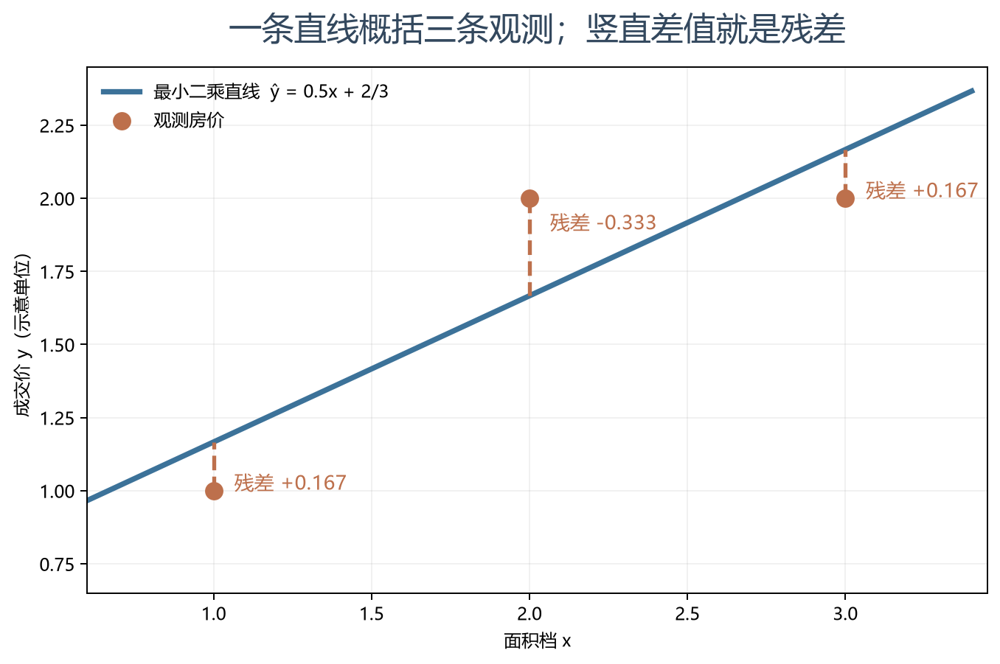
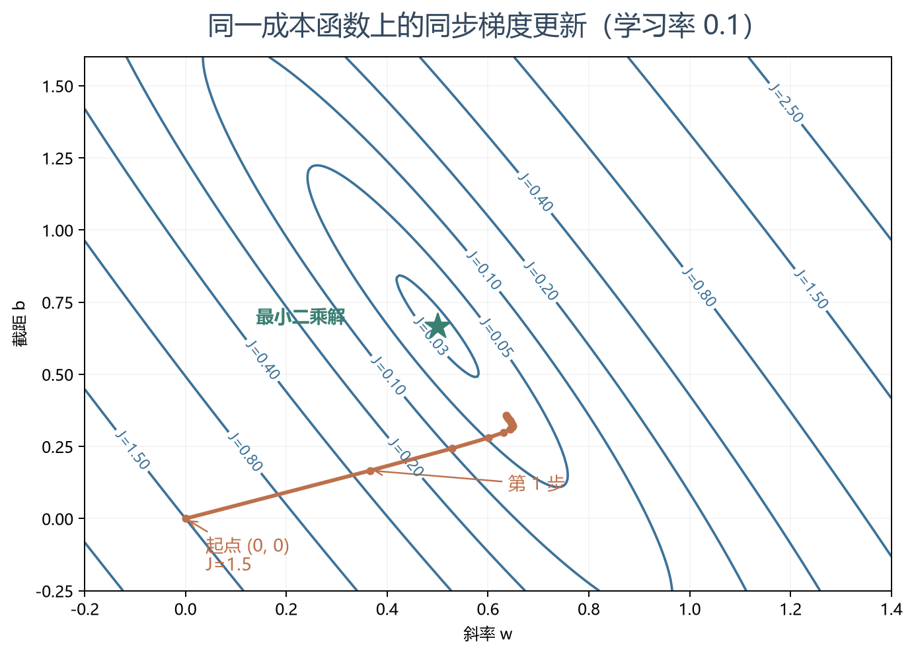
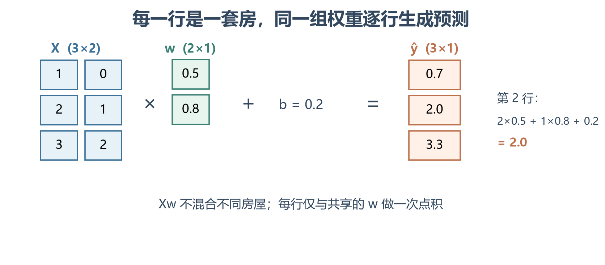
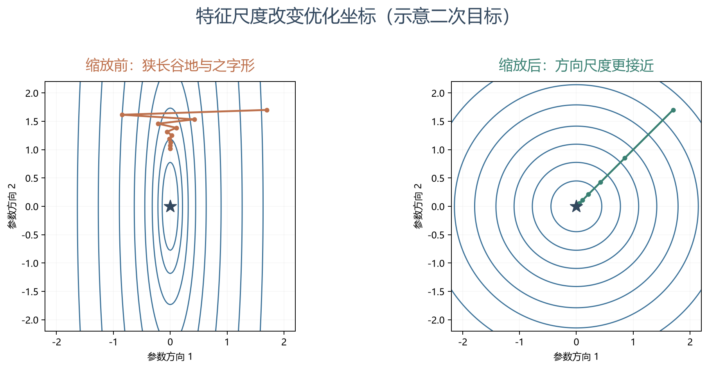
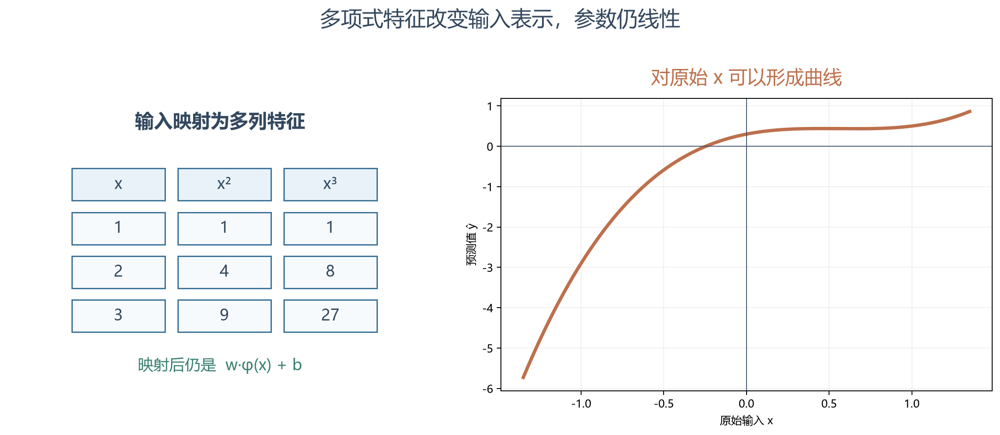

# [AI基础-机器学习]2.线性回归、最小二乘与特征工程

在实际业务中，我们经常需要预测一个连续数值：根据房屋的面积、房龄和地段估算成交价；根据广告的投放预算预测销售额。

线性回归（Linear Regression）就是解决这类问题最基础、最透明的工具。它的核心逻辑非常朴素：**用特征的“加权求和”来做预测，再拿历史真实数据把这套权重调整到最优**。

在学习或复习线性回归时，不要把公式当成死记硬背的推导，只要始终抓牢三个核心问题，整套逻辑就会极其清晰：
1. **模型怎么算预测？**（假设函数 / Hypothesis）
2. **用什么量化好与坏？**（损失函数 / Cost Function）
3. **怎样找到最优参数？**（优化算法：梯度下降 vs 解析解）

---

## 1 单变量线性回归：用一条直线预测连续数值

为了看清本质，我们先从最简单的情况切入：**只用一个特征（房屋面积 $x$）来预测房价 $y$**。

我们手头有若干条历史成交样本，记作 $(x^{(i)}, y^{(i)})$。我们希望用一条最简单的直线来给出预测值 $\hat y$：

$$
\hat y = f_{w,b}(x) = wx + b
$$

- $x$：输入特征（房屋面积）。
- $\hat y$：模型的预测房价（Prediction）。
- $y$：真实的历史成交价（Ground Truth / Label）。
- $w$（Weight，权重 / 斜率）：表示**面积每增加 1 个单位，预测价格平均上涨多少**。
- $b$（Bias，偏置 / 截距）：直线在纵轴上的截距。当 $x=0$ 时模型的基准预测值。
  > **注意**：偏置 $b$ 并不一定具备现实物理意义。比如实际中没有“0 平方米”的房子，$b$ 只是数学上保证直线能够自由平移的底数。

这是一个典型的**监督回归任务（Supervised Regression）**：训练时，我们拿已有的成对数据 $(x^{(i)}, y^{(i)})$ 寻找最合理的 $w$ 和 $b$；部署上线时，面对一套全新的房子，我们只有未知的面积 $x$，带入直线公式输出预测值 $\hat y$。

真实数据几乎不可能严丝合缝地全落在一张纸的直线上，点和线之间必然存在纵向的间距。这个**真实值与预测值之间的竖直距离**，就是模型的预测误差。

---

## 2 平方误差：把一条直线的好坏变成一个数

我们需要一个客观的数学指标，把整条直线的拟合质量凝聚成一个具体的标量数值。

对于第 $i$ 个样本，**残差（Residual）**定义为“预测值减去真实值”：

$$
r_i = f_{w,b}(x^{(i)}) - y^{(i)}
$$

- $r_i > 0$：预测偏高（高估了）。
- $r_i < 0$：预测偏低（低估了）。

如果我们直接把所有样本的残差加起来，正负误差就会互相抵消（例如一套高估 10 万，一套低估 10 万，总和直接变成了 0，但显然两次都猜错了）。为了解决正负号问题，同时更严厉地惩罚严重离谱的大错误，机器学习中最常用的标准就是**均方误差（Mean Squared Error, MSE）**，也就是**最小二乘法（Ordinary Least Squares, OLS）**：

$$
\boxed{J(w,b) = \frac{1}{2m}\sum_{i=1}^{m} \bigl(wx^{(i)} + b - y^{(i)}\bigr)^2}
$$

- $m$：训练样本的总数量。
- $\frac{1}{m}$：取平均值，保证不管数据集有 100 条还是 10 万条，损失值的大小尺度一致、可以横向比较。
- 平方项 $(\dots)^2$：不仅消除了正负抵消，还放大了大误差的代价（误差是 1 时惩罚是 1，误差放大到 3 时惩罚暴增到 9）。
- $\frac{1}{2}$ 的巧思：纯粹是为了求导求梯度时，消去平方掉下来的指数 $2$，完全不改变使得代价最小的最优解位置。

### 业务评估指标：MAE 与 RMSE

训练模型时为了数学求导方便，通常使用均方误差 $J(w,b)$；但在向业务汇报或上线评估时，我们通常使用具有直观物理单位的指标：
- **MAE（平均绝对误差）**：$\mathrm{MAE} = \frac{1}{m}\sum_i |r_i|$。直接表达“平均每套房猜偏了多少钱”，不受离群点过激影响。
- **RMSE（均方根误差）**：$\mathrm{RMSE} = \sqrt{\frac{1}{m}\sum_i r_i^2}$。开方后单位变回万元，但因为底层保留了平方，它对“预测错得离谱”的离群案例极其敏感。如果业务极度厌恶极端误判，应重点盯防 RMSE。

### 最小二乘背后的概率本质：高斯噪声与极大似然估计

为什么偏偏选平方误差，而不是三次、四次方？最小二乘法有坚实的统计学支撑：

假设真实价格等于理想线性关系加上未观测的随机误差：$y^{(i)} = wx^{(i)} + b + \varepsilon_i$。如果这些误差 $\varepsilon_i$ 相互独立，且都符合以 0 为均值的正态分布（高斯分布）$N(0, \sigma^2)$，那么样本出现的概率密度为：

$$
p(y^{(i)} \mid x^{(i)}; w, b) \propto \exp\left( -\frac{(y^{(i)} - (wx^{(i)}+b))^2}{2\sigma^2} \right)
$$

当我们希望这批数据发生的总概率最大（**极大似然估计，Maximum Likelihood Estimation**）时，对全样本概率相乘并取负对数，指数位置的指数项就正好变成了**残差平方和**。换句话说：**在噪声服从正态分布的假设下，最小化均方误差等价于最大化观测数据的出现概率。**

---

## 3 梯度下降与学习率：沿参数空间逐步降低成本

有了损失函数 $J(w,b)$，我们要如何找到让 $J$ 最小的参数组合 $(w,b)$？

在线性回归中，以 $w$ 和 $b$ 为坐标轴构建的三维空间是一个完美的“碗状”凸函数（Convex Function），它没有坑人的局部陷阱，碗底就是全局唯一的全局最小值。

**梯度下降（Gradient Descent）**的直观逻辑就是：站在碗壁的任意一个初始点，环顾四周，**沿着坡度最陡（梯度反方向）的方向迈出一小步**，一步步走向碗底。

参数的**同步更新（Simultaneous Update）**公式为：

$$
\begin{aligned}
w &:= w - \alpha \frac{\partial J(w,b)}{\partial w} \\
b &:= b - \alpha \frac{\partial J(w,b)}{\partial b}
\end{aligned}
$$

- $\alpha$（Learning Rate，学习率）：步长大小。决定了每一步迈多大。
- 偏导数项 $\frac{\partial J}{\partial w}, \frac{\partial J}{\partial b}$：指示了参数在当前位置的“上坡”方向，前面加负号代表“下坡”。
- **同步更新原则**：计算偏导必须全部基于上一轮固定的旧参数 $(w, b)$。算完后两项同时替换，严禁先更新了 $w$ 拿新值去算 $b$ 的偏导。

### 学习率 $\alpha$ 的权衡
- **$\alpha$ 过小**：下山极其缓慢，需要迭代成千上万次才能收敛。
- **$\alpha$ 过大**：步子迈得太大，可能直接跨过碗底，在两边反复震荡，甚至逐步发散导致数值溢出（`NaN`）。

---

## 4 单变量回归的梯度：每个样本怎样推动斜率与截距

具体到公式上，每个样本究竟是怎样发力把 $w$ 和 $b$ 拽向最优解的？通过对 $J(w,b)$ 分别求偏导（应用复合函数链式法则），可以得到梯度的清晰解析形式：

$$
\boxed{
\begin{aligned}
\frac{\partial J}{\partial w} &= \frac{1}{m}\sum_{i=1}^{m} r_i x^{(i)} = \frac{1}{m}\sum_{i=1}^{m} \bigl(f_{w,b}(x^{(i)}) - y^{(i)}\bigr) x^{(i)} \\
\frac{\partial J}{\partial b} &= \frac{1}{m}\sum_{i=1}^{m} r_i = \frac{1}{m}\sum_{i=1}^{m} \bigl(f_{w,b}(x^{(i)}) - y^{(i)}\bigr)
\end{aligned}
}
$$

拆开看这两条式子的直觉物理意义：
1. **截距的梯度 $\frac{\partial J}{\partial b}$**：就是**所有样本残差的算术平均值**。如果当前预测普遍偏大，残差和为正，梯度为正，按更新公式 $b := b - \alpha \times (\text{正数})$ 就会让截距整体向下沉，把预测线拉低。
2. **斜率的梯度 $\frac{\partial J}{\partial w}$**：残差乘以输入特征 $x^{(i)}$。面积越大（$x^{(i)}$ 越大）的房子，杠杆臂越长，对调整直线的倾斜角度起到的拉扯力就越大。

### 批量梯度下降的三种形态
- **全批量梯度下降（Batch Gradient Descent, BGD）**：每走一步，都要把全部 $m$ 条数据扫描一遍算平均梯度。方向极其稳定准确，但样本量极大时非常耗时。
- **随机梯度下降（Stochastic Gradient Descent, SGD）**：每看 1 条样本就立刻更新一次参数。速度飞快，但更新轨迹剧烈震荡。
- **小批量梯度下降（Mini-batch Gradient Descent）**：工业界最通用的折中方案，每次使用一小批（如 32、64、128 条）样本计算梯度，兼顾向量化并行计算效率与更新稳定性。

---

## 5 多元线性回归：把一套房的多个特征放到同一行

现实中绝不可能只靠面积估价，房龄、卧室数、离地铁距离都会产生影响。假设每套房有 $d$ 个数值特征，输入特征向量记为 $x^{(i)} \in \mathbb R^d$，模型对该样本的预测就是所有特征的加权和：

$$
\hat y^{(i)} = w^\mathsf T x^{(i)} + b = w_1 x_1^{(i)} + w_2 x_2^{(i)} + \dots + w_d x_d^{(i)} + b
$$

- $w_j$ 的物理含义：**在其他所有特征保持不变的前提下，第 $j$ 个特征每增加 1 个单位，预测价格的变化量**。

### 矩阵化与设计矩阵（Design Matrix）

为了摆脱低效的逐个样本循环，机器学习通常把整批数据堆叠成矩阵进行运算：
- 将 $m$ 个样本按行排列，构成**设计矩阵 $X \in \mathbb R^{m \times d}$**（第 1 维是样本，第 2 维是特征）。
- 权重向量 $w \in \mathbb R^{d \times 1}$。
- 偏置常数通过全 1 向量广播：$b \mathbf 1_m$。

整批预测直接写成矩阵乘法：

$$
\boxed{\hat y = Xw + b\mathbf1_m \quad \in \mathbb R^{m \times 1}}
$$

矩阵维度的对应关系清晰明了：

$$
(m \times d) \times (d \times 1) + (m \times 1) = (m \times 1)
$$

$X$ 的每一行代表一套独立的房子，与权重向量 $w$ 做内积，精准输出该套房的预测值。底层数值库（如 NumPy、BLAS）能够通过 SIMD 和多线程硬件加速高度优化矩阵乘法，这就是所谓的**向量化（Vectorization）**。

---

## 6 多特征的最小二乘梯度与直接求解

定义全量样本的预测残差向量为 $r = \hat y - y = Xw + b\mathbf 1_m - y \in \mathbb R^m$。多元回归的均方损失为：

$$
J(w,b) = \frac{1}{2m} r^\mathsf T r
$$

梯度的矩阵形式推导非常简洁对称：

$$
\nabla_w J = \frac{1}{m} X^\mathsf T r \in \mathbb R^{d \times 1}, \qquad \frac{\partial J}{\partial b} = \frac{1}{m} \mathbf 1_m^\mathsf T r \in \mathbb R
$$

$X^\mathsf T$ 的形状为 $(d \times m)$，与长为 $m$ 的残差向量相乘，正好将各样本的残差按各自特征权重相加，压缩为 $d$ 维的权重更新梯度。

### 正规方程（Normal Equation）：跳过迭代，一步求解

对于线性回归这种简单的凸模型，我们其实可以**令梯度直接等于 0**，通过纯代数方式一步解出最优参数，不需要设步长也不用循环迭代。

把偏置项 $b$ 作为第 0 个权重并入权重向量，在设计矩阵 $X$ 左侧或右侧拼上一列全 1：
$\widetilde X = [X \quad \mathbf 1_m] \in \mathbb R^{m \times (d+1)}$，参数合并为 $\theta = [w_1, \dots, w_d, b]^\mathsf T$。

目标函数变为最小化 $\|\widetilde X\theta - y\|_2^2$。令其导数为 0，得到著名的**正规方程**：

$$
\boxed{\widetilde X^\mathsf T \widetilde X \theta = \widetilde X^\mathsf T y}
$$

若矩阵 $\widetilde X^\mathsf T \widetilde X$ 可逆（即特征之间不存在完全共线性，数据矩阵满列秩），则全局唯一最优解为：

$$
\theta = (\widetilde X^\mathsf T \widetilde X)^{-1} \widetilde X^\mathsf T y
$$

### 正规方程 vs 梯度下降：如何抉择？

| 比较维度 | 梯度下降（Gradient Descent） | 正规方程（Normal Equation） |
| :--- | :--- | :--- |
| **超参数** | 需要仔细挑选学习率 $\alpha$、决定迭代轮数 | 零超参数，一键解析求解 |
| **循环迭代** | 需要多轮逐步收敛 | 无需迭代，单次矩阵运算 |
| **时间复杂度** | 每次迭代复杂度约 $O(md)$ | 涉及矩阵求逆，复杂度约 $O(d^3)$ |
| **适用数据量** | 特征维度 $d$ 极大（如百万维）时表现优异 | 仅适合特征数 $d$ 适中（通常 $< 10000$）的场景 |

> **工业界实践提醒**：
> 在真实代码中（如 `numpy.linalg.lstsq` 或 `sklearn.linear_model.LinearRegression`），底层**绝不会直接调用求逆函数计算 $(\widetilde X^\mathsf T \widetilde X)^{-1}$**。因为直接求逆不仅速度慢，而且如果存在几乎重合的共线特征，会导致矩阵病态、数值精度严重失真。工业库通常采用更加稳健的 **SVD（奇异值分解）** 或 **QR 分解** 来直接解出参数。

---

## 7 特征缩放：让不同单位的参数更容易一起优化

如果一套房子的特征中，“面积”在 $50 \sim 300$ 平方米之间，而“卧室数”在 $1 \sim 5$ 之间，两者的原始数值尺度相差两个数量级。

这会导致严重的优化问题：
- 在未缩放的参数空间中，损失函数的等高线会被严重拉伸成一个**极端扁平狭长的椭圆“深谷”**。
- 梯度方向几乎垂直于等高线，导致参数在狭窄的侧壁之间来回剧烈“打乒乓震荡”，沿着长轴谷底的有效前进速度极度缓慢。统一的学习率 $\alpha$ 稍大就会在窄轴发散，稍小又在长轴走不动。

**特征缩放（Feature Scaling）**的目的，就是把各个特征的尺度统一拉平，将狭长的椭圆等高线重新变成均匀的同心圆（正圆），让梯度笔直指向最低点。

### 常用缩放方法

1. **Z-score 标准化（Standardization）**：最广泛使用的工业标准。
   $$x_{ij}' = \frac{x_{ij} - \mu_j}{\sigma_j}$$
   减去均值，除以标准差。变换后该特征列均值为 0，方差为 1。对异常值相对更宽容。
2. **Min-Max 归一化（Min-Max Normalization）**：
   $$x_{ij}' = \frac{x_{ij} - x_{j,\min}}{x_{j,\max} - x_{j,\min}}$$
   将所有数值严格挤压映射到 $[0, 1]$ 区间内。缺点是如果出现一个极端离群点，其余正常数据会被全部压成极狭窄的小段。

> **防泄漏铁律（Data Leakage Prevention）**：
> 缩放所使用的统计量（均值 $\mu$、方差 $\sigma$、最值），**必须且只能完全从训练集计算得出**！严禁利用包含测试集在内的全量数据去 fit 标准化器。验证集和未来的线上数据，必须严格套用从训练集保存下来的同一套统计量进行变换。

---

## 8 训练成本曲线：检查收敛与调整学习率

在利用梯度下降调参时，最直接的“仪表盘”就是绘制**训练成本曲线（Learning Curve / Cost Curve）**：
- **横轴**：迭代更新的步数（Epoch / Iteration）。
- **纵轴**：当前参数对应的训练损失 $J(w,b)$。

### 曲线形态诊断表

1. **正常收敛**：曲线从陡峭迅速下降，随后平滑趋于平缓。
2. **学习率 $\alpha$ 过小**：曲线下降极其平缓，呈现一条几乎拉直的微倾斜线，几百轮迭代后依然悬在高位。
3. **学习率 $\alpha$ 过大**：曲线剧烈锯齿状波动，甚至在某一步后突然向上窜升直至报错（Exploding）。

> **概念辨析：成本曲线 vs 学习曲线**
> - **优化成本曲线**：横轴是“迭代轮数”，观察的是**梯度下降算法本身到底收敛了没有**。
> - **评估学习曲线**：横轴是“提供给模型的训练样本数量 $m$”，对比的是训练集与验证集的差距，用来**诊断系统到底处于高偏差（欠拟合）还是高方差（过拟合）**。

---

## 9 特征工程：把已知的业务关系表达成输入

线性模型最常被误解的一点是：“只能表示现实中纯粹按直线缩放的关系”。其实不然，模型对**输入变量**完全可以是非线性的，只要它对**待学习的参数 $w$ 是线性的**，它就依然能用线性最小二乘法完美求解。

这就引出了机器学习中最能体现人脑业务经验的环节——**特征工程（Feature Engineering）**。

举个经典例子：评估地块价值时，手头只有地块的“临街宽度 $x_1$”和“进深深度 $x_2$”。
如果你只给模型输入 $w_1 x_1 + w_2 x_2 + b$，模型只能分别加权相加。但常识告诉我们：**地块的真正价值由面积决定，而面积是长乘宽**。

此时，我们可以人工创造一个交互特征：

$$
x_3 = x_1 \times x_2
$$

模型假设升级为：

$$
\hat y = w_1 x_1 + w_2 x_2 + w_3 (x_1 x_2) + b
$$

引入交叉特征后，宽度 $x_1$ 对价格的边际拉动能力不再是一个死板的常数 $w_1$，而是变成了 $w_1 + w_3 x_2$——它会随着深度的不同动态改变。通过显式组合业务特征，我们让极度简单的线性模型拥有了捕捉高阶非线性规律的能力。

---

## 10 多项式回归：参数仍线性，预测可随输入弯曲

当单一特征与目标之间存在弧度甚至 S 型走势时（例如：房龄在头几年快速折旧，但在老到一定年限后残值趋于稳定），一条死板的斜线无法有效拟合。

**多项式回归（Polynomial Regression）**通过给输入特征升维来解决这一问题。定义特征映射函数 $\phi(x)$：

$$
\phi(x) = \begin{bmatrix} x \\ x^2 \\ x^3 \end{bmatrix}, \qquad \hat y = w_1 x + w_2 x^2 + w_3 x^3 + b
$$

虽然在平面上看，最终预测输出针对原始输入 $x$ 画出了一条蜿蜒优美的弯曲曲线；但从内部看，每个权重 $w_j$ 依然只作为一次幂线性存在。在代数层面，这依然是一个标准的多元线性回归问题，正规方程与梯度下降全部原样适用。

### 引入多项式后的风险与代价
1. **量纲急剧膨胀**：如果 $x = 100$，则 $x^2 = 10000$，$x^3 = 1000000$。特征尺度差距被成倍拉大，**多项式回归后必须进行特征缩放**，否则梯度下降极难收敛。
2. **过拟合与外推灾难（Overfitting & Extrapolation Risk）**：随着多项式次数不断升高，曲线获得了不可思议的弯曲能力，甚至能穿过训练集每一个噪点，但这种能力会在训练范围之外发生毁灭性失控（在没有见过的区间高阶曲线会急剧飙升或暴跌）。如何驯服多项式模型的这种过激灵活性，正是后续**正则化（L1/L2 正则）**所要解决的核心课题。