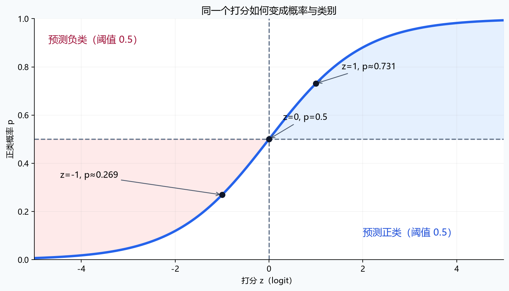

# [AI基础-机器学习]3.逻辑回归、Softmax与交叉熵

线性回归解决的是连续数值的预测问题（例如预测房价）。但现实中更多的问题是做决策与分类：
- 一封邮件是“垃圾邮件”还是“正常邮件”？
- 肿瘤是“恶性”还是“良性”？
- 一张图片里的动物是“猫”、“狗”还是“鸟”？

在分类任务中，我们不仅希望模型给出具体的类别判断，更需要知道模型对这个判断的**置信度（概率）**：把一封邮件判为垃圾邮件，概率是 51% 还是 99%，后续的拦截策略和人工复核机制是完全不同的。

本篇从最基础的二分类逻辑回归出发，彻底讲清分类模型如何实现“从打分到概率、从概率到类别、从错误到惩罚、从惩罚到更新参数”的完整闭环，并自然延展到互斥多分类与多标签分类。

---

## 1 二元分类：为什么要改变线性回归的输出

在二分类问题中，样本标签通常用二值离散量表示：$y \in \{0, 1\}$。
- $y = 1$：正类（Positive，即我们重点关注或希望检测的目标，如“垃圾邮件”）。
- $y = 0$：负类（Negative，如“正常邮件”）。

设特征向量为 $x = (x_1, x_2, \ldots, x_d)^\mathsf{T}$。如果我们直接套用线性回归模型 $z = w^\mathsf{T}x + b$：
1. **取值范围失控**：线性回归的输出 $z \in (-\infty, +\infty)$。当算出的打分是 $-5$ 或 $+10$ 时，这个数值无法直接当作有统计意义的概率值 $P(y=1 \mid x) \in [0, 1]$。
2. **损失惩罚不合理**：线性回归采用均方误差（MSE）。如果真实标签为 $1$，模型算出了 $z = 100$，这本是一个极其自信且正确的预测，但 MSE 却会计算出 $(100 - 1)^2 = 9801$ 的天文数字惩罚；反之，若模型将正例错判为负例，其误差曲面在配合非线性映射时极易陷入非凸的局部陷阱。

因此，分类算法需要做两件事：
1. **引入压缩函数（Activation Function）**：把无边界的线性打分 $z$ 平滑压缩映射到 $(0, 1)$ 区间，使其具备概率含义。
2. **更换匹配的损失函数（Loss Function）**：使用专门惩罚分类错误的**交叉熵损失**，替换连续数值回归的均方误差。

---

## 2 从线性打分到垃圾邮件概率

逻辑回归通过两步完成概率预测：

1. **线性特征打分（Logit）**：
   $$z = w^\mathsf{T}x + b = \sum_{j=1}^{d} w_j x_j + b$$
   $z$ 是特征根据各自权重加权累加的原始分数。
2. **Sigmoid 函数映射为概率**：
   $$p = \sigma(z) = \frac{1}{1 + e^{-z}}$$
   这里的 $p$ 即为模型对正类的概率估计 $P(y=1 \mid x)$，对应的负类概率则为 $1 - p$。

### Sigmoid 函数的关键特性

- 当 $z = 0$ 时，$p = \sigma(0) = \frac{1}{1+1} = 0.5$；
- 当 $z \to +\infty$ 时，$p \to 1$；当 $z \to -\infty$ 时，$p \to 0$；
- 它将整条实数轴 $(-\infty, +\infty)$ 单调平滑地映射为 $(0, 1)$，非常适合作为二分类概率生成器。

### 为什么叫“逻辑回归”？几率（Odds）与 Logit 的本质

很多初学者困惑：明明是个分类模型，为什么名字里带“回归”？这源于**对数几率（Log-odds / Logit）**。

- **几率（Odds）**：定义为正类概率与负类概率的比值 $\frac{p}{1-p}$。如果模型预测垃圾邮件的概率 $p=0.8$，则几率为 $\frac{0.8}{0.2} = 4$，即“是垃圾邮件的可能性是正常邮件的 4 倍”。
- 对几率取自然对数，并代入 $p = \frac{1}{1 + e^{-z}}$：
  $$\log\left(\frac{p}{1-p}\right) = \log\left(\frac{\frac{1}{1+e^{-z}}}{\frac{e^{-z}}{1+e^{-z}}}\right) = \log(e^z) = z = w^\mathsf{T}x + b$$

本质浮出水面：**逻辑回归本质上是对“正类对数几率”进行建模的多元线性回归！**
权重 $w_j$ 的具体物理意义是：当特征 $x_j$ 增加 1 个单位时，正类的对数几率线性增加 $w_j$（几率 Odds 则乘上 $e^{w_j}$ 倍）。

---

## 3 阈值与决策边界：概率怎样变成类别

模型输出的概率 $p \in (0, 1)$ 是一个连续值，最终落地成离散类别需要设定一个**决策阈值 $\tau$**：
- 若 $p \ge \tau$，预测为正类（$\hat y = 1$）；
- 若 $p < \tau$，预测为负类（$\hat y = 0$）。

### 默认阈值 $\tau = 0.5$ 与决策边界

在对称无偏的场景下，默认取 $\tau = 0.5$。由于 Sigmoid 在 $z = 0$ 时输出 0.5，因此：
$$p \ge 0.5 \iff z = w^\mathsf{T}x + b \ge 0$$

两类之间的分界线被称为**决策边界（Decision Boundary）**，其数学方程正是：
$$w^\mathsf{T}x + b = 0$$

> **关键认知**：
> 决策边界是在**输入特征空间**中划分正负类别的几何边界，它完全由参数 $w$ 和 $b$ 决定。
> - 如果特征输入是原始的 $[x_1, x_2]$，决策边界是一条直线（二维）或超平面（高维）；
> - 如果通过特征工程引入了非线性项（如 $z = w_1 x_1^2 + w_2 x_2^2 - 1$），则在原始输入平面上能够形成圆形、椭圆等复杂非线性边界。

### 业务场景下的阈值调整

$\tau = 0.5$ 并不是不可改动的教条。调整阈值改变的是业务决策的松紧度，**无需重新训练模型参数**：
- **垃圾邮件拦截**：误判一封重要工作邮件的代价极高。可以把阈值调高到 $\tau = 0.8$（宁可放过一些垃圾邮件，也不能误伤正常邮件）。
- **重大疾病筛查**：漏诊一位癌症患者的后果是致命的。可以把阈值降低到 $\tau = 0.2$（宁可错叫健康人来复查，也不能放过任何一个潜在患者）。

---

## 4 二元交叉熵：错误概率为什么要付出代价

模型预测了概率 $p$，我们该如何量化这次预测与真实标签 $y \in \{0, 1\}$ 的差距？

逻辑回归采用**二元交叉熵损失（Binary Cross-Entropy Loss, BCE）**，单样本的损失形式为：

$$\boxed{L(p, y) = -\bigl[y \log p + (1-y)\log(1-p)\bigr]}$$

这个公式看似复杂，拆成两个分支看极其直观：
- 当真实标签 $y = 1$ 时：
  $$L = -\log p$$
  模型预测 $p \to 1$（完全猜对），损失 $-\log 1 = 0$；若模型预测 $p \to 0$（极度自信地猜错），损失 $-\log 0 \to +\infty$。
- 当真实标签 $y = 0$ 时：
  $$L = -\log(1-p)$$
  模型预测 $p \to 0$（完全猜对），损失 $-\log 1 = 0$；若模型预测 $p \to 1$（严重误报），损失 $-\log 0 \to +\infty$。

| 真实标签 $y$ | 模型给正类的预测概率 $p$ | 对应项的损失计算 | 最终损失 $L$ | 评价 |
|:---:|:---:|:---:|:---:|:---|
| $1$ | $0.90$ | $-\log(0.90)$ | $\approx 0.105$ | 预测准确且自信，惩罚极小 |
| $1$ | $0.51$ | $-\log(0.51)$ | $\approx 0.673$ | 勉强算对，惩罚适中 |
| $1$ | $0.01$ | $-\log(0.01)$ | $\approx 4.605$ | **极度自信地犯错，施加指数级重罚** |
| $0$ | $0.05$ | $-\log(1 - 0.05)$ | $\approx 0.051$ | 预测准确，惩罚极小 |

### 交叉熵的统计学本质：极大似然估计

这套损失函数并非凭空拼凑。由于 $y \in \{0, 1\}$ 服从伯努利分布，单个样本被模型预测正确的概率可以统一写成：
$$P(y \mid x) = p^y (1-p)^{1-y}$$

在样本相互独立的假设下，全数据集 $m$ 个样本同时发生的**联合似然函数**为：
$$\mathcal L(w, b) = \prod_{i=1}^{m} \left(p^{(i)}\right)^{y^{(i)}} \left(1-p^{(i)}\right)^{1-y^{(i)}}$$

为了求导方便，取对数并加上负号除以 $m$（将“最大化似然”转化为“最小化目标函数”），直接推导出全数据集的**成本函数（Cost Function）**：

$$J(w,b) = -\frac{1}{m} \sum_{i=1}^{m} \left[ y^{(i)} \log p^{(i)} + (1 - y^{(i)}) \log (1 - p^{(i)}) \right]$$

这一函数对参数 $w, b$ 具有严格的**凸（Convex）函数性质**，不存在局部极小值陷阱，使用梯度下降能稳定收敛至全局最优。

---

## 5 梯度下降：每封邮件怎样推动参数

有了目标成本函数 $J(w, b)$，我们通过求偏导获得参数更新的方向。

### 优美的链式求导相消

求导过程展示了 Sigmoid 与交叉熵绝妙的数学互补性：
1. 交叉熵对概率的导数：$\frac{\partial L}{\partial p} = -\frac{y}{p} + \frac{1-y}{1-p} = \frac{p-y}{p(1-p)}$
2. Sigmoid 对打分的导数：$\frac{\partial p}{\partial z} = p(1-p)$

利用链式法则两式相乘，中间项 $p(1-p)$ **完美对消**：
$$\boxed{\frac{\partial L}{\partial z} = \frac{\partial L}{\partial p} \cdot \frac{\partial p}{\partial z} = p - y}$$

这是一个令人赞叹的精简结果：**损失函数对原始打分 $z$ 的偏导，恰好就是预测概率与真实标签的误差 $(p - y)$！**

- 若真实 $y = 1$，模型只预测了 $p = 0.2$：误差为 $0.2 - 1 = -0.8$（负号促使打分 $z$ 向上增加）。
- 若真实 $y = 0$，模型盲目预测了 $p = 0.9$：误差为 $0.9 - 0 = +0.9$（正号促使打分 $z$ 向下压低）。

### 批量更新的矩阵表示

对参数 $w$ 和 $b$ 进一步求导，得到在整批数据上的梯度：

$$\frac{\partial J}{\partial w} = \frac{1}{m} \sum_{i=1}^{m} (p^{(i)} - y^{(i)}) x^{(i)}, \qquad \frac{\partial J}{\partial b} = \frac{1}{m} \sum_{i=1}^{m} (p^{(i)} - y^{(i)})$$

设设计矩阵 $X \in \mathbb R^{m \times d}$（$m$ 个样本，$d$ 个特征），残差向量 $r = p - y \in \mathbb R^{m \times 1}$。全批量的向量化更新表示为：

$$\nabla_w J = \frac{1}{m} X^\mathsf{T} r \in \mathbb R^{d \times 1}, \qquad \frac{\partial J}{\partial b} = \frac{1}{m} \mathbf 1_m^\mathsf{T} r \in \mathbb R$$

$$w := w - \alpha \nabla_w J, \qquad b := b - \alpha \frac{\partial J}{\partial b}$$

公式在形式上与线性回归的均方误差更新式几乎一模一样，但内在本质已彻底改变：这里的误差 $r_i = p^{(i)} - y^{(i)}$ 是经过 Sigmoid 非线性压缩后的**概率残差**。

---

## 6 Softmax：当类别多于两个且互斥

当任务变成“互斥的多分类”（如手写数字 0~9 识别、猫狗鸟三分类）时，单一的二分类概率无法满足需求。我们需要输出 $C$ 个类别的概率分布，且必须满足两个硬性约束：
1. 每个类别的预测概率 $p_c \in (0, 1)$；
2. 所有互斥类别的概率总和必须严格等于 1：$\sum_{c=1}^C p_c = 1$。

**Softmax 回归**通过归一化指数函数实现了这一目标：

1. 分别为每一个类别计算一个独立的线性打分：
   $$z_c = w_c^\mathsf{T}x + b_c \quad (c = 1, 2, \ldots, C)$$
2. 通过 Softmax 函数将全部打分转换为概率分布：
   $$\boxed{p_c = \frac{e^{z_c}}{\sum_{k=1}^{C} e^{z_k}}}$$

### 为什么要通过指数化再归一化？
- **保正性**：指数运算 $e^{z_c}$ 保证了不管原始打分 $z_c$ 是正是负，映射后全部变为非负数；
- **排他性与动态拉伸**：指数函数具有“贫富差距放大”效应，打分越高的类别其概率份额会被显著拉大，而较小的打分会被压缩；
- **二分类退化**：当类别数 $C=2$ 时，Softmax 在数学上完全退化等价为 Sigmoid 函数。

> **矩阵化计算形状**：
> 若有 $m$ 个样本、输入特征维度为 $d$、类别数为 $C$：
> - 权重矩阵 $W \in \mathbb R^{C \times d}$，偏置向量 $b \in \mathbb R^C$；
> - 批量打分矩阵 $Z = XW^\mathsf{T} + \mathbf 1_m b^\mathsf{T} \in \mathbb R^{m \times C}$；
> - Softmax 沿着**行的方向（即跨类别维度）**进行独立归一化，得到同样为 $m \times C$ 的概率预测矩阵。

---

## 7 多分类交叉熵：只看正确类别拿到多少概率

在多分类任务中，样本标签通常采用 **One-Hot（独热）编码**：真实的类别位置为 1，其余全为 0（如猫、狗、鸟中的“狗”表示为 $y = [0, 1, 0]^\mathsf{T}$）。

### 损失函数的形式化与极简本质

**多分类交叉熵损失（Categorical Cross-Entropy Loss）**写作：

$$L = -\sum_{c=1}^{C} y_c \log p_c$$

因为除了真实类别对应的那一项 $y_{\text{true}} = 1$ 之外，其余位置的 $y_c$ 全部为 0，所以该求和式实质上可以极简地写为：

$$\boxed{L = -\log p_{y_{\text{true}}}}$$

**多分类交叉熵的核心本质极其纯粹：它完全只在乎“真实目标所在的那个类别，模型到底分配给了它多大的概率”！**
- 如果给真实类别分了 0.99 的概率：$L = -\log(0.99) \approx 0.01$（模型胜出）；
- 如果给真实类别只分了 0.05 的概率：$L = -\log(0.05) \approx 3.00$（施加沉重惩罚）。

与二分类类似，Softmax 搭配多分类交叉熵求导后，对各类打分 $z_c$ 的梯度仍然具有极致纯粹的形式：
$$\frac{\partial L}{\partial z_c} = p_c - y_c$$

### 工程实践底线：LogSumExp 技巧与 logits 输入

直接在代码里计算 $e^{z_c}$ 极其危险：如果某个打分稍微偏大（如 $z_c = 1000$），$e^{1000}$ 会直接触发浮点数上溢（溢出为 `inf`），随后除法产生 `NaN`。

现代深度学习框架（如 PyTorch、TensorFlow）在底层统一采用 **Log-Sum-Exp 技巧**：
$$\frac{e^{z_c}}{\sum_k e^{z_k}} = \frac{e^{z_c - M}}{\sum_k e^{z_k - M}} \quad \text{其中 } M = \max(z_1, \ldots, z_C)$$
打分全量减去最大值 $M$，不仅保持最终概率结果分毫不差，同时将指数项的底数牢牢锁定在 $(-\infty, 0]$ 区间内，彻底杜绝浮点数上溢。

**工业级 API 准则**：在训练网络时，模型最后一层**切勿手动套用 Softmax/Sigmoid**，直接输出裸打分 logits！调用 `nn.CrossEntropyLoss` 或 `nn.BCEWithLogitsLoss`，让底层函数将指数与对数操作融合计算，既保证速度，又具备完美的数值稳定性。

---

## 8 多分类与多标签：先确认答案能否同时成立

在动手写模型之前，首先必须从业务语义上明确分类任务的本质属性，严禁混淆：

| 维度 | 单标签多分类（Multi-class） | 多标签分类（Multi-label） |
|:---|:---|:---|
| **业务语义** | 多个类别**互斥**（非此即彼）。 例：判断图片里的动物是“猫、狗、鸟”中的哪**一种**。 | 多个标签**相互独立**，可同时成立。 例：判断这幅画里“是否包含猫、是否包含狗、是否包含草地”。 |
| **标签表示** | 标量类别索引（如 `y = 1`）或独热向量 $[0, 1, 0]$。 | 二值向量（如 $[1, 1, 0]$ 代表同时包含猫和狗）。 |
| **输出层函数** | **Softmax**（强制所有类别概率和为 1，强行争夺份额）。 | **Sigmoid**（每个类别位置各自独立输出 0~1 的概率）。 |
| **损失函数** | **多分类交叉熵**（Categorical Cross-Entropy）。 | **独立二元交叉熵求和**（BCEWithLogitsLoss）。 |

> **常见灾难 Bug**：
> 如果在一个多标签任务（例如检测多目标）中误用了 Softmax，模型会强行让各个目标的概率之和等于 1。一旦模型发现了“猫”（概率被顶到 0.9），它分配给“狗”的概率空间就会被暴力压缩到 0.1 以下，导致多个共存目标根本无法同时被有效检出！