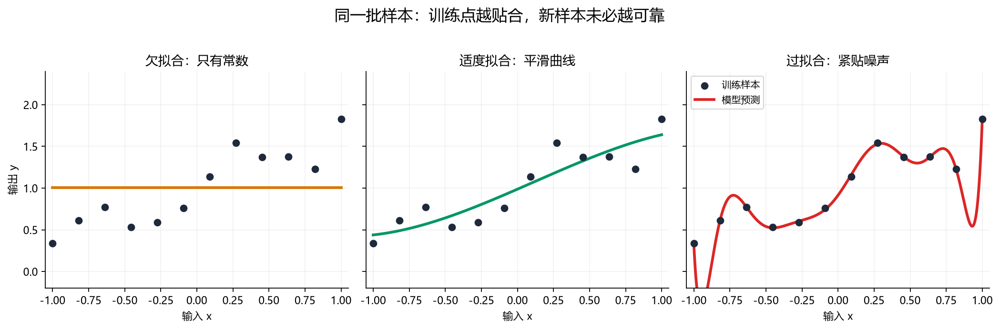
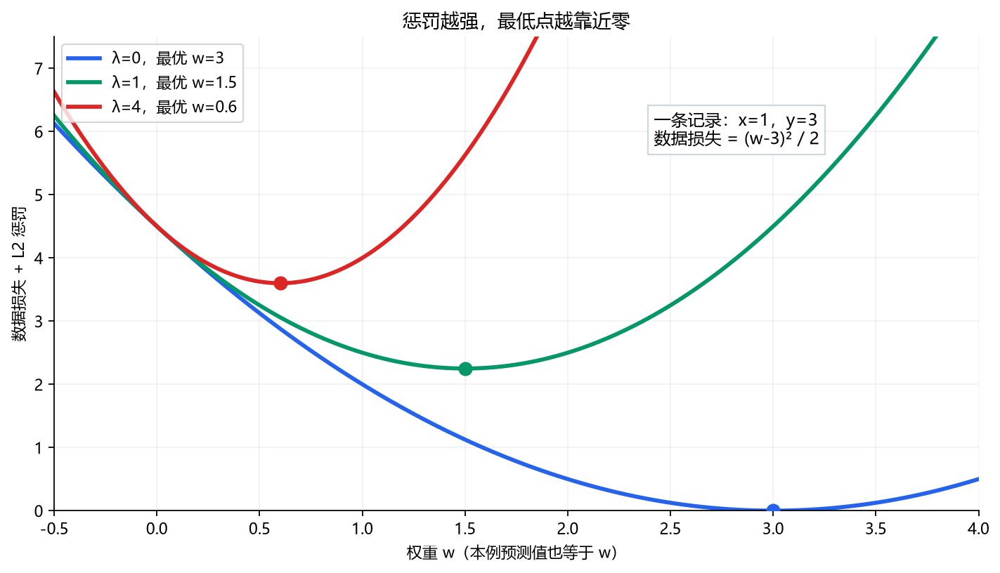

# [AI基础-机器学习]4.泛化、正则化与模型改进

在训练模型时，我们很容易陷入一个误区：以为训练集上的损失越低、准确率越高，模型就越厉害。

如果我们在预测房价时盲目引入面积的平方、立方甚至更高次项，模型确实能精准穿过已有的每一个历史成交点；在垃圾邮件过滤中，如果我们无休止地组合词语特征，模型也能把手头的训练邮件全部判对。但一旦部署上线面对全新的真实样本，预测往往会错得离谱。

机器学习的终极追求不是“死记硬背看过的样本”，而是**泛化能力（Generalization）**——在从未见过的全新数据上，依然能够做出稳健而准确的推断。

本篇系统拆解模型泛化问题的根源：从识别欠拟合与过拟合开始，理清应对过拟合的三条经典工程路径，深入剖析 L2 与 L1 正则化的数学机制与梯度行为，并建立完整的模型改进诊断直觉。

---

## 1 欠拟合与过拟合：为什么训练分数不能代表新样本

在模型训练中，最常见的两类典型病症是**欠拟合（Underfitting）**与**过拟合（Overfitting）**：

1. **欠拟合（高偏差 / High Bias）**：
   - **直观表现**：模型过于简单粗糙，连训练集里最基本的规律与主干趋势都没学会。
   - **典型场景**：真实房价随面积非线性上升，模型却只用了一条水平线或者一条死板的单一直线去硬套。
   - **指标信号**：**训练集误差很高，验证集误差也很高**（“两头都差”）。
2. **过拟合（高方差 / High Variance）**：
   - **直观表现**：模型过于复杂自由，不仅学会了真实规律，还把训练数据中的随机噪声、离群异常点甚至偶然细节全部“死记硬背”了下来。
   - **典型场景**：20 套房子里有一套因为豪华装修导致价格畸高，高阶多项式模型为了兼顾这个点，在相邻面积段之间上下剧烈震荡。新房子一旦落入震荡区间，预测值就会彻底崩塌。
   - **指标信号**：**训练集误差极低，但验证集误差极高**（“训练表现极好，泛化差距极大”）。

### 误差对照诊断示例

使用平均绝对误差（MAE，单位为万元，越低越好）评估同一批数据上的三个模型：

| 候选模型 | 训练 MAE | 验证 MAE | 状态诊断与行动线索 |
|:---|---:|---:|:---|
| **简单均值模型**（欠拟合） | 30 | 31 | 拟合严重不足，应扩展特征、提升模型容量 |
| **适度多项式模型**（良好拟合） | 8 | 10 | 训练好且泛化稳健，两端表现均衡 |
| **高阶多项式模型**（过拟合） | 1 | 24 | 死记硬背噪声，泛化剪刀差巨大，亟需约束自由度 |

> **评估铁律**：
> 评估与对比模型优劣时，**必须在训练集与验证集上使用完全一致的业务指标（纯预测误差，绝不能包含正则化惩罚项）**。否则指标不仅失去了现实业务含义，也无法客观度量泛化差距。

---

## 2 过拟合时的三条改进路径

当诊断出模型存在严重的过拟合（例如训练误差 1，验证误差 24）时，工程上主要有三条应对路线：

### 路径一：增加更多具有代表性的训练数据
- **底层逻辑**：数据越少，噪声和极端偶然样本在拟合中所占的权重就越大；当引入源源不断、覆盖目标场景的优质样本后，偶然特征会被海量真实规律冲淡，极端弯曲的震荡曲线会被自然拉平。
- **注意事项**：必须是来自同一目标业务分布的新样本。单纯把手头的 20 条样本机械复制几遍毫无新信息量；如果补充的数据来自完全不同的领域，甚至会引发数据分布漂移。

### 路径二：特征筛选（降低自由度）
- **底层逻辑**：直接减少模型可使用的特征数量，关掉不必要的自由度。
- **注意事项**：剔除那些由极少数偶然样本支撑的高阶项或噪声特征，但这种暴力剔除往往伴随着丢弃潜在有用信息的代价。

### 路径三：保留特征，引入正则化（Regularization）
- **底层逻辑**：**保留全部候选特征，但在损失函数中人为给参数施加惩罚，压制权重系数的膨胀**。
- **核心优势**：不需要人工纠结该彻底删掉哪个特征；模型可以自由使用每个特征，但只要某个特征对整体收益贡献微弱，模型就倾向于将该项权重压到极小，从而自然得到平滑稳健的预测边界。

---

## 3 L2 正则化：给大权重增加一项代价

正则化的本质，是在优化目标中引入对模型复杂度的显式约束。

传统的损失函数只衡量预测与真实标签之间的差距，称为**数据损失（Data Loss）** $J_{\mathrm{data}}(w,b)$（例如均方误差或交叉熵）。**L2 正则化（也称岭回归 / Weight Decay）**在数据损失之后，追加了一项与所有权重平方和成正比的惩罚：

$$\boxed{J_{\mathrm{reg}}(w,b) = J_{\mathrm{data}}(w,b) + \frac{\lambda}{2m}\sum_{j=1}^{d}w_j^2}$$

- $w = (w_1, w_2, \ldots, w_d)$：输入特征对应的权重参数。
- $\lambda \ge 0$：**正则化强度超参数**。
  - 当 $\lambda = 0$ 时：完全退化为传统经验风险最小化（只顾贴合训练集）。
  - 当 $\lambda$ 极大时：惩罚压倒一切，所有权重 $w_j$ 都被强行压缩逼近 0，模型退化为一条平直直线（欠拟合）。
- $\frac{1}{2m}$：归一化常数，与均方误差的平均系数相匹配，方便求导求梯度。
- **为什么偏置 $b$ 不加正则？**
  偏置 $b$ 仅决定输出基准线的高低，不参与控制曲线对输入特征的敏感度和弯曲程度。惩罚 $b$ 只会限制模型的上下平移范围，对遏制曲线剧烈震荡没有任何帮助，因此行业约定俗成不惩罚 $b$。

### 极简算例：参数是如何被收缩的？

假定只有 1 条样本 $x=1, y=3$（$m=1, b=0$），均方损失为 $J_{\mathrm{data}}(w) = \frac{1}{2}(w-3)^2$。加入 L2 正则化后：

$$J_{\mathrm{reg}}(w) = \frac{1}{2}(w-3)^2 + \frac{\lambda}{2}w^2$$

对 $w$ 求导并令导数为 0：
$$\frac{\mathrm dJ_{\mathrm{reg}}}{\mathrm dw} = (w - 3) + \lambda w = 0 \implies \boxed{w = \frac{3}{1+\lambda}}$$

- $\lambda = 0$：$w = 3$（完全拟合该样本，训练误差为 0）。
- $\lambda = 1$：$w = 1.5$（模型主动牺牲一半拟合，预测值为 1.5）。
- $\lambda = 4$：$w = 0.6$（参数被大幅收缩向 0）。

**核心本质**：模型不再盲目迎合极端的训练样本点，而是**在“贴合数据”与“保持参数小而平缓”之间寻找最优平衡**。

---

## 4 正则化线性回归：数据要求拟合，惩罚要求收缩

在线性回归中，设样本数为 $m$，残差向量为 $r_i = \hat y^{(i)} - y^{(i)} = (w^\mathsf T x^{(i)} + b) - y^{(i)}$。包含 L2 正则化的完整目标函数为：

$$J_{\mathrm{reg}}(w,b) = \frac{1}{2m}\sum_{i=1}^{m}r_i^2 + \frac{\lambda}{2m}\sum_{j=1}^{d}w_j^2$$

### 梯度与更新公式的物理拆解

对权重 $w_j$ 和偏置 $b$ 分别求偏导：

$$\frac{\partial J_{\mathrm{reg}}}{\partial w_j} = \underbrace{\frac{1}{m}\sum_{i=1}^{m} r_i x_j^{(i)}}_{\text{数据拟合梯度}} + \underbrace{\frac{\lambda}{m}w_j}_{\text{L2 惩罚梯度}}, \qquad \frac{\partial J_{\mathrm{reg}}}{\partial b} = \frac{1}{m}\sum_{i=1}^{m} r_i$$

将权重梯度代入梯度下降更新式 $w_j := w_j - \alpha \frac{\partial J_{\mathrm{reg}}}{\partial w_j}$，合并同类项后得到极具直觉的形式：

$$\boxed{w_j := \left(1 - \alpha\frac{\lambda}{m}\right)w_j - \alpha \left(\frac{1}{m}\sum_{i=1}^{m} r_i x_j^{(i)}\right)}$$

- **第一步：先收缩（Weight Decay）**
  因子 $\left(1 - \alpha\frac{\lambda}{m}\right) < 1$。这意味着**在每次利用样本误差更新权重之前，旧权重都会先自动按比例打折缩小一点点**。
- **第二步：再拟合（Data Update）**
  减去常规的数据梯度，根据样本残差继续微调方向。

### 全批量矩阵形式

设设计矩阵 $X \in \mathbb R^{m \times d}$，残差向量 $r = Xw + b\mathbf 1_m - y \in \mathbb R^{m \times 1}$：

$$\nabla_w J_{\mathrm{reg}} = \frac{1}{m} X^\mathsf T r + \frac{\lambda}{m}w, \qquad \frac{\partial J_{\mathrm{reg}}}{\partial b} = \frac{1}{m} \mathbf 1_m^\mathsf T r$$

---

## 5 正则化逻辑回归：分类损失换了，权重约束不变

逻辑回归解决的是分类问题，数据损失替换为**二元交叉熵损失**，但控制模型过拟合的 L2 约束形式分毫不差：

$$J_{\mathrm{reg}}(w,b) = -\frac{1}{m}\sum_{i=1}^{m}\bigl[y^{(i)}\log p^{(i)} + (1-y^{(i)})\log(1-p^{(i)})\bigr] + \frac{\lambda}{2m}\sum_{j=1}^{d}w_j^2$$

其中 $p^{(i)} = \sigma(w^\mathsf T x^{(i)} + b)$ 为模型预测的正类概率。

### 向量化梯度表达

同样利用链式法则求导，预测概率与真实标签的误差向量记为 $p - y$：

$$\nabla_w J_{\mathrm{reg}} = \frac{1}{m} X^\mathsf T(p - y) + \frac{\lambda}{m}w, \qquad \frac{\partial J_{\mathrm{reg}}}{\partial b} = \frac{1}{m}\mathbf 1_m^\mathsf T(p - y)$$

- 数据端的纠错信号 $p - y$ 依然在发挥作用：如果某垃圾邮件被误判，负残差会驱动相关特征权重上升；
- 正则项 $\frac{\lambda}{m}w$ 则在背后形成阻尼，死死抑制参数无节制膨胀，从而**避免分类边界被个别离群噪点生硬扭曲成复杂的高维怪圈**。

---

## 6 特征尺度与正则化强度：让惩罚有可比意义

L2 正则化直接对参数数值的平方 $\sum w_j^2$ 进行惩罚。**这一机制天然包含一个致命前提：所有特征必须处于相同或相当的数量级！**

### 为什么正则化前必须做特征缩放？

以房屋估价为例：
- 特征 1（面积）：以平方米为单位，数值在 $100$ 左右；
- 特征 2（卧室数）：数值在 $1 \sim 4$ 之间。

为了让两项在预测中产生相同的价格影响（假设均为 20 万元）：
- 面积特征对应的权重只需 $w_1 = 0.2$（$0.2 \times 100 = 20$）；
- 卧室数特征对应的权重需要 $w_2 = 10$（$10 \times 2 = 20$）。

计算 L2 惩罚项时：
- $w_1^2 = 0.04$
- $w_2^2 = 100$（惩罚力度足足是前者的 2500 倍！）

**结论**：在未缩放的数据集上使用正则化，会导致原始数值较小的特征（如卧室数）受到极度严苛的过度惩罚，而原始数值巨大的特征（如面积）几乎不受约束。**因此，使用 L1/L2 正则化之前，必须对所有特征进行 Z-Score 标准化**：

$$x_j' = \frac{x_j - \mu_j}{\sigma_j}$$

> **工程严防：数据泄漏**
> 标准化所使用的均值 $\mu$ 与方差 $\sigma$ 必须**仅在训练集上计算**，随后将这一转换规则原封不动应用到验证集、测试集及线上实时流中。

### 如何通过验证集科学选择 $\lambda$？

$\lambda$ 属于模型的超参数。正确的调参流程是：
1. 设定一组按对数尺度递增的候选值（如 $[0, 0.01, 0.1, 1, 10, 100]$）；
2. 分别在训练集上最小化 $J_{\mathrm{reg}}$ 拟合参数；
3. **在保留的验证集上，使用纯粹的业务指标（不加正则项）评估表现**，挑选验证集误差最低的拐点。

| 正则化强度 $\lambda$ | 训练错误率 | 验证错误率 | 诊断结论 |
|:---:|:---:|:---:|:---|
| $\lambda = 0$ | $1.5\%$ | $11.0\%$ | 过拟合（模型严重放飞，死记硬背） |
| $\mathbf{\lambda = 0.2}$ | $\mathbf{3.0\%}$ | $\mathbf{4.5\%}$ | **最佳平衡点（适度约束，泛化能力最强）** |
| $\lambda = 20$ | $16.0\%$ | $17.5\%$ | 欠拟合（约束过猛，模型能力被过度扼杀） |

> **常见工具库 API 差异提醒**：
> 在 `scikit-learn` 的 `LogisticRegression` 等实现中，超参数通常不叫 $\lambda$，而是叫 **$C$**。
> $C$ 与 $\lambda$ 是反比倒数关系（$C \propto \frac{1}{\lambda}$）：
> - **$C$ 越大**：正则化越弱，越偏向拟合训练集；
> - **$C$ 越小**：正则化越强，参数收缩越狠。

---

## 7 L1 与 L2：当目标是压小系数，或希望部分系数归零

除了 L2 正则化，另一类广泛应用的是 **L1 正则化（Lasso 回归）**。它将平方和惩罚替换为权重的绝对值之和：

$$J_{\mathrm{L1}}(w,b) = J_{\mathrm{data}}(w,b) + \lambda_1 \sum_{j=1}^{d} |w_j|$$

### L1 与 L2 的核心差异：绝对值 vs 平方

| 维度 | L2 正则化（Ridge 岭回归） | L1 正则化（Lasso 回归） |
|:---|:---|:---|
| **惩罚形式** | $\sum w_j^2$（权重平方和） | $\sum |w_j|$（权重绝对值和） |
| **权重收缩特性** | 权重被均匀压缩变小，但**几乎永远不会精确变为 0** | 会把大量对目标贡献微弱的权重**精确压缩为 0** |
| **解的稀疏性** | 非稀疏（所有特征均保留在模型中） | **高稀疏性（天然自带特征选择功能）** |
| **计算与可导** | 处处可导，解析解与梯度更新平滑 | 在 $w=0$ 处不可导（需使用次梯度或坐标下降法） |
| **适用场景** | 特征大部分有效，旨在防范共线性与过拟合 | 特征维度极高（成千上万维），大部分特征为冗余噪声 |

### 直觉几何解释：为什么 L1 能把权重压到绝对的 0？

以二维参数空间 $(w_1, w_2)$ 为例：
- **L2 正则约束面**是一个平滑的正圆（等高线为 $w_1^2 + w_2^2 \le C$）。数据损失函数的椭圆等高线向外扩张时，几乎必定切在圆弧的光滑侧面，此时两个权重坐标一般均不为 0。
- **L1 正则约束面**是一个带有尖锐顶点的菱形方块（等高线为 $|w_1| + |w_2| \le C$）。损失等高线向外扩张时，极易先撞在菱形落在坐标轴上的**尖锐顶点**上。落在坐标轴上的点，其对应的某个特征维度恰好**精确为 0**！

> **综合折中：Elastic Net（弹性网络）**
> 当手头既有大量冗余噪声特征（需要 L1 带来稀疏性），又存在多个高度相关的核心特征（L1 会随机留一个踢掉其余，表现极不稳定）时，可使用 **Elastic Net**：它同时组合 L1 和 L2 惩罚，兼得稀疏选择与平滑抗扰两项优势。

---

## 8 把正则化放回模型改进流程

模型调优绝不是盲目乱拧旋钮的玄学过程，正则化只是排查治理工具箱中的一个关键组件。在真实项目中，必须建立全局诊断直觉：

1. **辨明指标定义**：
   - **参数更新依据**：看加了惩罚项的“总目标损失 $J_{\mathrm{reg}}$”；
   - **方案定型抉择**：看脱离惩罚项的“纯预测评估指标”（MAE、F1、错误率等）。绝不能拿不同 $\lambda$ 下的 $J_{\mathrm{reg}}$ 直接比大小，因为裁判规则本身在变。
2. **依照梯度阶梯逐级定位**：
   - 若模型连**训练集都严重欠拟合**：检查是否存在数据泄漏、优化是否收敛、是否过早施加了过强的正则化（此时应当**减小 $\lambda$**，或引入非线性交互特征、加深网络结构）。
   - 若模型**在同源验证集上存在巨大泛化差距**：这才是**增大 $\lambda$、收集更多代表性样本、引入 Dropout/权重衰减**的最佳主战场。
   - 若模型在同源数据上表现优异，但在**线上真实场景严重滑坡**：问题出在**数据分布不匹配（Data Mismatch）**，机械地调整正则化参数完全于事无补，应优先排查线上线下采集口径、标注标准与数据漂移。