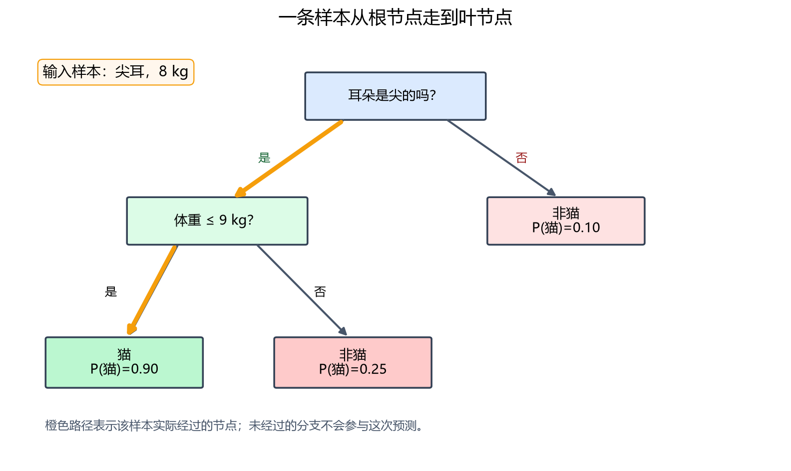
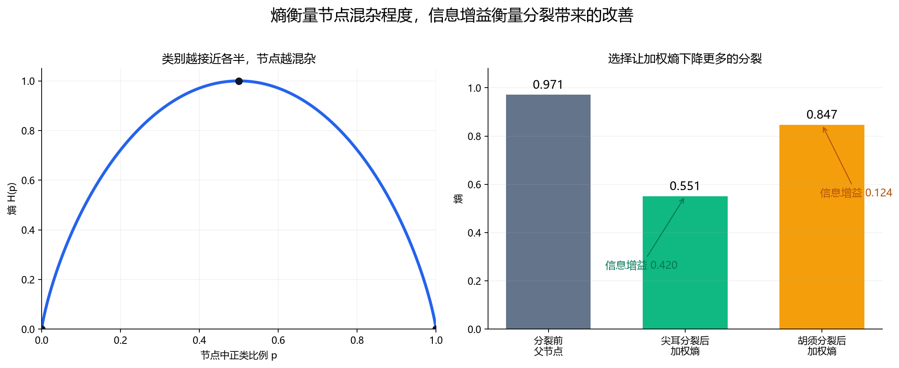
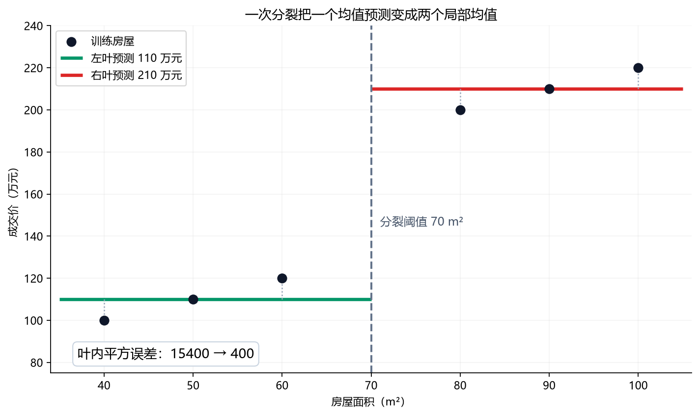
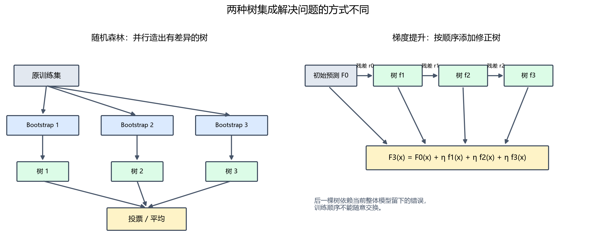

# [AI基础-机器学习]5.决策树、随机森林与梯度提升

线性回归和逻辑回归的核心思路，是给每一个输入特征分配一个固定的全局权重，通过一次性加权求和来做判断。

但人类在现实中做决策往往不是这样的。面对一张房产表格、一份信贷申请或病人的体检单，我们通常是一步一步提问：
- “年龄是否大于 35 岁？”
- “若是，月收入是否超过 2 万元？”
- “若否，过去两年是否有严重逾期记录？”

**决策树（Decision Tree）**正是这种层层分流思考方式的数学建模。它把复杂的特征空间切分成一个个清晰的局部区域，天然契合结构化的表格数据（Tabular Data）。

然而，单棵决策树极易走极端：数据稍微抖动一下，整棵树的结构就可能彻底改变。为了解决这个问题，机器学习发展出了两条极其强大的集成学习（Ensemble Learning）路径：
1. **随机森林（Random Forest / Bagging）**：通过构建大量有差异的树“并行投票”，大幅消除过拟合与方差波动；
2. **梯度提升树（GBDT / XGBoost / Boosting）**：让一棵棵新树“串行接力”，后一棵树专门瞄准前面模型的预测残差进行纠错。

本篇从单棵决策树的分裂原理与数学推导入手，逐步推进到随机森林与现代梯度提升算法的底层机制与工程实战。

---

## 1 决策树：让一条样本沿规则走到叶节点

决策树的拓扑结构由三类节点组成：
- **根节点（Root Node）**：整个决策流程的起点，包含全量待分类样本；
- **内部决策节点（Decision Node）**：中间判断环节，针对某个特征提出具体判断条件（例如“体重 $\le 9\text{ kg}$”）；
- **叶节点（Leaf Node）**：终点出口，不再继续分裂，直接输出最终的预测值或概率分布。

### 决策树的核心优势与固有局限

1. **自动捕捉特征非线性交互（Feature Interaction）**：
   在线性模型中，如果你希望模型知道“尖耳朵且体重小于 9kg 才是猫”，必须人工手动创造交叉特征 $x_1 \times x_2$。但在树结构中，样本沿着路径向下走，下层节点天然是在“上层条件全部满足”的局部子集上做决策，无需任何人工特征工程即可捕捉高阶交互。
2. **轴对齐切分（Axis-Aligned Splits）的几何局限**：
   单特征阈值分裂在几何上只能画出**与坐标轴平行的横平竖直分界线**。如果真实决策边界是一条平滑的 $45^\circ$ 斜线，单棵树必须用类似“阶梯状”的大量子分支去艰难逼近，需要消耗很深的层级。

---

## 2 熵与信息增益：从候选问题中选出更好的分裂

训练一棵决策树时，核心问题只有两个：**在当前节点选哪个特征切分最好？切分阈值定在多少？**

我们需要一个客观的数学指标，来衡量一个节点内样本分类标签的“混乱程度”。这个指标就是**熵（Entropy）**。

### 二分类的信息熵定义

设当前节点中正类样本的比例为 $p$，负类比例为 $1 - p$，节点的信息熵定义为：

$$\boxed{H(p) = -p \log_2(p) - (1-p) \log_2(1-p)}$$

- **当 $p = 0.5$（两类各占一半）时**：$H(0.5) = -0.5 \log_2(0.5) - 0.5 \log_2(0.5) = 1$。节点混乱度达到峰值，没有任何明确倾向。
- **当 $p = 1$ 或 $p = 0$（全是猫或全不是猫）时**：$H = 0$（定义 $0 \log_2 0 = 0$）。节点达到绝对纯净，无需再分。
- **当 $p = 0.8$ 时**：$H(0.8) = -0.8 \log_2(0.8) - 0.2 \log_2(0.2) \approx 0.722$。

### 信息增益（Information Gain, IG）：评估分裂带来的纯度提升

信息增益的逻辑非常直观：**分裂前父节点的混乱度，减去分裂后所有子节点的加权混乱度**。信息增益越大，说明这次切分让样本整体变得越纯净！

$$IG = H(\text{Parent}) - \left[ \frac{m_{\text{left}}}{m} H(\text{Left}) + \frac{m_{\text{right}}}{m} H(\text{Right}) \right]$$

> **完整算例对比**：
> 某个父节点共有 10 只动物（6 猫、4 非猫），父节点熵为 $H(\text{Parent}) = H(0.6) \approx 0.971$。
> 
> - **候选切分 A：“是否尖耳”**
>   - 左子节点（尖耳）：4 只全为猫。熵 $H(\text{Left}) = H(1.0) = 0$；
>   - 右子节点（非尖耳）：6 只（2 猫、4 非猫）。熵 $H(\text{Right}) = H(2/6) \approx 0.918$；
>   - 分裂后加权熵：$\frac{4}{10} \times 0 + \frac{6}{10} \times 0.918 \approx 0.551$；
>   - **信息增益**：$IG_A = 0.971 - 0.551 = \mathbf{0.420}$。
> 
> - **候选切分 B：“是否有胡须”**
>   - 左子节点（有胡须）：5 只（4 猫、1 非猫）。熵 $H(0.8) \approx 0.722$；
>   - 右子节点（无胡须）：5 只（2 猫、3 非猫）。熵 $H(0.4) \approx 0.971$；
>   - 分裂后加权熵：$\frac{5}{10} \times 0.722 + \frac{5}{10} \times 0.971 \approx 0.847$；
>   - **信息增益**：$IG_B = 0.971 - 0.847 = \mathbf{0.124}$。
> 
> 算法对比结果清晰明了：候选切分 A 带来的纯度净化（$0.420$）远大于切分 B（$0.124$），因此该节点坚决采用“是否尖耳”作为分裂条件！

> **基尼不纯度（Gini Impurity）**：
> 经典的 CART 树算法通常使用基尼不纯度替代信息熵：$Gini(p) = 1 - p^2 - (1-p)^2$。由于计算基尼系数无需进行对数运算 $\log_2$，在底层运行效率更高，且在绝大多数实际任务中切分排序结果与信息熵高度一致。

---

## 3 递归建树与停止条件：每个子节点重新做一次选择

确定了一次最优切分之后，算法便按照“分治法（Divide and Conquer）”递归推进：

1. 当前节点接收样本集合 $S$；
2. **检查停止条件**（是否已达到最大深度？样本是否已完全纯净？样本量是否过少？）；若满足，直接封装为叶节点并返回；
3. 遍历所有可用特征及其所有切分阈值，计算信息增益；
4. 选取信息增益最大的“特征 + 阈值”组合，将 $S$ 割裂为 $S_{\text{left}}$ 和 $S_{\text{right}}$；
5. 将 $S_{\text{left}}$ 送入左子树、将 $S_{\text{right}}$ 送入右子树，分别**递归调用第 1 步**。

### 树的正则化：为什么必须设定停止生长条件？

如果不加任何干预，贪心的决策树会一直递归向下分裂，直到每个叶节点仅剩下 1 个样本（纯度达到 100%，训练误差为 0）。此时模型就变成了一张庞大的“查找表”，把训练样本里的每一个随机噪声和极端个案都固化成了一条死规则，引发严重的过拟合。

树模型的正则化主要依靠对几何结构的硬约束（预剪枝与后剪枝）：
- **`max_depth`（最大深度）**：直接限制树的层数，防止模型无限挖掘长尾逻辑；
- **`min_samples_split`（节点分裂最小样本数）**：若一个节点里的样本量已经少于此门槛（如 $< 10$），禁止继续分裂；
- **`min_samples_leaf`（叶节点最小样本数）**：任何一个叶子拥有的样本数不能低于此阈值，避免把孤立噪点单独划为一个叶子；
- **`min_impurity_decrease`（最小不纯度下降阈值）**：若某次分裂带来的信息增益极其微弱，直接驳回分裂。

---

## 4 类别特征与连续特征：分裂条件从哪里来

现实数据中同时包含两种特征形态，决策树的处理机制截然不同：

### 1. 离散类别特征（Categorical Features）
- **二元独热编码（One-Hot Encoding）**：
  若特征包含三个类别（“尖耳、垂耳、圆耳”），可展开为 3 列二元特征，树每次只问“是否为尖耳？”。
- **集合切分与目标编码（Target Encoding）**：
  现代高性能树框架（如 LightGBM、CatBoost）支持原生类别处理。它们直接在类别集合内部寻找最优子集切分（如“是否属于 {尖耳, 圆耳}”），或基于标签统计量转化为数值，避免了独热编码导致高维稀疏特征切分效率低下的问题。

### 2. 连续数值特征（Continuous Numerical Features）
- 对所有样本在该特征上的连续数值进行**升序排序**（例如体重：$[4, 5, 7, 8, 10, 12]$）；
- 取相邻两点之间的中点作为候选切分阈值（候选阈值：$[4.5, 6.0, 7.5, 9.0, 11.0]$）；
- 逐个测试各个阈值对应的左右子集划分，计算信息增益，选出最优阈值。

> **免特征缩放（No Scaling Required）的核心优势**：
> 决策树只在乎数值在特征维度的**相对大小与排序**，根本不在乎绝对数值尺度。“面积 $\le 100\text{ m}^2$”与“面积 $\le 1076\text{ sq ft}$”产生的样本左右划分没有任何区别。因此，**决策树体系对特征缩放（标准化、归一化）完全免疫**，极大地简化了表格数据预处理流程。

---

## 5 回归树：选择能让叶内数值更接近的分裂

如果预测目标不是离散类别，而是连续数值（如预测房价），我们就需要使用**回归树（Regression Tree）**。

在回归树中，由于目标是连续值，无法计算概率分布与信息熵。其核心指标替换为**方差缩减（Variance Reduction）**或**均方误差（MSE）的减少量**。

### 叶节点输出与分裂准则

对于落入叶节点 $R$ 的所有样本，在平方误差损失下，使得该叶节点内误差平方和最小的最佳预测值，就是**该叶内所有样本真实标签的算术平均值**：

$$\hat y_R = \frac{1}{m_R} \sum_{i \in R} y^{(i)}$$

树在选择分裂特征与切分点时，追求的是让**分裂后左右两子集内部的平方误差之和最小化（即两子集各自高度抱团，内部方差极小）**：

$$J(j, t) = \sum_{i \in R_{\text{left}}} (y^{(i)} - \bar y_{\text{left}})^2 + \sum_{i \in R_{\text{right}}} (y^{(i)} - \bar y_{\text{right}})^2$$

回归树的预测在几何上是一个**阶梯状的分段常数函数（Piecewise Constant Function）**：同一个叶节点内的所有输入，输出的预测价格完全相同；一旦特征跨过边界，预测值会发生跳跃式跃迁。

---

## 6 单棵树为什么不稳定

单棵决策树拥有强大的可解释性与非线性拟合能力，但它在统计学上存在一个致命弱点：**极高的高方差（High Variance / 不稳定性）**。

### 贪心算法的“蝴蝶效应”
决策树每一层的分裂都是局部的**贪心选择**。假设在根节点处，两个特征“耳朵形状”与“胡须长度”的信息增益极其接近（分别为 $0.420$ 与 $0.419$）。
此时，如果训练数据集中随机增加或删除了仅仅一条样本，就很可能使后者的信息增益反超变成 $0.421$。
这一微小的扰动会导致根节点的切分特征直接易主；而根节点一切换，流向下层子树的数据集被全盘打乱，**整棵树后续几十个分支的结构和判定条件将发生雪崩式的剧烈剧变**！

这种对训练样本扰动的高度敏感性，导致单棵深层树在测试集上的泛化表现往往非常不稳定。为了解决这一痛点，**集成学习（Ensemble Learning）**应运而生。

---

## 7 Bagging 与随机森林：制造差异，再通过平均降低波动

既然一棵树容易波动，那么能否训练 100 棵不同的树，让它们一起投票？

统计学基本定理告诉我们：**若各子模型的误差相互独立，将多个高方差模型的预测求平均，能够显著降低整体方差，而保持偏差基本不变。**

### 1. Bootstrap 抽样（自助重采样法）

如何从现有的一个训练集中凭空制造出 100 棵不同的树？采用 **Bootstrap 抽样**：
- 设原始数据集有 $m$ 条样本；
- 每次随机抽取一条样本放入新训练集，**记录后放回原集合**，重复执行 $m$ 次。

在这一机制下，部分样本会被重复抽中，而另一部分样本一次都不会被抽到。
当样本量 $m \to \infty$ 时，某特定样本在 $m$ 次抽样中**一次都未被抽中**的概率收敛为：

$$\lim_{m \to \infty} \left(1 - \frac{1}{m}\right)^m = \frac{1}{e} \approx 36.8\%$$

这意味着：每次 Bootstrap 抽样得到的子训练集只包含约 $63.2\%$ 的去重样本，剩下的约 $36.8\%$ 未参与该树训练的样本被称为**袋外样本（Out-of-Bag, OOB）**。这为我们提供了一个天然的内置验证集：利用 OOB 样本可以直接评估每棵树的泛化能力（OOB Score），无需额外切分交叉验证折。

### 2. 随机森林（Random Forest）：样本随机 + 特征随机

单纯对样本进行 Bootstrap（即普通的 Bagging）还不够：如果数据集中存在一两个预测能力极强的超强特征，那么几乎每一棵树在根节点依然都会首选这些特征，导致生成的几十棵树结构依然高度雷同（模型相关性太高，削弱了平均降方差的效果）。

**随机森林在 Bagging 的基础上引入了第二重随机性——特征子空间随机采样**：
- 在每个节点准备寻找最佳切分点时，**不允许遍历所有 $d$ 个特征**；
- 而是随机抽取一部分特征子集（分类任务通常取 $\sqrt{d}$ 个，回归任务通常取 $\frac{d}{3}$ 个）；
- 强制模型只能在这受限的特征子集里寻找最优切分。

这一步看似故意给模型增加阻碍，实则是绝妙的“脱敏解耦”：它强行抑制了霸榜强特征的统治地位，逼迫不同树挖掘其他潜在的替代特征，从而**极大地降低了不同树之间的相关性**。

- **分类任务**：所有树并行预测，采用**多数投票法（Majority Vote）**或概率加权平均；
- **回归任务**：所有树并行预测，直接计算**预测数值的算术平均值**。

---

## 8 梯度提升：后一棵树拟合前面模型尚未解决的部分

随机森林走的是“并行独立造树、最后平均”的民主路线；而 **Boosting（提升法）** 走的是“精英接力、错题本递归攻关”的进阶路线。

### 极简算例：梯度提升树是如何一步步纠错的？

设有一组极其简单的数据（$m=3$），输入为 $x = (1, 2, 3)$，目标连续标签为 $y = (2, 4, 8)$。

1. **第 0 步：初始化基准模型 $F_0(x)$**
   初始基准通常为全量样本真实标签的均值：
   $$F_0(x) = \frac{2 + 4 + 8}{3} = 4.667$$
   计算当前的预测**残差（Residual = 真实值 - 当前预测）**：
   $$r_1 = y - F_0 = (2 - 4.667, 4 - 4.667, 8 - 4.667) = (-2.667, -0.667, 3.333)$$
   当前均方误差总和高达 $18.667$。

2. **第 1 步：训练第一棵弱树 $f_1(x)$ 拟合残差**
   注意：**这棵新树的目标标签不再是原始的 $y$，而是上面的这组残差向量 $r_1$！**
   假设这棵小树根据 $x \le 2$ 完成了一次简单切分：
   - 左子树预测值（负残差均值）：$\frac{-2.667 - 0.667}{2} = -1.667$；
   - 右子树预测值：$3.333$。

3. **第 2 步：将纠错树累加到整体模型，引入学习率（收缩步长）**
   设提升学习率 $\eta = 0.5$（不能让新树一次修正过猛）：
   $$F_1(x) = F_0(x) + \eta f_1(x)$$
   更新后的三条样本新预测值为：
   - 样本 1：$4.667 + 0.5 \times (-1.667) \approx 3.833$（向真实值 2 显著靠拢）；
   - 样本 2：$4.667 + 0.5 \times (-1.667) \approx 3.833$（向真实值 4 显著靠拢）；
   - 样本 3：$4.667 + 0.5 \times 3.333 \approx 6.333$（向真实值 8 显著靠拢）。
   误差总和由 $18.667$ 锐减至 $6.167$！

4. **后续循环**：重新计算新预测值与真实值之间的第二轮残差，训练第二棵树 $f_2(x)$ 继续拟合该残差……

最终的模型就是所有弱树的加权累加和：

$$\boxed{F_T(x) = F_0(x) + \sum_{t=1}^{T} \eta f_t(x)}$$

### 广义梯度提升（GBDT）与损失函数的负梯度

为什么叫“梯度提升”？
在均方误差损失 $L(y, \hat y) = \frac{1}{2}(y - \hat y)^2$ 下，损失对当前预测的负梯度恰好就是残差：
$$-\frac{\partial L}{\partial \hat y} = y - \hat y$$
这揭示了一个深刻本质：**所谓“拟合残差”，本质上是让新树拟合损失函数沿着函数空间的负梯度方向！**
将这一概念推广到二分类对数损失、排序损失等任意可微损失函数时，每一轮新树只要负责拟合该损失函数对应的负梯度，模型就能沿着最优方向逐步降低全局风险。

### XGBoost（Extreme Gradient Boosting）的工程与算法突破

在竞赛与工业落地中，XGBoost 成为了梯度提升树的事实标准，其关键演进包括：
1. **二阶泰勒展开（Taylor Expansion）**：不仅利用一阶梯度 $g_i$，还利用损失函数的二阶 Hessian 矩阵信息 $h_i$，使分裂点评估与叶子权重计算更加精准迅速；
2. **显式树结构正则化**：在目标函数中直接将“叶子节点总数 $T$”和“叶子权重平方和 $\|w\|^2$”列入惩罚项：
   $$\mathrm{Obj}^{(t)} = \sum_{i=1}^m \ell(y_i, \hat y_i^{(t)}) + \gamma T + \frac{1}{2}\lambda \sum_{j=1}^T w_j^2$$
   从根源上控制树的复杂度，大幅缓解了传统 GBDT 容易过拟合的问题。

---

## 9 随机森林、梯度提升与神经网络的使用边界

在实际机器学习工程选型中，面对不同的业务场景与数据结构，应当如何决断？

### 随机森林 vs 梯度提升决策表

| 对比维度 | 随机森林（Random Forest） | 梯度提升树（GBDT / XGBoost / LightGBM） |
|:---|:---|:---|
| **树的构建机制** | **并行独立生长**，互不干扰 | **严格串行生长**，后树依赖前树的残差 |
| **核心算法定位** | **降低方差**（把多个高方差深树平均化） | **降低偏差**（把多个高偏差弱小树累加拟合） |
| **超参数敏感度** | **极其皮实抗造**。只要树够多（如 200 棵），几乎无需细致调参即可获得优异基准。 | **高度敏感**。学习率 $\eta$、树深、正则项、早停轮数（Early Stopping）必须配合精调。 |
| **并行计算优势** | 天生支持多核全并行训练。 | 树与树之间无法并行，只能在单树内部寻找切分点时做特征并行。 |
| **离群噪点耐受度** | 极强（少数树被带偏会被多数投票稀释）。 | 相对脆弱（异常噪点会产生巨大残差，逼迫后续弱树死磕噪点）。 |

### 树模型体系 vs 深度神经网络

1. **表格结构化数据（Tabular Data）的主宰者**：
   对于金融风控表、医疗指标表、用户点击画像等结构化数据，各类特征含义明确（连续与离散并存、缺失值常见、尺度千差万别），**梯度提升树（LightGBM / XGBoost / CatBoost）在研发效率、训练资源占用与预测指标上依然大幅优于深度神经网络**。
2. **非结构化数据（图像、音频、自然语言）**：
   文本和图像等原始像素/文字信号没有预定义好的离散表格列，依赖深层特征提取器进行语义表征，这属于卷积神经网络（CNN）与 Transformer 等深度学习模型的绝对统治领域。