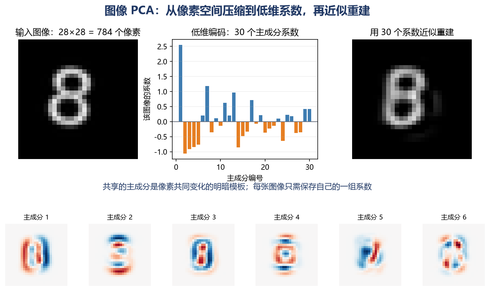
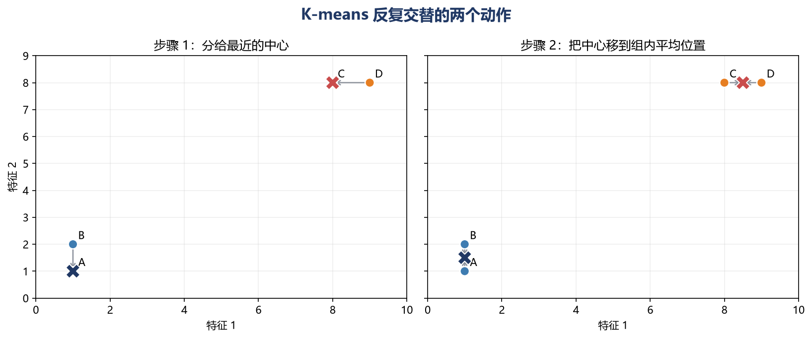
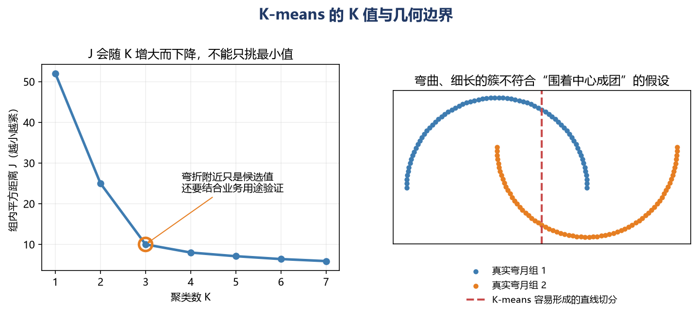
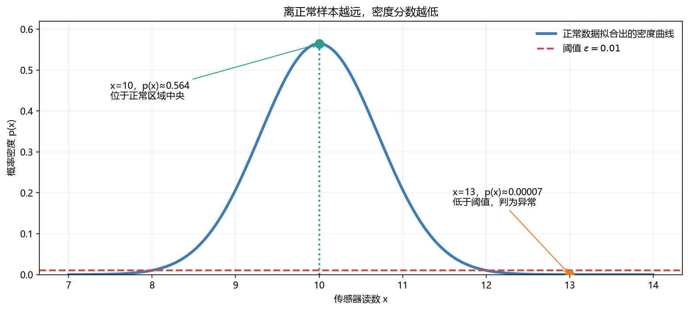
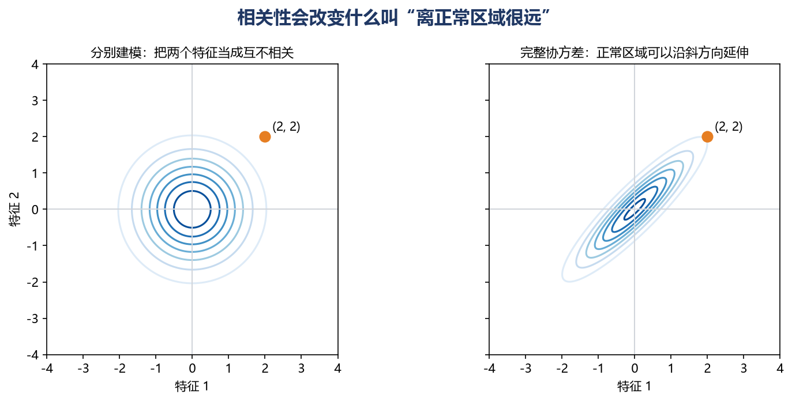

# [AI基础-机器学习]6.主成分分析、聚类与异常检测

监督学习必须依赖成对的输入和标签 $(x, y)$。但在工业界与实际研究中，绝大多数数据没有现成标注，或者打标成本高昂。

面对没有标签的纯输入数据，我们通常有三类完全不同的核心需求：
1. **降维（PCA）**：特征太多、冗余严重，如何用少数几个正交的新坐标轴保留绝大部分信息？
2. **聚类（K-means）**：没有任何预设分类名，如何把几何空间中彼此接近的样本自动归为同一组？
3. **异常检测（Anomaly Detection）**：绝大部分数据都是正常的，如何识别偏离主流分布的罕见异动？

这三项技术可以协同串联成流水线（例如先用 PCA 压缩传感器特征，再用 K-means 分类设备运行模式，最后用异常检测筛查故障），但它们的数学目标与评判标准截然不同。

---

## 1 无标签数据里可以寻找三种不同结果

设数据矩阵为 $X \in \mathbb R^{m \times n}$：共有 $m$ 个样本，每个样本包含 $n$ 个特征。样本排在行，特征排在列。

面对完全相同的数据矩阵 $X$，三项技术给出的输出形态各异：

| 方法 | 核心要回答的问题 | 主要输出结果 | 经典工程用途 |
|---|---|---|---|
| **PCA** | 能否找到少数几个方差最大的投影方向，保留数据的主要变化？ | 低维坐标矩阵 $Z \in \mathbb R^{m \times k}$（其中 $k \ll n$） | 消除线性冗余、降低存储开销、2D/3D 可视化、为后续模型加速 |
| **K-means** | 样本在空间中如何抱团？哪些样本彼此更接近？ | 每个样本的类别归属 $c^{(i)}$，以及 $K$ 个簇中心点 $\mu_k$ | 客群分群画像、图像颜色量化压缩、构建无监督原型特征 |
| **异常检测** | 新样本出现在“正常世界”的概率有多低？ | 异常评分/概率密度 $p(x)$，以及基于阈值的报警判定 | 工业设备磨损预警、金融欺诈拦截、服务器入侵检测 |

无监督学习绝不等于“完全不需要人工判断”。降维保留多少维、聚类设定多少簇、报警阈值定在多严格，都必须紧扣下游业务目标与评估指标进行取舍。

---

## 2 PCA 的图像应用：把像素变成少量成分系数

在线性代数中，PCA 的目标是在高维空间中找到方差最大（即信息保留最多）的正交坐标轴；在机器学习应用中，它扮演着**特征压缩器与重构器**的角色：把由成百上千个像素组成的复杂图像，投影为少数关键系数，并且之后还能近似复原。

以一批 $28 \times 28$ 的灰度手写数字图像为例：
- 每张图像展平为一个行向量，长度为 $n = 28 \times 28 = 784$；
- $m$ 张图像堆叠成数据矩阵 $X \in \mathbb R^{m \times 784}$。

那么，**PCA 究竟是如何从数学上“提取出前 30 个主成分”，又是如何把每张图像的 784 个像素“压缩成 30 个系数”的？**

---

### 2.1 从 784 个像素压缩成 30 个系数

整个降维流程分为清晰的四个数学步骤：

#### 第一步：零均值中心化（Zero-centering）
PCA 寻找的是数据“围绕均值波动的离散程度”（方差），必须先把原点移到数据中心。
1. 仅在训练集上计算每个像素特征的算术均值，得到平均行向量 $\mu \in \mathbb R^{1 \times 784}$；
2. 将全量样本减去均值，得到去中心化后的矩阵：
   $$\widetilde{X} = X - \mathbf 1_m \mu \quad \in \mathbb R^{m \times 784}$$
   $\mu$ 代表所有数字重叠出来的“平均底图”，减去它后，每个样本保留的都是偏离底图的明暗起伏量。

#### 第二步：协方差矩阵与“提取前 30 个主成分”的数学机理
我们怎么知道哪个投影方向保留的信息最多？
假设我们要找一个单位方向向量 $v \in \mathbb R^{784 \times 1}$（满足 $\|v\| = 1$），样本投影到该方向上的方差为：
$$\mathrm{Var} = \frac{1}{m} v^\mathsf{T} \widetilde{X}^\mathsf{T} \widetilde{X} v = v^\mathsf{T} \Sigma v$$
其中 $\Sigma = \frac{1}{m} \widetilde{X}^\mathsf{T} \widetilde{X} \in \mathbb R^{784 \times 784}$ 就是样本的**协方差矩阵**。
- 对角线上的元素 $\Sigma_{jj}$ 代表第 $j$ 个像素自身的方差；
- 非对角线元素 $\Sigma_{jk}$ 代表第 $j$ 与第 $k$ 个像素之间的相关程度。

利用拉格朗日乘子法求解约束极值问题 $\max_{v} v^\mathsf{T} \Sigma v \text{ s.t. } v^\mathsf{T}v = 1$，导数等于 0 时直接导出了经典的**特征值方程**：
$$\Sigma v = \lambda v$$
- **特征向量 $v$**：正是我们要找的主成分投影轴方向；
- **特征值 $\lambda$**：代表数据在该方向上的方差大小！$\lambda$ 越大，说明沿着这个轴的信息展得越开、损失越小。

对 $784 \times 784$ 的协方差矩阵进行谱分解，会得到 784 个正交特征向量和对应的特征值。**所谓“提取前 30 个主成分”，就是把所有特征值按从大到小排序：$\lambda_1 \ge \lambda_2 \ge \dots \ge \lambda_{784}$，然后取出前 30 个最大特征值对应的特征向量 $v_1, v_2, \ldots, v_{30}$**。

将这 30 个列向量并排拼在一起，就构成了投影矩阵：
$$V_{30} = \begin{bmatrix} | & | & & | \\ v_1 & v_2 & \dots & v_{30} \\ | & | & & | \end{bmatrix} \quad \in \mathbb R^{784 \times 30}$$

> **工程实现小注（SVD 奇异值分解）**：
> 在工业级库（如 NumPy 或 `scikit-learn`）中，通常不会显式去乘出庞大的协方差矩阵 $\widetilde{X}^\mathsf{T}\widetilde{X}$，而是直接对中心化矩阵 $\widetilde{X}$ 做奇异值分解（SVD）：$\widetilde{X} = U S V^\mathsf{T}$。右奇异矩阵 $V$ 的前 30 列与协方差矩阵的前 30 个特征向量完全等价，但数值稳定性更高。

#### 第三步：如何把原始数据转化为 30 个系数（低维投影）
有了这 30 个主基底 $V_{30}$，原本 784 维的数据是如何映射成 30 维的？**通过简单的矩阵内积做坐标投影**！

对于单张去中心化后的图像 $\widetilde{x} = x - \mu \in \mathbb R^{1 \times 784}$，它在第 $j$ 个主成分向量 $v_j \in \mathbb R^{784 \times 1}$ 上的投影为一个标量数值：
$$z_j = \widetilde{x} \cdot v_j = \sum_{p=1}^{784} (x_p - \mu_p) v_{p, j}$$
这个标量 $z_j$ 的物理含义非常直观：**它代表这张图像在第 $j$ 种明暗特征模板上“匹配得分”是多少**。

将 30 个方向的标量整合成一行，得到降维后的 30 维新向量：
$$z = \widetilde{x} V_{30} = (x - \mu) V_{30} \quad \in \mathbb R^{1 \times 30}$$

对于整个数据集 $m$ 张图，一次性矩阵乘法即可完成全局转换：
$$Z = (X - \mathbf 1_m \mu) V_{30} \quad \in \mathbb R^{m \times 30}$$
- 输入维度：$(m \times 784)$
- 转换矩阵：$(784 \times 30)$
- 输出维度：$(m \times 30)$

每张图片仅用 30 个浮点数标量就表达了全貌，数据存储量与维度缩减了约 $1 - \frac{30}{784} \approx 96.2\%$。

#### 第四步：从 30 个系数近似还原原图（低维重构）
因为基底 $V_{30}$ 的各列是相互正交的单位向量（$V_{30}^\mathsf{T} V_{30} = I_{30}$），要从 30 个系数复原图像，只需将系数作为权重线性组合基底，再加上被扣除的平均底图 $\mu$：
$$\hat x = z V_{30}^\mathsf{T} + \mu \quad \in \mathbb R^{1 \times 784}$$
- $z V_{30}^\mathsf{T}$ 的维度是 $(1 \times 30) \times (30 \times 784) = (1 \times 784)$；
- 加上 $\mu$ 后，重新 reshape 回 $28 \times 28$ 网格，就得到了重构图像 $\hat x$。

图中这张数字 8 的前六个系数约为 $(2.553, -1.061, -0.908, -0.840, -0.762, 0.200)$。这说明图像在第 1 个主成分模板上的特征表现极其突出（权重高达 2.553），随后配合后续模版的加权调节，重构出数字的主干轮廓。未保留的 754 个次要方向对应的微小笔触与噪声则在压缩中被自然滤除。

---

### 2.2 成分数由应用结果决定

保留的成分数 $k$ 越大，保留的信息越完整，但计算和存储开销也越大。我们通常根据**解释方差占比**来评估信息保留度：

$$\text{累计解释方差比} = \frac{\sum_{i=1}^k \lambda_i}{\sum_{j=1}^n \lambda_j}$$

| 成分数 $k$ | 累计解释方差 | 全部图像的平均像素平方误差 | 状态评估 |
|---:|---:|---:|:---|
| 10 | 52.7% | 0.0130 | 压缩极强，但图像边缘开始模糊失真 |
| 20 | 69.8% | 0.0083 | 找回主干笔画，适合快速分类特征提取 |
| **30** | **79.6%** | **0.0056** | **平衡拐点：保真度接近 80%，数据压缩达 96.2%** |
| 50 | 89.8% | 0.0028 | 细节极其清晰，但低维表示体积有所上升 |

在确定 $k$ 时，应遵循以下工程原则：
- **目标为图像重建**：观察重构图的轮廓与像素均方误差是否满足清晰度要求；
- **下游有分类器/聚类任务**：将降维后的矩阵 $Z$ 喂给后续模型，在验证集上对比不同 $k$ 对最终指标（如 F1-score）的影响；
- **异常检测场景**：必须格外审慎，因为异常和缺陷往往藏在方差极小的次要方向中，盲目使用前 $k$ 个主成分可能会误将关键异常特征当作噪声滤除。

> **防泄漏铁律**：
> 均值 $\mu$ 与投影矩阵 $V_k$ **必须仅从训练集拟合求出**。验证集、测试集以及线上新样本，都必须直接套用这一套固定的 $\mu$ 和 $V_k$ 做矩阵乘法映射，绝不能在测试集上重新计算协方差与特征值。
---

## 3 K-means：在没有类别名时把相近样本分组

PCA 是做坐标变换和降维，而 **K-means 聚类** 是在特征空间中寻找紧凑的样本团簇。

其运行机制极其纯粹，反复迭代执行两个交替步骤：
1. **簇分配（Cluster Assignment）**：把每个样本分配给离它欧氏距离最近的中心点；
2. **中心移动（Centroid Update）**：将每个簇的中心点更新为该簇所有样本的几何算术平均值。

### 极简算例追踪

平面上有 4 个点：$A(1,1), B(1,2), C(8,8), D(9,8)$。设定 $K=2$，初始中心指定为 $\mu_1=(1,1), \mu_2=(8,8)$。

- **第 1 步：样本分配**
  - 计算点 $B(1,2)$ 到两中心的平方欧氏距离：
    - 到 $\mu_1$：$(1-1)^2 + (2-1)^2 = 1$
    - 到 $\mu_2$：$(1-8)^2 + (2-8)^2 = 85$
    - 显然离 $\mu_1$ 更近，归入簇 1。
  - 同理：$A, B \to \text{簇 1}$；$C, D \to \text{簇 2}$。
- **第 2 步：更新中心**
  - 新中心 $\mu_1 = \frac{(1,1) + (1,2)}{2} = (1, 1.5)$
  - 新中心 $\mu_2 = \frac{(8,8) + (9,8)}{2} = (8.5, 8)$
- 重新计算分配，所有点的归属不再发生变动，算法收敛停止。

---

## 4 聚类目标、初始化与局部最优

K-means 的两步迭代，本质上是在通过坐标轮换下降法最小化同一个优化目标——**畸变函数（Distortion Function / 簇内平方和）**：

$$J(c^{(1)}, \ldots, c^{(m)}, \mu_1, \ldots, \mu_K) = \frac{1}{m}\sum_{i=1}^{m} \left\|x^{(i)} - \mu_{c^{(i)}}\right\|_2^2$$

- $c^{(i)}$：第 $i$ 个样本所属的簇索引；
- $\mu_{c^{(i)}}$：该样本所属簇的中心点坐标。

由于每一步分配都在局部寻找最近中心，每一步更新都在取均值最小化平方误差，$J$ 在迭代中**单调不增**。

### 局部最优陷阱与 K-means++

$J$ 是一个非凸函数，存在大量局部极小值。如果初始中心选得不好（例如多个中心恰好扎堆在同一个密集簇里），算法很容易收敛到极差的局部最优解。

为了解决这个问题：
1. **K-means++ 初始化**：
   - 随机选第 1 个中心；
   - 后续每个中心的选取概率与该点到已有最近中心的距离平方成正比（**越偏远的点越优先成为新中心**，强行把中心拉开）；
2. **多次随机重启（Multiple Random Restarts）**：
   运行多次算法（如设置 `n_init=10`），最终保留总畸变损失 $J$ 最小的那组聚类结果。

---

## 5 选择 K，并判断数据是否适合 K-means

簇数 $K$ 是一个外部超参数。随着 $K$ 的增加，样本到中心的距离被不断压缩，当 $K=m$ 时 $J=0$，因此**绝不能单靠追求 $J$ 最小来选 $K$**。

### 评估方法与业务约束

1. **肘部法（Elbow Method）**：
   绘制 $K$ 从 $1$ 到 $N$ 对应的畸变度 $J$ 曲线。寻找曲线斜率急剧放缓的拐点（“手肘”）。
2. **轮廓系数（Silhouette Score）**：
   对每个样本综合衡量“簇内紧密度 $a(i)$”与“最近簇间分离度 $b(i)$”：
   $$s(i) = \frac{b(i) - a(i)}{\max(a(i), b(i))} \in [-1, 1]$$
   得分越接近 1 说明聚类效果越好，接近 0 说明处于交界模糊区，负值说明被错分。
3. **业务指标优先**：
   如果聚类是为了将服装分为 S、M、L 三个尺码生产，那么 $K=3$ 是业务的硬性约束，数学指标只用于评估该 $K$ 下的表现。

### K-means 的几何短板

K-means 基于欧氏距离度量，默认所有簇呈现**凸球形、各向同性、方差相近**。在以下场景中会严重失效：
- **流形/环形/月牙形数据**：无法用直线超平面切分（需使用 DBSCAN、谱聚类）；
- **簇大小与密度极度悬殊**：稀疏大簇常被暴力撕裂；
- **强离群噪点存在**：平方误差会对异常点过度敏感，将均值中心大幅拉偏。

---

## 6 异常检测：先描述“正常”，再寻找低密度样本

异常检测与分类/聚类的核心区别在于：**它先从大量健康数据中学习出“正常形态”的概率密度分布 $p(x)$**。

当遇到新样本时，计算其发生的联合概率密度：
$$p(x) < \epsilon \implies \text{触发告警（判定为异常）}$$

其中 $\epsilon$ 为预设的异常判定阈值。

### 6.1 一维高斯模型的完整计算

假设某服务器 CPU 利用率在正常状态下的 4 次抽样为：$9\%, 10\%, 10\%, 11\%$。

1. **参数估计（极大似然估计）**：
   $$\mu = \frac{9+10+10+11}{4} = 10$$
   $$\sigma^2 = \frac{(9-10)^2 + (10-10)^2 + (10-10)^2 + (11-10)^2}{4} = 0.5 \implies \sigma \approx 0.707$$
2. **构建正态分布概率密度函数**：
   $$p(x) = \frac{1}{\sqrt{2\pi}\sigma} \exp\left(-\frac{(x - \mu)^2}{2\sigma^2}\right)$$
3. **打分与判定**：
   - 对于新读数 $x = 10$：
     $$p(10) = \frac{1}{\sqrt{2\pi} \times 0.707} \approx 0.564$$
   - 对于突发异常读数 $x = 13$：
     $$p(13) = 0.564 \times \exp\left(-\frac{(13-10)^2}{2 \times 0.5}\right) = 0.564 \times e^{-9} \approx 0.00007$$

若设定阈值 $\epsilon = 0.01$，读数 13 的出现密度远远低于阈值，立即触发故障警报。

---

## 7 多特征异常分数：相乘、取对数与相关性

在实际工程中，监控指标往往有多个维度（如温度 $x_1$、振动 $x_2$、网络流量 $x_3$）。

### 独立高斯假设（特征独立）

标准做法是对每个特征分别独立拟合一维高斯分布，联合概率直接连乘：

$$p(x) = \prod_{j=1}^{n} p(x_j; \mu_j, \sigma_j^2) = \prod_{j=1}^{n} \frac{1}{\sqrt{2\pi}\sigma_j} \exp\left(-\frac{(x_j - \mu_j)^2}{2\sigma_j^2}\right)$$

为防止多个小数连乘造成浮点数下溢，工程实现中**全部转换为对数加法计算**：

$$\log p(x) = \sum_{j=1}^{n} \log p(x_j; \mu_j, \sigma_j^2)$$

### 多元高斯分布（捕捉特征相关性）

独立高斯模型假设各特征互不相干，其等高线只能是**正立的椭圆或圆**。
但在现实中，特征之间往往存在强烈的联动关系（例如：服务器访问量激增时，CPU 利用率同步飙升属于完全正常的业务波峰）。

- 如果某时刻“访问量极高”但“CPU 利用率为 0”，单看两个指标各自的数值，都在合理区间内；
- 但两者的组合关系极度反常（可能进程死锁崩溃）。

此时需要使用**多元高斯分布（Multivariate Gaussian Distribution）**，引入协方差矩阵 $\Sigma$：

$$p(x) = \frac{1}{(2\pi)^{n/2} |\Sigma|^{1/2}} \exp\left( -\frac{1}{2} (x - \mu)^\mathsf{T} \Sigma^{-1} (x - \mu) \right)$$

- **协方差矩阵 $\Sigma$** 能够生成倾斜拉伸的椭圆等高线，精准捕捉两两特征之间的线性协同关系；
- **代价与权衡**：多元高斯需要计算 $n \times n$ 的协方差矩阵并求逆，计算复杂度达到 $O(n^3)$，且要求样本量 $m > n$（否则矩阵奇异不可逆）。如果特征数高达上万维，通常使用独立高斯模型或手动组合特征。

---

## 8 用开发集选择阈值，而不是凭感觉报警

虽然异常检测模型只用正常数据训练，但**超参数 $\epsilon$（告警门槛）绝不能拍脑袋决定**。

标准的工业验证集划分架构如下：
- **训练集（Training Set）**：包含纯粹的海量正常样本（允许极微量未标记噪声），用于拟合参数 $\mu, \sigma^2$；
- **交叉验证集（CV / Dev Set）**：包含正常样本以及**少量已知的真实异常样本**（例如 10~20 个标注故障），用于调优阈值 $\epsilon$；
- **测试集（Test Set）**：保留完全独立的正常与异常样本，评估最终系统的实战召回率与虚警率。

### 为什么不能看准确率（Accuracy）？

在异常检测场景中，正常样本通常占 99.9%，异常样本仅占 0.1%。如果一个模型把所有样本统统预测为正常，准确率高达 99.9%，但真实异常漏报率是 100%！

必须使用针对偏斜类别的指标来确定 $\epsilon$：
- **召回率（Recall）**：真异常里抓出了多少？（评估漏报风险）；
- **精确率（Precision）**：报出来的故障里有多少是真的？（评估误报与运维打扰成本）；
- **$F_1\text{-score}$ 或 PR-AUC**：在精确率与召回率之间寻找最佳平衡拐点。

---

## 9 特征设计往往比更复杂的异常模型先见效

高斯模型的有效性高度依赖一个前提：**特征分布是否接近钟形的正态分布**。

在实际构建特征工程时，两个技巧立竿见影：

1. **偏态特征的对数变换**：
   长尾分布（如访问耗时、下载字节数、充值金额）往往呈严重右偏。直接拟合高斯会导致正常区间被过度拉伸。应用非线性变换：
   $$x_{\mathrm{new}} = \log(x + c) \quad (c > 0 \text{ 避免 } \log 0)$$
   能将严重右偏的长尾特征迅速拉回近似正态的单峰钟形分布。
2. **构建比率与交互特征**：
   如果独立高斯无法捕捉联动异动，无需强行上多元高斯，直接人工显式构造比率特征：
   $$x_{\mathrm{ratio}} = \frac{x_{\mathrm{CPU}}}{x_{\mathrm{network}} + c}$$
   正常情况下该比值保持平稳，一旦服务卡死，该比值会瞬间爆表偏离均值数十个标准差，独立高斯模型也能轻松将其捕捉。

### 异常检测 vs 监督学习选型指南

| 决策维度 | 异常检测（Anomaly Detection） | 监督学习（二分类 / 逻辑回归） |
|---|---|---|
| **正例（异常）数量** | 极少（几个到几十个，严重不平衡） | 充足且正负样本均衡（成百上千条以上） |
| **异常模式的变化** | **未知的多样性**。明天的攻击手段或设备故障模式可能从未发生过。 | **已知的重复性**。未来的异常模式与训练集中的正例高度相似。 |
| **核心算法思想** | 学习“什么是正常”，偏离者皆可疑。 | 学习“正负样本之间的切分边界”。 |
| **典型案例** | 航天飞机新故障预警、未公开的零日黑客攻击。 | 经典垃圾邮件过滤、已知套路的欺诈刷单判定。 |