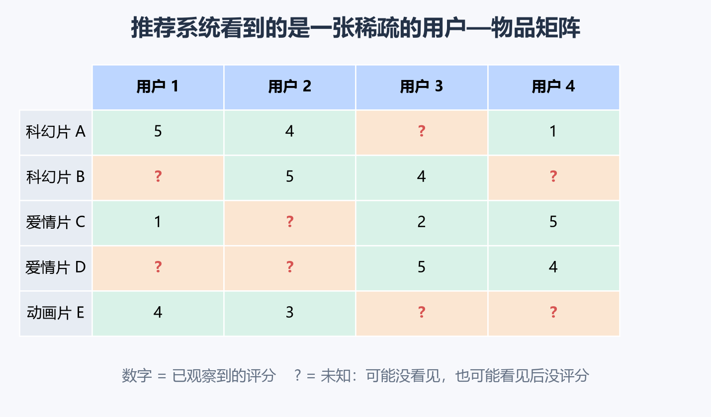
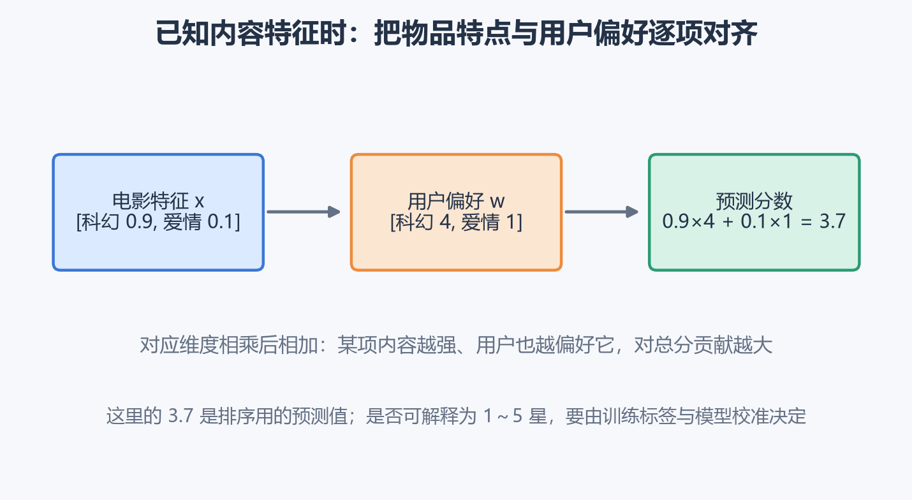
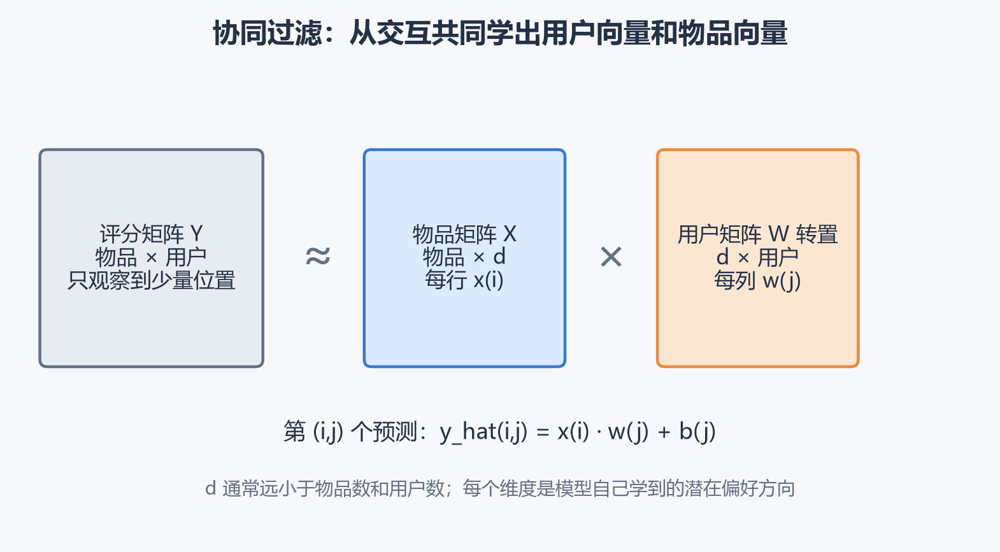
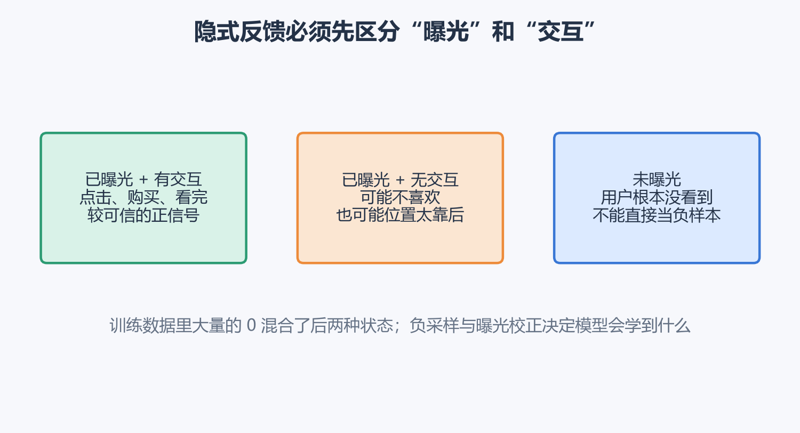
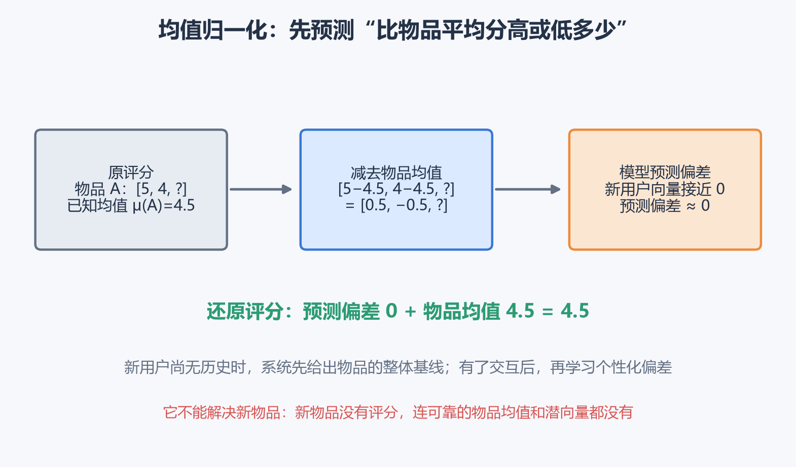
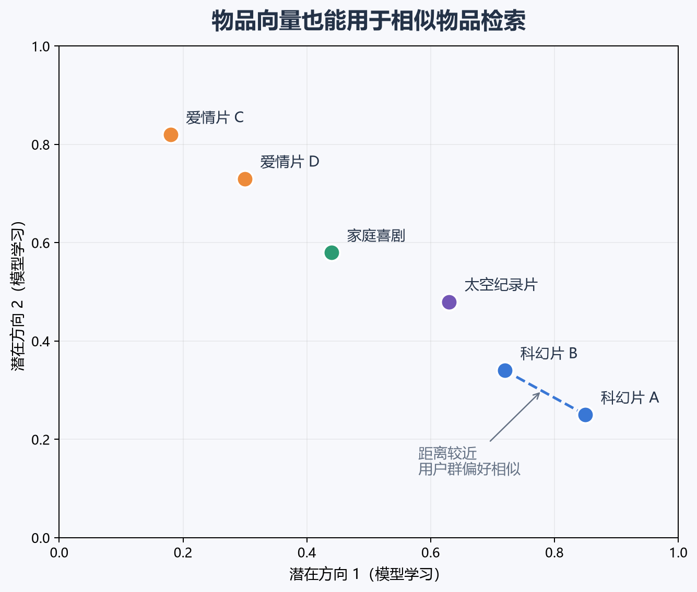
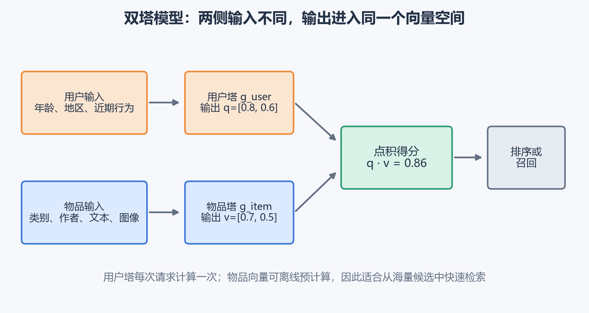
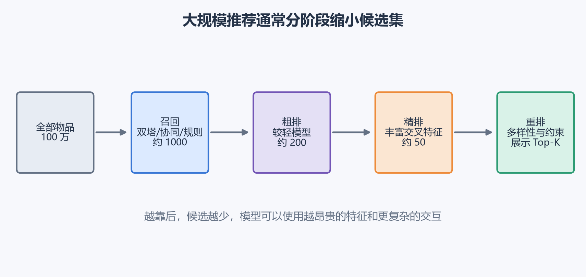
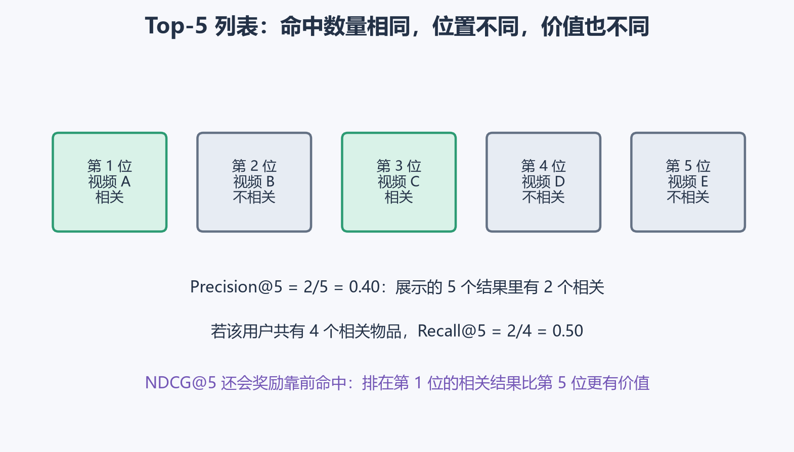
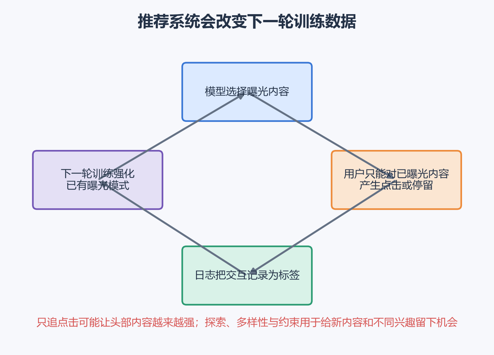

# [AI应用-推荐系统]1.协同过滤、内容推荐与双塔模型

推荐系统的核心任务非常明确：在海量物品（电影、商品、短视频、文章）中，为指定用户挑选出他最可能感兴趣的候选集合。

初学者最容易陷入的一个误区是：**把“未交互”等同于“不喜欢”**。在实际业务中，一个物品没有被用户点击或评分，极大概率只是它从未被曝光在用户眼前。推荐系统不仅要学会从极度稀疏的已有行为中挖掘偏好，还必须直面曝光偏差、冷启动、超大规模候选库的毫秒级检索，以及算法自我强化所引发的反馈循环。

本篇从稀疏评分矩阵与显隐式反馈切入，拆解协同过滤与矩阵分解的数学本质，进而引出工业级主流的向量检索利器——双塔模型，最终还原现代化工业推荐系统“召回—排序—重排”的分层漏斗全貌。

---

## 一、推荐任务从一张稀疏的用户—物品表开始

设平台上有 $n_m$ 个物品和 $n_u$ 个用户，交互数据可以用一个巨型评分矩阵 $Y$ 来表示：

$$
Y \in \mathbb R^{n_m \times n_u}
$$

矩阵的第 $i$ 行对应物品 $i$，第 $j$ 列对应用户 $j$，交叉位置的值 $y^{(i,j)}$ 即为用户 $j$ 对物品 $i$ 的反馈（如 1~5 星打分）。

在真实世界中，一个电商平台可能有数千万件商品，而单个用户一生看过的商品通常只有几千件，矩阵的绝大多数空格都没有数值。因此需要引入一个**观察掩码指示器**：

$$
r(i,j) =
\begin{cases}
1, & \text{观察到了用户 } j \text{ 对物品 } i \text{ 的交互反馈}, \\
0, & \text{该位置未发生交互（未知状态）}.
\end{cases}
$$

### 必须严格区分的三种状态
- **缺失的问号（`?`，即 $r(i,j)=0$）**：代表“未知”。用户可能完全不知道该物品的存在，绝不能简单当成负反馈处理；
- **数值 0**：只有在业务显式定义时才有意义（例如“已在首屏明显曝光，但用户明确划过未点击”）；
- **有记录的数值（$r(i,j)=1$）**：用户明确表达了偏好，训练回归模型时**只在这部分已观察位置上计算损失**。

推荐系统的终极追求不是去严丝合缝地猜准每个空格的绝对打分，而是**对候选物品进行相对排序（Ranking）**，确保排在最前面的物品能击中用户的偏好。

---

## 二、物品特征已知时，可以为每位用户学习偏好

为了理解模型如何刻画偏好，先看最理想的简化场景：**每部电影的内容属性预先已知**。

假设每部电影有 $d=2$ 个专家标注的内容特征 $x^{(i)} \in \mathbb R^2$（分别代表科幻程度、爱情程度）：

$$
x^{(i)} = \begin{bmatrix} x_{\text{科幻}}^{(i)} \\ x_{\text{爱情}}^{(i)} \end{bmatrix}
$$

对于用户 $j$，我们为其分配一个对应的偏好权重向量 $w^{(j)} \in \mathbb R^2$ 和一个标量偏置 $b^{(j)}$：

$$
w^{(j)} = \begin{bmatrix} w_{\text{科幻}}^{(j)} \\ w_{\text{爱情}}^{(j)} \end{bmatrix}
$$

用户 $j$ 对电影 $i$ 的预测评分即为特征的加权和：

$$
\hat y^{(i,j)} = {w^{(j)}}^T x^{(i)} + b^{(j)}
$$

- $w_{\text{科幻}}^{(j)}$ 大，说明该用户极度热爱科幻片；
- $b^{(j)}$ 吸收用户的基线打分风格（有些用户是“宽容型”，均分给 4.5；有些用户是“严苛型”，均分给 2.0）。

> **数值计算直觉**：
> 一部强科幻、弱爱情的电影特征为 $x^{(i)} = [0.9, 0.1]^T$。
> 某科幻迷用户的偏好为 $w^{(j)} = [4.0, 1.0]^T$，基线 $b^{(j)} = 0$。
> 
> $$
> \hat y^{(i,j)} = 4.0 \times 0.9 + 1.0 \times 0.1 = 3.6 + 0.1 = 3.7
> $$
> 
> 电影在科幻轴上的高取值（0.9）与用户在科幻轴上的高权重（4.0）发生共振，贡献了绝大部分预测分。

### 用户专属优化目标
如果特征 $x^{(i)}$ 是固定的，为每个用户学习偏好就像为该用户单独拟合一个线性回归：

$$
J_j(w^{(j)}, b^{(j)}) = \frac{1}{2} \sum_{i: r(i,j)=1} \left( {w^{(j)}}^T x^{(i)} + b^{(j)} - y^{(i,j)} \right)^2 + \frac{\lambda}{2} \|w^{(j)}\|_2^2
$$

只拿该用户实际看过的电影算均方误差，并施加 $L_2$ 正则化，防止打分较少的用户学出畸形偏好。

---

## 三、协同过滤同时学习物品向量与用户向量

在真实业务中，没有人能给几亿件商品逐一打上精准的“科幻、爱情”标签。

**协同过滤（Collaborative Filtering / 矩阵分解 MF）的核心突破是：不再依赖人工预设的特征，让物品的隐藏特征向量与用户的偏好向量，同时从海量群体的交叉行为中自发学习出来！**

- 为每个物品学习一个 $d$ 维**潜在特征向量（Latent Vector / Embedding）** $x^{(i)} \in \mathbb R^d$；
- 为每个用户学习一个 $d$ 维**潜在偏好向量** $w^{(j)} \in \mathbb R^d$。

预测依然是点积加偏置：

$$
\hat y^{(i,j)} = {x^{(i)}}^T w^{(j)} + b^{(j)}
$$

这里的维度不再有明确的人工定义，它们是经过数学降维后自动提炼出的低维语义流形。

### 矩阵分解的几何视图
把所有物品向量按行拼成矩阵 $X \in \mathbb R^{n_m \times d}$，所有用户向量按行拼成 $W \in \mathbb R^{n_u \times d}$。整张预测矩阵即为低秩矩阵的乘积：

$$
\hat Y = X W^T + \mathbf 1 b^T
$$

维度运算完美自洽：$(n_m \times d) \times (d \times n_u) = (n_m \times n_u)$。

### 联合优化目标函数
优化器在所有已知数据点上，同时对 $X$、$W$ 和偏置求梯度更新：

$$
J(X, W, b) = \frac{1}{2} \sum_{(i,j): r(i,j)=1} \left( {x^{(i)}}^T w^{(j)} + b^{(j)} - y^{(i,j)} \right)^2 + \frac{\lambda_x}{2}\sum_{i=1}^{n_m} \|x^{(i)}\|_2^2 + \frac{\lambda_w}{2}\sum_{j=1}^{n_u} \|w^{(j)}\|_2^2
$$

- **双向驱动的协同反馈**：当一群用户都同时给某部电影打高分时，这批用户的偏好向量会拉扯该电影向量移动；反过来，该电影向量又会把这批用户的偏好向量聚拢在一起。
- **正则化不可或缺**：因为点积具有尺度任意性（把 $x$ 放大 10 倍，同时把 $w$ 缩小 10 倍，乘积不变）。没有 $L_2$ 约束，数值极易漂移失控。

---

## 四、评分、点击和购买提供的监督信号并不相同

工业推荐系统与学术玩具模型最大的分野，在于**反馈信号的物理性质**：

- **显式反馈（Explicit Feedback）**：用户主动评星（1~5 星）、点踩。意图明确无歧义，但数据量极度稀疏，仅占全部行为的冰山一角。
- **隐式反馈（Implicit Feedback）**：用户自然产生的使用痕迹（曝光、点击、完播率、加购、购买）。数据量极其庞大，但背后含义充满噪声与歧义。

### 隐式反馈建模（以点击率预测为例）
将点积分数通过 Sigmoid 压缩为 $[0, 1]$ 的概率预测：

$$
p^{(i,j)} = \sigma(s^{(i,j)}) = \frac{1}{1 + e^{-s^{(i,j)}}}
$$

单样本二元交叉熵损失：

$$
\mathcal L = -y \log p - (1-y)\log(1-p)
$$

### 隐式日志的三种真实状态
- **点击样本（正样本，$y=1$）**：用户明确产生了兴趣；
- **曝光未点击（负样本，$y=0$）**：系统在显眼位置展示了该物品，用户看了一眼没有点击（真实弱负反馈）；
- **未曝光（真实缺失值）**：由于排位靠后，用户根本没翻到。**严禁直接作为负样本全量训练**，否则等于把成千上万原本优秀但缺少曝光的长尾内容判了死刑。

> **BPR 排序损失（Bayesian Personalized Ranking）**：
> 面对隐式反馈，更先进的做法不是生硬逼迫网络预测 0 或 1，而是**成对排序（Pairwise Ranking）**：针对同一用户，其产生过正向交互的物品 $i^+$ 的打分，理应高于从未交互过的随机物品 $i^-$：
> 
> $$
> \mathcal L_{\text{BPR}} = -\sum_{(u, i^+, i^-)} \log \sigma\left( s(u, i^+) - s(u, i^-) \right)
> $$

---

## 五、均值归一化把评分基线与个性偏差分开

面对评分基准差异巨大的数据，直接用未中心化的数值训练容易导致偏见。

**均值归一化**将每个物品的基础口碑与用户的个性化偏好显式剥离：

1. **计算每部物品的历史平均分**：
   $$\mu_i = \frac{\sum_{j: r(i,j)=1} y^{(i,j)}}{\sum_{j: r(i,j)=1} 1}$$
2. **构建中心化偏差标签**：
   $$\tilde y^{(i,j)} = y^{(i,j)} - \mu_i$$
3. **最终预测由基线与偏差复合构成**：
   $$\hat y^{(i,j)} = {x^{(i)}}^T w^{(j)} + b^{(j)} + \mu_i$$

### 针对全新用户的冷启动兜底直觉
当一个没有任何观影记录的新用户初次进入系统时，其个人参数没有任何更新，偏好向量初始处于原点：$w^{(\text{new})} \approx 0, b^{(\text{new})} \approx 0$。

此时个性化项归零，预测公式直接退化为：

$$
\hat y^{(i, \text{new})} \approx 0 + \mu_i = \mu_i
$$

模型天然向其展现平台上全站均分最高、最受大众欢迎的经典高分内容，实现了优雅的冷启动安全兜底。

---

## 六、学到的物品向量还能寻找相似物品

协同过滤不仅能用于猜用户喜欢什么，其训练产出的稠密向量本身蕴含着深刻的语义拓扑。

经过充分训练后，每个物品都被赋予了一个 $d$ 维向量 $x^{(i)}$。度量两个物品之间的相似度，只需计算**归一化余弦相似度**：

$$
\operatorname{sim}(i, k) = \frac{{x^{(i)}}^T x^{(k)}}{\|x^{(i)}\|_2 \|x^{(k)}\|_2}
$$

> **协同空间相似的独特性**：
> 这里的“相似”不是根据文本分词或封面的像素长相计算出来的，而是**根据千千万万用户的“同时喜欢”共同塑造出来的**。两部电影哪怕一部是科幻题材、一部是黑色幽默，只要大量资深影迷都频繁给它们同时打高分，它们的向量就会在几何空间中紧紧靠在一起。这为构建电商底部的“看了又看”、“买了还买”提供了强大的算法底座。

---

## 七、内容推荐用物品本身的信息应对冷启动

纯协同过滤完全仰赖交互历史，一旦遭遇**全新上架的物品**或**纯新注册的用户**，整个系统就会陷入休克，这就是致命的**冷启动（Cold Start）问题**。

**基于内容的推荐（Content-based Recommendation）**引入了独立于交互历史之外的静态属性：
- **用户侧属性**：年龄段、性别、地理位置、安装渠道、偏好标签勾选；
- **物品侧属性**：品类、标题文本向量（BERT 抽取）、封面图像向量（ResNet 抽取）、价格区间、发布时间。

构建独立的映射函数：

$$
q^{(j)} = g_u(u^{(j)}) \in \mathbb R^d, \qquad z^{(i)} = g_i(v^{(i)}) \in \mathbb R^d
$$

通过深层特征提取器，将原本缺乏点击历史的新物品直接投影到连续语义流形上，使其一上架就具备和其他老物品同台比拼的基础向量。

---

## 八、双塔模型把用户与物品编码到同一空间

在大规模工业召回场景中，**双塔模型（Two-Tower Model）**是统治级的绝对主力。

它由两座完全分离的深度神经网络构成：
- **用户塔（User Tower）**：输入用户画像与实时行为序列特征，输出 $d$ 维用户向量 $q$；
- **物品塔（Item Tower）**：输入物品静态属性与统计特征，输出 $d$ 维物品向量 $z$。

两座塔的深层结构完全不需要一致，唯一的铁律是：**最终输出的向量维度必须严格相同（均为 $d$ 维）**，最终打分由点积直接决断：

$$
s(u, i) = q^T z
$$

### 为什么双塔架构能支撑“千万级候选的毫秒级检索”？
双塔模型最大的工程魔法在于**解耦与离线预计算**：
1. **物品塔全部离线异步计算**：全库的 1000 万件物品向量在后台预先跑完，导入诸如 FAISS、Milvus 等**向量数据库（ANN / 近似最近邻检索）**构建空间索引；
2. **用户塔实时在线前向计算**：当用户刷新页面时，系统仅需在毫秒内完成单次用户塔推理，得到当前的查询向量 $q$；
3. **向量引擎近邻爆破**：将向量 $q$ 扔进向量引擎，利用多维空间聚类（IVF）或分层图索引（HNSW），**在 5 毫秒内从千万候选集中瞬时取出点积最大的 Top-1000 个物品**。

---

## 九、双塔训练要让正样本超过合理的负样本

双塔模型的训练核心是**对比学习（Contrastive Learning）**：让真实发生交互的正样本对，在点积分数上显著碾压未经选择的负样本。

### 批内负采样（In-Batch Negatives）与 Softmax 交叉熵
为了摆脱为每个正样本单独费力抽样负样本的高昂开销，现代双塔网络普遍采用**批内负采样机制**。

设当前 Mini-batch 包含 $B$ 个正向交互对 $\{(u_1, i_1), (u_2, i_2), \dots, (u_B, i_B)\}$：
- 用户 $u_1$ 的正样本是 $i_1$；
- **同一个批次内其他 $B-1$ 个用户所交互的物品 $\{i_2, i_3, \dots, i_B\}$，天然直接作为用户 $u_1$ 的负样本！**

对每个用户 $u_k$，将其对该批次所有 $B$ 个物品的点积分数计算温度缩放后做 Softmax：

$$
\mathcal L = -\sum_{k=1}^B \log \frac{\exp(q_k^T z_k / \tau)}{\sum_{j=1}^B \exp(q_k^T z_j / \tau)}
$$

- **超高计算性价比**：一次矩阵乘法 $Q Z^T$（形状 $B \times B$），直接瞬间完成了 $B \times (B-1)$ 个负样本的交叉打分；
- **消除流行度偏差**：批内负采样的概率天然与物品的真实出现频率正比，热门物品作为负样本的曝光频率高，有效防止了双塔模型盲目追捧热门头部内容的顽疾。

---

## 十、大规模系统把推荐拆成召回、排序与重排

面对千万级规模的商品池，任何单一网络都不可能在几十毫秒的请求时延内完成逐一打分。现代工业推荐系统统一采用**多级漏斗过滤架构**：

### 1. 召回阶段（Retrieval / Matching）
- **目标**：从千万级全库中，以极快速度广撒网，初筛出几百到数千个候选集合；
- **策略**：**多路并发召回**。双塔向量召回（主干） + 实时行为序列召回 + 协同过滤相似召回 + 地域与热门保底召回；
- **核心关注**：**查全率（Recall@K）**。召回决定了整个系统的天花板，被召回层漏掉的好内容，后面算力再强也绝无翻盘可能。

### 2. 粗排与精排阶段（Ranking）
- **目标**：对千级候选集进行精密打分，排定严密优先级（缩减至几十个候选）；
- **特点**：此时候选量已大幅缩减，允许引入极度复杂的深度模型（如 DeepFM、DIN、多任务 MMoE 模型）；
- **算力倾斜**：模型吃进最细腻的用户微观序列、上下文特征（时间、网络、电量）及物品细粒度交叉属性，联合预估点击率（CTR）、完播率、点赞率等多维连续概率。

### 3. 重排阶段（Re-ranking）
- **目标**：将精排打分最高的几十个物品组织成最终呈现给用户的屏幕列表；
- **考量**：
  - **多样性打散（Diversity）**：绝不能让用户连刷 5 条都是同款运动鞋；
  - **业务规则与干预**：广告位强插、运营活动保量、版权时效限制、防沉迷频控。

---

## 十一、离线评估要围绕 Top-K 列表进行

推荐系统的输出是一个带有先后次序的列表，评估必须针对 Top-$K$ 列表的质量进行排查。

### 经典评估指标全景解析（以推荐前 $K=5$ 个物品为例）

1. **查准率（Precision@K）**：
   $$\operatorname{Precision@K} = \frac{\text{前 } K \text{ 个推荐中命中的相关物品数}}{K}$$
   衡量推荐位中“有效内容的密度”。若推荐 5 个，其中 2 个被用户喜欢，则 $\operatorname{Precision@5} = \frac{2}{5} = 40\%$。
2. **查全率（Recall@K）**：
   $$\operatorname{Recall@K} = \frac{\text{前 } K \text{ 个推荐中命中的相关物品数}}{\text{该用户在测试集所有喜欢的物品总数}}$$
   衡量系统能否将用户在未来产生的所有感兴趣内容尽收囊中。若用户其实喜欢 4 件，命中 2 件，则 $\operatorname{Recall@5} = \frac{2}{4} = 50\%$。
3. **归一化折损累计增益（NDCG@K）**：
   Precision 和 Recall 漠视位置顺序：把用户最喜欢的内容排在第 1 位还是第 5 位，两者的得分完全一样。
   **NDCG 引入位置折损惩罚（DCG）**：
   $$\operatorname{DCG@K} = \sum_{k=1}^K \frac{rel_k}{\log_2(k+1)}$$
   命中位置越靠前，分母 $\log_2(k+1)$ 越小，贡献的收益越巨大；归一化后指标锁定在 $[0, 1]$，是衡量列表排序合理性的最强离线标尺。

> **时间切分铁律**：
> 评估推荐系统时，**严禁使用全量随机 K 折交叉验证**！必须严格按时间轴进行切分（用过去 3 周的数据训练，去预测第 4 周的交互）。随机切分会让网络提前感知未来交互，发生严重的数据穿越穿越泄露。

---

## 二、推荐目标会通过反馈循环改变数据

机器学习系统通常假设数据分布是独立同分布（I.I.D.）的，但推荐系统打破了这一假设：**算法给出的推荐结果，会直接主导用户接下来的视野与行为，进而污染后续生成的训练日志！**

### 恶性反馈循环（Feedback Loops）的表现
1. **马太效应与信息茧房（Matthew Effect）**：
   头部爆款内容被算法赋予更高曝光，从而积累更多点击，下一轮训练模型更加坚信这是好内容；而小众长尾优质内容由于缺乏初始曝光，沦为算法盲区，彻底失去生存空间；
2. **目标偏差陷阱（Clickbait Trap）**：
   若单纯将“点击率（CTR）”设为单一最高优化目标，算法会迅速学会推销低俗夸张的标题党内容；虽然短期内点击激增，但用户跳出率攀升、体验恶化，长期留存断崖式下跌。

---

## 十三、今天怎样理解这些方法的分工

在以大模型与端到端智能为背景的今天，经典推荐算子并未被淘汰，而是演进成了精密体系中各司其职的模块：

| 算法类型 | 当前在工业流水线中的定位 | 核心优势 | 必须直面的短板 |
|---|---|---|---|
| **传统协同过滤（MF / i2i）** | 召回层的轻量保底路、相似物品推荐 | 零属性依赖，纯行为驱动，计算飞快 | 无法抵御纯新用户/物品冷启动 |
| **双塔深度模型（DSSM 类）** | **大规模全库检索的核心大动脉** | 解耦预计算，毫秒级向量引擎检索 | 无法完成深层次特征交叉互动 |
| **精排复杂大模型（DIN / MMoE）** | 决定最终曝光前几十个席位的决胜场 | 深度挖掘交互上下文与多目标价值平衡 | 计算极其沉重，仅能吞吐小规模候选池 |
| **重排与探索模块（Bandit / 多样性）** | 掌控用户体验底线的安全阀门 | 破除信息茧房，打破循环，探索新兴趣 | 需在短期流量转化与长期生态间权衡 |

推荐系统不是单一模型的性能跑分游戏，而是一整套涵盖“**多路候选召回 $\to$ 深度多目标精排 $\to$ 业务多维度重排 $\to$ 在线 A/B 实验追踪**”的系统工程。理解每一个组件在漏斗中的定位与代价值，才能在真实工业场景中构建出既聪明、又健壮的推荐大脑。