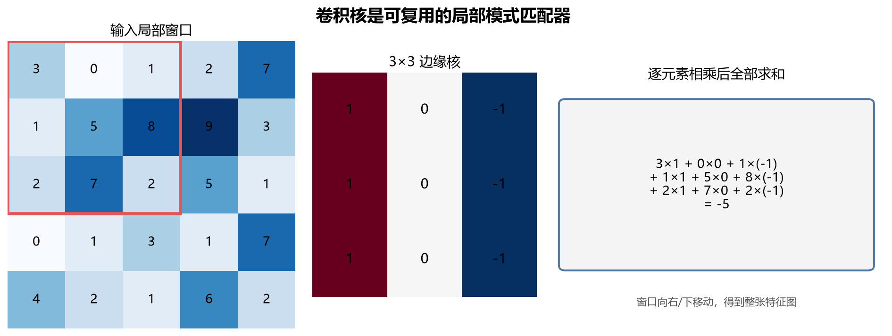
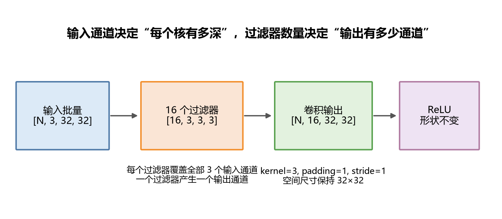
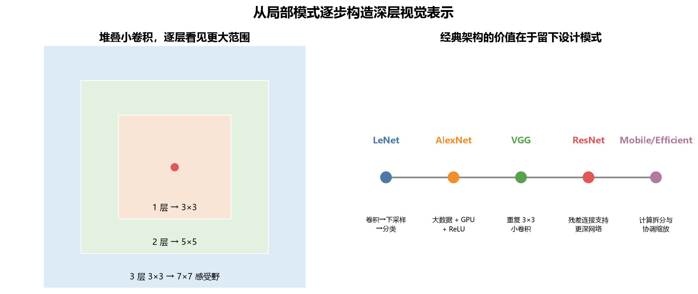
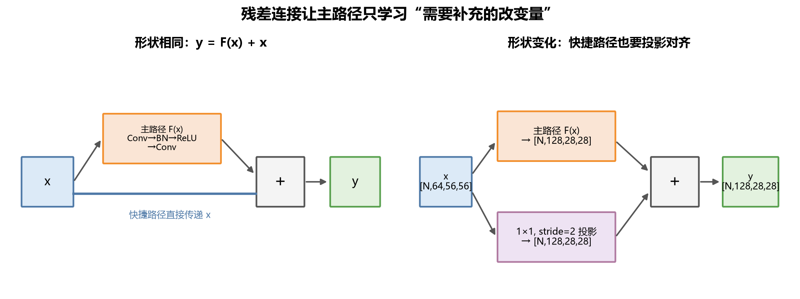
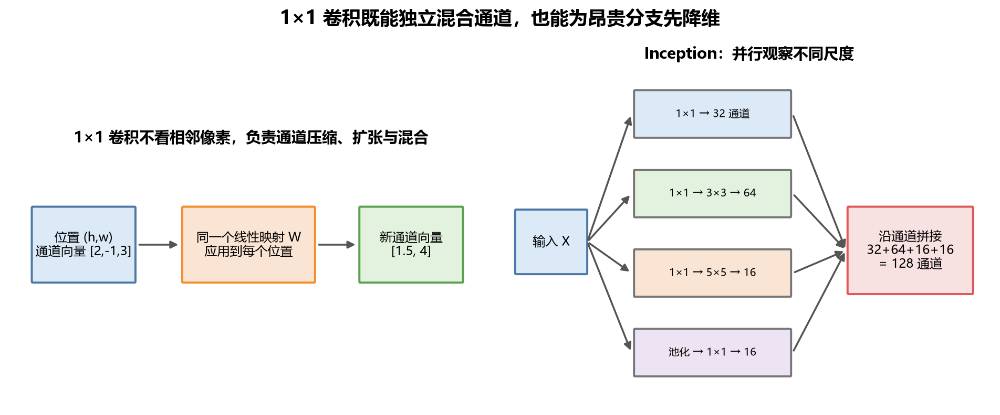
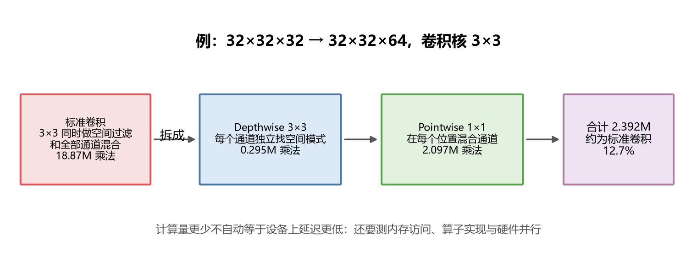
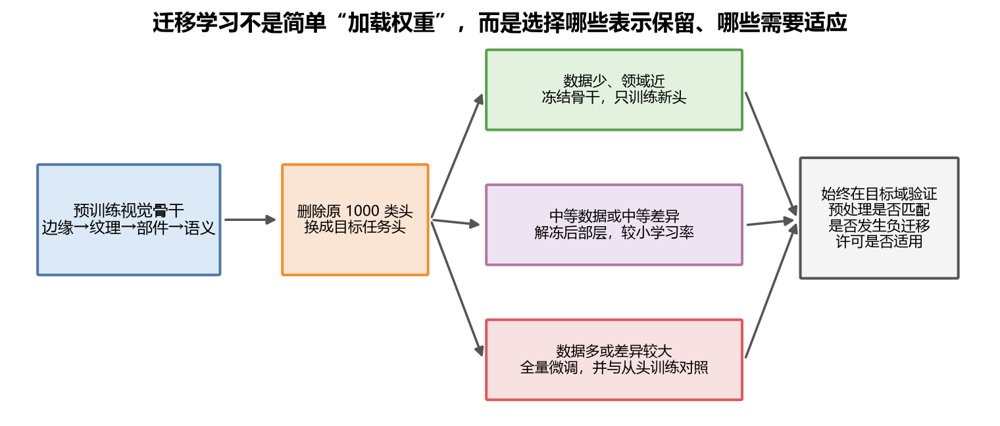
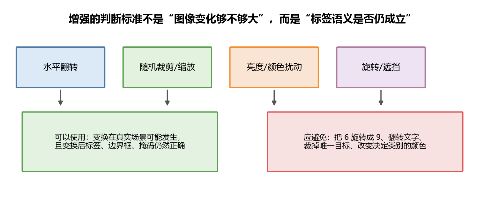

# [AI应用-计算机视觉]1.卷积网络、经典架构与迁移学习

图像数据天然具备强烈的局部空间结构：相邻的像素组合成边缘，边缘勾勒出纹理与轮廓，轮廓进一步拼装成物体的局部器官与完整实体。

如果用全连接层去硬解图像，不仅会面临灾难级的参数爆炸，更会彻底抹杀这种二维几何关联。**卷积神经网络（CNN）**通过两项极其强大的归纳偏置（Inductive Bias）——**局部连接**与**权重共享**，奠定了现代计算机视觉的基石。

本篇从单次卷积的底层计算机制出发，彻底剖析填充、步幅、多通道、感受野与池化的几何逻辑；系统复盘从 LeNet 到 EfficientNet 经典架构演进中的核心破局思路；最后落地工业界最通用的工程利器——迁移学习与数据增强。

---

## 一、图像为什么不适合直接交给巨大全连接层

在深度学习张量排布中，图像批量通常遵循**通道优先（Channel-First）**格式：

$$
X \in \mathbb{R}^{N \times C \times H \times W}
$$

- $N$：批大小（Batch Size）；
- $C$：通道数（RGB 彩色图像 $C=3$，灰度图 $C=1$）；
- $H, W$：图像的高与宽。

假设输入是一张标准的 $224 \times 224 \times 3$ 图像，展平为一维向量后，输入特征维度高达：

$$
224 \times 224 \times 3 = 150{,}528
$$

如果第一层全连接层仅设置 1000 个隐藏神经元，单层权重参数量就达到了恐怖的：

$$
150{,}528 \times 1000 \approx 1.5 \times 10^8 \quad (\text{1.5 亿个参数})
$$

### 全连接层的两大本质缺陷
1. **参数爆炸与过拟合灾难**：如此庞大的参数量需要不可承受的显存与计算资源，且在中小规模数据集上几乎必定严重过拟合。
2. **缺乏平移不变性与空间感知**：全连接层给图像左上角和右下角的像素分配完全独立的权重。当画面中的猫从左上角平移到右下角时，全连接网络必须重新从零学习一套右下角权重的组合模式。

### 卷积网络的两大核心破局假设
- **局部连接（Local Connectivity）**：每个卷积神经元只连接输入图像的一个局部小窗口（感受野），专注于提取局部特征；
- **参数共享（Parameter Sharing）**：同一个卷积核在整张图像的全部空间位置上反复滑动扫过。在左上角能识别猫耳朵边缘的核，移到右下角同样能识别猫耳朵边缘。

参数量瞬间与输入分辨率彻底解耦，网络直接具备了先天的空间拓扑理解能力。

---

## 二、一次卷积到底计算了什么

在直觉上，**卷积核（Filter / Kernel）就是一个滑动的前馈局部模式匹配探测器**。

以经典的 $3 \times 3$ 垂直边缘检测核为例：

$$
K = \begin{bmatrix}
1 & 0 & -1 \\
1 & 0 & -1 \\
1 & 0 & -1
\end{bmatrix}
$$

- 左侧为正权重，中间为 0，右侧为负权重；
- 当它盖住一个“左边极亮、右边极暗”的像素区域时，乘积累加结果显著为正；反之若左暗右亮则为负；若左右平坦均匀则相互抵消接近 0。

假设当前卷积核滑移到输入的左上角窗口：

$$
\text{Patch} = \begin{bmatrix}
3 & 0 & 1 \\
1 & 5 & 8 \\
2 & 7 & 2
\end{bmatrix}
$$

### 逐元素相乘并累加（内积运算）

$$
\begin{aligned}
z_{0,0} &= 3(1) + 0(0) + 1(-1) \\
&\quad + 1(1) + 5(0) + 8(-1) \\
&\quad + 2(1) + 7(0) + 2(-1) \\
&= 2 - 7 = -5
\end{aligned}
$$

结果标量 $-5$ 填入输出特征图的 $(0, 0)$ 坐标。卷积核沿着输入矩阵自左向右、自上而下规律滑动，每落在一个合法锚点，就完成一次局部的逐元素乘加，最终织成一张完整的二维**特征图（Feature Map）**。

> **术语厘清：互相关（Cross-Correlation）vs 数学卷积（Convolution）**
> 严格信号处理中的卷积在滑动前需将核沿水平和垂直翻转 $180^\circ$。在深度学习中，卷积核参数完全是反向传播自主学习出来的，翻转与否无非是权重对称学偏而已，因此所有框架（如 PyTorch `nn.Conv2d`）底层执行的皆为免翻转的互相关运算，但约定俗成通称为“卷积”。

---

## 三、填充与步幅：决定卷积核在哪里落脚

特征图的尺寸不是凭空生成的，它由四个几何要素共同锁定：输入分辨率 $(H, W)$、核大小 $(K_H, K_W)$、填充大小 $(P_H, P_W)$ 与步幅 $(S_H, S_W)$。

### 空间尺寸计算核心公式

$$
H_{\text{out}} = \left\lfloor \frac{H + 2P_H - K_H}{S_H} \right\rfloor + 1, \qquad W_{\text{out}} = \left\lfloor \frac{W + 2P_W - K_W}{S_W} \right\rfloor + 1
$$

向下取整 $\lfloor \cdot \rfloor$ 的物理意义极为明确：**当核滑动到图像边缘、剩余像素尺寸不足以垫满一个完整卷积核时，最后的残缺空间直接被舍弃，无法成活为一个输出点**。

> **手算示例**：
> 输入 $7 \times 7$，核 $3 \times 3$，填充 $P=1$，步幅 $S=2$：
> 
> $$
> H_{\text{out}} = \left\lfloor \frac{7 + 2 \times 1 - 3}{2} \right\rfloor + 1 = \left\lfloor \frac{6}{2} \right\rfloor + 1 = 4
> $$
> 
> 输出特征图精准为 $4 \times 4$。

### 常见填充策略（Padding Modes）
- **Valid 模式（不填充，Padding=0）**：每次卷积特征图四周边缘都会被“啃掉”一圈，随着网络深度增加，特征图急速萎缩，边缘信息过早遗失。
- **Same 模式（等尺寸填充）**：在步幅 $S=1$ 的前提下，通过外围补零让输出特征图完全保持与输入相同的空间分辨率。当核长为奇数时，最佳对称填充取值：
  
  $$
  P = \frac{K - 1}{2}
  $$
  
  （即 $3 \times 3$ 卷积配 $P=1$；$5 \times 5$ 卷积配 $P=2$）。

---

## 四、多通道卷积：一个过滤器必须同时看完所有输入通道

现实输入几乎都是多通道的（如输入图片具备 RGB 3 通道；中间特征图具备 64、128 等多个通道）。

初学者最容易产生的认知误区，是以为卷积核是一个个孤立平面的切片。**实际上，多通道网络中的一个“过滤器（Filter）”是一个拥有三维立体厚度的立方体张量！**

设输入张量为 $X \in \mathbb R^{N \times C_{\text{in}} \times H \times W}$，我们期望输出 $C_{\text{out}}$ 个通道的特征图：

- **单个过滤器的维度**必须是 $(C_{\text{in}} \times K_H \times K_W)$，其通道深沉度必须**无条件强行等于输入通道数 $C_{\text{in}}$**；
- 为了产出 $C_{\text{out}}$ 个通道，我们必须并排堆叠 $C_{\text{out}}$ 个互不相同的立体过滤器，构成全网权重张量：
  
  $$
  W \in \mathbb R^{C_{\text{out}} \times C_{\text{in}} \times K_H \times K_W}
  $$

### 单通道输出的生成机制
当某一个三维过滤器划过输入的一个空间位置时：
1. 它的每个二维切片分别与对应通道的对应区域做乘加；
2. **将所有 $C_{\text{in}}$ 个通道计算出的结果全部跨通道求和加在一起，合拢成一个唯一的标量**；
3. 加上该过滤器独享的一个标量偏置 $b_c$，形成输出特征图上某个坐标点的一个数值。

### 参数量 vs 计算量（FLOPs）
以输入 $32 \times 32 \times 3$、配置 16 个 $3 \times 3$ 卷积核（带偏置）为例：
- **权重参数量（模型大小）**：仅取决于核几何尺寸与通道数，与输入宽高无关：
  
  $$
  \text{Params} = (K_H \times K_W \times C_{\text{in}} + 1) \times C_{\text{out}} = (3 \times 3 \times 3 + 1) \times 16 = 448
  $$

- **浮点计算量（推理开销）**：必须乘上卷积核在特征图上滑动的全部空间位置总数（$H_{\text{out}} \times W_{\text{out}}$）：
  
  $$
  \text{FLOPs} \approx 32 \times 32 \times (3 \times 3 \times 3 \times 16) \approx 4.42 \times 10^5 \text{ 次乘加}
  $$

---

## 五、池化、感受野与位置变化

### 1. 池化（Pooling）：空间维度的粗粒度下采样
池化层用来压缩特征图的空间分辨率，降低下游计算负载，同时提升对图像微小形变的容忍度。
- **最大池化（Max Pooling）**：在滑动窗口内只提取最大值（如 $2 \times 2$ 区域取最大值），擅长保留显著边缘与强烈纹理激活；
- **平均池化（Average Pooling）**：取窗口内所有值的算术平均值，平滑背景特征；
- **关键特性**：池化**完全沿单通道内部独立进行，绝不跨通道混合**；池化**不含任何可学习参数**。

### 2. 感受野（Receptive Field）：深层神经元究竟看到了多大范围
特征图上某个神经元所能“看见”的原始输入图像区域的物理大小，称为该神经元的感受野。
- 经过一层步幅为 1 的 $3 \times 3$ 卷积，感受野为 $3 \times 3$；
- 再堆叠一层步幅为 1 的 $3 \times 3$ 卷积，感受野扩散至 $5 \times 5$；
- 堆叠第三层 $3 \times 3$ 卷积，感受野达到 $7 \times 7$。

这揭示了深度卷积的本质：**浅层神经元仅能看到细碎的局部像素边缘；但随着层数深入与步幅下采样，深层神经元汇聚了极其辽阔的视野，从而能够捕捉整体物体的抽象语义**。

### 3. 平移等变性（Equivariance）与平移不变性（Invariance）
- **卷积赋予平移等变性**：$f(g(x)) = g(f(x))$。如果输入图像中的猫向右平移 5 个像素，浅层卷积提取到的猫特征图也分毫不差地向右平移 5 个像素。
- **分类追求平移不变性**：无论猫位于画面中央还是角落，最终分类头都应输出“猫”。不变性是依靠**步幅下采样、池化聚合以及全图全局平均池化（GAP）**共同逐步磨平位置差异而达成的。

---

## 六、LeNet、AlexNet 与 VGG 留下了什么

回望经典架构，学习的不是机械的层数参数表，而是先辈为了解决特定时代瓶颈而迸发的关键设计范式。

### 1. LeNet-5 (1998)：确立 CNN 标准工程范式
开创了经典的流式拓扑：

$$
\text{卷积} \to \text{下采样} \to \text{卷积} \to \text{下采样} \to \text{全连接分类头}
$$

确立了“**空间分辨率逐级减半（$H, W \downarrow$），特征通道数逐级翻倍（$C \uparrow$）**”的经典空间信息交换法则。

### 2. AlexNet (2012)：现代深度学习的破晓之作
夺得 ImageNet 冠军，以工程实践宣告深度学习时代的全面降临：
- 全面引入 **ReLU** 激活函数替换饱和的 Sigmoid，彻底攻克浅深层梯度消失；
- 率先引入 **Dropout** 与大规模**数据增强**抑制深度模型的过拟合；
- 开启 GPU 并行训练深层网络的先河。

### 3. VGGNet (2014)：“小卷积核堆叠”统一设计美学
彻底终结了 AlexNet 时代 $11 \times 11$、$7 \times 7$ 笨重巨核混搭的无序状态，全网严格统一采用 $3 \times 3$ 微型卷积核：
- **等效感受野**：连续堆叠两个 $3 \times 3$ 卷积即可等效替换单个 $5 \times 5$ 卷积的感受野；
- **参数量显著降低**：单个 $5 \times 5$ 参数量为 $25C^2$，两个 $3 \times 3$ 仅需 $2 \times 9C^2 = 18C^2$（参数锐减 $28\%$）；
- **非线性表达更强**：堆叠两个小核意味着中间多插入了一层 ReLU 激活函数，网络决策边界更具非线性拟合力。

---

## 七、ResNet：让新增层学习“需要补充的部分”

随着网络深度进一步突破（超过 20 层），学术界遭遇了极其反常的**网络退化现象（Degradation Problem）**：56 层网络的训练集误差居然比 20 层网络还要差！这不是过拟合（过拟合表现为训练集好、验证集差），而是极其深邃的网络陷入了优化困境，反向传播梯度流在极深链条中迷失。

何恺明团队提出的 **ResNet（残差网络）**彻底颠覆了层与层之间的直接映射逻辑。

### 残差学习的核心数学思想
传统网络强求非线性变换层直接拟合目标潜在映射 $H(x)$。ResNet 则让变换分支仅仅负责拟合**差值残差（Residual）**：

$$
F(x) = H(x) - x
$$

最终输出由跳跃连接（Shortcut Connection）直接相加构成：

$$
H(x) = F(x) + x
$$

> **优雅的优化退路**：
> 如果增加的深层网络在当前阶段根本没有学到任何新知识，它只需把权重全部推向 0（即让残差分支 $F(x) \approx 0$），整个残差块就直接恒等退化为 $H(x) = x$！深层网络至少不会比浅层网络表现更差。

### 梯度的高速公路（Gradient Highway）
反向求导时，损失对输入的偏导为：

$$
\frac{\partial H(x)}{\partial x} = \frac{\partial F(x)}{\partial x} + I
$$

就算残差分支的局部导数 $\frac{\partial F(x)}{\partial x}$ 因权重微弱而严重衰减，后项**单位矩阵 $I$ 依然能像一条无阻力的高速公路，将上游的梯度信号无损畅通地直通传递回几百层前的浅层网络**！这使上千层超深网络的稳定收敛首次成为现实。

> **工程避坑点**：
> 逐元素相加要求两条路径的张量形状 $(C, H, W)$ 必须绝对一致。当残差块发生步幅下采样（$S=2$）或通道扩增时，快捷支路上必须额外放置一个步幅为 2 的 $1 \times 1$ 卷积（Projection Shortcut）执行升维与缩放，否则张量相加会直接报维度不匹配错误。

---

## 八、1×1 卷积与 Inception：先整理通道，再并行观察尺度

### 1. 1×1 卷积的本质：跨通道的局部线性变换
在单通道看来，$1 \times 1$ 卷积似乎只是把像素乘上一个倍数；但**在多通道特征图上，$1 \times 1$ 卷积是在每一个空间点上执行的跨通道全连接层（MLP）**：
- 它完全不卷入任何相邻空间像素，在保持空间分辨率 $(H, W)$ 绝对不变的前提下，纯粹通过矩阵乘法完成通道维度的自由**压缩（降维）、扩充（升维）与信息混合**；
- 引入了非线性激活，使得通道间能够低成本组合出复杂特征。

### 2. Inception 模块：多尺度特征融合与计算量瓶颈突破
人类无法预先断言一张图像中的关键目标到底是大是小，GoogLeNet / Inception 放弃了单一核尺寸的选择，采用**多分支并行并排竞争**机制：
- 同一层输入同时穿过 $1 \times 1$、$3 \times 3$、$5 \times 5$ 以及 MaxPool 四个并行支路；
- 各支路空间尺寸保持一致，最终通过 `torch.cat(..., dim=1)` 在**通道维度无缝拼接**。

### 1×1 卷积在 Inception 中的降维神技
直接在 192 通道的输入上使用 $5 \times 5$ 大核卷积会带来上亿次浮点运算（FLOPs）。
Inception 巧妙地在 $3 \times 3$ 和 $5 \times 5$ 卷积之前，先塞入一个 $1 \times 1$ 卷积将通道数由 192 极速压缩至 16，大核卷积在狭窄的 16 通道上跑完后，整体计算成本暴降至原来的 **$10\%$ 左右**，以极致性价比赢得了强大的多尺度表征力。

---

## 九、深度可分离卷积与轻量网络

在手机、无人机、车载芯片等算力受限的边缘端硬件上，标准卷积沉重的计算负担无法满足实时性要求。

### 深度可分离卷积（Depthwise Separable Convolution）
标准卷积在单一步骤中，强行混杂了“空间特征提取”与“跨通道信息交互”。深度可分离卷积将这两项职责彻底解耦为两步推进：

1. **逐通道深度卷积（Depthwise Conv, DW）**：
   - 彻底打破通道交织。若输入有 $C_{\text{in}}$ 个通道，就使用 $C_{\text{in}}$ 个独立的单通道卷积核，**每个卷积核只管自己对应的单层通道，各自独立做空间卷积**。
2. **逐点卷积（Pointwise Conv, PW）**：
   - 紧接着套用常规的 $1 \times 1$ 卷积，负责在空间各点上**跨通道加权混合融合成新的特征**。

### 惊人的计算量暴降对比
标准卷积与深度可分离卷积的计算量理论比值收敛为：

$$
\text{Ratio} = \frac{\text{DW} + \text{PW}}{\text{Standard}} = \frac{1}{C_{\text{out}}} + \frac{1}{K^2}
$$

对于最常见的 $3 \times 3$ 卷积核（$K=3$），无论通道数多少，**深度可分离卷积的计算量天然只有标准卷积的约 $\frac{1}{9} \approx 11\%$ 左右**，参数量与算力消耗直接降低了一个数量级！

### 经典轻量架构演进路线
- **MobileNet v1**：全面普及 Depthwise + Pointwise 架构模式，配合宽度缩放乘子调节计算档位。
- **MobileNet v2（倒残差与线性瓶颈）**：
  - **Inverted Residuals（倒残差结构）**：打破 ResNet“两头宽、中间窄”的传统瓶颈，采用“**两头窄（低维）、中间宽（高维扩张）**”设计，让 Depthwise 卷积在更丰富的高维空间提取特征；
  - **Linear Bottleneck（线性瓶颈）**：在低维输出端**坚决不用 ReLU 激活**，改用纯线性透传，防止微弱负值在低维流形投影中被暴力抹零导致信息永久损毁。
- **EfficientNet（复合缩放 Compound Scaling）**：
  传统调优要么只调深网络（加深），要么只放大输入（增分辨率），要么只加宽通道（增宽），容易遭遇木桶短板。EfficientNet 提出依据固定的复合比例系数，**协同平衡地按比例等倍同步扩展深度、宽度与图像分辨率**，在相同算力预算下挖掘出极致精度。

---

## 十、迁移学习：复用表示，再决定解冻多少层

在工业界，几乎没有人会从随机初始化的权重开始训练一个商业级视觉模型。

ImageNet 等海量通用数据集预训练出的特征提取器，已经在浅层沉淀出了极其普适的边缘线条、色彩过渡认知，并在深层具备了高级几何纹理理解。**迁移学习（Transfer Learning）的核心逻辑，正是复用成熟骨干网络的通用特征抽取力，针对下游小规模业务目标快速微调定制**。

### 迁移学习的三种实战作战策略

| 业务场景条件 | 推荐应对策略 | 具体工程操作机制 |
|---|---|---|
| **下游数据极少（< 百张） 且场景与源域极其相近** | **纯特征提取（Feature Extractor）** | **完全冻结骨干网络所有权重**（`param.requires_grad = False`），仅替换最后的全连接分类头（FC Head）参与反向传播。计算飞快且极抗过拟合。 |
| **下游数据量中等 或业务语义与源域存在差异** | **分层解冻（Layer-wise Fine-Tuning）** | 冻结浅层通用层，**仅解冻并微调骨干网络的最后 1~2 个高阶 Block 及新分类头**。采用**差分学习率**：骨干解冻层学习率设得极小（如 $10^{-5}$），新分类头设得较大（如 $10^{-3}$）。 |
| **下游数据极其庞大（数十万级） 或跨模态差异巨大（如医学红外）** | **全网端到端微调（Full Fine-Tuning）** | 预训练权重作为优秀初始化底座，全网所有参数全面放开梯度更新，配合温和的学习率预热与余弦衰减。 |

> **权重规范提醒**：
> 调用预训练模型时，输入的图像预处理流（均值、方差标准化、缩放插值方式）必须**严格无条件对齐该预训练权重原本的设定规范**（例如 TorchVision 的 `weights.transforms()`），绝不能胡乱更改。

---

## 十一、数据增强：只生成标签仍然成立的变化

数据增强（Data Augmentation）的底层本质是在图像空间人为注入合法的领域先验，**迫使模型在几何形变和环境扰动中寻找真正的不变量，从而大幅拉平泛化差距**。

### 核心安全准则：绝不能破坏真实语义与标签的对应关系
数据增强绝不是盲目把各种变换堆叠在一起，每一次变换的前提必须是：**变换后图像的客观真实标签依然成立**！

- **空间几何变换**：
  - 水平翻转（Horizontal Flip）：对绝大多数自然界物体（猫狗、汽车）完全成立；但在**字符文字识别（OCR）、医学器官左右镜像**场景中严禁使用（翻转后数字 6 变成 9，左心房变成右心房，标签直接被颠覆）；
  - 随机裁剪与缩放（Random Resized Crop）：逼迫网络观察局部物体，但必须防止把关键目标全盘裁出画外。
- **色彩与光影扰动（ColorJitter）**：
  - 改变亮度、对比度与饱和度模拟镜头和天气变化；但在**交通红绿灯识别、化工颜色分拣**等依赖颜色作为唯一判定标准的任务中必须极度克制。
- **高级混合增强（Mixup / CutMix）**：
  - 将两张图像及其独热标签按面积比例线性混合（如 0.7 猫 + 0.3 狗），软化标签置信度，强力抑制过拟合，但会轻微破坏局部细粒度轮廓信息。

---

## 十二、今天应怎样理解和选择视觉骨干

在 Vision Transformer（ViT）与现代混合大模型风靡的今天，卷积神经网络依然凭借其高能效与独特优势活跃在工业前沿：

| 经典模型系列 | 依然闪耀的核心工业价值 | 不可盲目照搬的过时设计 |
|---|---|---|
| **LeNet / AlexNet** | 教学启蒙、极简微控制器跑通流水线 Demo | 原始的大核步幅卷积、两端饱和激活（Sigmoid）、过时的 LRN 归一化 |
| **VGG** | 简单直白规则堆叠；极适合提取感知损失特征（Perceptual Loss） | 笨重庞大的三个连续全连接尾巴（巨耗显存与参数） |
| **ResNet** | **工业界绝对的通用基准定海神针**，各种任务（分类、检测、分割）最稳健的 Backbone 首选 | 机械死守单一深层配置 |
| **MobileNet** | 移动端、端侧嵌入式设备、实时工控板卡的首选高效骨干 | 盲信论文 FLOPs（某些硬件对 DW 内存带宽优化差可能导致测速不达标） |
| **EfficientNet** | 追求在服务器端与边缘端高算力下压榨极致的 Top-1 分类准确率 | 复合缩放参数繁琐，碎片化算子导致部分低算力芯片适配困难 |

### 骨干选型黄金法则
在启动一个计算机视觉项目时，不要盲目跟风选择参数量最大的最新学术架构。遵循以终为始的工程选型顺序：
1. **明确终端硬件部署边界**：是跑在数据中心 A100，还是跑在嵌入式工控板、智能手机甚至单片机上？
2. **评估吞吐延迟红线**：端到端推理必须卡在 10ms 以内（优先选轻量 MobileNet、ResNet-18/34），还是更在乎极致精度不在乎速度（选 EfficientNet、ConvNeXt 或 ViT）？
3. **首选开源生态最丰富的成熟预训练模型**：优先选用自带成熟预训练权重并经过海量工业验证的工业标准底座。