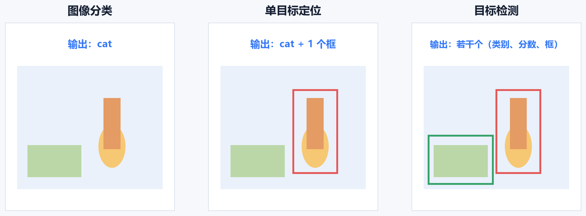
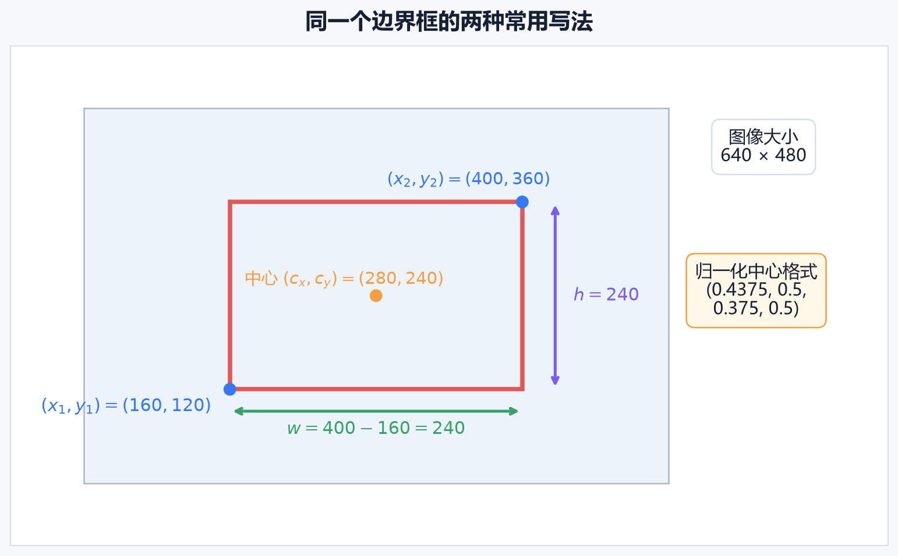
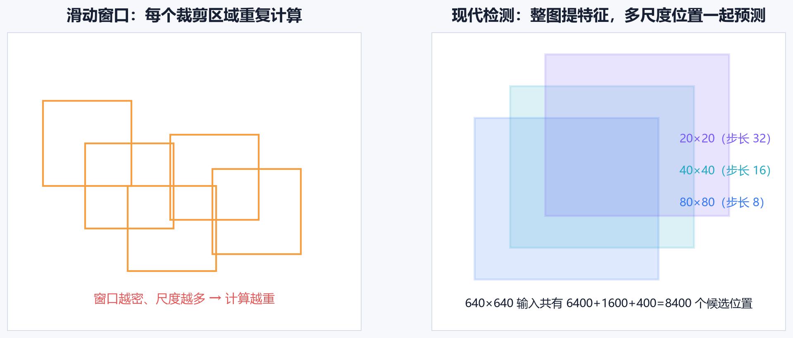
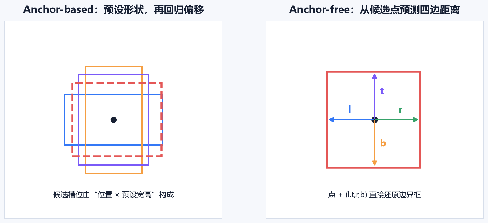
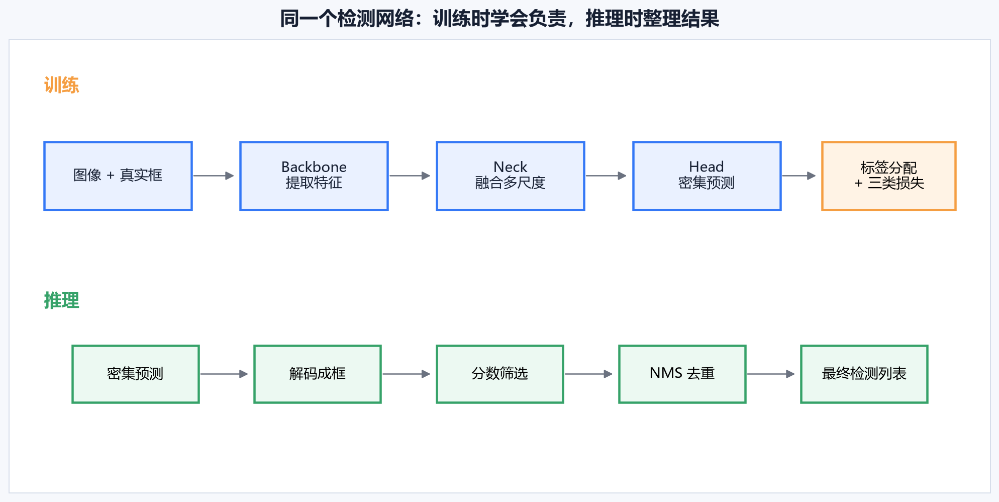
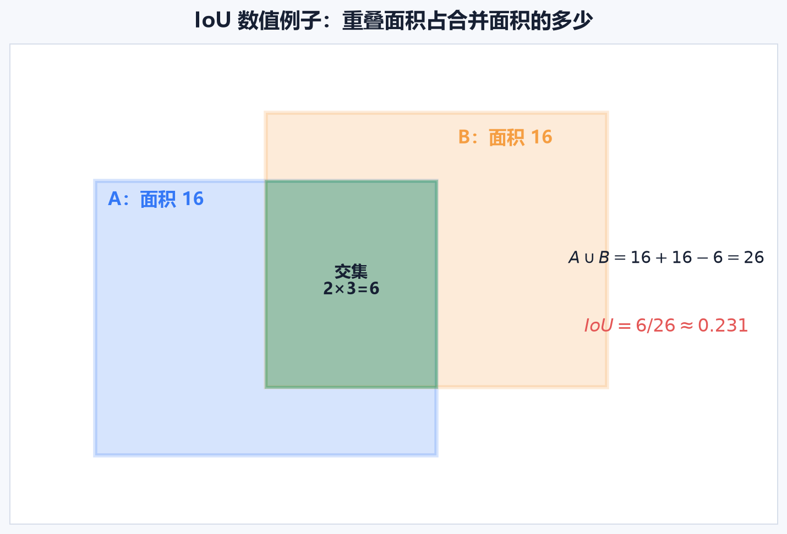
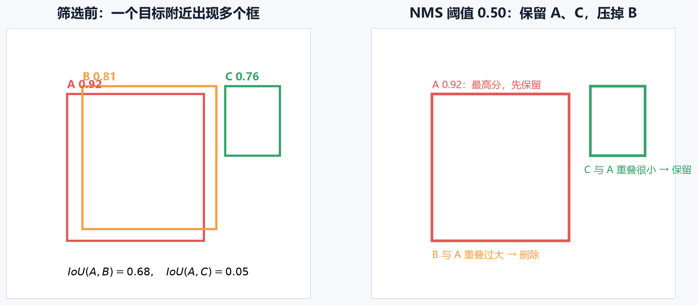
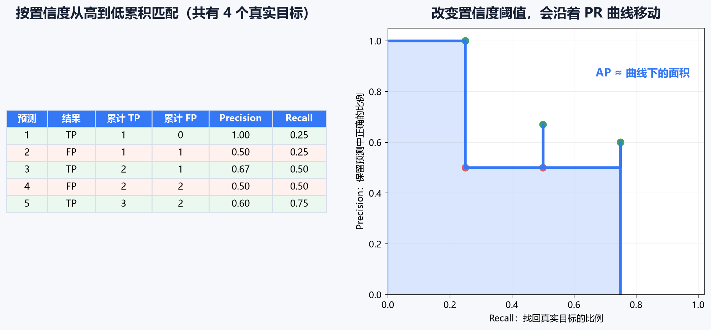
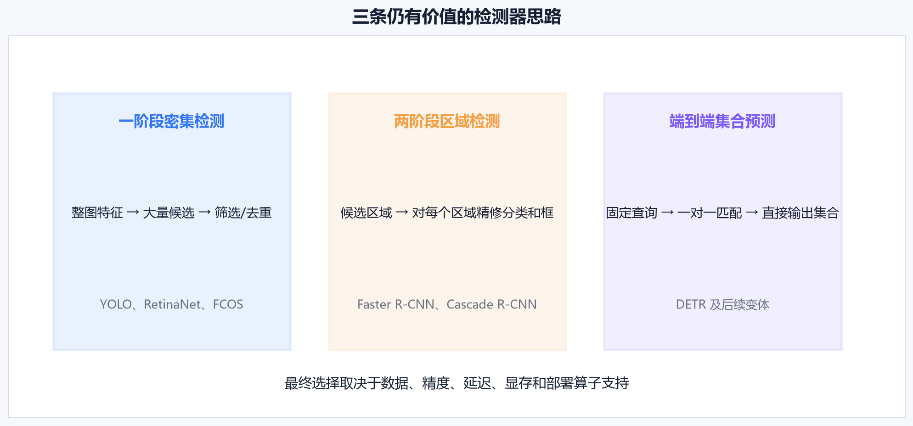

# [AI应用-计算机视觉]2.目标检测、检测器与评估指标

图像分类只回答“图里有什么”，但在自动驾驶、安防监控和机器人抓取等真实工业场景中，我们必须同时回答三个问题：
1. **是什么**（类别识别）；
2. **在哪里**（边界框定位）；
3. **有几个**（多目标枚举）。

这就是**目标检测（Object Detection）**的核心任务。检测系统面临一个天然的工程矛盾：输入图像中物体的数量是任意的（可能是 0 个，也可能是上百个），但神经网络底层的张量输出维度必须预先固定。

本篇从坐标体系与密集预测机制讲起，理清候选框生成、正负样本匹配、NMS 去重后处理的完整链条，并彻底拆解 IoU、Precision、Recall、AP 与 mAP 的评估本质。

---

## 一、分类、定位与检测的输出有何不同

先通过输出形态辨清三个常被混淆的视觉任务：

| 任务类型 | 假定目标数量 | 核心输出定义 | 典型输出格式 |
|---|---|---|---|
| **图像分类 (Classification)** | 不关心数量/默认 1 个主体 | 单一离散类别标签 | `label = "cat"` |
| **分类与定位 (Classification & Localization)** | 强假设图中仅有 **1 个主目标** | 单一类别标签 + 1 组边界框坐标 | `("cat", [x1, y1, x2, y2])` |
| **目标检测 (Object Detection)** | **0 到任意多个目标** | 变长元组集合（类别、置信度、边界框） | `[("car", 0.96, b1), ("car", 0.83, b2), ...]` |



### 变长输出的工程解法：密集预测（Dense Prediction）
既然物体的数量不固定，网络就无法直接输出一个长度动态变化的一维列表。现代检测器的经典做法是：
- **以空间换数量**：在整张图像的各个空间网格和尺度上，预先铺设数千甚至数万个**固定槽位的候选检测点**（如 Anchor 或特征网格点），让每个位置都独立预测一组类别分数与框坐标；
- **后处理精简**：通过设定置信度阈值和非极大值抑制（NMS），从成千上万个初始预测中过滤掉背景并合并重合框，最终还原出与场景实际物体数量匹配的变长结果列表。

---

## 二、边界框：先统一坐标，后面的计算才有意义

边界框（Bounding Box）用一个轴对齐的矩形框定目标在图像上的空间范围。常见的三种坐标格式如下：

1. **xyxy 格式**（角点格式）：$(x_1, y_1, x_2, y_2)$，分别代表左上角坐标和右下角坐标。
2. **xywh 格式**（左上宽高格式）：$(x_1, y_1, w, h)$，左上角点坐标配合矩形宽度与高度。
3. **cxcywh 格式**（中心宽高格式）：$(c_x, c_y, w, h)$，矩形几何中心点坐标配合宽度与高度。

### 坐标系相互转换关系

从角点格式 $(x_1, y_1, x_2, y_2)$ 转换为中心宽高格式 $(c_x, c_y, w, h)$：

$$w = x_2 - x_1, \qquad h = y_2 - y_1$$

$$c_x = \frac{x_1 + x_2}{2}, \qquad c_y = \frac{y_1 + y_2}{2}$$

反向将中心宽高格式 $(c_x, c_y, w, h)$ 还原为角点格式 $(x_1, y_1, x_2, y_2)$：

$$x_1 = c_x - \frac{w}{2}, \quad y_1 = c_y - \frac{h}{2}, \quad x_2 = c_x + \frac{w}{2}, \quad y_2 = c_y + \frac{h}{2}$$



> **归一化坐标算例**：
> 图像分辨率为 $640 \times 480$，像素框为 $(x_1, y_1, x_2, y_2) = (160, 120, 400, 360)$。
> - 中心宽高像素值：$c_x = 280, c_y = 240, w = 240, h = 240$；
> - 归一化至 $[0, 1]$（横坐标除以宽 640，纵坐标除以高 480）：
>   
>   $$>   \left(\frac{280}{640}, \frac{240}{480}, \frac{240}{640}, \frac{240}{480}\right) = (0.4375, 0.5, 0.375, 0.5) >$$

### 坐标管理的工业防错底线
真实项目中 $80\%$ 的“漏检、框漂移、精度异常”均由坐标口径不一致引发：
- **格式定义混乱**：混淆了 `xyxy` 与 `cxcywh`；
- **尺度基准混淆**：把归一化浮点坐标直接喂给了需要绝对像素整型坐标的损失函数；
- **预处理与后处理脱节**：输入图像经过 Letterbox 补黑边或等比缩放后，后处理映射未反向扣除偏移量，导致预测框与原图发生系统性平移。

---

## 三、训练标签：没有物体的位置不应学习一个虚构框

检测头在每个候选位置通常输出三组信息：
- **类别分数（Class Scores）**：属于目标类别的概率分布；
- **边界框偏移/参数（Box Coordinates）**：修正真实边框所需的连续数值；
- **目标存在置信度（Objectness）**：评估当前位置到底属于前景物体还是背景区域。

### 多任务联合损失函数

整网损失可以抽象为分类误差、前景判断与边界框回归的加权和：

$$L = \lambda_{\text{cls}} L_{\text{cls}} + \lambda_{\text{obj}} L_{\text{obj}} + \lambda_{\text{box}} \sum_{i} m_i L_{\text{box}}^{(i)}$$

- **掩码指示项 $m_i \in \{0, 1\}$ 的决定性意义**：
  只有被成功匹配为正样本的候选框（$m_i = 1$），才有资格参与计算边界框回归损失 $L_{\text{box}}^{(i)}$。**绝不能强迫背景区域去拟合一个凭空捏造的边界框**，否则会给回归分支注入严重的破坏性噪声；
- **正负样本极度失衡与 Focal Loss**：
  在一阶段密集检测中，负样本（纯背景候选）通常占到 $99\%$ 以上。传统的交叉熵会被海量简单背景样本的微小梯度淹没。**Focal Loss** 通过动态调制因子 $(1 - p_t)^\gamma$，大幅压低极易分类的简单负样本对梯度的贡献，强迫网络把注意力聚焦在少量难以判别的真实目标和难例上。

---

## 四、从滑动窗口到整图密集预测

传统计算机视觉采用**滑动窗口法（Sliding Window）**：设计不同尺寸和宽高比的矩形框，在原图上逐像素平移滑动，将每个局部切片单独送入分类器判断。
- **缺点**：相邻窗口存在 $90\%$ 以上的重叠像素，大量重复计算直接拖垮推理速度；步长稍大又极易漏检。



### 现代全卷积密集预测机制
现代一阶段检测（如 YOLO）彻底摒弃了图像空间的重复滑动：
1. **单次前向传导（You Only Look Once）**：整张图像只经过一次骨干网络（Backbone），全图特征计算完全共享；
2. **多尺度特征图分工（FPN / PAN 机制）**：
   以 $640 \times 640$ 输入为例，网络在下采样 8 倍、16 倍、32 倍的位置输出三张特征图：
   - **浅层大特征图（$80 \times 80$，步长 8）**：感受野小、空间几何分辨率高，**专职负责捕捉画面中的微小目标**；
   - **中层特征图（$40 \times 40$，步长 16）**：捕捉常规中等尺寸目标；
   - **深层小特征图（$20 \times 20$，步长 32）**：感受野辽阔、高级语义特征丰富，**专职负责捕捉大跨度宏观物体**。
   三层合计生成 $80^2 + 40^2 + 20^2 = 8400$ 个密集预测点，实现全尺度覆盖。

---

## 五、Backbone、Neck 与 Head 各自负责什么

现代目标检测器普遍采用经典的“三段式”解耦架构：

```
输入图像 ──> [ Backbone: 基础特征抽取 ] ──> [ Neck: 多尺度特征融合 ] ──> [ Head: 任务解耦预测 ]
```

1. **Backbone（骨干网络）**：
   通常采用标准的视觉特征网络（如 ResNet、CSPDarkNet）。其唯一使命是从纯像素中自底向上逐层提取不同深度维度的特征图，从边缘线条逐步抽象到高级语义。
2. **Neck（特征融合颈部）**：
   负责解决“浅层特征几何细节清晰但语义薄弱，深层特征语义高度抽象但空间位置粗糙”的矛盾。通过**特征金字塔（FPN 自顶向下传递强语义）**与**路径聚合网络（PAN 自底向上传递强定位定位细节）**，让不同尺度的特征充分双向流通融合。
3. **Head（解耦检测头）**：
   在融合后的多尺度特征图上，设置卷积分支直接输出具体的业务预测张量。现代网络通常将“分类任务（Cls Head）”与“回归任务（Reg Head）”完全解耦为两条独立的卷积通道，消除不同优化目标之间的梯度干扰。

---

## 六、标签分配：训练时决定谁来负责真实目标

在推理时，网络只需要直接输出前向预测；但在训练阶段，我们必须面临**标签分配（Label Assignment）**：
**网络在特征图上布设了数千个候选预测点，面对真实的 Ground Truth（GT）目标，到底应当指派哪些候选点作为正样本负责学习，哪些作为负样本算作背景？**

### 标签分配机制的演进逻辑
- **早期的空间落点硬规则（YOLOv1）**：
  真实目标的几何中心落在哪个网格单元（Grid Cell），就强制由该网格负责。规则死板，若一个网格内密集存在多个小物体，槽位发生物理冲突直接导致漏检。
- **静态 IoU 阈值匹配（Anchor-based 时代）**：
  预先比对所有候选 Anchor 与真实框的 IoU，IoU 超过门槛（如 $> 0.5$）的自动划为正样本。虽然允许多个候选点共同分担，但超参数僵化，无法感知网络当前的实际学习状态。
- **现代动态分配策略（如 SimOTA、TaskAlignedAssigner）**：
  引入**匹配代价矩阵（Cost Matrix）**。全面综合“分类分数高低”、“定位贴合程度（IoU）”以及“几何中心先验”动态评估代价。当前哪个候选框学得又好又准，就动态指派它为正样本。不仅大幅提升了模型收敛质量，也避免了给网络强行灌输低质量正样本。

---

## 七、Anchor-based 与 Anchor-free 的差别

| 对比维度 | 基于锚框（Anchor-based，如 Faster R-CNN, YOLOv3/v4） | 无锚框（Anchor-free，如 FCOS, CenterNet, YOLOv8） |
|---|---|---|
| **核心机制** | 在每个特征点上预先布设多组固定宽高与长宽比的矩形参考框（Anchor），网络预测相对于 Anchor 的相对偏移量 $(\Delta x, \Delta y, \Delta w, \Delta h)$。 | 彻底抛弃预设参考框，网络把特征图上的每个点直接视为主体，从该点直接向四周辐射预测到物体四条边界的物理距离 $(l, t, r, b)$。 |
| **超参数复杂度** | 高。需要人工针对业务数据集统计长宽比，调优 Anchor 的大小、数量与匹配阈值。 | 低。零 Anchor 超参数配置，推理流程显著精简。 |
| **长尾尺度适应** | 较难泛化到极端长宽比（如极细长的线缆、裂缝）。 | 适应力极强，天然支持任意多变尺度的物体包络。 |



> **Anchor-free 的边界解码直觉**：
> 设特征点映射回原图的坐标为 $(x, y) = (300, 220)$，网络预测出向左、向上、向右、向下的距离偏移量为 $(l, t, r, b) = (40, 60, 80, 100)$。
> 解码出的物理角点坐标为：
> 
> $$
> x_1 = 300 - 40 = 260, \quad y_1 = 220 - 60 = 160
> $$
> 
> $$
> x_2 = 300 + 80 = 380, \quad y_2 = 220 + 100 = 320
> $$
> 
> 矩形直接由中心辐射展开，数学含义极为直观透明。

---

## 八、从密集预测到最终检测列表

在模型推理阶段，原始网络输出的是数千个粗糙的张量切片，必须经过一套标准工业后处理流水线，转化为清晰精炼的检测列表：

```
[原始图像输入]
    │
    ▼ (1. 等比缩放与 Letterbox 补边，输入模型前向推理)
[密集预测张量输出 (如 8400 x (C+4))]
    │
    ▼ (2. 坐标解码：根据步幅或 Anchor 还原为图像上的实际坐标)
[全图物理预测框集合]
    │
    ▼ (3. 置信度初筛：直接硬丢弃低于 conf_thresh (如 < 0.25) 的纯背景候选)
[高分候选框集合]
    │
    ▼ (4. 坐标回退映射：扣除 Letterbox 补边偏移，缩放对齐回原图原始分辨率)
[原图空间候选框集合]
    │
    ▼ (5. 类别独立 NMS：消除同一真实物体周围密集重叠的冗余重复预测)
[最终输出结构化检测列表 (类别, 置信度, 坐标)]
```



---

## 九、IoU：两个框到底重叠了多少

**交并比（Intersection over Union, IoU）**是衡量两个几何矩形框重叠紧密程度的核心数学基石：

$$
\operatorname{IoU}(A, B) = \frac{|A \cap B|}{|A \cup B|} = \frac{|A \cap B|}{|A| + |B| - |A \cap B|}
$$

- 取值范围严格锁定在 $[0, 1]$：$0$ 代表完全无交集，$1$ 代表两个框严丝合缝绝对重合。

### 矩形交集计算全手算推导
设矩形 $A = (1, 1, 5, 5)$，矩形 $B = (3, 2, 7, 6)$：
1. **两框各自面积**：
   $|A| = (5 - 1) \times (5 - 1) = 16$；$|B| = (7 - 3) \times (6 - 2) = 16$。
2. **交集矩形边界坐标确定**：
   - 左上角取大值（靠内）：$x_{\text{left}} = \max(1, 3) = 3$，$y_{\text{top}} = \max(1, 2) = 2$；
   - 右下角取小值（靠内）：$x_{\text{right}} = \min(5, 7) = 5$，$y_{\text{bottom}} = \min(5, 6) = 5$。
3. **计算交集面积（必须对负数截断）**：
   
   $$
   w_{\cap} = \max(0, x_{\text{right}} - x_{\text{left}}) = \max(0, 5 - 3) = 2
   $$
   
   $$
   h_{\cap} = \max(0, y_{\text{bottom}} - y_{\text{top}}) = \max(0, 5 - 2) = 3
   $$
   
   交集面积 $|A \cap B| = 2 \times 3 = 6$。
4. **计算并集与 IoU**：
   并集面积 $|A \cup B| = 16 + 16 - 6 = 26$；
   
   $$
   \operatorname{IoU}(A, B) = \frac{6}{26} \approx 0.231
   $$



> **工业级实现提醒**：
> 现代边框回归早已不再使用简单的平滑 L1 损失，而是全面切换为 **GIoU / DIoU / CIoU** 等度量损失。因为传统 L1 损失将四个坐标独立对待，无法感知宽高的长宽比耦合效应；而 IoU 类损失天然具备尺度不变性，并显式对重叠面积、中心点欧氏距离以及长宽比形变进行联合优化。

---

## 十、NMS：从同一目标周围的重复框中留下代表

由于密集预测机制的特点，画面中的同一辆车周围往往有几十个相邻候选点同时给出很高的置信度分数，形成一群重叠的“框堆”。**非极大值抑制（NMS）**的使命就是剔除冗余重叠，只留下最具代表性的最佳预测框。

### NMS 经典算法执行步骤
1. 将当前图像中同一类别的所有候选框，**严格按照置信度分数从高到低排序**；
2. 选取当前列表中分数最高的框 $B_{\text{best}}$，作为确认保留的最优预测，移出候选池；
3. **遍历其余所有低分框，依次计算它们与 $B_{\text{best}}$ 的 IoU**；
4. 若某个低分框与 $B_{\text{best}}$ 的重叠度 $\operatorname{IoU} \ge \text{iou\_thresh}$（如 $> 0.5$），判定其为对同一物体的冗余重复检测，**直接物理剔除**；
5. 在未被剔除的剩余框中，重复上述步骤，直至候选池清空。



> **传统硬 NMS 的致命短板**：
> 在极端密集的人群拥挤场景中，排在后面的真实行人如果恰好与前面的行人身体大幅重叠（客观 IoU 确实大于 0.5），传统 NMS 会粗暴地将属于后方行人的正确检测框一并当成冗余删除，引发严重漏检。
> - **Soft-NMS**：不直接暴力删除高 IoU 候选框，而是根据重叠度连续衰减其置信分数；
> - **DETR 类网络**：借助匈牙利算法（Hungarian Matcher）实现端到端一对一匹配，从模型结构层面彻底淘汰了后处理 NMS。

---

## 十一、Precision、Recall、AP 与 mAP 怎样评价检测器

目标检测评估不能像分类那样仅统计简单的“答对/答错百分比”，它必须先在预测框与真实标注框（GT）之间完成**空间几何匹配**。

### 样本判别黄金规则（给定评测 IoU 阈值，如 0.5）
1. 将模型预测的框按置信度分数从高到低排序；
2. 顺序取出一个预测框，在同一图像同类别中寻找尚未被匹配的真实框 GT：
   - 若存在且双方 $\operatorname{IoU} \ge 0.5$：该预测判定为 **真正例（TP，检测成功）**，同时该真实框被标记为“已消耗”；
   - 若找不到任何重合度达标的 GT：该预测判定为 **假正例（FP，误报/定位偏差过大）**；
   - **单目标排他原则**：若多个预测框同时命中同一个真实框，**只有分数最高的那个算 TP，其余统统记为 FP（重复误报）**！
3. 评测结束时，画面中所有从未被任何预测框命中的真实目标，记为 **假负例（FN，漏检）**。

### PR 曲线与 AP 的积分本质

随着置信度阈值由高向低连续下移，被接纳的预测框越来越多，Recall（查全率）单调递增，而 Precision（查准率）随之上下波动，在坐标系中连成一条 **P-R 曲线**。

**平均精度（Average Precision, AP）正是 P-R 曲线下的几何投影面积**：

$$
\text{AP} = \int_{0}^{1} P(R) \, \mathrm{d}R
$$

它综合度量了检测器在所有可能工作阈值下的整体表现（AP 越接近 1，说明模型在极高召回率下依然能维持极高查准率）。



### COCO 评测指标全景图
- **mAP（Mean Average Precision）**：所有类别的 AP 算术平均值；
- **$\text{mAP}_{50}$（PASCAL VOC 风格）**：评测匹配门槛固定为宽松的 $\operatorname{IoU} \ge 0.50$；
- **$\text{mAP}_{75}$**：评测匹配门槛提高至严苛的 $\operatorname{IoU} \ge 0.75$（专门惩罚边框定位松垮的模型）；
- **$\text{mAP}_{50:95}$（COCO 综合主指标）**：在 $\operatorname{IoU} \in [0.50, 0.95]$ 区间内以 $0.05$ 为步长（共 10 个阈值）分别计算 mAP，最后取全局大平均。这是目前衡量检测器综合定位质量的绝对国际标准。

---

## 十二、一阶段、两阶段与端到端集合预测

从架构范式的发展脉络看，目标检测器经历了三代核心进化：



### 1. 两阶段检测器（Two-Stage，代表：Faster R-CNN）
- **第一阶段（RPN 粗筛）**：区域建议网络先在全图无差别扫出数百个可能存在前景的粗糙候选区域（Proposals）；
- **第二阶段（RoI Pooling 精修）**：利用 RoI 算子将候选特征截取并统一池化，再送入后续网络精细研判类别与坐标微调。
- **优缺点**：定位精度细腻、样本不平衡压力小；但计算流程割裂冗长，难以兼顾边缘端实时高帧率要求。

### 2. 一阶段检测器（One-Stage，代表：YOLO 系列、RetinaNet）
- **机制**：跳过显式的候选区域提取，直接在 Backbone+Neck 输出的多尺度特征图上执行单步密集预测；
- **优缺点**：端到端计算极其紧凑高效，天然契合工业级芯片（如 TensorRT、NPU）的算子融合加速；凭借不断升级的动态标签分配与特征融合结构，现代 YOLO 在精度上已全面比肩甚至超越传统两阶段网络。

### 3. 端到端集合预测（Query-Based，代表：DETR 系列）
- **机制**：采用 Transformer 编码器-解码器架构，预设一组可学习的 Object Queries，直接与全图全局特征做交叉注意力（Cross-Attention）交互；训练期间依托匈牙利二分图匹配（Bipartite Matching）强制建立“一个查询槽位对一个真实目标”的唯一映射。
- **优缺点**：模型架构极具数学形式美感，彻底消除了手工设计的 Anchor 与后处理 NMS；但小目标注意力聚焦较慢，在边缘轻量端芯片部署上的算子优化门槛依然高于高度成熟的卷积 CNN 系列。

---

## 十三、选择和诊断检测器时看完整系统

脱离具体业务与部署环境谈检测器排行榜没有任何意义。在真实落地中，构建一个检测系统应遵循六步排查法：

1. **确定业务第一指标**：
   - 工业瑕疵质检、安防越界：**漏检代价致命，主盯高召回（Recall / $\text{AP}_{50}$）**，允许少量误报由人工复核；
   - 自动分拣、无人零售结账：**误报引发直接经济损失，主盯高查准（Precision）**。
2. **多尺度目标尺寸剖析（Scale Profiling）**：
   统计数据集中目标在像素空间的真实占比。如果小目标（COCO 定义为 $< 32 \times 32$ 像素）占比超过 $40\%$，盲目换大模型收效甚微，**优先增加输入分辨率（如从 640 扩至 1280）、引入浅层 P2 特征检测头或采用 SAHI（切片辅助推理）**。
3. **软硬件全链路延迟实测（Latency Profiling）**：
   不能只看论文标注的理论 FLOPs。真实帧率受算子内存搬运效率制约极大，必须在部署硬件目标芯片上实测包含“预处理 Letterbox + NPU 推理 + CPU 端 NMS”的**端到端全链路耗时**。
4. **深入错题本做精细化归因**：
   通过绘制错误分布图，将低指标精准定位到四大根因之一：
   - **分类错误（Cls Error）**：类别间视觉相似度过高，需扩充细粒度难例或调整类别层次；
   - **定位偏差（Loc Error）**：在大目标上 IoU 较低，需强化 CIoU 损失与高质量标注数据对齐；
   - **背景混淆（Bkg Error）**：复杂背景被大量误报为前景，需引入更多带标注的纯负样本图像入库训练；
   - **密集漏检（Missed Error）**：高重叠物体被吞没，需调整 NMS 阈值或尝试 Soft-NMS。