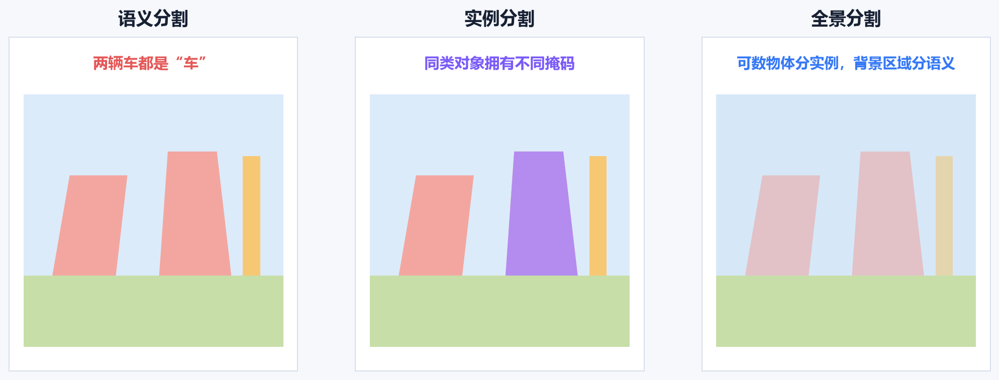
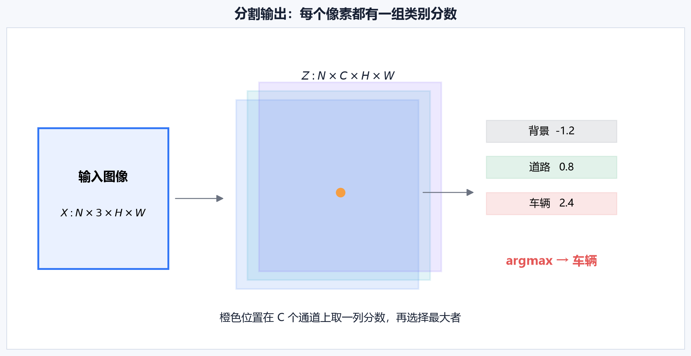
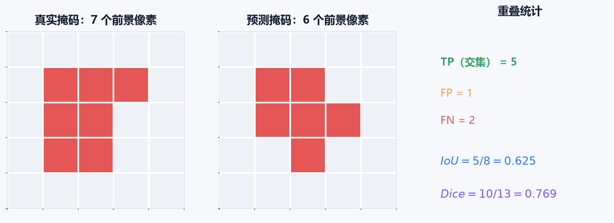
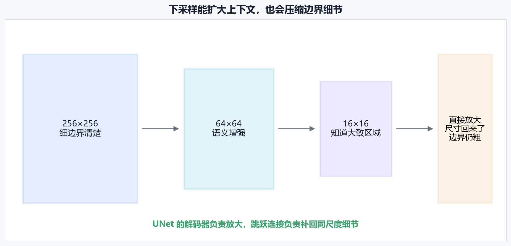
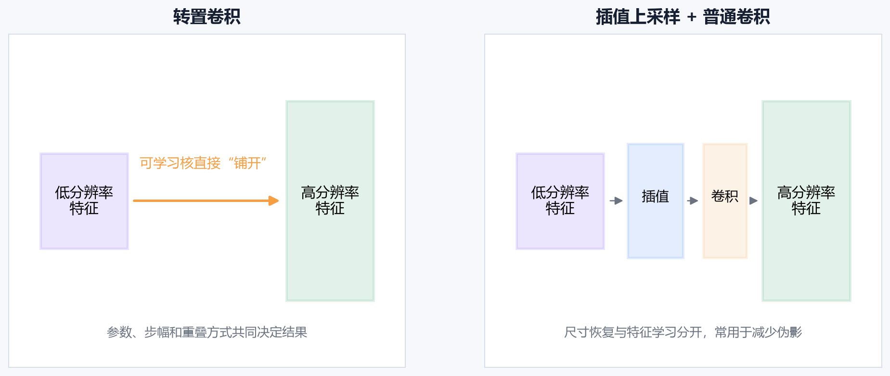
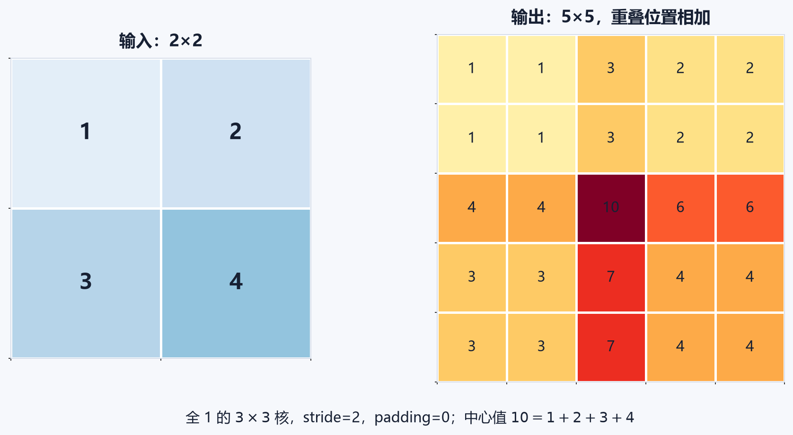
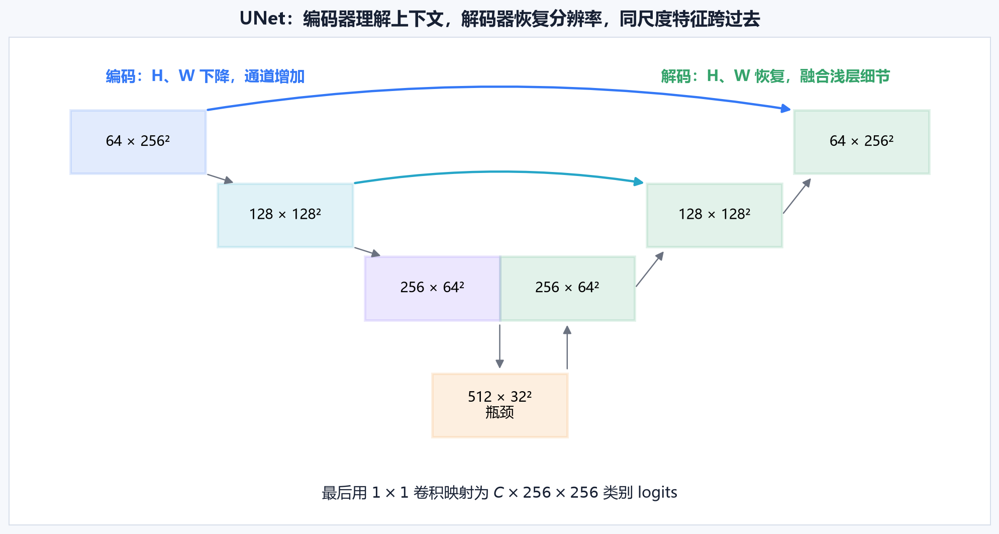
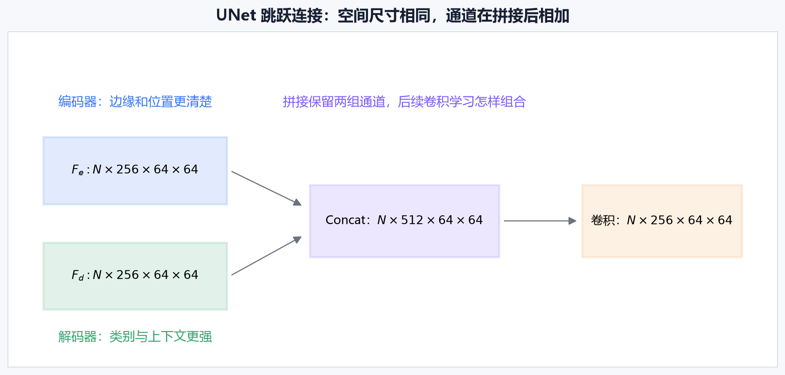

# [AI应用-计算机视觉]3.图像分割、上采样与UNet

目标检测用矩形框框出了物体的粗略范围，但现实世界许多任务必须精确到轮廓边缘：自动驾驶需要分清哪几厘米是可行驶路面、哪几厘米是马路牙子；医疗影像必须精确圈出微小肿瘤的边缘浸润范围；工业质检需要量化划痕的具体面积。

这些任务需要**图像分割（Image Segmentation）**——对输入画面的**每一个像素进行密集分类**。

图像分割面临的核心技术矛盾是：
1. **语义识别需要大感受野**：网络必须经过多层下采样，在宏观视野下理解“这块区域到底是什么东西”；
2. **边缘定位需要高分辨率**：下采样会严重丢失细微的空间几何坐标，导致边界模糊失真。

**UNet** 凭借优雅的对称 U 形编解码架构与**同尺度跳跃连接（Skip Connection）**，完美化解了“宏观语义理解”与“微观精确轮廓”之间的冲突。本篇将从张量表示与像素损失讲起，深度拆解转置卷积与上采样的数学机制，彻底吃透 UNet 的全链路实现。

---

## 一、语义分割输出的是一张类别图

通过输出粒度的演进，明确分割家族的三大任务定位：

- **语义分割（Semantic Segmentation）**：**只认类别，不分个体**。将全图每个像素归入指定语义类别。如果画面中并排站着两只猫，所有属于猫身体的像素都被统一标为“猫”类，彼此相连融为一体。
- **实例分割（Instance Segmentation）**：**既认类别，又分个体**。不仅识别像素是“猫”，还要精准区分“猫 1”和“猫 2”。通常只关注可数的前景目标（Thing），不关注天空、道路等背景（Stuff）。
- **全景分割（Panoptic Segmentation）**：**终极全貌统一**。对背景（道路、草地、建筑）执行语义分割，同时对前景可数目标（行人、车辆）执行独立的实例分割。

全卷积网络（FCN）最早去掉了分类网络的末端全连接层，使特征图能够在空间维度展开，开创了“像素进、像素出（Pixel-to-Pixel）”的密集预测范式。

---

## 二、输入、标签和输出张量分别装什么

在 PyTorch 的通道优先格式中，语义分割的张量流转具有严格的形状约束：

### 1. 输入图像张量（RGB 图像）
$$X \in \mathbb R^{N \times 3 \times H \times W}$$
- $N$：批大小；
- $3$：红绿蓝色彩通道；
- $H, W$：输入的原始分辨率高度与宽度。

### 2. 真实标签张量（Ground Truth Mask）
$$Y \in \{0, 1, \dots, C-1\}^{N \times H \times W}$$
- **关键细节**：语义分割的标签**没有通道维度**（通道数为 1 且通常被省略降维），它本质上是一张单通道的二维索引矩阵；
- 矩阵中坐标 $(h, w)$ 处存放的数值是一个**整数类别索引（Class Index）**（例如：0 代表背景，1 代表道路，2 代表车辆）。

### 3. 网络原始预测张量（Logits）
$$Z \in \mathbb R^{N \times C \times H \times W}$$
- $C$：预定义的总类别数；
- 网络在每个像素位置 $(h, w)$ 沿通道轴展开，都输出一个长为 $C$ 的实数打分向量。

### 像素预测解码过程
在推理阶段，取出特定像素点上的打分向量 $[Z_{n, 0, h, w}, Z_{n, 1, h, w}, \dots, Z_{n, C-1, h, w}]$，沿通道维度（`dim=1`）取最大值索引（`argmax`）：

$$\hat Y_{n, h, w} = \arg\max_{c} Z_{n, c, h, w}$$

若某像素各通道 logits 为 $[-1.2, 0.8, 2.4]$，最大值索引为 2（对应车辆），则该像素被最终染成“车辆”标签。

> **二分类分割的特例配置**：
> 面对纯黑白的病灶/缺陷二值分割：
> - **方案 A（推荐）**：网络输出通道设为 $C=1$（输出形状 $N \times 1 \times H \times W$），经过 Sigmoid 压缩至 $(0, 1)$ 概率，配合 `BCEWithLogitsLoss`；
> - **方案 B**：网络输出通道设为 $C=2$（分别代表背景和前景），经过 Softmax 概率归一化，配合 `CrossEntropyLoss`。

---

## 三、像素交叉熵：把每个有效像素当作一次分类

语义分割的损失计算，本质上是**将整张图像中成千上万个像素点拆解成一个个独立的分类样本，求取全图的平均交叉熵**：

$$\mathcal L_{\text{CE}} = -\frac{1}{|\Omega|} \sum_{(n,h,w) \in \Omega} \log p_{n, Y_{n,h,w}, h, w}$$

- $\Omega$：全图参与监督的有效像素集合；
- $Y_{n,h,w}$：该像素的真实类别整数；
- $p_{n, c, h, w}$：模型通过 Softmax 为该像素在真实类别通道上分配的预测概率。

> **数值惩罚直觉**：
> 某像素真实标签为“缺陷”：
> - 若模型给出的预测概率为 $0.70$：损失为 $-\log(0.70) \approx 0.357$（预测自信且正确，惩罚轻微）；
> - 若模型仅分给该类别 $0.05$ 的极低概率：损失激增至 $-\log(0.05) \approx 2.996$（严重错判，施加重罚以驱动梯度反向修正）。

### 忽略无标注边缘（`ignore_index`）的工程意义
在人工标注分割数据集时，物体的物理交界往往处于几像素宽的半透明过渡带，无法确定归属；或者遥感图像外围存在黑边填充。
- 绝不能将这些不确定区域硬标为“背景”；
- 赋予这些无监督像素一个特殊的类别标记（如 `255`），并在损失函数中指定 `ignore_index=255`。底层在反向求导和计算均值损失时，会自动物理跳过这批像素，防止网络学习到脏标注。

---

## 四、类别不平衡：99% 的背景会淹没 1% 的目标

在工业瑕疵质检或早期肿瘤筛查中，图像整体可能达到 $1024 \times 1024 \approx 10^6$ 像素，而病灶/裂痕往往仅占几百个像素（占比不到 $0.1\%$）。

若直接套用普通交叉熵，**即使模型把全图所有像素全部盲猜为“正常背景”，像素准确率（Pixel Accuracy）也能达到虚假的 $99.9\%$**，但模型实际上没有任何检测能力。

### 工业级常用破解策略

1. **类别加权交叉熵（Weighted CE）**：
   统计数据集中各类别像素总数，将类别的频率倒数作为权重传给 `CrossEntropyLoss(weight=class_weights)`，大幅提升漏判极小缺陷像素的惩罚代价。
2. **Dice Loss（基于重叠度惩罚）**：
   直接以集合相似度为优化目标，在预测概率层面平滑构建损失：
   $$\mathcal L_{\text{Dice}} = 1 - \frac{2 \sum p_i y_i + \epsilon}{\sum p_i^2 + \sum y_i^2 + \epsilon}$$
   其损失大小取决于重叠比例，天然对绝对像素数量脱敏，小目标即便只有几十个像素也能激发出巨大的优化梯度。
3. **复合混合损失（Combo Loss = CE + Dice）**：
   目前学术界与 Kaggle 竞赛最稳健的标准组合：交叉熵负责平滑引导像素级梯度收敛，Dice Loss 负责强行拉升小目标的轮廓对齐度。

---

## 五、IoU、Dice 和 mIoU 怎样从掩码算出来

在评估分割质量时，不再按“框”统计，而是**直接把预测的二值布尔掩码与真实标注掩码拉到像素级做点对点布尔运算**：

- **$TP$（真正例像素）**：真实属于该类，且模型预测正确的像素重叠数；
- **$FP$（假正例像素）**：真实不属于该类，但模型误报染色的像素数；
- **$FN$（假负例像素）**：真实属于该类，但模型遗漏未识别的像素数。

### 核心指标定义式

1. **交并比（IoU / Jaccard 系数）**：
   $$\operatorname{IoU} = \frac{\text{交集像素数}}{\text{并集像素数}} = \frac{TP}{TP + FP + FN}$$
2. **Dice 系数（F1-Score 像素级等价物）**：
   $$\operatorname{Dice} = \frac{2 \times \text{交集像素数}}{\text{预测总像素} + \text{真实总像素}} = \frac{2TP}{2TP + FP + FN}$$

> **极简算例推演**：
> 真实目标有 7 个像素，模型预测给出了 6 个像素，其中双方重合命中的交集像素有 5 个：
> - $TP = 5, FP = 1, FN = 2$；
> - 并集像素数：$5 + 1 + 2 = 8$；
> - **IoU 指标**：$\frac{5}{8} = \mathbf{0.625}$；
> - **Dice 指标**：$\frac{2 \times 5}{2 \times 5 + 1 + 2} = \frac{10}{13} \approx \mathbf{0.769}$。
> 
> *规律：同一组掩码预测，Dice 理论数值恒大于等于 IoU，绝不能混淆跨指标对比。*

### 平均交并比（mIoU）
将多分类任务中各个单独类别算出的 $\operatorname{IoU}_c$ 进行宏观算术平均：

$$\operatorname{mIoU} = \frac{1}{C}\sum_{c=0}^{C-1}\operatorname{IoU}_c$$

mIoU 是目前全球衡量语义分割算法综合性能的绝对黄金基准。

---

## 六、分类 CNN 为什么不能直接给出精细掩码

标准分类网络通过连续的步幅卷积（Stride=2）或最大池化（MaxPool），将特征图分辨率一路斩半：

$$
256 \times 256 \to 128 \times 128 \to 64 \times 64 \to 32 \times 32 \to 16 \times 16
$$

下采样带来了不可替代的收益：
- **大幅降低中间显存开销与计算复杂度**；
- **成倍激增深层神经元的感受野**，使其能够总览全局上下文，判断复杂物体。

### 带来的毁灭性代价：空间高频细节彻底湮灭
经过 16 倍或 32 倍下采样后，原本在输入图像中仅有几像素宽的细小血管、狭窄裂缝或毛刺边缘，其空间坐标在特征图上直接被坍缩压制到了同一个特征网格点内部。

如果直接拿深层 $16 \times 16$ 的特征图强行双线性插值放大 16 倍回 $256 \times 256$：
- 恢复的仅仅是数组矩阵的**几何尺寸**；
- 那些在下采样过程中被平均抹平的**边缘边界信息早已永久损毁，根本无法凭空恢复**，输出的掩码边缘必然像马赛克一样模糊粗糙。

因此，分割网络必须构建一条对称的**解码恢复路径**，将深层的语义特征与浅层的空间坐标无缝缝合。

---

## 七、上采样的几种路线

将低分辨率特征图放大回原始输入尺寸，工程上有两类核心思路：

1. **无参数确定性插值 + 普通卷积（Bilinear + Conv）**：
   - 先通过双线性插值（Bilinear）将特征图空间尺寸按数学规则平滑拉伸放大 2 倍；
   - 紧接着套用标准 $3 \times 3$ 卷积去融合平滑通道。
   - **优势**：算法极其稳健，**天然绝无棋盘格伪影**，现代大模型高度推荐。
2. **转置卷积（Transposed Convolution）**：
   - 将尺寸放大与通道变换融为一个单一的可学习卷积算子，由网络自主反向传播学习如何最优重构放大。
   - **代价**：计算步幅与核大小不匹配时极易产生周期性网格伪影。
3. **亚像素卷积（Pixel Shuffle）**：
   - 在通道维度扩张出 $r^2$ 倍特征，随后在空间维度重新折叠排布（周期性重排），常见于超分辨率与轻量级网络。

> **踩坑警告**：
> - 连续特征图上采样使用**双线性插值（Bilinear）**；
> - 针对带有离散类别整数编号的标签掩码（Mask）做缩放时，**必须强制使用最近邻插值（Nearest Neighbor）**！如果对整数标签 0（背景）和 2（车辆）使用双线性插值，中间过渡带会凭空算出不存在的数值 1（行人），直接酿成假标签灾难。

---

## 八、转置卷积怎样把一个输入值“铺”到输出上

转置卷积（Transposed Convolution）在结构上是常规卷积矩阵运算的**转置（Transpose）**，但**绝对不是数学意义上的求逆（Inverse）**，它无法完全还原未下采样前的原始像素数值。

其最直观的物理操作机制是：**“按步幅在输出画布上打点，拿输入值去加权缩放整个卷积核，再将各个扩展小块重叠累加”**。

### 手工数值追踪（以 $2\times 2$ 放大到 $5\times 5$ 为例）

输入单通道矩阵（$2 \times 2$）：
$$X = \begin{bmatrix} 1 & 2 \\ 3 & 4 \end{bmatrix}$$
设转置卷积核为全 1 的 $3 \times 3$ 矩阵，步幅 $s = 2$，填充 $p = 0$：
1. **左上角元素 1**：以步幅步进在画布左上角，铺设一个 $1 \times \text{Kernel}$ 的 $3 \times 3$ 全 1 块；
2. **右上角元素 2**：向右跳动 $s=2$ 个像素，在对应区域铺设一个 $2 \times \text{Kernel}$ 的 $3 \times 3$ 全 2 块；
3. **左下角元素 3 与右下角元素 4**：向下跳动 $s=2$ 个像素，分别铺设全 3 块与全 4 块；
4. **重叠区域物理相加**：四个小块在交叉区域发生重叠，所有覆盖于同一坐标的数值直接相加求和。

最终累加输出矩阵（$5 \times 5$）：
$$\begin{bmatrix}
1 & 1 & 3 & 2 & 2 \\
1 & 1 & 3 & 2 & 2 \\
4 & 4 & \mathbf{10} & 6 & 6 \\
3 & 3 & 7 & 4 & 4 \\
3 & 3 & 7 & 4 & 4
\end{bmatrix}$$
*画布中心位置由四个小块共同叠盖，数值正是 $1 + 2 + 3 + 4 = 10$。*

### 输出分辨率精确推导公式

$$H_{\text{out}} = (H_{\text{in}} - 1) \times s - 2p + d \times (k - 1) + o + 1$$

- $s$：步幅；$p$：填充；$k$：卷积核尺寸；$o$：输出补偿参数（`output_padding`）。
- 代入上式：$(2 - 1) \times 2 - 0 + 1 \times (3 - 1) + 0 + 1 = 2 + 2 + 1 = 5$，与手工推导完全契合。

---

## 九、棋盘格伪影来自不均匀覆盖

在使用转置卷积时，图像重构结果中经常会肉眼可见地浮现出一层类似“纱窗布”或“国际象棋棋盘”的细密周期性明暗网格，这就是著名的**棋盘格伪影（Checkerboard Artifacts）**。

### 伪影爆发的数学根源
当转置卷积的**卷积核大小 $k$ 不能被步幅 $s$ 整除**时（例如最常用的 $k=3, s=2$）：
- 某些像素位置刚好被相邻的多个滑动小块重复叠加了 4 次；
- 而另一些交界像素位置仅仅被覆盖了 1 次甚至 2 次；
- 这导致最终输出画布上天然存在着**周期性的能量累加不均匀**，即使充分训练，网络也会倾向于将这种结构性失衡放大为高频伪影。

### 工业避坑法则
- 若坚持使用转置卷积，优先采用核长能被步幅整除的尺寸（如 $s=2$ 时搭配 $k=4$）；
- **最佳实践**：全面弃用转置卷积，转为采用 **`nn.Upsample(mode='bilinear')` + `nn.Conv2d`** 组合，彻底在物理根源上抹除棋盘格现象。

---

## 十、UNet 怎样把编码和解码连接成一条 U 形路径

2015 年 Olaf Ronneberger 提出的 UNet，其经典 U 形拓扑由四个核心组件闭环构成：

1. **收缩路径（Encoder / 编码器）**：
   连续堆叠常规卷积与下采样（MaxPool），特征图宽高逐级减半，特征通道数逐级翻倍（$64 \to 128 \to 256 \to 512$）。核心使命是**逐步压缩空间冗余，提炼强泛化的高级抽象语义**；
2. **中心瓶颈层（Bottleneck）**：
   网络的最底层低分辨率阶段（如 $32 \times 32 \times 1024$），拥有全网最大的感受野，负责聚合全局宏观上下文信息；
3. **扩张路径（Decoder / 解码器）**：
   对称堆叠上采样算子与卷积，空间分辨率逐步成倍放大恢复（$32 \to 64 \to 128 \to 256$），通道数逐步收缩；
4. **同尺度跳跃连接（Skip Connection）**：
   横跨整个网络，直接将编码器某一深度的高清特征图，**完整复刻并粘贴送入解码器对应的相同尺度层级**。

最后在网络尾端，通过一个极简的 $1 \times 1$ 卷积，将通道数直接压缩为目标类别数 $C$，无损输出 $N \times C \times H \times W$ 的全尺寸密集预测图。

---

## 十一、跳跃连接为什么能让边界重新清楚

如果没有跳跃连接，解码器只能完全依靠底层那个被过度压缩的小小瓶颈特征去艰难脑补高频细节，最终勾勒出的边界往往绵软无力。

**跳跃连接的核心精髓，是让浅层纯净的空间坐标直接与深层的高阶语义产生“跨时空对话”**：
- **深层解码器特征**：知道“哪里是一只猫”（强语义，粗定位）；
- **浅层编码器特征**：不知道这是一只猫，但知道“这里有一条黑白灰相间的清晰细线”（弱语义，精确定位）；
- **UNet 融合机制（通道拼接 Concat）**：

$$F_{\text{fusion}} = \operatorname{Concat}(F_{\text{encoder}}, F_{\text{decoder}}, \text{dim}=1)$$

将两组特征图在通道维度强行拼装在一起（若两组通道皆为 256，拼接后通道数跃升为 512），紧接着由随后的两层 $3 \times 3$ 卷积去自主学习权重：**利用深层特征的语义把关，利用浅层特征的精确坐标给轮廓画线**。

> **辨析：UNet 拼接（Concat）vs ResNet 相加（Add）**
> - **ResNet 的 Add**：两路张量形状完全相同，对应数值直接逐元素相加（$F(x) + x$），通道数不变。本质是残差学习，旨在消除深层梯度消失；
> - **UNet 的 Concat**：两路张量沿通道轴堆叠拼接，通道数直接翻倍。本质是**特征融合**，完整保留两侧各自不同维度的原始信息，交给后续卷积自由组合。

---

## 十二、沿着一组形状走完 UNet

以 $256 \times 256$ 输入图像、多分类任务（$C$ 类）为例，追踪全网对称张量维度的演化轨迹：

| 网络阶段 | 输出张量形状（$N \times C \times H \times W$） | 操作核心任务与说明 |
|---|---|---|
| **输入层** | $N \times 3 \times 256 \times 256$ | 原始 RGB 图像输入 |
| **编码 Stage 1** | $N \times 64 \times 256 \times 256$ | 保持原尺寸的高清浅层边缘特征（**留存用于跳跃连接 1**） |
| 下采样 1 (MaxPool) | $N \times 64 \times 128 \times 128$ | 空间分辨率减半 |
| **编码 Stage 2** | $N \times 128 \times 128 \times 128$ | 提取中层局部纹理（**留存用于跳跃连接 2**） |
| 下采样 2 (MaxPool) | $N \times 128 \times 64 \times 64$ | 空间分辨率再次减半 |
| **编码 Stage 3** | $N \times 256 \times 64 \times 64$ | 提取局部器官与实体部件（**留存用于跳跃连接 3**） |
| 下采样 3 (MaxPool) | $N \times 256 \times 32 \times 32$ | 进入最低尺度空间 |
| **瓶颈层 (Bottleneck)** | $N \times 512 \times 32 \times 32$ | 全网最深层，捕获最大范围的宏观上下文语义 |
| 上采样 1 | $N \times 256 \times 64 \times 64$ | 尺度恢复到第 3 级（通道减半） |
| **拼接融合 1** | $N \times (256 + 256) \times 64 \times 64 = N \times 512 \times 64 \times 64$ | **与编码 Stage 3 特征图通道拼接** |
| 解码 Stage 1 (卷积) | $N \times 256 \times 64 \times 64$ | 卷积融合，整理为 256 通道 |
| 上采样 2 | $N \times 128 \times 128 \times 128$ | 尺度恢复到第 2 级（通道减半） |
| **拼接融合 2** | $N \times (128 + 128) \times 128 \times 128 = N \times 256 \times 128 \times 128$ | **与编码 Stage 2 特征图通道拼接** |
| 解码 Stage 2 (卷积) | $N \times 128 \times 128 \times 128$ | 卷积融合，整理为 128 通道 |
| 上采样 3 | $N \times 64 \times 256 \times 256$ | 尺度彻底恢复到原始全分辨率 |
| **拼接融合 3** | $N \times (64 + 64) \times 256 \times 256 = N \times 128 \times 256 \times 256$ | **与编码 Stage 1 特征图通道拼接** |
| 解码 Stage 3 (卷积) | $N \times 64 \times 256 \times 256$ | 最终融合出兼备高语义与高精度的 64 维特征图 |
| **最终预测输出** | $N \times C \times 256 \times 256$ | 通过 $1 \times 1$ 卷积直接输出 $C$ 个类别的全尺寸 logits |

> **尺寸对齐底线**：
> 拼接操作（Concat）要求跳跃而来的特征图与上采样后的特征图 $(H, W)$ 必须绝对严丝合缝一致！若输入图像的初始宽高不能被 $2^L$（下采样倍数）整除，计算中向下取整会导致上下游特征图尺寸相差 1 像素，拼接直接抛出运行时异常。**工程上应确保输入分辨率为 32 的整数倍，或在拼接前对解码特征调用自适应插值（Adaptive Resize）做对齐保护**。

---

## 十三、分割训练中图像和标签必须同步变化

在图像分类任务中，数据增强只改变图像，标签始终是标量不变的；但**在语义分割中，标签本身就是一张空间像素图！**

### 增强机制的严格对齐准则

1. **几何空间变换必须强绑定**：
   对图像执行随机旋转 $15^\circ$、水平翻转、透视变换或随机裁剪时，**必须以完全相同的随机几何参数，对真实的标签 Mask 同步施加一模一样的变换**！如果图像翻转了而标签没翻转，网络将直接把正确的左脑病灶强行学习到右脑空域上。
2. **像素颜色光影变换必须严格单向**：
   调整对比度、增加高斯模糊、调整亮度或色调抖动时，**必须仅施加在输入 RGB 图像上，严禁作用于标签 Mask**。
3. **插值模式必须严格解耦**：
   - 图像旋转与缩放采用**双线性或双三次插值（Bilinear / Bicubic）**以保持平滑；
   - 对应的标签 Mask 缩放时**严禁开启抗锯齿，必须死守最近邻插值（Nearest）**。

---

## 十四、今天怎样使用 UNet 和其他分割模型

2015 年原始 UNet 的朴素卷积配置在今天看来相对简单，但在现代计算机视觉生态中，UNet 的拓扑哲学早已演变为一种通用架构基石：

### 现代实战选型与演进全景

1. **现代 UNet 变体（工业与医疗首选基准）**：
   - **Backbone 替换**：直接将收缩路径（Encoder）替换为成熟的预训练骨干（如 ResNet-34/50、ConvNeXt、EfficientNet），直接站在通用海量视觉先验的肩膀上微调；
   - **UNet++ / UNet 3+**：在跳跃连接中嵌入嵌套密集的稠密卷积块或全尺度跳跃连接，大幅缓和编解码器之间的语义鸿沟；
   - **Attention UNet**：在跳跃连接处引入注意力门控机制（Attention Gate），自动抑制不相关背景区域的浅层噪声信号传输。
2. **高吞吐实时场景（自动驾驶、嵌入式工控）**：
   - 优先选择 **BiSeNet（双向分割网络）**：一条深层上下文分支走语义，一条浅层高分辨率分支走空间细节，摆脱繁重的逐层 U 形上采样，推理帧率可轻松突破 60 FPS。
3. **大型通用自然场景（复杂城市街景、大尺度地物分类）**：
   - 选用 **DeepLabv3+**（引入空洞空间金字塔池化 ASPP 捕捉多尺度上下文）或 **SegFormer**（无重叠 Patch 划分的轻量级层次化 Vision Transformer，告别位置编码硬约束）。
4. **统一大模型与交互式标注（时代前沿）**：
   - **Mask2Former**：用统一的掩码分类（Mask Classification）框架，彻底抹平了语义分割、实例分割与全景分割的架构壁垒；
   - **Segment Anything Model (SAM)**：基于强大的零样本提示工程（Prompt-driven），以海量数据训练的大一统视觉基础分割大模型，已成为现代半自动标注流水线的事实标准。