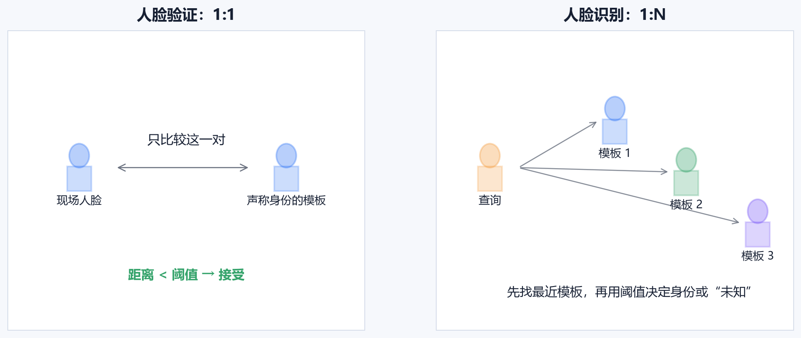
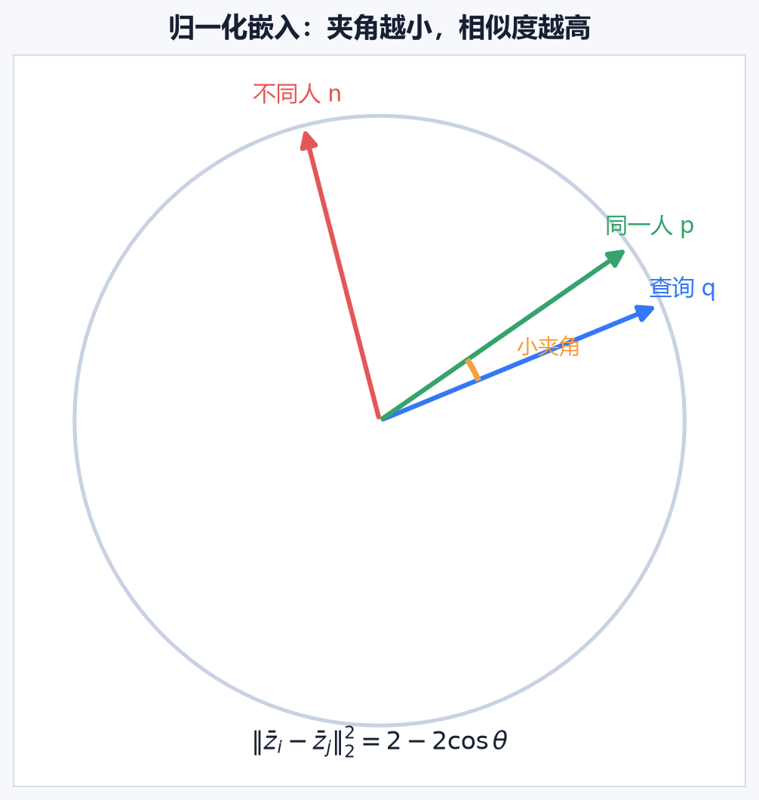
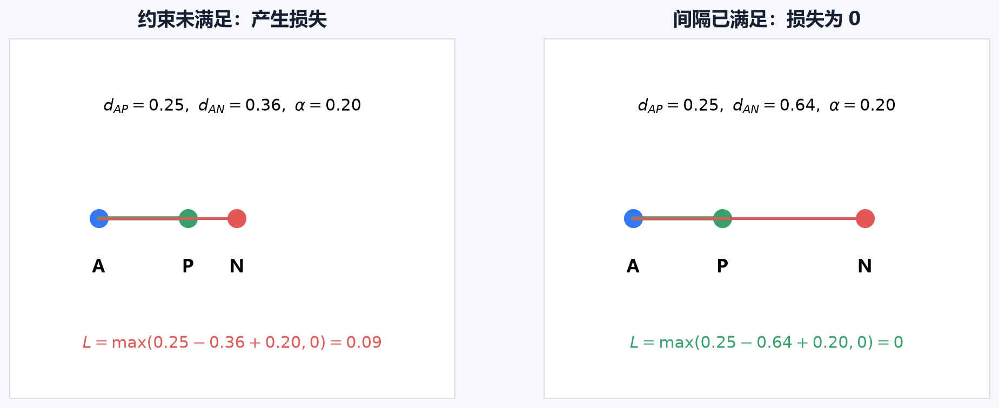
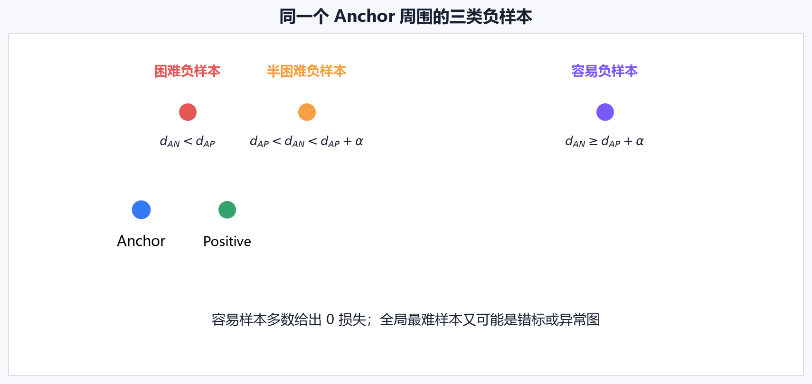
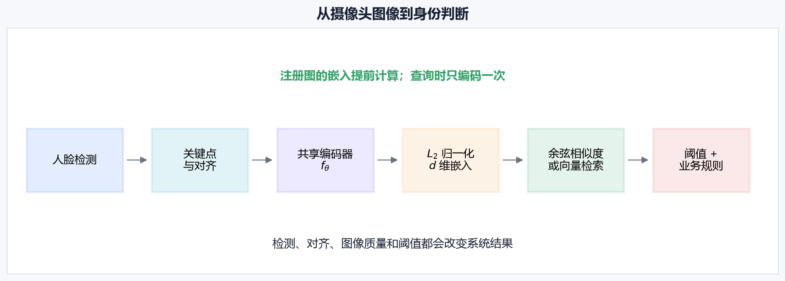
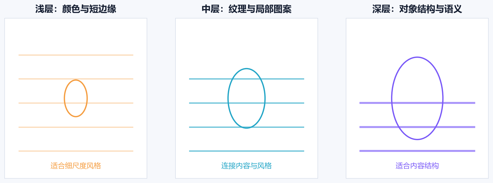
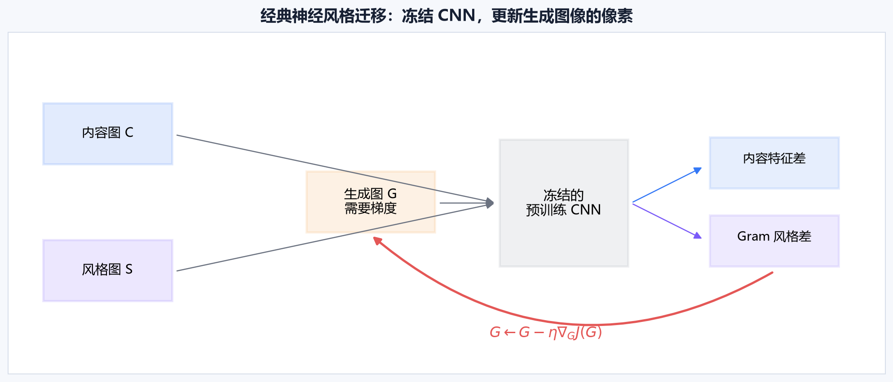
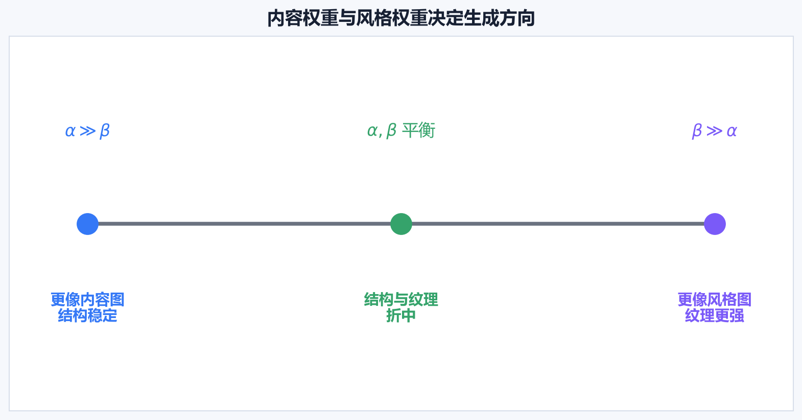
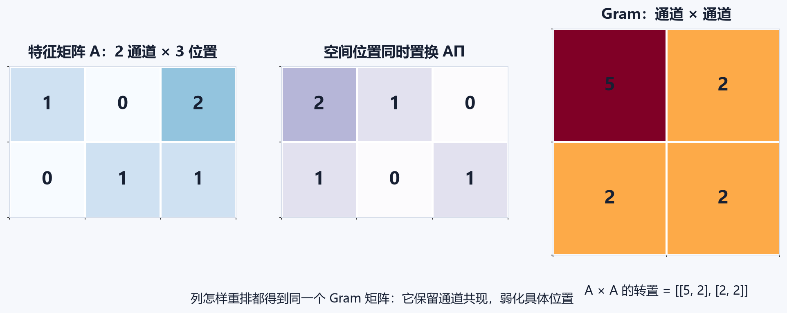
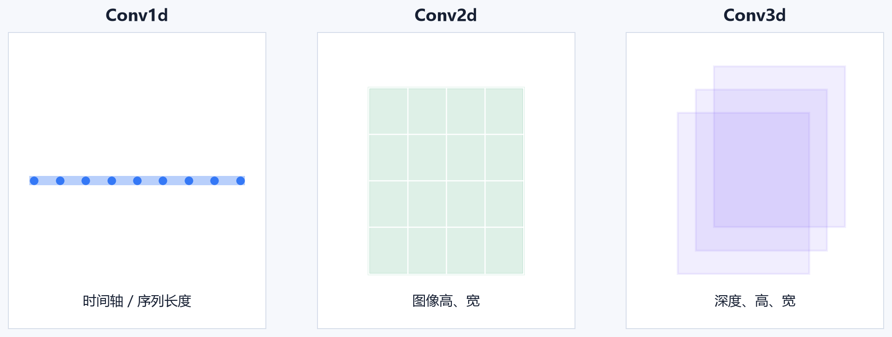

# [AI应用-计算机视觉]4.人脸表征、度量学习与神经风格迁移

卷积神经网络不仅能做分类，其提取的中间层特征本身就是强大的视觉语义表征。

本篇涵盖两个看似不同、实则共享同一底层的视觉主题：
1. **人脸表征与度量学习**：如何把一张复杂的人脸图像映射为一个紧凑的高维向量，让同一人的不同照片靠拢、不同人的照片远离；
2. **神经风格迁移**：如何解耦并复用 CNN 中间层的“内容结构”与“风格纹理”，通过反向传播直接优化出一张全新艺术画作。

这两项技术的本质都在于：**深层特征空间比原始像素矩阵更贴近人类视觉对“身份”与“风格”的理解**。

---

## 一、人脸验证与人脸识别解决的问题不同

在工程落地中，必须严格区分两类任务的复杂度与评测边界：

- **人脸验证（Face Verification，$1:1$ 比对）**：
  - **核心问题**：“眼前这个人，是不是他所声称的某个人？”
  - **输入**：现场抓拍图 + 该人员预先登记的底库模板；
  - **输出**：二分类判定（匹配成功 / 匹配失败）；
  - **典型应用**：手机人脸解锁、海关持证核验、刷脸考勤打卡。
- **人脸识别（Face Identification，$1:N$ 检索）**：
  - **核心问题**：“眼前这个人到底是谁？或者他根本不在白名单库里？”
  - **输入**：未知人脸一张，在包含 $N$ 个底库模板的集合中盲搜；
  - **输出**：匹配的具体人员 ID，或判定为“陌生人/未命中（Unknown）”。



设现场人脸向量为 $q$，底库有 $N$ 个已知特征向量 $\{z_1, z_2, \dots, z_N\}$。系统首先检索出欧氏距离最近的候选人：

$$k^* = \arg\min_k d(q, z_k)$$

在实际开放场景（Open-set）中，还必须设置距离阈值 $\tau$ 拦截冒充者：

$$\hat y = \begin{cases} k^*, & d(q, z_{k^*}) < \tau \\ \text{unknown}, & d(q, z_{k^*}) \ge \tau \end{cases}$$

> **关键认知**：$1:N$ 检索的难度远高于 $1:1$ 验证。当底库规模 $N$ 扩展至百万级时，即使单对比较的准确率高达 $99.9\%$，偶发出现某个错误候选距离极近的误报概率也会急剧膨胀。

---

## 二、单样本注册不等于只用一张图训练模型

在真实业务中，新员工入职或新用户注册时通常只能提供**单张证件照（One-shot Learning）**。

### 为什么不能把人脸当成普通的分类任务？
如果把底库中的每个人当成 Softmax 的一个分类类别：
1. **样本极度匮乏**：单人只有 1~2 张底片，网络根本学不出稳健的分类决策超平面；
2. **架构动态死锁**：输出层维度被写死在员工数量上，每加入一个新用户就必须改动网络结构并全网重新训练，工程上完全不可行。

### 真正的工程解法：度量学习（Metric Learning）
我们的目标不是训练一个分类器，而是**训练一个参数固定的特征编码器（Feature Extractor）**：

$$z = f_\theta(x) \quad \in \mathbb R^d$$

- 训练阶段利用海量公开人脸数据集（数万个人物、每个人数十张照片），让网络学会过滤光照、发型、姿态等无关变量；
- 部署阶段彻底冻结网络参数。新用户注册时，直接前向推理提取出 128 或 512 维的稠密特征向量存入数据库即可。

---

## 三、共享编码器把所有人脸放进同一个坐标系

**孪生网络（Siamese Network）**由两个结构完全相同且**强行共享全部权重参数 $\theta$** 的子网络分支构成：

$$z_i = f_\theta(x_i), \qquad z_j = f_\theta(x_j)$$

权重共享是度量学习的基石：它强制所有输入图像必须通过同一套度量标尺投影到完全一致的高维特征流形上。

### 向量的 $L_2$ 归一化与余弦距离对齐
现代人脸编码器输出的嵌入向量统一强制除以其模长，做 **$L_2$ 归一化**：

$$\bar z = \frac{z}{\Vert{}z\Vert{}_2} \implies \Vert{}\bar z\Vert{}_2 = 1$$

此时所有特征点均被精准投影在单位超球面（Unit Hypersphere）表面。余弦相似度退化为单纯的向量内积：

$$s(\bar z_i, \bar z_j) = \bar z_i^\top \bar z_j = \cos\theta_{ij}$$

两点的平方欧氏距离与余弦相似度呈现完美的单调对等换算：

$$\Vert{}\bar z_i - \bar z_j\Vert{}_2^2 = \Vert{}\bar z_i\Vert{}_2^2 + \Vert{}\bar z_j\Vert{}_2^2 - 2\bar z_i^\top \bar z_j = 2 - 2\cos\theta_{ij}$$

在归一化特征空间中，**欧氏距离最小等价于夹角最小、余弦相似度最大**。



---

## 四、三元组损失同时规定“拉近谁、推远谁”

FaceNet 奠定了度量学习的核心损失——**三元组损失（Triplet Loss）**。

每个输入元组固定由三张图片组成：
- **$A$（Anchor，基准原图）**：某人的基准人脸；
- **$P$（Positive，正样本）**：与 $A$ 属于**同一人**的另一张抓拍照；
- **$N$（Negative，负样本）**：与 $A$ 属于**不同人**的任意其他人脸。

### 核心优化目标与 Hinge 损失公式
我们希望基准与正样本的距离，比基准与负样本的距离至少要小一段安全边际 $\alpha$（Margin）：

$$d(A, P) + \alpha \le d(A, N)$$

单组样本的损失函数为：

$$\mathcal L(A, P, N) = \max\left( \Vert{}f(A) - f(P)\Vert{}_2^2 - \Vert{}f(A) - f(N)\Vert{}_2^2 + \alpha, \; 0 \right)$$

- **$\alpha > 0$（安全边际 Margin）**：防止特征空间偷懒退化。如果没有 $\alpha$，网络把所有输入无脑映射为一个全 0 向量就能让损失归零；
- **$\max(\cdot, 0)$**：当不同人已经被推得足够远（超过 $\alpha$）时，该组样本贡献的损失自动归零，不再参与梯度更新。



> **算例追踪**：
> 设边际 $\alpha = 0.20$。
> - **状态 1**：$d(A, P) = 0.25, d(A, N) = 0.36$。
>   虽然负样本确实更远，但差距仅有 $0.11 < 0.20$。损失 $\mathcal L = \max(0.25 - 0.36 + 0.20, 0) = 0.09$。网络继续施加反向推拉梯度。
> - **状态 2**：$d(A, P) = 0.25, d(A, N) = 0.64$。
>   差距扩大至 $0.39 > 0.20$。损失 $\mathcal L = \max(0.25 - 0.64 + 0.20, 0) = 0$。模型满意达标。

---

## 五、三元组是否有用取决于负样本怎样选择

在全量数据集中随机抓取三元组，极大概率会抽到与 Anchor 八竿子打不着的路人（如男女有别、肤色不同）。此时天然满足 $d(A, N) \gg d(A, P) + \alpha$，损失恒为 0，模型无法学到有效辨识特征。

**三元组采样的核心生命线是负样本挖掘（Negative Mining）**：



根据相对距离，负样本分为三个等级：
1. **简单负样本（Easy Negatives）**：$d(A, N) > d(A, P) + \alpha$（损失直接为 0，浪费算力）；
2. **极难负样本（Hard Negatives）**：$d(A, N) < d(A, P)$（模型彻底判错，负样本比正样本更靠近基准）；
3. **半困难负样本（Semi-Hard Negatives）**：
   $$d(A, P) < d(A, N) < d(A, P) + \alpha$$
   负样本确实比正样本远，但**还没有拉开足够的 Margin 护城河**。

> **工程最佳实践**：优先挖掘 **Semi-Hard 负样本**进行在线批次训练（Batch Mining）。极难负样本（Hard）往往由标注错误、极端遮挡或伪影造成，盲目硬啃容易导致梯度震荡难以收敛。

---

## 六、ArcFace 用角度间隔塑造大规模身份空间

尽管三元组损失直观优美，但其组合对数爆炸（$O(N^3)$），且采样策略极度脆弱。

现代工业级人脸系统全面转向基于**分类框架的加边际损失**，其中最具统治力的是 **ArcFace（Additive Angular Margin Loss）**。

### 归一化球面的角度分类
将输入特征向量 $x_i$ 和线性分类权重列向量 $W_j$ 全部强制执行 $L_2$ 归一化并乘上缩放因子 $s$：

$$W_j^\top x_i = \Vert{}W_j\Vert{} \Vert{}x_i\Vert{} \cos\theta_j = \cos\theta_j \implies \text{Logit} = s \cdot \cos\theta_j$$

权重向量 $W_j$ 的物理几何意义，就是第 $j$ 个人物类别的**中心主方向**。

### ArcFace 的附加角度边际机制
在计算该样本对应的真实类别（Ground Truth）得分时，在夹角弧度上**显式强加一个固定角度惩罚 $m$**：

$$\ell_{y_i} = s \cdot \cos(\theta_{y_i} + m)$$

其他负类别保持不变：$\ell_j = s \cdot \cos\theta_j \quad (j \ne y_i)$。

由于余弦函数在 $[0, \pi]$ 区间内单调递减，$\theta + m$ 意味着人为给真实类别制造了严重的打分惩罚。网络为了在 Softmax 中抵消这个惩罚，必须迫使同一人的所有样本特征向量极其紧密地贴向类中心 $W_{y_i}$。

ArcFace 在流形球面上直接构建了几何意义极其纯粹的类间角边际，训练稳定，彻底免除了手工构建三元组的算力消耗。

---

## 七、一套人脸系统不只有编码器

在实际部署时，直接拿手机相机拍出的原始大图喂给 ResNet 提取特征是完全行不通的。一套商业级人脸识别系统是由多个级联算法串起的精密流水线：

```
[原始抓拍大图]
      │
      ▼ (1. 人脸检测：定位画面中人脸的矩形框)
[检测到的人脸候选区]
      │
      ▼ (2. 关键点定位与对齐：检测双眼、鼻尖、嘴角五点，执行旋转与仿射变换)
[正面居中对齐的人脸切片 (如 112x112)]
      │
      ▼ (3. 活体防伪检测：拦截打印照片、手机翻拍、硅胶面具攻击)
[确认真人有效人脸]
      │
      ▼ (4. 特征抽取骨干网络：提取 512 维特征并执行 L2 归一化)
[512 维特征向量]
      │
      ▼ (5. 向量检索与阈值判定：比对底库向量，余弦分数决断)
[输出最终业务识别结果]
```



> **对齐（Alignment）的核心地位**：未经仿射变换对齐的人脸，光是微弱的偏头或仰俯就会引起像素排列的剧变。通过仿射变换将双眼与嘴唇强制拉齐到标准模版坐标系，能为后续编码器抹平巨大的几何形变干扰。

---

## 八、阈值、活体检测和人群差异属于系统边界

工业部署绝不仅是跑出一个模型得分，必须设立清晰的安全与鲁棒性工程边界：

1. **阈值与指标博弈（FMR vs FNMR）**：
   - **错误接受率（FMR / False Match Rate，误识率）**：把张三错认成了李四；
   - **错误拒绝率（FNMR / False Non-Match Rate，拒真率）**：真实员工自己刷脸却被系统拒之门外；
   - 阈值设定是业务成本的权衡：高安防银行金库必须严苛压低 FMR（宁可多拒真，绝不放过一个假冒）；相册聚类为了体验则允许轻微抬高 FMR。
2. **活体检测（Anti-spoofing）是绝对物理前置**：
   特征编码器只管“长得像不像”，一张打印的高清照片在特征提取器眼里与真人一模一样。必须依赖红外双目、双目结构光、微表情活体检测模块在最前端予以物理阻截。

---

## 九、人脸表征与风格表示的共同点和边界

至此，我们完成了计算机视觉对图像表征的第一阶段抽象：通过训练深层网络，将复杂外观投影为低维特征向量。

接下来探讨的**神经风格迁移（Neural Style Transfer）**同样借力 CNN 的特征表达能力，但方向彻底掉转：
- **人脸表征**：训练网络，把整张图的高维信息**高度浓缩为一串紧凑的身份向量**；
- **风格迁移**：网络权重彻底冻结，反过来**利用深层特征的统计量指导生成一张全新的艺术图像**。

---

## 十、卷积网络不同深度记录不同视觉信息

随着卷积神经网络层数的逐渐加深，各层特征图呈现出极强的语义分层阶梯：

- **浅层特征（如 Conv1_1 ~ Conv2_1）**：感受野极小，专注于捕获细碎的高频几何细节（精细边缘、笔触走向、局部颜色过渡）；
- **中层特征（如 Conv3_1 ~ Conv4_1）**：感受野扩大，组合出复杂的局部图案、重复纹理与特定几何轮廓；
- **深层特征（如 Conv5_1）**：感受野几乎覆盖全图，过滤掉了绝大多数微观像素摆放，高度抽象出物体的宏观空间布局与实体语义结构。



正是这种“语义与微观纹理逐层解耦”的特性，赋予了我们分别提取“内容”与“风格”的可能。

---

## 十一、经典神经风格迁移优化的是生成图像

Gatys 经典算法最颠覆直觉的一点是：**整个网络的所有参数完全冻结，参与反向传播被梯度更新的不是权重，而是生成图像 $G$ 本身的像素矩阵！**

输入给定：
- 内容图像 $C$（如一张街景照片）；
- 风格图像 $S$（如梵高的《星空》）；
- 初始待优化图像 $G$（通常直接初始化为内容图像，或纯高斯白噪声）；
- 预训练好的特征提取器（经典采用 ImageNet 预训练的 VGG-19）。



### 全局复合优化目标

$$\min_{G} J(G) = \alpha J_{\text{content}}(C, G) + \beta J_{\text{style}}(S, G) + \gamma J_{\text{TV}}(G)$$

- $\alpha$：内容权重，掌控画面的结构保真度；
- $\beta$：风格权重，掌控笔触与色彩的渲染烈度；
- $J_{\text{TV}}(G)$：全变差正则项（Total Variation），用于平滑相邻像素，抑制高频噪点。



---

## 十二、内容损失在特征空间比较结构

如果为了保留内容，直接去约束像素差距 $\Vert{}C - G\Vert{}^2$，就会强迫生成图的颜色也必须与原图一致，艺术风格将无法渗透。

**内容损失应当在网络的深层特征空间进行度量**：

$$J_{\text{content}}^{[l]}(C, G) = \frac{1}{2C_l H_l W_l} \sum_{i, j, k} \left( A_{ijk}^{[l]}(C) - A_{ijk}^{[l]}(G) \right)^2$$

- 选择 VGG 的中深层（如 `Conv4_2`）；
- $A^{[l]}(C)$ 与 $A^{[l]}(G)$ 分别代表内容图和生成图在该层的特征激活图。

深层特征丢弃了微观颜色和笔触细节，保留的是高阶物体轮廓与空间排布。只要生成图在深层的激活图与内容图逼近，它就能在保留建筑物、人物轮廓的同时，允许底层像素自由变换颜色与质感。

---

## 十三、Gram 矩阵把空间特征压缩成通道共现

风格（纹理、配色、笔法）到底该如何用数学严谨定义？
风格具有一个核心性质：**它是一种全图弥散的统计属性，与具体画在画面的左边还是右边完全无关**。

Gatys 引入了**格拉姆矩阵（Gram Matrix）**，将三维特征图压缩成跨通道的未中心化二阶协方差统计量。

### Gram 矩阵的计算流程
设第 $l$ 层的特征图形状为 $C_l \times H_l \times W_l$。将空间宽高展平，得到形状为 $C_l \times M_l$ 的矩阵（其中 $M_l = H_l \times W_l$）：
- 矩阵的第 $i$ 行代表第 $i$ 个卷积核在全图所有像素位置上的激活响应。

Gram 矩阵定义为特征矩阵与其转置的乘积：

$$\mathcal G^{[l]} = A^{[l]} (A^{[l]})^\top \quad \in \mathbb R^{C_l \times C_l}$$

其内部每个元素计算为所有空间位置的点乘累加：

$$\mathcal G_{ij}^{[l]} = \sum_{k=1}^{M_l} A_{ik}^{[l]} A_{jk}^{[l]}$$



### Gram 矩阵捕获风格的物理直觉
- 假设第 $i$ 个通道专门对“明黄色的油画颜料”产生高响应；
- 第 $j$ 个通道专门对“波浪状卷曲线条”产生高响应；
- $\mathcal G_{ij}$ 的数值越大，说明这幅画作中**只要出现波浪线条的地方，大概率同时涂抹着明黄色**！

Gram 矩阵通过在全图空间尺度求和累加，**彻底抹平了坐标位置信息，纯粹记录了不同视觉特征之间的共现关联与色彩能量**。

---

## 十四、多层风格损失捕捉不同大小的纹理

单层 Gram 只能捕捉单一尺度的笔触。为了复刻艺术大师丰富的层次，我们在浅层、中层和深层全面布设风格监督：

$$J_{\text{style}}(S, G) = \sum_{l \in \mathcal L_s} \lambda_l J_{\text{style}}^{[l]}(S, G)$$

单层风格损失归一化公式为：

$$J_{\text{style}}^{[l]}(S, G) = \frac{1}{4 C_l^2 M_l^2} \left\| \mathcal G^{[l]}(S) - \mathcal G^{[l]}(G) \right\|_F^2$$

- **浅层（Conv1_1, Conv2_1）**：逼近细腻的小笔触和局部色调搭配；
- **深层（Conv4_1, Conv5_1）**：逼近宏观的大色块与大跨度抽象纹理。

多层联合约束，使生成图能够兼具细腻质感与全局艺术张力。

---

## 十五、生成图像怎样一步步被优化

经典风格迁移的迭代过程与常规网络训练相反：

1. **预提特征并固化**：将内容图 $C$ 和风格图 $S$ 分别喂入预训练冻结的 VGG，计算并保存各自的目标激活值与 Gram 矩阵；
2. **初始化生成图**：设定 $G_0 = C$（作为初始输入张量，并标记 `G.requires_grad = True`）；
3. **前向传导**：将 $G$ 喂入冻结的 VGG，提取对应的各层特征与 Gram 矩阵；
4. **计算标量损失**：计算 $J(G) = \alpha J_{\text{content}} + \beta J_{\text{style}} + \gamma J_{\text{TV}}$；
5. **反向传播求导**：调用 `loss.backward()`，此时微积分梯度沿着固化的 VGG 骨干层层向后传递，最终沉淀在输入图像上：
   
   $$\nabla_G J(G) = \frac{\partial J}{\partial G}$$

6. **像素级优化更新**：优化器（实践中通常采用对曲率感知优秀的 **L-BFGS** 优化器或 Adam）更新像素：
   
   $$G \leftarrow G - \eta \nabla_G J(G)$$

7. **截断越界像素**：将像素强度强制截断约束在 $[0, 255]$ 或归一化区间，循环往复数百步。

---

## 十六、经典风格迁移今天处在什么位置

Gatys 经典算法直观纯粹，但它最大的瓶颈是**慢**：每渲染一张新图，都需要执行几百轮完整的前向与反向梯度计算，耗时数秒至数分钟，无法满足移动端相机滤镜等实时场景。

随后计算机视觉沿着三个方向实现了全面进化：
- **前馈快速风格迁移（Fast Style Transfer）**：训练一个专门的图像前馈转换网络（Image Transformation Network），推理时单次前向传导即可在毫秒级完成单风格渲染；
- **任意风格迁移（Arbitrary Style Transfer / AdaIN）**：提出**自适应实例归一化（Adaptive Instance Normalization）**，直接拿风格特征的通道均值与方差替换内容特征的统计量，彻底免去了任何慢速迭代；
- **生成扩散大模型时代（Diffusion Models）**：以 ControlNet 和 IP-Adapter 为代表的扩散模型，能够结合文本语义与局部掩码实现更高维度的可控艺术创作。

然而，Gatys 的经典架构为后世留下了不可磨灭的理论遗产：它首次雄辩地证明了**深层特征空间具备可解释的感知距离，且通过反向传播不仅能更新网络参数，更能雕琢数据本身**。

---

## 十七、补充：一维、二维与三维卷积的“维”指滑动轴

很多人容易把“多通道”与“多维卷积”混为一谈。**卷积的维度，严格仅指卷积核在输入空间中沿着几个物理独立轴向进行平移滑动！**



1. **一维卷积（Conv1d）**：
   - 输入形状：$N \times C \times L$（批量 $\times$ 通道 $\times$ 序列长度）；
   - 滑动方式：卷积核仅沿着单一的**时间序列或空间距离轴**前后平移滑动；
   - 经典应用：单导联心电图（ECG）、纯音频波形信号、自然语言文本序列。
2. **二维卷积（Conv2d）**：
   - 输入形状：$N \times C \times H \times W$；
   - 滑动方式：卷积核在**高度（Height）和宽度（Width）两个正交几何轴**上矩阵式扫掠平移；
   - 典型代表：RGB 彩色图像（虽然厚度 $C=3$，但核不沿着颜色轴滑动，因此是纯粹的二维卷积）。
3. **三维卷积（Conv3d）**：
   - 输入形状：$N \times C \times D \times H \times W$（深度/时间 $\times$ 高度 $\times$ 宽度）；
   - 滑动方式：卷积核拥有立方体结构，同时沿着**立体深度（Depth）/连续时序帧（Time）、高度与宽度三个独立轴向**立体滑动；
   - 典型代表：连续视频动作识别（时空立方体提取）、医院 CT / MRI 断层医学切片扫描。