# [AI进阶-序列模型]1.循环神经网络、GRU与LSTM

序列数据最核心的特征是**前后强依赖的演进顺序**。把“你欠我钱”和“我欠你钱”的词汇调换位置，所用词语完全一致，含义却彻底反转。自然语言、传感器采样、音频流、金融时序都遵循这一规律：单纯孤立地看某个瞬间的数值毫无意义，必须结合历史上下文才能做出准确判断。

**循环神经网络（Recurrent Neural Network, RNN）**解决序列问题的直觉非常质朴：**像人类读书一样，沿着时间轴从左向右逐字读取，同时在脑海中维护一个固定维度的内部记忆状态（Hidden State）**。每当读入当前时刻的新输入，就用“旧记忆 + 新输入”刷新一次记忆。后续的 **GRU** 与 **LSTM** 则在此基础上引入了门控开关，赋予了网络自主决定“忘记什么、记住什么”的能力。

尽管在当今的大规模自然语言处理与超长文本建模中，基于自注意力机制的 Transformer 已成为绝对主流，但 RNN 家族所代表的**常数级显存递推、单步流式更新**的设计思想，依然在低延迟边缘计算、流式语音识别、传感器时序监控及新型状态空间模型（如 Mamba、xLSTM）中扮演着不可替代的角色。

---

## 一、先判断任务中的“序列”究竟在哪里

序列中的每个元素按时序排列，输入序列通常记为：

$$
X = (x^{\langle1\rangle}, x^{\langle2\rangle}, \ldots, x^{\langle T_x\rangle})
$$

- $x^{\langle t\rangle}$：第 $t$ 个时间步（Time Step）的输入向量；
- $T_x$：该序列的总步长。尖括号 $\langle t\rangle$ 专门用于标识时间步位置，避免与样本索引或指数幂混淆。

在动手写模型之前，首先必须从输入与输出的长度对应关系上，界定任务的具体范式：

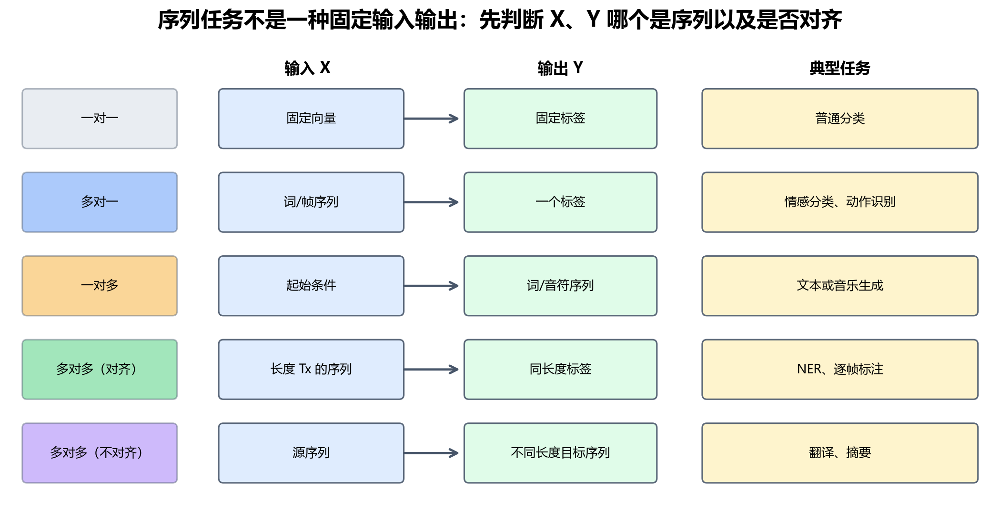

1. **多对一（Many-to-One）**：输入为变长序列，最终仅输出一个全局结果。
   - *典型场景*：文本情感分类（一段影评判断褒贬）、整段脑电波/心电图分类。
2. **等长多对多（Many-to-Many, Synced）**：输入与输出的时间步长严格对齐（$T_x = T_y$）。
   - *典型场景*：词性标注（POS Tagging）、命名实体识别（NER）、逐帧音频事件检测。
3. **不等长多对多（Many-to-Many, Seq2Seq）**：输入序列与输出序列长度解耦（$T_x \ne T_y$）。
   - *典型场景*：机器翻译（中译英词数不同）、语音转文本（输入音频帧数远超输出文字数）。通常采用 Encoder-Decoder 架构。
4. **在线流式多对一/逐步输出（Streaming / Real-time）**：数据随物理时间源源不断到达，每接收一个新数据点，网络立即在当前步增量刷新输出。
   - *典型场景*：工业设备实时异常熔断警报、自动驾驶传感器连续滤波。

---

## 二、基础 RNN 用隐藏状态压缩已经读过的历史

全连接层（MLP）只能处理维度固定的输入。如果简单粗暴地将序列拉平成大向量，不仅无法支持长短不一的动态序列，更会丢失平移不变性——在第 2 个词学到的语法规则，根本无法自动迁移复用到第 20 个词上。

基础 RNN 在每一个时间步，**强行复用同一套参数矩阵**来更新隐藏状态：

$$
h^{\langle t\rangle} = \tanh\left( W_{hh} h^{\langle t-1\rangle} + W_{xh} x^{\langle t\rangle} + b_h \right)
$$

- $x^{\langle t\rangle} \in \mathbb R^{n_x}$：当前步的全新输入向量；
- $h^{\langle t-1\rangle} \in \mathbb R^{n_h}$：上一时刻滚存下来的历史记忆摘要；
- $h^{\langle t\rangle} \in \mathbb R^{n_h}$：融入当前输入后更新的最新状态；
- $W_{xh} \in \mathbb R^{n_h \times n_x}$：将当前输入特征投影至状态空间的权重矩阵；
- $W_{hh} \in \mathbb R^{n_h \times n_h}$：跨时间步传递、调节历史记忆影响力的状态权重矩阵；
- $b_h \in \mathbb R^{n_h}$：隐藏层偏置向量；
- $\tanh$：非线性激活函数，将状态数值平滑压缩至 $(-1, 1)$，防止前向连乘时数值过早溢出。

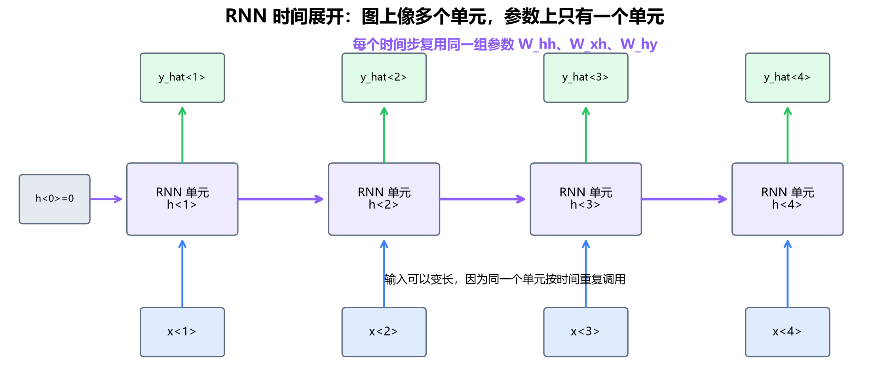

### 参数共享的工程本质
时间轴上画出的多个串联单元，仅仅是计算在时间维度的**动态展开视图（Unfolded Graph）**。无论序列是 5 步还是 500 步，全网参与状态更新的参数始终只有固定的 $\{W_{xh}, W_{hh}, b_h\}$，模型参数量与序列长度完全脱钩。

输出层只需从当前状态直接映射求取预测：

$$
\hat y^{\langle t\rangle} = g_y\left( W_{hy} h^{\langle t\rangle} + b_y \right)
$$

---

## 三、用一组数字走完一次 RNN 状态更新

通过一个极简的手工算例，全程追踪单步前向传播的内部数值流向。

设定输入维度 $n_x = 2$，隐藏状态维度 $n_h = 2$：
- 当前输入：$x^{\langle t\rangle} = \begin{bmatrix} 1 \\ 0 \end{bmatrix}$
- 上一步滚存状态：$h^{\langle t-1\rangle} = \begin{bmatrix} 0.2 \\ -0.1 \end{bmatrix}$

模型参数矩阵配置如下（偏置设为 $b_h = 0$）：

$$
W_{hh} = \begin{bmatrix} 0.5 & 0.1 \\ -0.2 & 0.4 \end{bmatrix}, \qquad W_{xh} = \begin{bmatrix} 0.8 & -0.3 \\ 0.2 & 0.7 \end{bmatrix}
$$

### 手工推演步骤

1. **计算历史记忆贡献**：
   $$
   W_{hh} h^{\langle t-1\rangle} = \begin{bmatrix} 0.5 \times 0.2 + 0.1 \times (-0.1) \\ -0.2 \times 0.2 + 0.4 \times (-0.1) \end{bmatrix} = \begin{bmatrix} 0.09 \\ -0.08 \end{bmatrix}
   $$
2. **计算当前输入贡献**：
   $$
   W_{xh} x^{\langle t\rangle} = \begin{bmatrix} 0.8 \times 1 + (-0.3) \times 0 \\ 0.2 \times 1 + 0.7 \times 0 \end{bmatrix} = \begin{bmatrix} 0.8 \\ 0.2 \end{bmatrix}
   $$
3. **两者线性融合（新旧碰撞）**：
   $$
   z^{\langle t\rangle} = \begin{bmatrix} 0.09 + 0.8 \\ -0.08 + 0.2 \end{bmatrix} = \begin{bmatrix} 0.89 \\ 0.12 \end{bmatrix}
   $$
4. **通过 $\tanh$ 激活映射**：
   $$
   h^{\langle t\rangle} = \tanh\left(\begin{bmatrix} 0.89 \\ 0.12 \end{bmatrix}\right) \approx \begin{bmatrix} 0.712 \\ 0.119 \end{bmatrix}
   $$

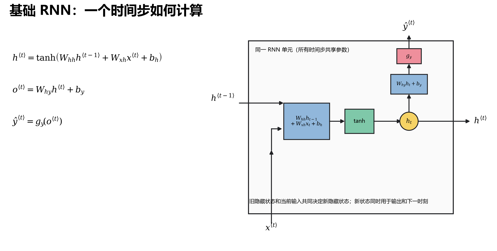

观察结果清晰直观：第一维状态由历史的 $0.2$ 被强烈拉升至 $0.712$（当前输入在该维度带来了极强的激活驱动）；第二维状态历史为负（$-0.1$），在当前输入的正向纠偏下扭转为 $0.119$。状态向量在每一步都自然充当着新旧信息的博弈载体。

---

## 四、BPTT 让后面的错误修改前面的状态更新

在序列末尾第 50 步产生的预测错误，往往病根出在第 1 步时关键信息的丢失。网络如何跨越漫长的时间步去调整早期的权重？

答案是**随时间反向传播（Backpropagation Through Time, BPTT）**。

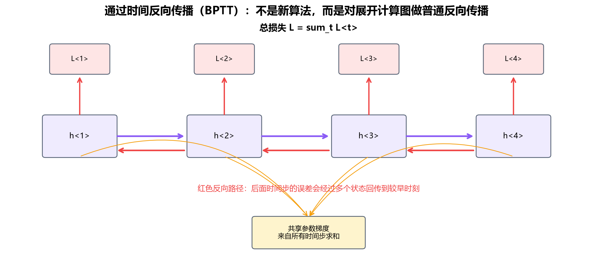

BPTT 的执行逻辑分为三步：
1. **展开计算图**：将 RNN 沿时间步展开为深度等于 $T$ 的标准前馈计算图；
2. **自右向左链式求导**：将各个时间步的损失 $\mathcal L^{\langle t\rangle}$ 沿时间链反向穿透，梯度信号顺着状态流从 $t$ 步向 $t-1$ 步递归倒流；
3. **共享梯度全时累加**：由于矩阵 $W_{hh}$ 与 $W_{xh}$ 在每个时间步都被重复调用，根据微积分多元链式法则，**参数的最终更新梯度等于其在所有时间步所产生梯度的算术累加和**：
   $$
   \frac{\partial \mathcal L}{\partial W_{hh}} = \sum_{t=1}^{T} \left. \frac{\partial \mathcal L}{\partial W_{hh}} \right|_{\text{第 } t \text{ 步}}
   $$

### 基础 RNN 的致命软肋：长程梯度消失与爆炸

当误差梯度从遥远的第 $T$ 步一路回传至第 $t$ 步时，中间经历了长达 $T-t$ 次雅可比矩阵的连续连乘：

$$
\frac{\partial h^{\langle T\rangle}}{\partial h^{\langle t\rangle}} = \prod_{k=t+1}^{T} \frac{\partial h^{\langle k\rangle}}{\partial h^{\langle k-1\rangle}} = \prod_{k=t+1}^{T} \operatorname{diag}\left(1 - (h^{\langle k\rangle})^2\right) W_{hh}^\top
$$

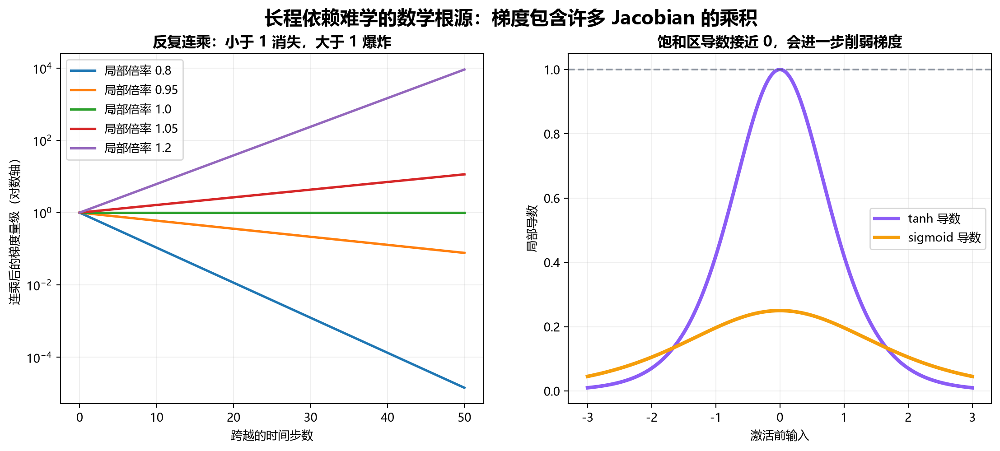

连乘项由两部分构成：
- **$\tanh$ 导数因子**：$\tanh'(z) = 1 - \tanh^2(z) \in (0, 1]$，其数值绝大多数时候严格小于 1；
- **转移矩阵 $W_{hh}$**：若其最大奇异值小于 1。

两者复合相乘，若单步衰减因子为 $0.8$，连续跨越 50 步后：

$$
0.8^{50} \approx 1.43 \times 10^{-5}
$$

**梯度信号在倒流中呈指数级剧烈衰减，到达前部时几乎彻底归零（梯度消失）**。这意味着基础 RNN 在面对长序列时患有严重的“短期健忘症”：它只能记住最近几步的局部特征，对十几步之前的长距离依赖关系完全无能为力。

反之，若 $W_{hh}$ 谱半径大于 1 且未加约束，梯度会呈几何级数急剧膨胀（$1.2^{50} \approx 9100$），引发**梯度爆炸**。
- **工程解药**：针对梯度爆炸，工业界标准采用**梯度裁剪（Gradient Clipping）**作为硬性防线；但针对长程梯度消失，必须依靠更先进的**门控架构（GRU / LSTM）**进行本质上的结构重构。

---

## 五、变长序列需要 Padding、Mask 和真实长度

在实际批处理训练中，同一个 Batch 内的句子或采样段长度极少完全一致（例如样本 A 长 4 步，样本 B 长 2 步，样本 C 长 6 步）。为了把它们堆叠成规则的矩阵张量，短序列必须在尾部补齐零占位符，这一过程称为 **Padding**：

$$
X \in \mathbb R^{B \times T_{\max} \times n_x}
$$

Padding 只是为了迎合硬件矩阵乘法的形状对齐，填充进去的占位符没有任何物理意义。如果不加干预，它们会严重污染训练：

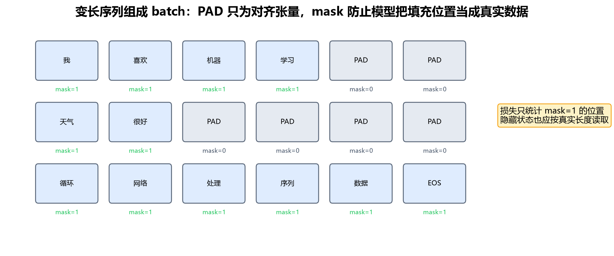

1. **掩码隔离（Loss Masking）**：
   构建形状相同的二值掩码矩阵 $M_{i, t} \in \{0, 1\}$（真实位置为 1，Padding 位置为 0）。在计算损失时，**必须强制用 Mask 过滤掉 Padding 处的误差**，只对有效时间步求平均，严禁让模型浪费参数容量去拟合虚假的填充项：
   $$
   \mathcal L = \frac{\sum_{i, t} M_{i, t} \mathcal L_{i, t}}{\sum_{i, t} M_{i, t}}
   $$
2. **多对一任务的终点定位提取**：
   在序列分类任务中，最终的整体表征必须提取**该样本真实有效长度所在步的隐藏状态 $h_i^{\langle T_i\rangle}$**，绝对不能无脑统一提取张量最后一列 $h_i^{\langle T_{\max}\rangle}$！对于长度仅为 2 的样本，第 6 步的状态早已被多次全零 Padding 冲刷稀释，失去了原本真实的语义记忆。

---

## 六、GRU 用门决定旧状态保留多少

基础 RNN 之重在易遗忘，是因为每一步都会粗暴地强行拿线性变换去覆写整个记忆。

**门控循环单元（Gated Recurrent Unit, GRU）**通过引入两扇利用 Sigmoid 激活的门控开关，实现了对状态更新的动态精细把控：

- **重置门（Reset Gate, $r_t$）**：控制在构想候选新记忆时，**允许调取多少过去的历史记忆**；
- **更新门（Update Gate, $z_t$）**：掌控新旧记忆的分配天平，决定**当前状态中有多少比例保留旧记忆，多少比例采纳新候选**。

数学计算流如下：

$$
r_t = \sigma(W_r x_t + U_r h_{t-1} + b_r)
$$

$$
z_t = \sigma(W_z x_t + U_z h_{t-1} + b_z)
$$

$$
\tilde h_t = \tanh\left( W_h x_t + U_h (r_t \odot h_{t-1}) + b_h \right)
$$

$$
h_t = (1 - z_t) \odot h_{t-1} + z_t \odot \tilde h_t
$$

其中 $\sigma$ 输出范围严格落在 $(0, 1)$，$\odot$ 表示逐元素相乘。

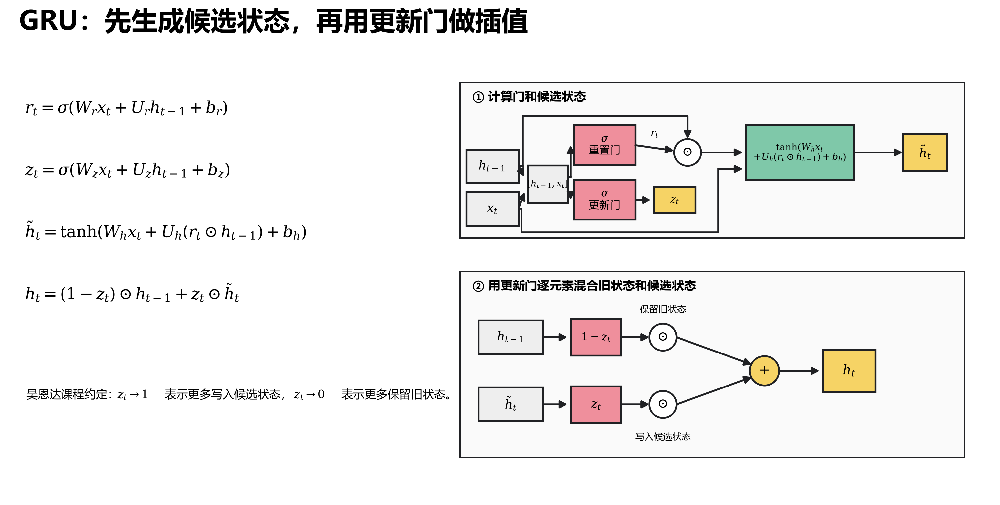

> **GRU 抵抗梯度消失的数学本质**：
> 观察最终的状态更新式：$h_t = (1 - z_t) \odot h_{t-1} + z_t \odot \tilde h_t$。
> 这本质上是一个**线性插值滑块**！
> - 若更新门某一维计算出 $z_t \approx 0$：则 $h_t \approx h_{t-1}$。
>   此时新候选完全被拒之门外，旧记忆不仅在**前向传播中被无损抄送传递**，更在**反向传播中提供了一条导数接近 1 的无阻力直通通道**！这与 ResNet 的残差跳跃连接异曲同工，使得梯度能够轻松跨越上百步而不衰减。

---

## 七、LSTM 把内部记忆与对外状态分开

**长短期记忆网络（Long Short-Term Memory, LSTM）**在抗遗忘机制上走得更深。它做出了一个决定性的架构解耦：**将内部隐秘滚存的“长期记忆通道（Cell State, $c_t$）”与当前对外呈现的“短期工作状态（Hidden State, $h_t$）”彻底拆分为两套物理变量**。

LSTM 由三扇门和一个候选记忆共同驱动：

$$
\begin{aligned}
f_t &= \sigma(W_f x_t + U_f h_{t-1} + b_f) \quad &&\text{【遗忘门】：过去的长期记忆要冲刷丢弃多少？} \\
i_t &= \sigma(W_i x_t + U_i h_{t-1} + b_i) \quad &&\text{【输入门】：当前准备将多少新知识存入长期记忆？} \\
g_t &= \tanh(W_g x_t + U_g h_{t-1} + b_g) \quad &&\text{【候选记忆】：本时刻提炼出的待写入知识内容} \\
o_t &= \sigma(W_o x_t + U_o h_{t-1} + b_o) \quad &&\text{【输出门】：长期记忆经过加工后，有多少能暴露给外界？}
\end{aligned}
$$

### 核心状态更新机制

1. **长期记忆通道的加法演进**：
   $$
   c_t = f_t \odot c_{t-1} + i_t \odot g_t
   $$
2. **短期工作状态的过滤输出**：
   $$
   h_t = o_t \odot \tanh(c_t)
   $$

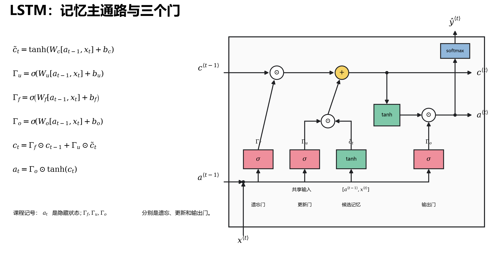

图中沿用原课程的记法：$a^{\langle t\rangle}$ 对应正文的 $h_t$，$\Gamma_f$、$\Gamma_u$、$\Gamma_o$ 分别对应遗忘门 $f_t$、输入门 $i_t$ 和输出门 $o_t$，候选记忆 $\tilde c^{\langle t\rangle}$ 对应 $g_t$。图中的 softmax 是接在隐藏状态之后的任务输出层，不属于 LSTM 的内部记忆更新。

> **极简数值追踪**：
> 设某一维旧长期记忆 $c_{t-1} = 0.8$。
> - 遗忘门判定 $f_t = 0.9$（保留 $90\%$ 历史）；
> - 输入门判定 $i_t = 0.2$，候选新内容 $g_t = -0.5$；
> - 长期记忆更新：$c_t = 0.9 \times 0.8 + 0.2 \times (-0.5) = 0.72 - 0.10 = 0.62$；
> - 若此时输出门截断限制为 $o_t = 0.5$，则对外暴露的短期状态仅为 $h_t = 0.5 \times \tanh(0.62) \approx 0.276$。

### 为什么说 Cell State 是贯穿始终的“高速传送带”？
注意 $c_t$ 的更新公式：$c_t = f_t \odot c_{t-1} + i_t \odot g_t$。
与基础 RNN 充满复杂非线性矩阵相乘的递推不同，**$c_{t-1}$ 到 $c_t$ 的演进完全是线性的纯加法运算**！只要遗忘门保持开启（$f_t \approx 1$），长期记忆就像放在无摩擦的传送带上一样平稳滑行，反向求导时梯度可以沿着这根线几乎无衰减地直达序列源头。

---

## 八、GRU 与 LSTM 的差别主要在状态控制粒度

| 对比维度 | 基础 RNN | 门控循环单元（GRU） | 长短期记忆网络（LSTM） |
|---|---|---|---|
| **核心状态变量** | 仅单状态 $h_t$ | 仅单状态 $h_t$ | **双状态解耦**：内部记忆 $c_t$ + 外部状态 $h_t$ |
| **门控开关数量** | 无门控机制 | **2 扇门**（更新门 $z$、重置门 $r$） | **3 扇门**（遗忘门 $f$、输入门 $i$、输出门 $o$） |
| **单单元参数量** | $n_h(n_x + n_h) + n_h$ | **$3 \times$** 基础参数量 | **$4 \times$** 基础参数量 |
| **状态传递逻辑** | 每步矩阵覆写，极度短视 | 线性插值滑块，轻量高效 | 线性加法高速通道，控制粒度最细腻 |
| **工程选型建议** | 仅用于极小基线或理论教学 | **轻量化时序首选**：参数更少、收敛更快、少样本不易过拟合 | **复杂长依赖首选**：调控维度更丰富，适合大容量时序建模 |

---

## 九、双向和堆叠结构增加上下文，也增加约束

### 1. 双向循环神经网络（Bidirectional RNN, BiRNN）
单向 RNN 在 $t$ 时刻只能捕获**过去（上文）**的信息。但在离线自然语言处理、文本分类或音频标注中，句子的后半部分对推断前半部分的词性同样至关重要。

BiRNN 同时并行构建两套互不干扰的独立循环链：
- **前向链（$\overrightarrow h_t$）**：从左往右正常扫描，收集过去上文；
- **后向链（$\overleftarrow h_t$）**：从右往左逆序扫描，收集未来下文；
- **最终拼接融合**：每个时刻的最终表征由两路状态拼合而成：
  $$
  h_t^{\text{bi}} = \left[ \overrightarrow h_t \,;\, \overleftarrow h_t \right]
  $$

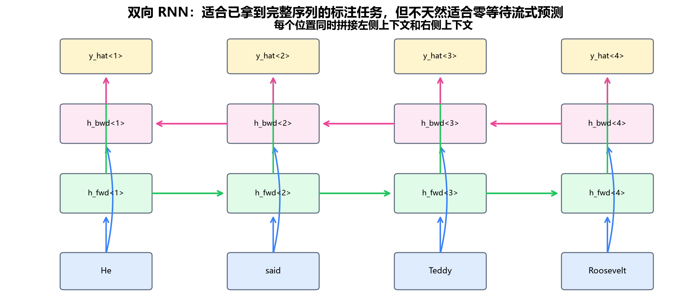

> **物理致命约束：双向模型严禁用于实时在线流式系统！**
> 后向链在第一步就需要吃进整个序列的最后一个元素。对于车载雷达实时探测、流式语音实时听写等传感器数据逐步到达的场景，未来数据在物理世界中尚未发生，强行使用双向模型会导致因果穿越（Data Leakage）或制造灾难性的端到端延迟。

### 2. 深度堆叠循环网络（Deep / Multi-layer RNN）

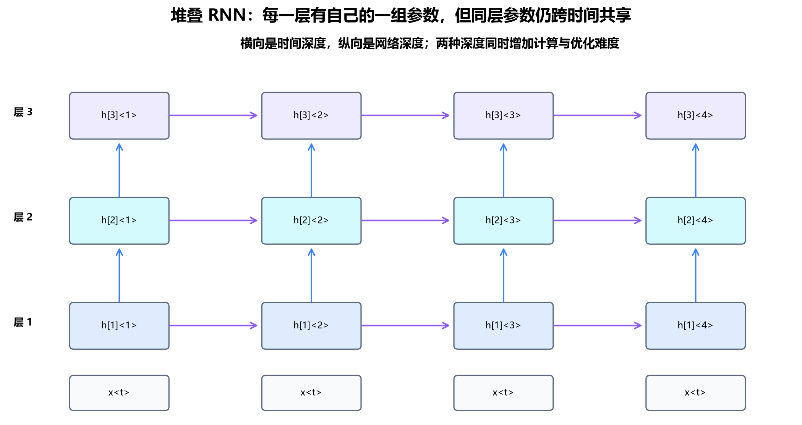

图中横向表示时间推进，纵向表示不同网络层；下层在同一时刻的输出成为上层的输入，每一层内部的参数沿时间共享。
单一循环层只能建模浅层时序动态。通过在纵向堆叠多层循环单元，下层输出的状态序列作为上层循环单元的时序输入：
- 浅层捕获高频局部的微观波动；
- 深层抽象宏观长程的全局演进模式。
- *注意*：循环网络由于沿时间轴展开本身已经极深，纵向堆叠通常很少超过 3~4 层，且往往需要配合 Dropout、LayerNorm 与残差连接防止退化。

---

## 十、RNN 家族确实在退潮，但没有走到“即将完全消失”

必须客观承认：**在大规模通用序列建模、预训练大语言模型（LLM）与开放域机器翻译领域，传统的 RNN、GRU 和 LSTM 确实已被自注意力机制（Transformer）全面边缘化**。

其根本物理死穴在于递归架构与现代算力的天生冲突：

$$
h_t = f(h_{t-1}, x_t)
$$

**计算第 $t$ 步必须严格等待第 $t-1$ 步计算完成**。这种天生的串行时间依赖链条，使得模型在训练阶段**完全无法利用现代 GPU 庞大的流式多处理器进行整序列的时间轴全并行计算**；且长距离信息的传递始终被限制在一个固定维度的隐状态瓶颈中。

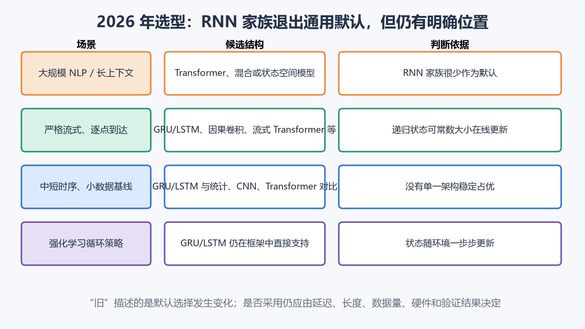

### 为什么说递归状态思想依然活跃？

尽管经典纯 LSTM 失去了王座，但“状态递归”这一优雅范式在很多专用工程战场中依然拥有强大的生命力：

1. **边缘低功耗流式推断（$O(1)$ 空间显存）**：
   在资源极度受限的嵌入式芯片上运行振动检测或心率监测，Transformer 的 KV Cache 会随运行时间无限线性膨胀，最终爆掉内存；而 GRU 只需常数级大小的几十字节内存，就能永久平稳运行。
2. **强化学习部分可观测环境（POMDP）**：
   智能体在复杂环境中交互，单步动作仅依赖当前状态，TorchRL 等工业框架依然广泛将 GRU/LSTM 作为记忆状态主干。
3. **架构的重构与新生（Mamba & xLSTM）**：
   学术界与工业界正从经典 LSTM 中汲取营养。通过将传统的固定参数矩阵改造为与输入强相关的动态扫描算子，现代**状态空间模型（SSM / Mamba）**以及引入指数门控与矩阵记忆的 **xLSTM**，成功实现了“**训练时享有 Transformer 的全并行矩阵吞吐，推理时享有 RNN 的常数级显存 $O(1)$ 快速状态流转**”。

学习 RNN、GRU 与 LSTM 的核心价值，不仅在于掌握几个具体的 PyTorch 模块，更在于彻底建立起**时序状态递归、门控信息筛选以及时间反向求导（BPTT）**的坚实底层直觉。这些认知将直接为你后续拆解 Transformer 的自注意力演进与现代大模型架构扫平道路。