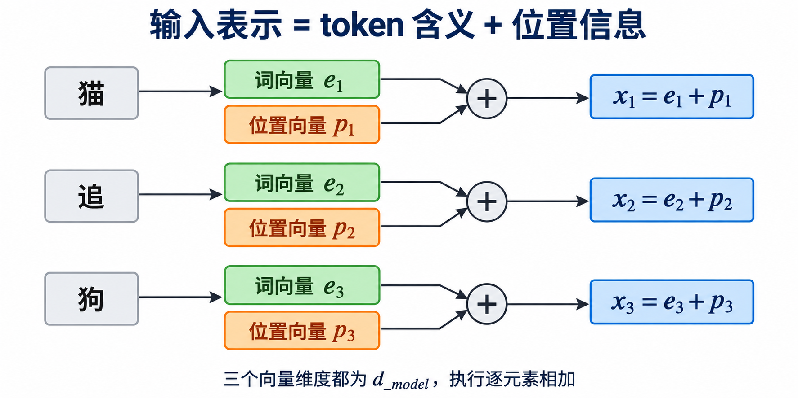
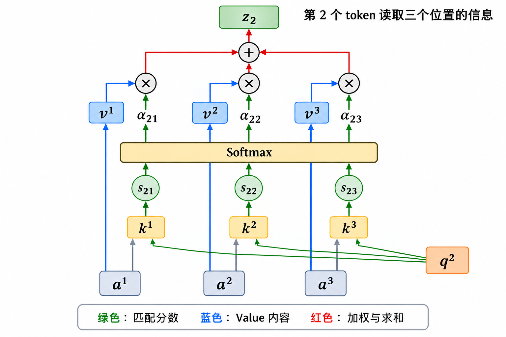
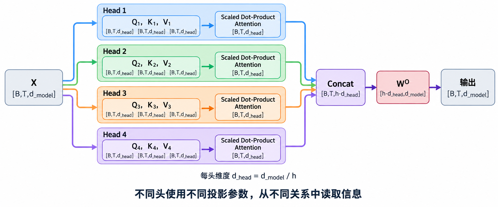
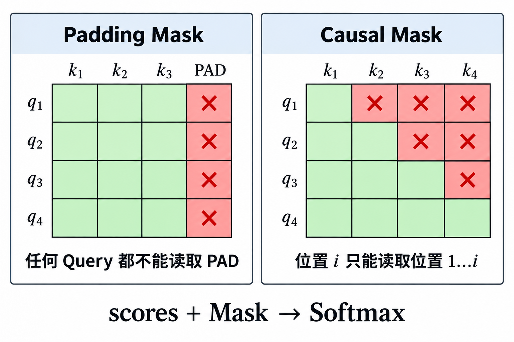
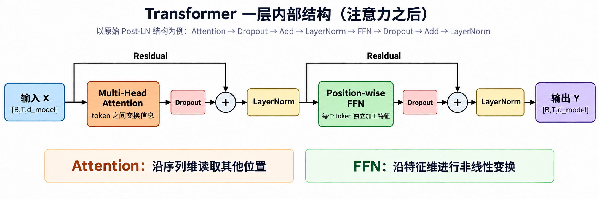
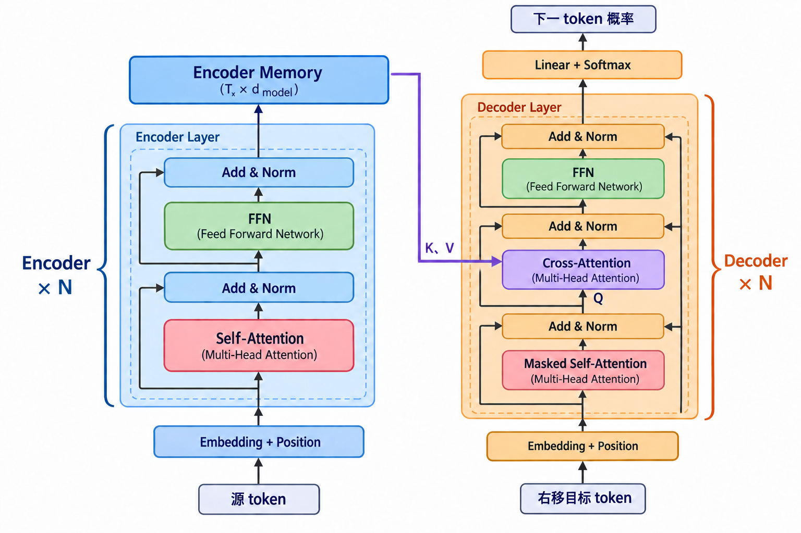
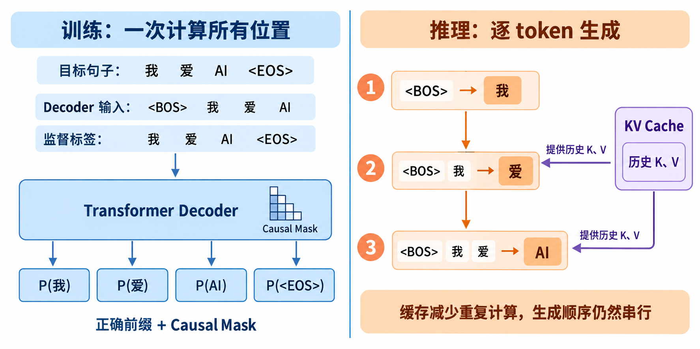

# [AI进阶-序列模型]4.Transformer结构、训练与推理

RNN 建模序列的核心思路是沿时间步逐个传递隐藏状态。但句子越长，串行依赖链就越深，算力吞吐低且容易遗忘长程信息。

Transformer 彻底改变了层内信息传递方式：**放弃循环递推，让所有 token 在同一层内直接计算相互之间的关联度，一步到位完成上下文信息的加权汇总**。

本篇从一段原始文本如何转为张量并流经模型讲起，深入剖析 Q/K/V 投影视角、点积缩放、多头注意力、前后掩码机制、前馈网络、残差归一化（Pre-LN vs Post-LN），以及端到端训练与推理优化的底层逻辑（KV Cache、FlashAttention、MQA/GQA）。

---

## 第一章：为什么需要 Transformer？

在深入数学推导前，先理清 Transformer 要颠覆的核心痛点：序列模型必须让每个 token 结合上下文，但不同架构下信息的流动拓扑完全不同。

### RNN 的信息流是串行的

RNN 依靠状态按时间步递推：

$$h_t = f(h_{t-1}, x_t)$$

计算第 $t$ 步必须等待第 $t-1$ 步完成。同一层内部形成了一条长达 $T$ 的串行链条：

$$h_1 \rightarrow h_2 \rightarrow \cdots \rightarrow h_T$$

这种架构存在两个难以回避的问题：
- **无法并行**：GPU 算力被锁死在单步递推中，训练吞吐被时间轴严重拖慢；
- **长程路径过长**：两个距离较远的词，信息必须穿过多次非线性变换与矩阵乘法，梯度容易衰减或爆炸。

### Transformer 的核心改变

Transformer 彻底砍掉了隐藏状态的传递链，让序列内部任意两个位置一步直达：

$$\text{position } i \longleftrightarrow \text{all positions } j$$

在单层 Self-Attention 内，任意两个 token 之间的交互距离只有 $O(1)$。所有位置的线性投影、点积注意力打分和加权聚合，全部打包成高维矩阵乘法在 GPU 上一次性并发完成。

### 并行不等于计算量更低

Self-Attention 需要计算全序列两两匹配的注意力矩阵，其形状为：

$$T \times T$$

运算与显存开销天然包含：

$$O(T^2)$$

Transformer 的优势在于**对现代高并发计算硬件极度友好、吞吐极高、易于 Scale Up 堆叠更深更宽的模型**，而不是在数学运算次数上比 RNN 更省。

---

## 第二章：输入表示

注意力机制无法直接处理文本字符串。文本必须经过分词、查表转化为向量，并显式注入位置信息。

### Token Embedding

词表大小设为 $\vert{}V\vert{}$，模型隐藏维度设为 $d_{\text{model}}$。文本先通过分词器（Tokenizer，如 BPE）切分为离散的 token，再转换为词表索引 ID。模型维护一个可学习的嵌入矩阵：

$$E \in \mathbb R^{\vert{}V\vert{} \times d_{\text{model}}}, \qquad e_w = E[\operatorname{id}(w)]$$

根据 ID 查表即可取出对应的 token 词向量 $e_w$。长度为 $T$ 的文本序列转换后形成矩阵 $X_{\text{token}} \in \mathbb R^{T \times d_{\text{model}}}$（批处理下为 $\mathbb R^{B \times T \times d_{\text{model}}}$）。

### 为什么必须加入位置？

纯粹的 Self-Attention 运算是**置换等价（Permutation Equivariant）**的：如果不加干预，将输入词序随意调换，算出的特征向量也只是原样调换顺序，注意力分布完全一样。模型仅凭内容无法区分：

```text
dog bites man
man bites dog
```

因此必须显式将序列时序注入输入张量。

### 正弦位置编码

原始 Transformer 采用确定性的三角函数生成绝对位置编码向量 $PE$：偶数维使用正弦，奇数维使用余弦：

$$PE(pos, 2i) = \sin\left(\frac{pos}{10000^{2i/d_{\text{model}}}}\right), \qquad PE(pos, 2i+1) = \cos\left(\frac{pos}{10000^{2i/d_{\text{model}}}}\right)$$

- $pos$ 为 token 的绝对位置序号（$0, 1, 2, \dots$），$i$ 为向量维度的索引；
- 低维变化剧烈（对局部临近位置敏感），高维变化平缓（区分宏观长程距离）；
- **核心数学性质**：由于三角函数的和差化积特性，$PE(pos+k)$ 可以由 $PE(pos)$ 通过与相对距离 $k$ 相关的线性变换矩阵直接求出，有助于模型学习相对位置偏差。

最终送入第一个 Transformer 层的输入张量，由词向量与位置向量**逐元素相加**：

$$X^{(0)} = X_{\text{token}} + PE \quad \in \mathbb R^{T \times d_{\text{model}}}$$



### 其他位置编码方案

正弦位置编码是经典方案，现代主流模型还演进出了多种替代结构：
- **可学习绝对位置嵌入（Learned Absolute PE）**：直接把位置作为参数训练（如 BERT、GPT-2）；
- **相对位置偏置（Relative Position Bias）**：直接在注意力分数上加入相对距离惩罚项（如 T5）；
- **旋转位置编码（RoPE）**：将相对位置信息作为旋转矩阵融入 Query 和 Key 的内积（如 LLaMA、DeepSeek 等大模型标准配置）；
- **ALiBi**：在注意力矩阵上直接施加与距离成正比的静态线性衰减，外推能力极强。

---

## 第三章：Multi-Head Self-Attention 总览

位置与语义融合后，序列正式进入核心交换枢纽——**多头自注意力机制（Multi-Head Attention, MHA）**。

### 先看整体：Self-Attention 是多头注意力中的一个单元

Transformer 使用的不是单一的大注意力头，而是将特征切分为 $h$ 个独立的注意力头并行计算。每个头在自己的低维子空间内执行缩放点积注意力：

$$head_r = \operatorname{softmax}\left(\frac{Q_r K_r^\top}{\sqrt{d_k}}\right) V_r$$

最后将所有头的计算结果沿通道拼接，并通过线性层输出投影：

$$\operatorname{MHA}(X) = \operatorname{Concat}(head_1, \ldots, head_h) W^O$$

### 完整计算流程

单次 Multi-Head Self-Attention 的工程计算步骤如下：

```text
输入 X [T x d_model]
→ 线性投影分别生成各个头的 Qr、Kr、Vr [T x d_k]
→ 计算点积匹配分数：Qr @ Krᵀ [T x T]
→ 缩放除以 √d_k、叠加 Mask 掩码、执行 Softmax 归一化
→ 权重矩阵乘上 Vr 加权聚合，得到单头输出 headr [T x d_v]
→ 拼接所有头 [T x (h * d_v)]
→ 经输出矩阵 WO 投影融合，得到最终 MHA 输出 [T x d_model]
```

“Self”表示在当前模块中，生成 $Q_r, K_r, V_r$ 的源头全部来自同一份输入矩阵 $X$。

### 输入 $X$ 从哪里来？

- **在第 1 层**：$X = X_{\text{token}} + PE \in \mathbb R^{T \times d_{\text{model}}}$，包含词义与初始位置；
- **在后续深层**：$X$ 直接来自于上一层 Transformer Layer 的输出。位置与上下文信息已经融入特征本身，无需重复添加 $PE$。

---

## 第四章：拆解一个 Self-Attention 头

将复杂的网络抽丝剥茧，先看单头自注意力是如何实现单个 token 与全局序列交互的。

### 一个头怎样生成 $Q、K、V$？

以第 $r$ 个头为例，输入矩阵 $X$ 经过三个可学习的线性变换矩阵投影：

$$Q_r = X W_r^Q, \qquad K_r = X W_r^K, \qquad V_r = X W_r^V$$

对于第 $i$ 个 token，其独立的向量切片为：

$$q_i^{(r)} = x_i W_r^Q, \qquad k_i^{(r)} = x_i W_r^K, \qquad v_i^{(r)} = x_i W_r^V$$

所有 token 的向量沿行堆叠成矩阵 $Q_r, K_r, V_r$。真正被训练和保存的是矩阵权重 $W_r^Q, W_r^K, W_r^V$。

### 为什么称为 Query、Key、Value？

这个命名来源于信息检索系统，清晰地界定了三者的功能分工：
- **Query（查询向量 $q_i$）**：当前 token 想要检索什么样的上下文信息；
- **Key（键向量 $k_j$）**：每个候选 token 具备什么样的对外特征以供检索；
- **Value（值向量 $v_j$）**：若两者的匹配度高，当前 token 能够对外贡献的具体内容。

$Q$ 与 $K$ 共同决定“该关注谁、关注多少”，$V$ 则是真正被抽取的语义载体。

### 一个 token 怎样读取其他 token？

第 $i$ 个 token 提取全局上下文包含三步：
1. **相似度匹配**：拿自己的 $q_i$ 与所有位置的 $k_j$ 计算点积标量 $s_{ij} = \frac{q_i^\top k_j}{\sqrt{d_k}}$；
2. **权重归一化**：沿所有候选 Key 的位置求 Softmax：$\alpha_{ij} = \frac{\exp(s_{ij})}{\sum_{m=1}^{T}\exp(s_{im})}$；
3. **内容加权聚合**：以注意力权重对所有 Value 向量做线性组合：$z_i = \sum_{j=1}^{T} \alpha_{ij} v_j$。



### 矩阵公式中每一部分在做什么？

将所有 token 的计算整合成矩阵表达式：

$$\operatorname{Attention}(Q, K, V) = \underbrace{\operatorname{softmax}\left(\frac{QK^\top}{\sqrt{d_k}}\right)}_{A \in \mathbb R^{T \times T}\text{：注意力权重矩阵}} V$$

- $QK^\top$ 的维度是 $(T \times d_k) \times (d_k \times T) = T \times T$。第 $i$ 行代表第 $i$ 个 token 对整个序列所有词的相似度得分；
- Softmax 确保矩阵的每一行概率和严格为 1；
- 最后右乘 $V \in \mathbb R^{T \times d_v}$，结果形状为 $T \times d_v$。它提取的是所有 token 的 Value，而不是用 Q 或 K 互相替代。

### $d_k$ 和缩放项是什么？

$d_k$ 是单个头中 $Q$ 和 $K$ 的维度。
假设 $q$ 与 $k$ 的各维度为均值 0、方差 1 的独立随机变量，点积 $\sum_{m=1}^{d_k} q_m k_m$ 的方差会膨胀至 $d_k$。当 $d_k$ 较大（如 64、128）时，点积数值的绝对值会变得极大，送入 Softmax 会导致概率分布极端推向 0 或 1，产生梯度饱和。**除以 $\sqrt{d_k}$ 将方差重新拉回 1，确保梯度在训练初期平稳反传**。

### 一个头最终得到什么？

一个头输出 $head_r \in \mathbb R^{T \times d_v}$。矩阵的每一行都是对应的 token 在该子空间中汲取完整个序列上下文后，生成的新动态表征。

#### 用两个位置把“打分—归一化—读取”完整算一遍

设单头维度 $d_k=2$，计算第 1 个 token 的输出：

$$q_1 = [1, 1], \quad k_1 = [1, 0], \quad k_2 = [0, 2]$$

1. **计算原始点积**：
   $$q_1^\top k_1 = 1 \times 1 + 1 \times 0 = 1, \qquad q_1^\top k_2 = 1 \times 0 + 1 \times 2 = 2$$
2. **缩放打分**（除以 $\sqrt{2}$）：
   $$[s_{11}, s_{12}] = \left[\frac{1}{\sqrt{2}}, \frac{2}{\sqrt{2}}\right] \approx [0.707, 1.414]$$
3. **Softmax 归一化**：
   $$e^{0.707} \approx 2.028, \quad e^{1.414} \approx 4.112, \quad \text{Sum} \approx 6.140$$
   $$[\alpha_{11}, \alpha_{12}] = \left[\frac{2.028}{6.140}, \frac{4.112}{6.140}\right] \approx [0.33, 0.67]$$
4. **加权提取 Value**（设 $v_1 = [10, 0], v_2 = [0, 6]$）：
   $$z_1 = 0.33 \times [10, 0] + 0.67 \times [0, 6] = [3.3, 4.02]$$

最终输出 $[3.3, 4.02]$ 融合了两个位置的信息，而不是死板地二选一。

---

## 第五章：多个头如何组合

单头注意力只能在一组固定的投影空间内建立关联。多头注意力通过引入并行的子空间，让模型能够同时关注不同维度的依赖关系（如一个头关注主谓宾结构，另一个头关注长程代词指代）。

### 多个头怎样并行计算？

每个头持有独立的参数矩阵：

$$W_r^Q, \quad W_r^K, \quad W_r^V \quad (r = 1, \dots, h)$$

各个头接收相同的 $X$，但投影出的 $Q_r, K_r, V_r$ 互不干扰，计算过程在 GPU 上全并行展开。



### 为什么每个头的维度通常要除以头数？

工业标准通常设定：

$$d_k = d_v = \frac{d_{\text{model}}}{h}$$

若 $d_{\text{model}} = 512, h = 8$，则每个子空间的维度设为 $d_k = 64$。
所有头的输出沿最后一维拼接：

$$H = \operatorname{Concat}(head_1, \ldots, head_h) \in \mathbb R^{T \times (h \cdot d_v)} = \mathbb R^{T \times d_{\text{model}}}$$

这样既获得了多视角的表达能力，又使得**多头的总参数量和计算量与单一的高维大头（直接做 $512$ 维）完全相当**。

### $W^O$ 做什么，最终输出是什么？

拼接后的矩阵只是将各个头的向量物理排列在一起，通道间尚未打通。引入参数矩阵 $W^O \in \mathbb R^{d_{\text{model}} \times d_{\text{model}}}$ 进行线性混合：

$$O = H W^O \quad \in \mathbb R^{T \times d_{\text{model}}}$$

输出结果重新回归标准的 $d_{\text{model}}$ 维度，随后进入残差连接与前馈网络。

### Mask 位于完整算法的哪里？

加入 Mask 后，单头的注意力公式为：

$$head_r = \operatorname{softmax}\left(\frac{Q_r K_r^\top}{\sqrt{d_k}} + M\right) V_r$$

Mask 矩阵将不可见位置的打分强行加上 $-\infty$。经由 Softmax 后，这些位置的注意力权重被精准压制为 0。

### Padding Mask

用于消除批处理补齐带来的无意义干扰。为了让同一个 batch 内不同长度的句子矩阵对齐，短句子尾部会被填入 `<PAD>`。Padding Mask 会将所有指向 `<PAD>` 列的注意力分数置为 $-\infty$，确保正常 token 绝不吸收填充符的信息。

### Causal Mask

因果掩码专用于**解码器的自回归序列生成**。三种注意力形态的对比边界如下：

| Attention 位置 | 是否使用 Causal Mask | 原因 |
|---|---|---|
| **Encoder Self-Attention** | 否 | 源语言句子是已经给定的已知事实，允许双向全局感知 |
| **Decoder Self-Attention** | **是** | 处于自回归生成阶段，物理上不允许提前窥视未来的目标词 |
| **Decoder Cross-Attention** | 否 | 查询的是完整的源序列 Memory，源序列不属于未来答案 |

在训练解码器时，为了实现多位置并行，目标序列是一次性喂入模型的。为了防止当前词偷看右侧的未来答案，Causal Mask 将右上角区域全部填为 $-\infty$：

$$M_{ij} = \begin{cases} 0, & j \le i \\ -\infty, & j > i \end{cases}$$



### Mask 必须在 Softmax 之前加入

核心规则：**先在点积得分上叠加 Mask（加上 $-\infty$），再送入 Softmax**。若在 Softmax 之后强行置零，会导致剩余有效位置的概率之和不再为 1，破坏了加权分布的数学定义。

---

## 第六章：Position-wise FFN

注意力层本质上只完成了**token 之间的加权路由交换**，操作完全是线性的。如果不加非线性提炼，模型表达复杂逻辑的能力将非常有限。

### Attention 输出先经过残差与归一化

在原论文的 Post-LN 架构中，注意力输出首先经过：

$$H = \operatorname{LayerNorm}\left(X + \operatorname{Dropout}(\operatorname{MHA}(X))\right)$$

得到稳定的中间矩阵 $H$ 后，再喂入前馈网络。

### FFN 解决什么问题？

$$\boxed{\text{Attention：跨 token 交换上下文信息} \quad \longrightarrow \quad \text{FFN：每个 token 独立闭门做非线性深加工}}$$

### FFN 的架构

原始结构是一个两层全连接感知机：

$$\operatorname{FFN}(x) = W_2 \operatorname{ReLU}(W_1 x + b_1) + b_2$$

维度流向为：

$$d_{\text{model}} \xrightarrow{W_1} d_{\text{ff}} \xrightarrow{\text{ReLU}} d_{\text{ff}} \xrightarrow{W_2} d_{\text{model}}$$

原论文取 $d_{\text{model}} = 512, d_{\text{ff}} = 2048$（放大 4 倍）。将向量投影到更高维的稀疏空间完成非线性特征重组，再降维投影回原维度。“Position-wise”代表**序列中的所有 token 完全独立并行通过该网络，参数完全共享，token 之间绝无横向交互**。

### FFN 得到什么，之后去哪里？

FFN 输出 $F \in \mathbb R^{T \times d_{\text{model}}}$，随后再次穿过 Dropout、残差连接和 LayerNorm：

$$Y = \operatorname{LayerNorm}\left(H + \operatorname{Dropout}(\operatorname{FFN}(H))\right)$$

输出的 $Y$ 即为当前 Transformer Layer 的最终输出。若当前不是最后一层，则直接作为下一层的输入 $X$。



一个标准层内部的数据流向为：

$$\text{Attention} \rightarrow \text{Add \& Norm} \rightarrow \text{FFN} \rightarrow \text{Add \& Norm} \rightarrow \text{当前层输出 } Y$$

---

## 第七章：Dropout、Residual 与 LayerNorm

为了支持数十层乃至上百层深度网络的稳定堆叠，Transformer 为每一个子模块都配置了三位一体的数值稳定保障。

### Dropout：随机丢弃部分特征

训练过程中，Dropout 随机将一部分维度的数值置零，破坏特征间的虚假共线性：

$$\operatorname{Dropout}(x) = \frac{m \odot x}{1 - p}, \qquad m_i \sim \operatorname{Bernoulli}(1 - p)$$

除以 $1-p$ 是为了维持训练与推理阶段张量总能量（期望值）的一致性。推理时关闭 Dropout，直接原样放行。

### Residual：保留原输入并执行 Add

在 Transformer 原始论文中，残差连接的标准抽象写法为：

$$y = x + \operatorname{SubLayer}(x)$$

**$\operatorname{SubLayer}(x)$ 是“子层（Sub-layer）”的通用抽象代称，不是某个固定的专有函数。**
- 在多头注意力子层中：$\operatorname{SubLayer}(x) = \operatorname{MultiHeadAttention}(x)$；
- 在前馈网络子层中：$\operatorname{SubLayer}(x) = \operatorname{FFN}(x)$。

对应到代码层面的直观实现为：
```python
# 1. 注意力子层的残差连接
x = x + self.dropout(self.self_attn(x, x, x))

# 2. 前馈网络子层的残差连接
x = x + self.dropout(self.ffn(x))
```

#### 为什么必须要有这根加法“旁路”（Shortcut）？
在深层网络中，多层非线性乘法极易造成反向梯度衰减。引入加法残差后，求导时产生了一个恒为 1 的常数项：

$$\frac{\partial y}{\partial x} = I + \frac{\partial \operatorname{SubLayer}(x)}{\partial x}$$

即使子层内部的梯度因参数微弱而衰减，**上游传回的误差信号依然能沿着这根“$+1$ 的加法旁路”无损倒流回浅层**，彻底粉碎了深层梯度消失。

### LayerNorm：稳定每个 token 的特征分布

对于某个 token 的特征向量 $x = [x_1, \dots, x_{d_{\text{model}}}]^\top$：
1. **单 token 内部统计**：计算该 token 在所有特征维度上的均值与方差：
   $$\mu = \frac{1}{d_{\text{model}}}\sum_{j=1}^{d_{\text{model}}} x_j, \qquad \sigma^2 = \frac{1}{d_{\text{model}}}\sum_{j=1}^{d_{\text{model}}} (x_j - \mu)^2$$
2. **仿射归一化**：
   $$\operatorname{LN}(x) = \gamma \odot \frac{x - \mu}{\sqrt{\sigma^2 + \epsilon}} + \beta$$

#### LayerNorm 与 BatchNorm 的本质区别
- **BatchNorm**：固定特征维度，跨样本和跨时间步统计（沿列统计）。受批次大小与变长填充影响极大，极其不适合生成式序列建模；
- **LayerNorm**：**独立固定单个样本的单个 token，仅在自身的所有特征维度上统计（沿行统计）**。完全不依赖其他样本与序列长度，推理单句与训练行为高度一致。

### 三者如何组成 Add & Norm？

Post-LN 结构的完整子层封装逻辑为：

$$y = \operatorname{LayerNorm}\left(x + \operatorname{Dropout}(\operatorname{SubLayer}(x))\right)$$

即数据先穿透子层变换，执行 Dropout 后与旁路原始输入相加，最后统一由 LayerNorm 约束尺度。

### Post-LN 与 Pre-LN

利用清晰的 $\operatorname{SubLayer}(x)$ 记法，两种架构的区别一目了然：

| 架构形态 | 数学公式与流向 | 训练特性与工业选型 |
|---|---|---|
| **Post-LN（经典原版）** | $y = \operatorname{LN}(x + \operatorname{SubLayer}(x))$<br>*(先计算子层相加，最后在输出端做归一化)* | 残差主干被 LN 截断，深层堆叠时梯度容易在主干受阻，必须配合精细的学习率预热（Warmup）才能平稳起步。 |
| **Pre-LN（现代主流）** | $y = x + \operatorname{SubLayer}(\operatorname{LN}(x))$<br>*(先对输入归一化送入子层，残差通道完全直通)* | **现代大模型（LLaMA、GPT 系列）的首选配置**。主残差通道没有任何算子阻隔，梯度高速公路彻底通畅，深层网络训练稳定性极强。 |

---

## 第八章：Encoder Block

将上述组件串联，构建出标准的编码器层（Encoder Layer）。堆叠 $N$ 层即为完整的 Encoder Stack。

### 结构

单层包含两大核心子层：
1. Multi-Head Self-Attention（配合 Padding Mask）；
2. Position-wise FFN。

每个子层都被残差连接与 LayerNorm 紧密包裹。

### Encoder Self-Attention 是否有 Causal Mask？

**绝无 Causal Mask**。源语言句子是输入给定的已知事实，每个位置允许双向全局感知上下文（看左侧、看自己、看右侧）。但为了隔离填充符号，仍需使用 Padding Mask。

### Encoder 输出是什么？

最终输出特征张量：

$$H^{(N)} \in \mathbb R^{T_x \times d_{\text{model}}}$$

该矩阵通常被称为 **Encoder Memory**。源序列中的每一个 token 在此都完成了全句语境融合，并作为高质量知识索引，供后续解码器检索。

---

## 第九章：Decoder Block

解码器负责生成目标序列。由于既要处理已生成的目标前缀，又要检索源语言记忆，Decoder Block 扩展为三大子层：

### 三个子层

1. **Masked Multi-Head Self-Attention**：
   处理目标序列自身。必须施加 **Causal Mask**，确保生成第 $t$ 步时无法偷看右侧的未来目标词；
2. **交叉注意力层（Cross-Attention）**：
   从源语言中汲取信息；
3. **Position-wise FFN**：
   逐位置独立非线性变换。

每个子层后同样配备 Dropout、Residual Add 和 LayerNorm。

### Masked Self-Attention

接收目标前缀输入。例如目标文本为：

```text
我 爱 你 <EOS>
```

训练时右移构造成的输入前缀为：

```text
<BOS>          → 预测 我
<BOS> 我       → 预测 爱
<BOS> 我 爱    → 预测 你
<BOS> 我 爱 你 → 预测 <EOS>
```

在位置 $t$，模型只能与 $y_{<t}$ 交互。Causal Mask 确保当前 token 只能向左看，严防未来标签泄露。

### Cross-Attention

Cross-Attention 是解码器与编码器交互的唯一纽带。其数学本质是 **$Q, K, V$ 来源的绝对解耦**：

$$Q = G W^Q \quad (G \text{ 来自 Decoder 自身上一子层的输出})$$

$$K = H_{\text{enc}} W^K, \qquad V = H_{\text{enc}} W^V \quad (H_{\text{enc}} \text{ 来自 Encoder 顶层的 Memory})$$

直觉解释极其通透：
- $Q$：“正在生成的目标词，当前需要什么样的源语言信息？”
- $K$：“源语言每个词各有什么索引特征可供检索？”
- $V$：“源语言每个词真正包含的语义内容是什么？”

解码器利用自己生成的 Query，去源语言的 Key/Value 数据库中检索相关内容。Cross-Attention 无需目标侧 Causal Mask，但若源序列存在 `<PAD>`，需使用源侧 Padding Mask。

### 三种 Attention 对比

| 类型 | Q 来源 | K/V 来源 | Causal Mask |
|---|---|---|---|
| **Encoder Self-Attention** | Encoder | Encoder | 否 |
| **Decoder Self-Attention** | Decoder | Decoder | **是** |
| **Cross-Attention** | **Decoder** | **Encoder** | 否 |

---

## 第十章：完整 Encoder–Decoder Transformer

将所有独立零件组装成完整的端到端翻译架构：



### 按编号阅读完整总图

| 编号 | 总图模块 | 输入 | 输出 |
|---|---|---|---|
| **①** | 源 token | 离散源语言词序列 | Token IDs |
| **②** | 源 Embedding + Position | 词 ID 与位置索引 | 初始连续输入 $H^{(0)}$ |
| **③** | Encoder $\times N$ | $H^{(0)}$ | 全局源序列 Memory $H^{(N)}$ |
| **④** | 右移目标 token | 目标序列（向右偏移一位） | Decoder 离散输入 |
| **⑤** | 目标 Embedding + Position | 目标词 ID 与位置索引 | 目标侧初始输入 $G^{(0)}$ |
| **⑥** | Decoder $\times N$ | $G^{(0)}$ 与 Encoder Memory | 最终隐藏状态 $G^{(N)}$ |
| **⑦** | Linear + Softmax | 顶层向量 $g_t^{(N)}$ | 全词表预测概率分布 |

#### 40.1 ① → ②：源 token 变成连续表示
$$H^{(0)} = \operatorname{Embed}_{src}(x) + P_{src} \quad \in \mathbb R^{T_x \times d_{\text{model}}}$$

#### 40.2 ② → ③：进入 Encoder Stack
$$H^{(N)} = \operatorname{EncoderStack}(H^{(0)}) \quad \in \mathbb R^{T_x \times d_{\text{model}}}$$
保留全时序长度 $T_x$，每个源词都有独立的深层特征。

#### 40.3 ④ → ⑤：右移目标变成 Decoder 输入
训练时输入为包含起始符的前缀切片：
$$\tilde y = [\text{BOS}, y_1, \dots, y_{T-1}] \implies G^{(0)} = \operatorname{Embed}_{tgt}(\tilde y) + P_{tgt}$$

#### 40.4 ⑤ → ⑥：进入 Decoder Stack
$$G^{(N)} = \operatorname{DecoderStack}(G^{(0)}, H^{(N)}) \quad \in \mathbb R^{T_y \times d_{\text{model}}}$$
> **注意**：Encoder Memory $H^{(N)}$ 会被**无保留地复制送入每一个 Decoder Layer 的 Cross-Attention 中**，而不是仅在最底层用一次。

#### 40.5 ⑥ → ⑦：从隐藏表示得到词表概率
顶层特征映射到词表空间：
$$\operatorname{logits}_t = W_{\text{vocab}} g_t^{(N)} + b \quad \in \mathbb R^{\vert{}V\vert{}}$$
$$P(y_t \mid y_{<t}, x) = \operatorname{softmax}(\operatorname{logits}_t)$$

### 为什么目标序列要右移？

利用 **Teacher Forcing** 策略：训练时强制把标准答案前缀喂给解码器，而不是让模型吃进自己上一轮可能猜错的词。

| 输入给 Decoder 的位置 | 模型需要预测的目标 |
|---|---|
| `<BOS>` | Jane |
| Jane | visits |
| visits | Africa |
| Africa | `<EOS>` |

### 训练为什么能并行？

在训练阶段，目标句子是现成已知的。结合右移输入与 Causal Mask 的物理隔离，**解码器中所有位置的损失可以在一次前向传播中同时算完**，完全不需要一步步做循环。

### 推理为什么仍然串行？

在推理阶段，未来目标词完全未知。生成必须回归自回归循环：
1. 输入 `<BOS>`，模型输出第 1 个词 $y_1$；
2. 将 $y_1$ 拼接到输入，重新前向预测 $y_2$；
3. 循环推进，直至吐出终止符 `<EOS>`。



---

## 第十一章：训练目标

### 交叉熵

全序列有效 token 的平均负对数似然：

$$\mathcal L = -\sum_{t=1}^{T_y} \log P(y_t^* \mid y_{<t}^*, x)$$

Padding 位置通过掩码排除，不计入损失。

### Teacher Forcing

训练时依赖真实答案前缀 $y_{<t}^*$，推理时依赖自身生成的历史 $\hat y_{<t}$。这种训练与部署的不一致性被称为 **暴露偏差（Exposure Bias）**。

### Label Smoothing

训练时不将真实标签设为绝对的 1.0，而是设为 $1 - \varepsilon$（如 $0.9$），并将 $\varepsilon$ 均匀分摊至全词表。有效防止网络对单一 token 产生过高 logits，改善泛化性与校准度。

---

## 第十二章：一个小型张量例子

追踪一组微型张量形状，理清残差相加的成立条件：

- **基础配置**：批大小 $B=2$，时序长 $T=5$，模型隐藏维度 $d_{\text{model}}=8$，头数 $h=2$（单头维度 $d_k = d_v = 4$）；
- **初始输入**：$X \in \mathbb R^{2 \times 5 \times 8}$。

```text
1. 线性投影与拆头 (Reshape & Permute):
   X @ W_Q -> [2, 5, 8] -> 拆头变形为 [B, h, T, dk] = [2, 2, 5, 4]
   同理得到 K, V: 形状均为 [2, 2, 5, 4]

2. 注意力矩阵计算:
   Scores = (Q @ K.transpose(-2, -1)) / sqrt(4)
   [2, 2, 5, 4] @ [2, 2, 4, 5] -> [2, 2, 5, 5] (每个批次每个头获得一张 5x5 的注意力方阵)

3. 聚合与多头合并:
   Attn_Out = Softmax(Scores) @ V -> [2, 2, 5, 4]
   转置与展平拼接 -> [B, T, h * dv] = [2, 5, 8]

4. 输出投影:
   Out = Attn_Out @ W_O -> [2, 5, 8]
   与原始输入 X [2, 5, 8] 形状分毫不差，顺利执行逐元素残差相加！
```

---

## 第十三章：常见错误

在复习与实现 Transformer 时，以下问题最易混淆：

1. **将 Q、K、V 具象为固定的人类语义**：它们只是由线性层投影出的抽象特征向量，分别负责“发问、索引、内容”三种数学角色；
2. **Softmax 归一化维度弄错**：每个 Query 是在所有的候选 Key 之间分配注意力份额，因此 Softmax **必须在 Key 所在的最后一维（时序维）执行**；
3. **忽略缩放项 $\sqrt{d_k}$**：高维点积方差过大，不除以 $\sqrt{d_k}$ 会导致 Softmax 极速饱和，浅层梯度消失；
4. **混淆两类 Mask**：Padding Mask 负责隔离无效补齐符，Causal Mask 负责在自回归解码中屏蔽未来词；
5. **Cross-Attention 的输入接反**：**Query 必须来自正在解码的 Decoder，Key 和 Value 必须来自 Encoder 的 Memory**；
6. **误以为位置编码每层都加**：绝对位置编码仅在输入嵌入层叠加一次，深层依赖残差网络自然传递位置上下文；
7. **混淆 LayerNorm 与 BatchNorm**：LayerNorm 沿特征通道横向归一化，单 token 自给自足，不依赖 batch 其它样本；
8. **忽略 FFN 的独立价值**：Attention 仅做空间线性聚合，全网非线性特征升维全靠 FFN；
9. **误以为推理也能全并行**：推理存在真实的因果依赖，必须单步自回归迭代。

---

## 第十四章：Transformer 家族

以经典架构为母体，现代生态分化为三大流派：

| 架构分支 | 核心机制特征 | 典型模型代表 | 主导应用场景 |
|---|---|---|---|
| **Encoder-only** | 纯双向 Self-Attention，无因果掩码 | **BERT**, RoBERTa | 文本分类、语义理解、命名实体识别、向量检索 Embedding |
| **Decoder-only** | 纯单向 Causal Self-Attention，自回归生成 | **GPT 系列**, LLaMA, DeepSeek | **通用大语言模型（LLM）的绝对主导范式**，擅长对话与代码生成 |
| **Encoder-Decoder** | 双向编码器 + 跨注意力解码器 | 原始 Transformer, **T5**, BART | 机器翻译、长文摘要、语音识别（ASR） |

---

## 第十五章：复杂度与现代优化

进入大模型长文本时代后，原始架构遭遇了计算吞吐与显存瓶颈，催生了多项关键工程突破：

### 标准 Self-Attention
计算复杂度为 $O(T^2)$，当上下文从 2k 扩展至 32k、128k 时，显存占用与耗时呈平方级爆炸。

### FlashAttention
FlashAttention 在数学公式上与标准注意力 $100\%$ 等价，它是一项**硬件感知（IO-Aware）的底层算法革新**：
- 标准注意力在 GPU 片外显存（高延迟 HBM）与片上极速缓存（SRAM）之间频繁搬运 $T \times T$ 巨型矩阵；
- FlashAttention 利用分块计算（Tiling）与在线 Softmax 动态修正算法，**在单次 Kernel 中直接在片上 SRAM 算完最终聚合，全程不在外部显存中落地 $T \times T$ 矩阵**，成倍提速并大幅削减峰值显存。

### KV Cache
自回归生成在预测第 $t$ 个 token 时，前 $t-1$ 个旧 token 的 $K$ 和 $V$ 投影是固定不变的。
- **KV Cache** 在内存中将历史的 Key 和 Value 矩阵缓存下来，每次迭代只需为当前最新的 1 个 token 计算单组 Q/K/V 并拼入缓存；
- 单步解码计算复杂度由 $O(t^2)$ 降为 $O(t)$，彻底消除了自回归推理中重复计算历史的巨大浪费。

### MQA 与 GQA
在超长文本推理中，全尺寸的 KV Cache 极易撑爆显卡显存。
- **MQA（Multi-Query Attention）**：所有 Query 头共享单一组 $K$ 和 $V$；
- **GQA（Grouped-Query Attention）**：折中方案。将 Query 头分组，组内共享一组 $K$ 和 $V$。在几乎不损失模型性能的前提下，将推理显存占用降低数倍，已成为现代主流大模型的标配。

---

## 第十六章：现代性审查

对照 2017 年的原版设计，梳理当前工业界与前沿研究的选型变化：

| 机制模块 | 2026 年现代定位 | 当前是否使用 | 主流替代与扩展演进 |
|---|---|---|---|
| **原版 Post-LN 架构** | 淘汰 | 仅教学或特定浅层复现 | **Pre-LN** 或 **RMSNorm**（舍弃均值计算，推理更快更稳） |
| **正弦绝对位置编码** | 边缘化 | 仅少数轻量模型保留 | **RoPE（旋转位置编码）**、ALiBi、长上下文动态插值 |
| **ReLU 激活 FFN** | 逐步被替换 | 基础模型可用 | 带有门控机制的 **SwiGLU** 激活前馈网络、MoE 稀疏结构 |
| **原版 Encoder-Decoder**| 局限于特定任务 | 翻译、语音识别仍在使用 | 开放式大模型已被 **Decoder-only 架构** 全面占据统治地位 |
| **标准显式点积实现** | 严重受限于显存带宽 | 小规模实验可用 | 框架底层强制集成 **FlashAttention** 算子 |
| **全尺寸多头（MHA）** | 推理显存过重 | 训练端或小模型可用 | 推理端广泛转向 **GQA（分组查询注意力）** 缩减 KV 显存开销 |
| **KV Cache** | 核心工业基础设施 | **自回归推理必备** | 配合 PagedAttention（如 vLLM）、量化 KV Cache 实现连续批处理 |

---

## 参考资料

#### Transformer
- Vaswani et al. *Attention Is All You Need*, 2017. https://arxiv.org/abs/1706.03762

#### Layer Normalization
- Ba, Kiros, Hinton. *Layer Normalization*, 2016. https://arxiv.org/abs/1607.06450

#### BERT
- Devlin et al. *BERT: Pre-training of Deep Bidirectional Transformers for Language Understanding*, 2018. https://arxiv.org/abs/1810.04805

#### 高效 Attention
- Dao et al. *FlashAttention: Fast and Memory-Efficient Exact Attention with IO-Awareness*, 2022. https://arxiv.org/abs/2205.14135

#### 写作结构参考
- [Transformer 模型详解（图解最完整版）](https://michealxie94.github.io/post/nlp009.html)，用于参考“先走完整流程，再拆解局部模块”的讲解顺序。原文知识内容、现代性修订和配图仍以本篇自己的课程材料与核查结果为准。