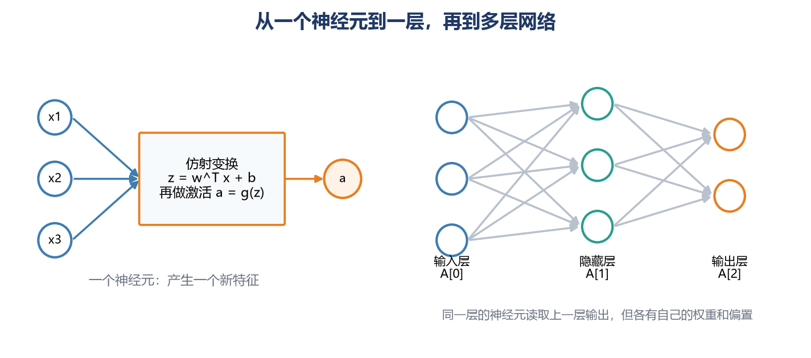
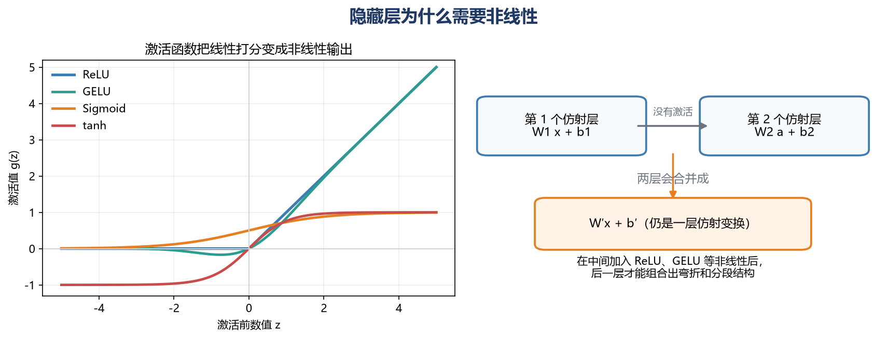
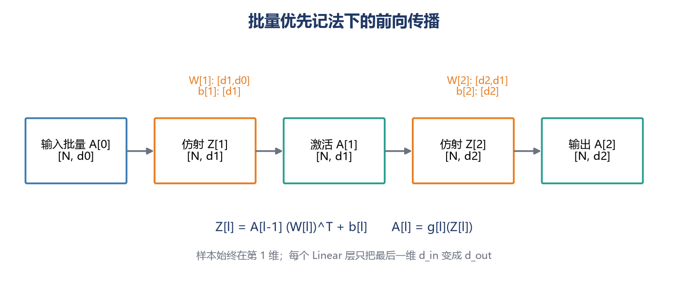
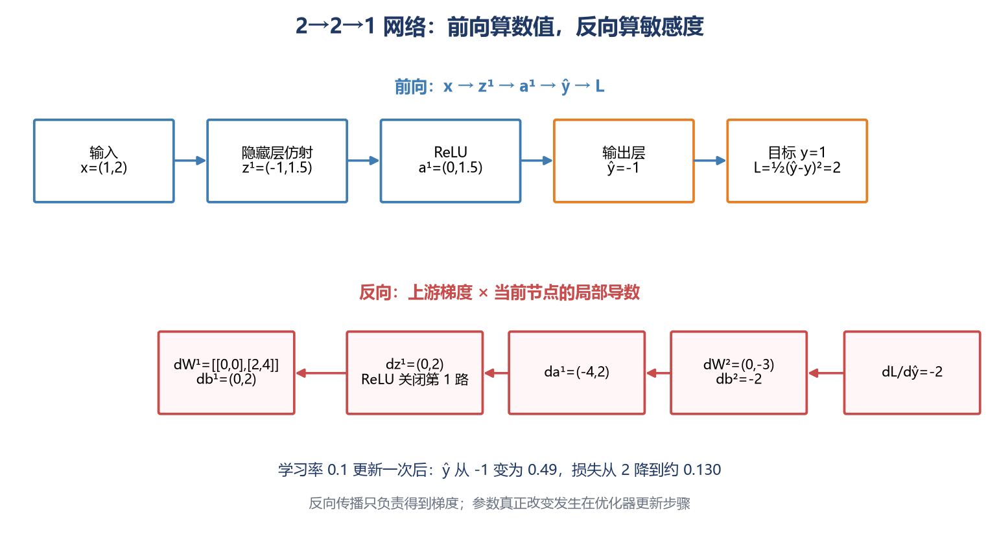
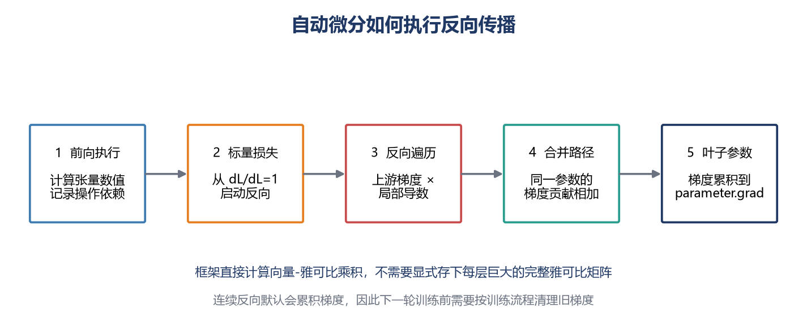

# [AI进阶-深度学习]1.神经网络、前向传播与反向传播

在线性回归和逻辑回归中，模型本质上只是对所有特征做一次加权求和。这种单层线性结构适合划分一条直线或超平面，但面对现实世界复杂的组合规律（例如“设备仅在高温且剧烈振动的特定区间才会发生故障”）时，就显得无能为力。

**深度神经网络（Deep Neural Networks）**的核心解决思路是：**通过多层堆叠的神经元，将原始输入逐层抽象、转换成更高级的中间特征表示，最终组合出任意复杂的非线性预测映射**。

一次完整的模型训练循环由四个清晰分工的环节构成：
1. **前向传播（Forward Propagation）**：依据当前网络参数，将输入样本逐层推算为最终预测值；
2. **损失计算（Loss Computation）**：衡量预测值与真实目标之间的差距，输出一个综合标量误差；
3. **反向传播（Backpropagation）**：基于微积分链式法则，自顶向下计算标量损失对网络中每一个参数的梯度（敏感度）；
4. **参数更新（Optimization Step）**：优化器沿着梯度的反方向调整权重与偏置，实现全网纠错。

本篇抛开繁琐的公式堆叠，带你彻底穿透前向传播与反向传播的运算全链路。

---

## 1 从一个神经元到多层网络

现代人工神经元（Artificial Neuron）无需被赋予神秘的生物学色彩，它本质上是一个由**仿射变换（加权求和 + 偏置）**与**非线性激活函数**串联而成的基础计算单元。

对于一个输入特征向量 $x \in \mathbb R^d$，单个神经元的计算分为两步：

$$
z = w^{\mathsf T}x + b, \qquad a = g(z)
$$

- $w \in \mathbb R^d$：权重向量，控制输入特征对神经元激活的拉动方向与强度；
- $b \in \mathbb R$：标量偏置，决定神经元被激活的基础平移门槛；
- $z$：激活前的线性打分（Pre-activation）；
- $g(\cdot)$：非线性激活函数；
- $a$：神经元最终输出的激活值（Activation），作为下一层神经元的输入。

### 层的全连接矩阵化

当一层中包含 $d_l$ 个神经元、接收上一层 $d_{l-1}$ 维输出时，所有神经元共享相同的上一层输入向量 $a^{[l-1]}$，但各自维护独立的权重与偏置。将整层参数紧凑排列为矩阵：

$$
z^{[l]} = W^{[l]}a^{[l-1]} + b^{[l]}, \qquad a^{[l]} = g^{[l]}(z^{[l]})
$$

- $W^{[l]} \in \mathbb R^{d_l \times d_{l-1}}$：权重矩阵，**其第 $i$ 行正是第 $i$ 个神经元的权重行向量**；
- $b^{[l]} \in \mathbb R^{d_l}$：偏置向量，第 $i$ 项对应第 $i$ 个神经元的偏置；
- **参数量统计**：该层共有 $d_l \times d_{l-1}$（权重数）$+ d_l$（偏置数）个待优化参数。

网络结构一般划分为三大层级：
1. **输入层（Input Layer）**：直接承接原始输入数据，记作 $a^{[0]} = x$（无参数，不计入模型深度）；
2. **隐藏层（Hidden Layer）**：负责逐层提炼无显式标签监督的高阶特征表示；
3. **输出层（Output Layer）**：输出与具体任务匹配的连续预测值或类别原始打分（Logits）。

---

## 2 非线性激活让多层网络不再等于一个线性模型

如果给隐藏层去掉激活函数，那么多层前馈网络的堆叠将彻底失去意义。

以无激活函数的两层网络为例：

$$
a^{[1]} = W^{[1]}x + b^{[1]}, \qquad a^{[2]} = W^{[2]}a^{[1]} + b^{[2]}
$$

展开直接合并：

$$
a^{[2]} = W^{[2]}\bigl(W^{[1]}x + b^{[1]}\bigr) + b^{[2]} = \underbrace{\bigl(W^{[2]}W^{[1]}\bigr)}_{W'}x + \underbrace{\bigl(W^{[2]}b^{[1]} + b^{[2]}\bigr)}_{b'}
$$

数学本质昭然若揭：**多个线性变换的复合，依然只是一个单一的线性变换**。无论中间堆叠几十层还是几百层，整个网络的表达能力与最简陋的单层线性回归毫无二致。

**非线性激活函数的绝对使命，就是在每层线性变换之间强行引入非线性弯折，打破线性折叠，使深层网络具备逼近任意复杂曲面的表达能力**。

### 常用激活函数选型一览

| 激活函数 | 数学表达 | 梯度动态与核心特性 | 主流应用场景 |
|---|---|---|---|
| **ReLU** | $\max(0, z)$ | 正区间导数恒等于 1（彻底根除正向梯度消失）；负区间输出与导数皆为 0。计算极快，但需防范神经元永久失活（Dying ReLU）。 | MLP 与 CNN 隐藏层的工业默认基准 |
| **Sigmoid** | $\frac{1}{1 + e^{-z}}$ | 将输入压缩至 $(0, 1)$；两端极度平缓，当 $|z|$ 稍大时导数急剧衰减趋近于 0（严重饱和并引发梯度消失）。 | 仅用于二分类任务的最终输出层、门控机制 |
| **tanh** | $\frac{e^z - e^{-z}}{e^z + e^{-z}}$ | 输出位于 $(-1, 1)$，具有零中心化（Zero-centered）优势；但同样存在两端饱和与梯度消失问题。 | 经典循环神经网络（RNN/LSTM）内部状态 |
| **GELU / SiLU** | $z \cdot \Phi(z)$ 等 | 平滑非单调激活，在 0 点附近光滑连续，提供更优的梯度流稳定性。 | Transformer 与现代大模型首选隐藏层激活 |

---

## 3 前向传播：按层把输入变成预测

前向传播的执行逻辑是确定性的流水线推进：**在当前网络参数固定时，将输入特征自底向上逐层变换，输出最终的目标预测**：

$$
A^{[0]} = X \to Z^{[1]} \to A^{[1]} \to \dots \to Z^{[L]} \to A^{[L]}
$$

### 批量优先（Batch-First）的张量维度规范

在工业实践（如 PyTorch）中，批量样本通常置于第一维度（Row 代表样本，Column 代表特征）。设批大小为 $N$，输入特征维度为 $d_{l-1}$，输出维度为 $d_l$：

$$
A^{[l-1]} \in \mathbb R^{N \times d_{l-1}}
$$

$$
Z^{[l]} = A^{[l-1]}(W^{[l]})^{\mathsf T} + b^{[l]} \in \mathbb R^{N \times d_l}
$$

$$
A^{[l]} = g^{[l]}(Z^{[l]}) \in \mathbb R^{N \times d_l}
$$

- 权重矩阵 $W^{[l]}$ 存储维度为 $(d_l, d_{l-1})$，右乘输入时进行转置 $(W^{[l]})^{\mathsf T} \in \mathbb R^{d_{l-1} \times d_l}$；
- 矩阵维度运算契合：$(N \times d_{l-1}) \times (d_{l-1} \times d_l) = (N \times d_l)$；
- 偏置向量 $b^{[l]} \in \mathbb R^{d_l}$ 借助张量广播机制（Broadcasting），自动加到批量的每一行。

> **前向接口规范**：
> 在分类任务中，模型输出层应直接输出未归一化的原始打分（Logits），并送入与交叉熵融为一体的损失函数（如 `CrossEntropyLoss` 或 `BCEWithLogitsLoss`）进行训练，以规避浮点溢出；仅在最终展示给用户或执行业务切分时，才手动套用 Sigmoid 或 Softmax 提取概率。

---

## 4 用一个 2→2→1 网络走完前向计算

通过一个极简的手工算例，全程追踪一次完整的前向传导。

网络架构为输入 2 维、隐藏层 2 维（激活为 ReLU）、输出层 1 维（线性回归）：
- 单条输入样本：$x = \begin{bmatrix}1 \\ 2\end{bmatrix}$，目标真值：$y = 1$。

隐藏层参数（$W^{[1]} \in \mathbb R^{2 \times 2}, b^{[1]} \in \mathbb R^2$）：

$$
W^{[1]} = \begin{bmatrix} 1 & -1 \\ 0.5 & 1 \end{bmatrix}, \qquad b^{[1]} = \begin{bmatrix} 0 \\ -1 \end{bmatrix}
$$

输出层参数（$W^{[2]} \in \mathbb R^{1 \times 2}, b^{[2]} \in \mathbb R$）：

$$
W^{[2]} = \begin{bmatrix} 2 & -1 \end{bmatrix}, \qquad b^{[2]} = 0.5
$$

### 手工推演步骤

1. **第一层线性仿射变换**：
   $$
   z^{[1]} = W^{[1]}x + b^{[1]} = \begin{bmatrix} 1 \times 1 + (-1) \times 2 + 0 \\ 0.5 \times 1 + 1 \times 2 - 1 \end{bmatrix} = \begin{bmatrix} -1 \\ 1.5 \end{bmatrix}
   $$
2. **第一层 ReLU 激活**：
   $$
   a^{[1]} = \operatorname{ReLU}(z^{[1]}) = \operatorname{ReLU}\left(\begin{bmatrix} -1 \\ 1.5 \end{bmatrix}\right) = \begin{bmatrix} 0 \\ 1.5 \end{bmatrix}
   $$
   *注意：神经元 1 因打分为负被截断为 0，通道关闭；神经元 2 正常放行。*
3. **输出层线性打分**：
   $$
   \hat y = W^{[2]}a^{[1]} + b^{[2]} = 2 \times 0 + (-1) \times 1.5 + 0.5 = -1.0
   $$
4. **计算单样本半平方损失**：
   $$
   L = \frac{1}{2}(\hat y - y)^2 = \frac{1}{2}(-1.0 - 1)^2 = 2.0
   $$

---

## 5 反向传播：把损失的影响逐节点传回参数

反向传播的本质，就是**链式求导法则在张量计算图上的高效工程实现**。

它从标量损失 $L$ 出发，逆着前向计算的方向，逐级向后传递“损失对当前节点的微商敏感度”：

$$
\underbrace{\frac{\partial L}{\partial u}}_{\text{当前输入的梯度}} = \underbrace{\frac{\partial L}{\partial v}}_{\text{上游节点回传的梯度}} \times \underbrace{\frac{\partial v}{\partial u}}_{\text{当前算子的局部偏导}}
$$

延续第 4 节的具体数值，逐层反向逆推：

### 1. 损失对最终预测的敏感度

$$
\delta^{[2]} = \frac{\partial L}{\partial \hat y} = \hat y - y = -1.0 - 1 = -2.0
$$

负号的物理含义非常明确：当前模型预测偏低（$\hat y < y$），增加预测值能够压低全局损失。

### 2. 输出层参数梯度

由于 $\hat y = W^{[2]}a^{[1]} + b^{[2]}$，局部偏导极为直观：

$$
\frac{\partial L}{\partial W^{[2]}} = \delta^{[2]} (a^{[1]})^{\mathsf T} = -2.0 \times \begin{bmatrix} 0 & 1.5 \end{bmatrix} = \begin{bmatrix} 0 & -3.0 \end{bmatrix}
$$

$$
\frac{\partial L}{\partial b^{[2]}} = \delta^{[2]} = -2.0
$$

*权重梯度为何为 0？因为第一个隐藏单元激活值为 0，并未对输出做出任何数值贡献，故其权重的微小改动在当前样本下对损失毫无影响。*

### 3. 梯度越过线性层，传回隐藏激活值

$$
\frac{\partial L}{\partial a^{[1]}} = (W^{[2]})^{\mathsf T} \delta^{[2]} = \begin{bmatrix} 2 \\ -1 \end{bmatrix} \times (-2.0) = \begin{bmatrix} -4.0 \\ 2.0 \end{bmatrix}
$$

### 4. 穿透 ReLU 激活层（门控筛选）

ReLU 的导数在正区间为 1，非正区间为 0。结合前向保存的 $z^{[1]} = \begin{bmatrix} -1 \\ 1.5 \end{bmatrix}$：

$$
\delta^{[1]} = \frac{\partial L}{\partial z^{[1]}} = \frac{\partial L}{\partial a^{[1]}} \odot \operatorname{ReLU}'(z^{[1]}) = \begin{bmatrix} -4.0 \\ 2.0 \end{bmatrix} \odot \begin{bmatrix} 0 \\ 1 \end{bmatrix} = \begin{bmatrix} 0 \\ 2.0 \end{bmatrix}
$$

### 5. 隐藏层参数梯度

结合原始输入 $x = \begin{bmatrix} 1 \\ 2 \end{bmatrix}$，推导出隐藏层权重与偏置的梯度：

$$
\frac{\partial L}{\partial W^{[1]}} = \delta^{[1]} x^{\mathsf T} = \begin{bmatrix} 0 \\ 2.0 \end{bmatrix} \begin{bmatrix} 1 & 2 \end{bmatrix} = \begin{bmatrix} 0 & 0 \\ 2.0 & 4.0 \end{bmatrix}
$$

$$
\frac{\partial L}{\partial b^{[1]}} = \delta^{[1]} = \begin{bmatrix} 0 \\ 2.0 \end{bmatrix}
$$

### 6. 参数更新与纠错验证

取学习率 $\alpha = 0.1$，执行标准 SGD 更新：

$$
W^{[2]}_{\text{new}} = W^{[2]} - 0.1 \frac{\partial L}{\partial W^{[2]}} = \begin{bmatrix} 2 & -1 \end{bmatrix} - \begin{bmatrix} 0 & -0.3 \end{bmatrix} = \begin{bmatrix} 2 & -0.7 \end{bmatrix}
$$

$$
b^{[2]}_{\text{new}} = 0.5 - 0.1 \times (-2.0) = 0.7
$$

$$
W^{[1]}_{\text{new}} = \begin{bmatrix} 1 & -1 \\ 0.5 & 1 \end{bmatrix} - \begin{bmatrix} 0 & 0 \\ 0.2 & 0.4 \end{bmatrix} = \begin{bmatrix} 1 & -1 \\ 0.3 & 0.6 \end{bmatrix}, \qquad b^{[1]}_{\text{new}} = \begin{bmatrix} 0 \\ -1 \end{bmatrix} - \begin{bmatrix} 0 \\ 0.2 \end{bmatrix} = \begin{bmatrix} 0 \\ -1.2 \end{bmatrix}
$$

拿更新后的参数重新进行前向验证：
- $z^{[1]}_{\text{new}} = \begin{bmatrix} 1 \times 1 - 1 \times 2 + 0 \\ 0.3 \times 1 + 0.6 \times 2 - 1.2 \end{bmatrix} = \begin{bmatrix} -1 \\ 0.3 \end{bmatrix} \implies a^{[1]}_{\text{new}} = \begin{bmatrix} 0 \\ 0.3 \end{bmatrix}$
- $\hat y_{\text{new}} = 2 \times 0 + (-0.7) \times 0.3 + 0.7 = 0.49$
- **新损失**：$L_{\text{new}} = \frac{1}{2}(0.49 - 1)^2 \approx 0.130$（**损失从 2.0 暴降至 0.130，预测值迅速向真值 1.0 收敛**）。

---

## 6 批量反向传播中的矩阵形状

在实际训练中，样本以大小为 $N$ 的批量（Mini-batch）同步处理。

定义上游误差矩阵 $D^{[l]} \in \mathbb R^{N \times d_l}$，其第 $i$ 行代表第 $i$ 个样本在第 $l$ 层激活前的敏感度 $\frac{\partial \ell_i}{\partial Z^{[l]}}$。对于整批样本的平均损失 $J = \frac{1}{N}\sum_{i=1}^N \ell_i$：

$$\frac{\partial J}{\partial W^{[l]}} = \frac{1}{N} (D^{[l]})^{\mathsf T} A^{[l-1]} \quad \in \mathbb R^{d_l \times d_{l-1}}$$

$$\frac{\partial J}{\partial b^{[l]}} = \frac{1}{N} \sum_{i=1}^{N} D^{[l]}_{i, :} \quad \in \mathbb R^{d_l}$$

- **形状自洽检验**：$(D^{[l]})^{\mathsf T}$ 维度为 $(d_l \times N)$，前一层输出 $A^{[l-1]}$ 维度为 $(N \times d_{l-1})$，矩阵相乘直接消除批量维度 $N$，结果形状天然与权重矩阵 $W^{[l]}$ 严丝合缝；
- **偏置的聚合**：前向传播时偏置被全量样本共享，反向传播时必然要**跨批量样本求和/平均**。

继续向前一层传递激活值梯度：

$$\frac{\partial J}{\partial A^{[l-1]}} = D^{[l]} W^{[l]} \quad \in \mathbb R^{N \times d_{l-1}}$$

$$D^{[l-1]} = \left( D^{[l]} W^{[l]} \right) \odot g'^{[l-1]}(Z^{[l-1]}) \quad \in \mathbb R^{N \times d_{l-1}}$$

---

## 7 自动微分怎样替我们执行反向传播

现代深度学习框架（如 PyTorch、TensorFlow）解脱了手动推导梯度的负担，其底层引擎统一依赖**动态计算图与反向模式自动微分（Reverse-mode Autodiff）**。

### 核心运转机理

1. **有向无环计算图（DAG）的动态构建**：在前向计算时，框架记录每个算子的运算类型与父子张量依赖关系，并将必要的前向中间激活缓存在内存中；
2. **反向遍历驱动**：当在标量损失上调用 `loss.backward()` 时，系统自动以 $\frac{\partial L}{\partial L} = 1.0$ 作为初始种子梯度，自顶向下反向回传；
3. **向量-雅可比积（Vector-Jacobian Product, VJP）**：
   对于高维输入输出映射 $y = f(x)$，框架**绝不显式构建庞大稀疏的完整雅可比矩阵 $\frac{\partial y}{\partial x}$**，而是直接计算输入行向量与局部偏导的乘积：
   $$\bar x = \bar y \cdot J_f = \left(\frac{\partial y}{\partial x}\right)^{\mathsf T} \bar y$$
   内存消耗被降低了数个数量级，使得深层大模型的高效反向求导成为现实；
4. **梯度累积与清零机制**：
   多个前向分支聚合至同一参数时，梯度天然相加。因此在 PyTorch 中，每轮优化迭代开始前，必须显式调用 `optimizer.zero_grad()` 清空上一轮累加的旧梯度，防止多步梯度污染。

---

## 8 神经网络训练中各部分的边界

为了建立扎实而清晰的工程架构直觉，必须严密厘清深度学习各个模块的职责边界：

- **前向传播（Forward）**：网络内部各层数学变换的纯函数执行，负责将特征映射为 Logits 或预测值；
- **损失函数（Criterion）**：定义业务好坏的裁判员，负责将高维预测转化为单一标量误差；
- **反向传播（Backward）**：微积分链式法则的忠实执行者，负责计算损失对所有可训练参数的精确梯度；
- **优化器（Optimizer）**：战术决策者，负责依据梯度和动量状态决定参数调整的步长与方向（如 SGD、AdamW）。

> **概念辨析：Epoch vs Step**
> - **Batch Size**：单次前向与反向传播同时吃进的样本量；
> - **Step / Iteration**：完成一次“前向 + 反向 + 参数更新”的微观循环；
> - **Epoch**：全量训练集样本被网络完整看过的宏观周期（1 个 Epoch 包含 $\lceil \text{总样本数} / \text{Batch Size} \rceil$ 个 Steps）。

无论后期的网络演化为复杂的卷积网络（CNN）、图神经网络（GNN）还是 Transformer 架构，其最底层的数学心脏始终如一：**前向记录拓扑图与激活值，反向依托链式法则计算梯度流**。彻底掌握前向与反向传播，就拥有了解锁一切现代深度学习架构的金钥匙。