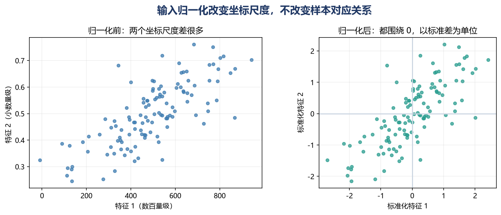
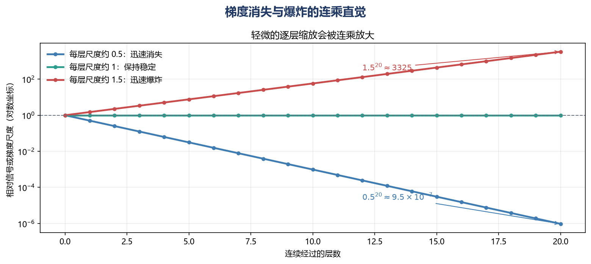
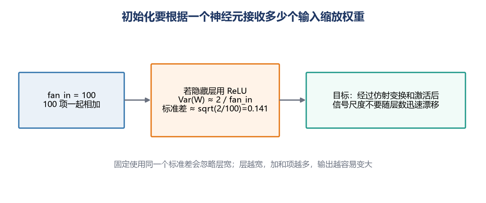
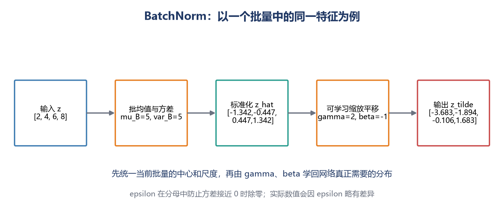
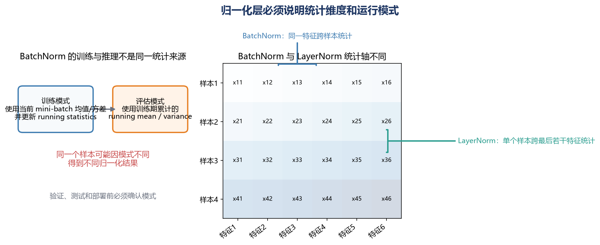
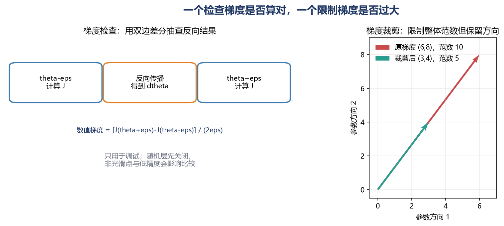

# [AI进阶-深度学习]2.参数初始化、归一化与训练稳定性

搭建神经网络时，即使网络拓扑结构和损失函数完全正确，训练依然经常遭遇各种“翻车”现场：损失根本不降、跑着跑着突然变成 `NaN`、前面浅层的权重几乎纹丝不动，或者在验证集上切换为评估模式后指标断崖式下跌。

这些现象通常被统称为“训练不稳定”，但它们本质上是发生在计算图不同节点上的数值与状态失控：
- **输入端失衡**：不同特征量纲差距成百上千倍，导致损失曲面极度狭长，梯度下降在两壁间来回剧烈震荡；
- **深层连乘失控**：前向激活或反向梯度经过几十层矩阵连续相乘后，指数级衰减为 0（梯度消失）或膨胀至溢出（梯度爆炸）；
- **动态分布漂移**：深层网络的输入依赖前层参数更新，导致中间层信号分布剧烈晃动，网络难以收敛；
- **状态切换脱节**：某些含有动态统计量的层（如 BatchNorm）在训练与推理模式下逻辑不同，评估时忘记切换模式导致结果错乱；
- **梯度计算求导有误**：手写的反向传播或自定义算子本身存在数学 Bug，从源头推导出了错误的梯度更新方向。

本篇将沿着数据的流动生命周期，逐一拆解输入归一化、参数初始化、层内归一化、梯度裁剪与梯度检查的底层机制，为深度网络的平稳训练搭建完整的防护体系。

---

## 一、训练稳定性究竟在稳定什么

监控并保障神经网络训练的稳定，核心在于确保计算图中的三类数值处于健康、合理的动态范围：

1. **输入特征的量纲尺度**：消除特征之间的单位壁垒，防止数值绝对值极大的特征垄断梯度方向。
2. **中间激活值与反向梯度的动态流动**：
   - 前向传播时，每层输出的激活值既不能逐层坍塌缩死为 0，也不能无节制指数级飙升；
   - 反向传播时，梯度从输出层倒流至浅层输入端，每一层都必须接收到尺度稳定、信噪比合理的有效信号。
3. **计算模式与状态的一致性**：严密管控含有动态统计量（BatchNorm）或随机行为（Dropout）的模块，确保训练环境与在线部署推理行为精准对齐。

### 训练异动的快速排查信号
- **损失异常**：Loss 突发变为 `NaN`、`Inf`，或者在某个 step 突然暴增几个数量级；
- **激活坍塌/发散**：深层神经元激活值全部熄火变为 0（如 ReLU 死亡），或绝对值持续上溢；
- **梯度冻结/尖峰**：浅层参数的梯度二范数长期贴地（如 $< 10^{-7}$），或周期性出现极大的梯度脉冲；
- **模式脱节**：同一组测试数据在 `model.train()` 和 `model.eval()` 模式下输出差距巨大。

---

## 二、输入归一化：先统一进入网络的坐标尺度

设有批量样本 $m$ 条，每个样本特征维度为 $d$，输入矩阵为 $X \in \mathbb R^{m \times d}$。

针对第 $j$ 列特征，**标准化（Z-score Normalization）**先统计其在训练集上的均值与方差：

$$
\mu_j = \frac{1}{m}\sum_{i=1}^{m} x_{ij}, \qquad \sigma_j^2 = \frac{1}{m}\sum_{i=1}^{m} (x_{ij} - \mu_j)^2
$$

随后执行线性平移与缩放：

$$
x'_{ij} = \frac{x_{ij} - \mu_j}{\sqrt{\sigma_j^2 + \varepsilon}}
$$

- 减去均值 $\mu_j$：把该维度的特征中心平移至原点 0；
- 除以标准差 $\sqrt{\sigma_j^2 + \varepsilon}$：将该特征的波动离散程度统一缩放至标准单位方差（$\varepsilon$ 是一个极小常数，如 $10^{-5}$，防止除零错误）。

> **直观算例**：
> 设有 3 组设备采样记录，温度为 $[10, 20, 30]^\circ\text{C}$，气压为 $[1000, 1005, 1010]\text{ hPa}$。
> - 温度列：$\mu = 20, \sigma \approx 8.165$，标准化后为 $[-1.225, 0, 1.225]$；
> - 气压列：$\mu = 1005, \sigma \approx 4.082$，标准化后同样为 $[-1.225, 0, 1.225]$。
>
> 变换后，原本物理意义完全不同的物理量被拉到了同一无量纲标尺下：两者数值变化 1 个单位，均代表偏离各自历史中心 1 个标准差。

### 为什么输入归一化能加速收敛？
未归一化的特征在损失空间中会形成**极端狭长的椭圆等高线“深谷”**，梯度方向垂直于等高线，会在窄壁之间剧烈打摆，沿主轴前进极其缓慢；归一化后，损失等高线被重塑为**接近正圆的同心圆**，梯度笔直指向最低点，允许全网采用更大的统一学习率快速收敛。

> **防泄漏铁律**：
> 均值 $\mu_j$ 与方差 $\sigma_j^2$ **必须且仅在训练集上计算得出**！测试集、验证集以及生产线上的输入，必须严格沿用训练集固化的均值和方差，严禁拿全量数据或测试集单独重新拟合统计量。

---

## 三、深层连乘怎样造成梯度消失和梯度爆炸

在深度网络中，信号无论是前向还是反向传导，都要经历大量矩阵和激活导数的连续相乘。

假设网络有 $L$ 层，每层传递时信号的平均缩放因子为 $s$。经过 $L$ 层的复合放大或衰减后，端到端的累计变化倍率为：

$$
\text{Total Gain} \approx s^L
$$

- **梯度消失（$s < 1$）**：若 $s = 0.5$，$L = 20$，则 $0.5^{20} \approx 9.54 \times 10^{-7}$。输出端的误差信号回传到浅层时已被削减了百万倍，浅层网络由于梯度几乎归零而彻底停止学习。
- **梯度爆炸（$s > 1$）**：若 $s = 1.5$，$L = 20$，则 $1.5^{20} \approx 3325$。微小的误差经过 20 层指数放大，回传到浅层时演变成数千倍的冲击，导致更新步长瞬间飞出合理区间，引发数值溢出 `NaN`。

传统 Sigmoid 激活函数的导数最大值仅为 $0.25$（$z$ 稍大便迅速落入饱和区趋近于 0），多层连续相乘天然是梯度消失的温床。现代网络采用 ReLU（正区间导数恒为 1）配合科学的**参数初始化**与**归一化层**，正是为了强行将每一层的复合增益 $s$ 维持在 1 附近。

---

## 四、参数初始化：让网络从可训练的尺度出发

### 1. 为什么隐藏层权重不能全部初始化为零？

如果将某一隐藏层中所有神经元的权重全部初始化为 0（甚至初始化为相同的常数）：
1. 面对相同输入，所有隐藏神经元的输出 $z = Wx + b$ 完全相同，激活值 $a$ 完全相同；
2. 反向传播时，下游回传给每一个神经元的梯度完全对称一致；
3. 更新后，该层所有神经元的权重依然保持完全一致。

这被称为**对称性陷阱（Symmetry Issue）**。无论该层配有 100 个还是 1000 个神经元，它在数学上完全退化成了 1 个神经元。因此，**隐藏层权重必须引入随机扰动来打破对称性**（偏置 $b$ 通常可以初始化为 0，因为权重的随机性已经打破了对称性）。

### 2. fan-in 为什么决定权重尺度

神经元的线性组合为 $z = \sum_{i=1}^{n} w_i x_i + b$。这里 $n$ 代表该神经元接收的上一层连接数，称为 **fan-in（输入度）**。

假设输入 $x_i$ 和权重 $w_i$ 相互独立、均值为 0，且方差分别为 $\operatorname{Var}(x)$ 和 $\operatorname{Var}(w)$，则和的方差为：

$$
\operatorname{Var}(z) \approx n \cdot \operatorname{Var}(w) \cdot \operatorname{Var}(x)
$$

**核心本质**：神经元接收的输入数量 $n$ 越多，求和累加的方差就越大！
为了让输出 $z$ 的方差与输入 $x$ 的方差保持在同一水平（即稳定放大倍率 $s \approx 1$），权重的方差必须与输入规模成反比：

$$
\operatorname{Var}(w) \propto \frac{1}{n}
$$

### 3. 主流初始化策略对比

#### He / Kaiming 初始化（专为 ReLU 设计）
ReLU 激活函数会把负半轴信号直接置零，导致前向传播时约有一半的神经元被关闭，信号方差减半。为了补齐这折损的一半能量，方差需要额外乘以 2：

$$
\operatorname{Var}(w) = \frac{2}{\text{fan\_in}} \implies \operatorname{Std}(w) = \sqrt{\frac{2}{\text{fan\_in}}}
$$

如果当前层有 100 个输入，权重将从均值为 0、标准差为 $\sqrt{\frac{2}{100}} \approx 0.141$ 的正态分布中采样。

#### Xavier / Glorot 初始化（专为 tanh / 线性层设计）
为了同时平衡前向传播（维持激活方差，依赖 fan-in）与反向传播（维持梯度方差，依赖 fan-out），Xavier 综合了两者的调和平均：

$$
\operatorname{Var}(w) = \frac{2}{\text{fan\_in} + \text{fan\_out}} \implies \operatorname{Std}(w) = \text{gain} \times \sqrt{\frac{2}{\text{fan\_in} + \text{fan\_out}}}
$$

其中 $\text{fan\_out}$ 是当前层的输出神经元数量。在 tanh 网络中配合 $\text{gain}=1$ 使用，能使信号在深层传递时不衰减也不爆炸。

---

## 五、BatchNorm：在网络内部按批量校准特征

输入标准化只能把好大门，但随着网络训练推进，浅层参数的更新会引发深层输入分布的持续剧烈漂移。

**批归一化（Batch Normalization, 简称 BatchNorm）**的思路是：**在网络内部的每一个中间层，沿着当前的 Mini-batch 样本维度，实时将特征强行拉回稳定的参考尺度，再赋予其自适应调节的自由度**。

### BatchNorm 的具体计算步骤

以全连接层输出的某一维特征 $z$ 为例，假设当前批量的 4 个样本输出为 $z = [2, 4, 6, 8]$：

1. **计算当前批量的均值与方差**：
   $$
   \mu_B = \frac{2+4+6+8}{4} = 5, \qquad \sigma_B^2 = \frac{(2-5)^2 + (4-5)^2 + (6-5)^2 + (8-5)^2}{4} = 5
   $$
2. **零均值单位方差标准化**：
   $$
   \hat z_i = \frac{z_i - \mu_B}{\sqrt{\sigma_B^2 + \varepsilon}} \approx [-1.342, -0.447, 0.447, 1.342]
   $$
3. **引入可学习的仿射变换参数（$\gamma$ 与 $\beta$）**：
   如果完全死守零均值和单位方差，可能会破坏非线性激活函数最有价值的表现区间（例如将 tanh 强行限制在原点附近纯线性段）。因此，BatchNorm 引入了两个参与反向传播学习的参数：
   $$
   y_i = \gamma \hat z_i + \beta
   $$
   - $\gamma$（Scale 缩放）：允许模型自适应重新放大或缩小特征的离散度；
   - $\beta$（Shift 平移）：允许模型根据需要整体上下平移特征均值。

> **结构搭配习惯**：
> 全连接层通常按照 `Linear -> BatchNorm -> Activation` 串联。由于 BatchNorm 内部自带偏置平移参数 $\beta$，前面的 `Linear` 层的偏置参数通常直接关闭（即在 PyTorch 中显式指定 `bias=False`），避免参数冗余。

---

## 六、训练模式与推理模式为什么不能混用

BatchNorm 在训练与评估阶段的行为截然不同：

- **训练阶段（`model.train()`）**：使用**当前批次（Current Batch）**的样本均值和方差进行归一化；同时在后台利用指数移动平均（EMA）默默维护全局的“运行统计量”：
  $$
  \mu_{\text{run}} \leftarrow (1 - \text{momentum}) \cdot \mu_{\text{run}} + \text{momentum} \cdot \mu_B
  $$
- **推理阶段（`model.eval()`）**：单条样本在线预测时，批量可能仅为 1（根本无法计算单样本方差）。此时**完全停用当前批次的统计计算，直接套用训练期间沉淀下来的全局固化统计量 $\mu_{\text{run}}$ 和 $\sigma_{\text{run}}^2$**。

> **踩坑警示**：
> 如果在线上推理单张图片时漏写了 `model.eval()`，模型将继续强行使用这 1 张图片计算均值和方差。均值等于输入本身，方差为 0，标准化后全图特征瞬间被抹平成 0，导致输出彻底失真崩溃！

### BatchNorm vs LayerNorm：维度的本质差异

BatchNorm 严重依赖批量大小。若 `batch_size` 极小（如 2 或 4），单批次均值和方差会剧烈波动，导致模型震荡不收敛。

| 归一化类型 | 统计维度方向 | 是否依赖 Batch Size | 训练与推理行为是否一致 | 主导应用领域 |
|---|---|---|---|---|
| **BatchNorm** | **跨样本统计**（沿 $N$ 维度汇总每个通道 $C$） | **强依赖**（Batch 太小效果极差） | 不一致（推理使用全局 EMA） | 传统卷积神经网络（CNN） |
| **LayerNorm** | **单样本内统计**（沿单一特征维度 $C$ 独立统计） | **完全无关**（单个样本即可完整计算） | 完全一致（推理直接算当前样本） | 序列模型、Transformer、大语言模型（LLM） |

---

## 七、梯度裁剪：在参数更新前加一道护栏

即使初始化和归一化做得再完美，在复杂长序列（RNN）或偶发离群脏数据冲击下，反向传播依然可能瞬间激荡出巨大的梯度尖峰。

**梯度裁剪（Gradient Clipping）**是在计算图反向求导完成后、优化器正式迈步更新前，强行介入的一道安全防护阀。

最经典的方案是**按全局范数裁剪（Clip by Global Norm）**：将全网所有参数的梯度展平成一个巨型向量 $g$，给定最大阈值 $c$：

$$
g_{\text{clip}} = g \cdot \min\left(1, \frac{c}{\|g\|_2}\right)
$$

- 如果全局梯度的二范数 $\|g\|_2 \le c$，乘数为 1，梯度**原封不动放行**；
- 如果 $\|g\|_2 > c$，则等比例缩放所有参数的梯度，强制将其总模长精准压制在 $c$。

> **物理直觉**：
> 设梯度向量为 $g = [6, 8]$，模长为 $\|g\|_2 = \sqrt{6^2 + 8^2} = 10$。设定门禁阈值 $c = 5$。
> 缩放系数为 $\frac{5}{10} = 0.5$，裁剪后的梯度向量为 $g_{\text{clip}} = [3, 4]$。
> **梯度的空间指向方向完全没有改变，只是步长被强行踩下了刹车，避免一步迈入发散深渊**。

---

## 八、梯度检查：确认反向传播计算是否正确

梯度裁剪解决的是“梯度太大”，而**梯度检查（Gradient Checking）**解决的是更底层的问题：**手写的反向传播算法到底有没有算错？**

它主要用于调试自定义算子或底层框架代码。其数学基础是微积分的**双边中心差分法**：

$$
g_{\text{num}} = \frac{J(\theta + \varepsilon) - J(\theta - \varepsilon)}{2\varepsilon}
$$

中心差分的近似误差为 $O(\varepsilon^2)$，精度远高于单边差分的 $O(\varepsilon)$。

通过中心差分算出纯数值梯度 $g_{\text{num}}$，再与反向传播算出的解析梯度 $g_{\text{backprop}}$ 进行**相对误差**比对：

$$
\text{relative error} = \frac{\|g_{\text{backprop}} - g_{\text{num}}\|_2}{\|g_{\text{backprop}}\|_2 + \|g_{\text{num}}\|_2 + \varepsilon}
$$

- **$\text{relative error} \le 10^{-7}$**：极大概率求导完全正确；
- **$\text{relative error} \approx 10^{-4}$**：可疑，需仔细排查是否存在不可导点或近似误差；
- **$\text{relative error} \ge 10^{-2}$**：反向传播存在确定性的推导或编码 Bug。

> **梯度检查调试准则**：
> 1. 务必采用高精度浮点数（`float64`），避免单精度舍入误差掩盖真实问题；
> 2. 暂时关闭 Dropout 等所有带随机性的模块；
> 3. 目标损失函数必须包含正则化项，确保比对的是完全相同的优化目标；
> 4. 仅抽取极小规模的玩具数据和网络层进行离线抽检（中心差分需遍历每个参数重算两次前向 Loss，计算成本极高）。

---

## 九、遇到不稳定训练时怎样逐步排查

当网络训练出现不收敛、数值爆炸或异常震荡时，千万不要同时乱调超参数。按照数据在系统中的流动路径，由外向内逐级排查：

1. **核对输入与标签（Input Check）**：
   - 检查输入数据与标签是否存在 `NaN`、`Inf` 或极端离群噪点；
   - 确认各特征已做标准化，且验证/测试集严格复用了训练集的均值与方差。
2. **检查损失函数的数值实现（Loss Stability）**：
   - 分类任务中，严禁手动手写 $\log(\text{softmax}(z))$，必须调用原生将两者融为一体的稳定 API（如 PyTorch 的 `nn.CrossEntropyLoss`），彻底杜绝中间指数上溢。
3. **监控前向激活分布（Forward Activation Profiling）**：
   - 逐层打印各层输出的均值、方差及极值；
   - 若某一层开始激活值大面积变为 0，重点排查是否存在 ReLU 神经元永久失活，考虑替换为 LeakyReLU 或 GELU。
4. **核对权重初始化（Weight Initialization）**：
   - 检查隐藏层权重是否错误地初始化全为 0；
   - 对 ReLU 系列网络，确认使用了 `kaiming_normal_`，而非方差过大的随机分布。
5. **排查归一化层的状态与维度（Normalization State）**：
   - 确认在训练循环内调用了 `model.train()`，在验证和测试阶段调用了 `model.eval()`；
   - 若使用 BatchNorm 且批量大小过小（$< 8$），优先切换为 LayerNorm 或 GroupNorm。
6. **监控反向梯度范数（Backward Gradient Flow）**：
   - 监控各层权重的梯度二范数，确认浅层是否存在梯度消失；
   - 如果偶发梯度尖峰导致崩溃，先在优化器更新前加入 `clip_grad_norm_`（阈值可设为 1.0 或 5.0）作为安全刹车。
7. **隔离与步进检查（Gradient Checking & Baseline）**：
   - 若存在自定义的反向传播代码，先在极小输入上执行 `gradcheck` 确认求导正确性；
   - 尝试在单张样本或极小批次上过拟合，确认网络基础结构有能力让 Loss 降到接近 0，再扩展到全量训练集。