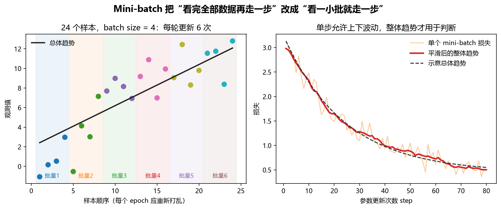
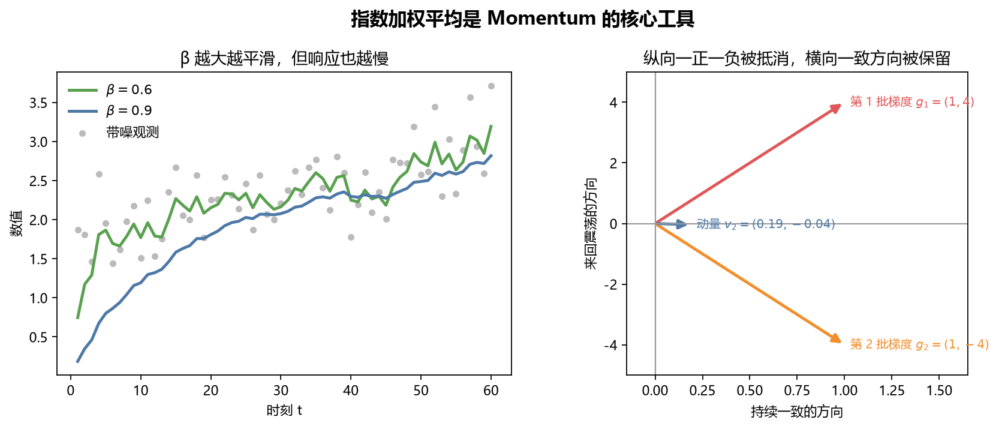
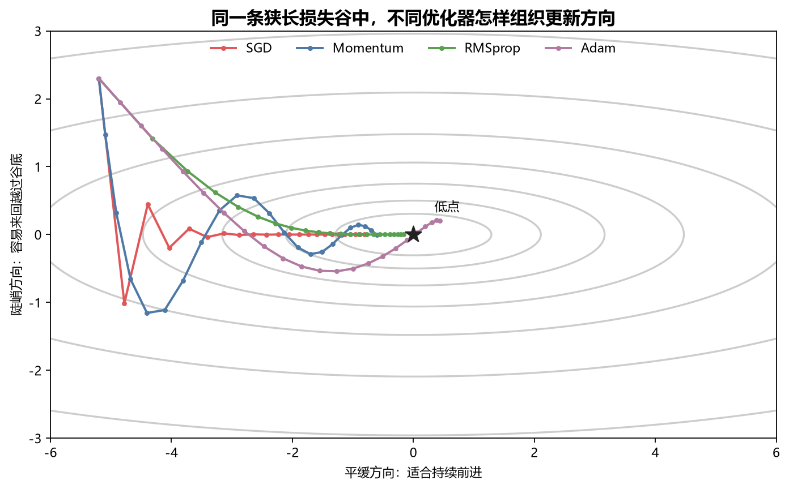
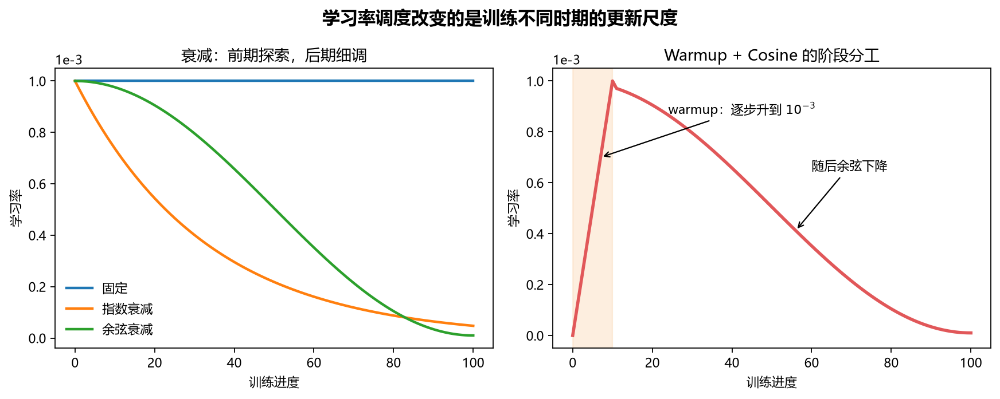
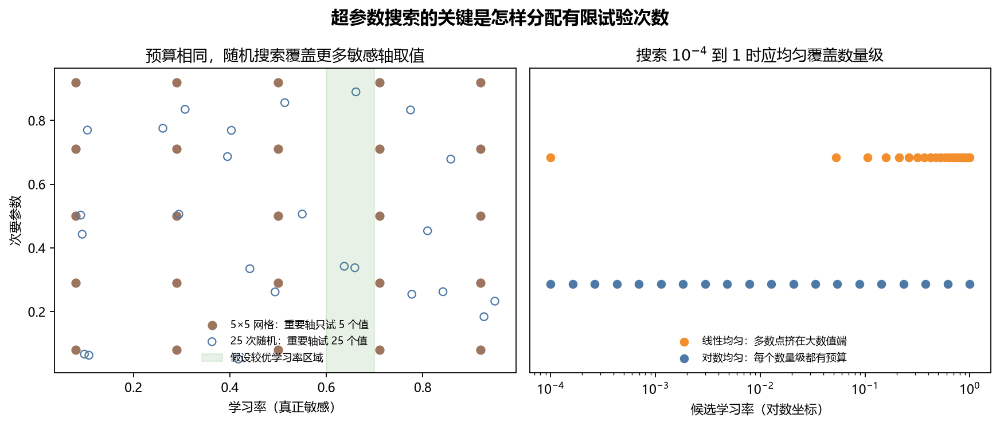
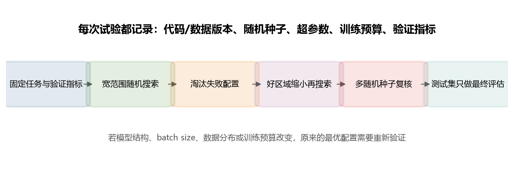

# [AI进阶-深度学习]3.优化器、学习率与超参数调优

反向传播负责回答“每个参数应该朝哪个方向修正”，而优化器负责解决“结合当前梯度与历史动量，这一步到底该跨多大、怎么走”。

这两件事必须严格解耦：
- 哪怕计算出的梯度完全一致，交给 SGD、Momentum 还是 Adam，参数在损失曲面上的行进轨迹也会截然不同；
- 哪怕使用完全相同的优化器，一旦调动了学习率、Batch Size 或权重衰减，模型的收敛速度和最终泛化上限也可能天差地别。

本篇沿着真实的工程训练链路展开：从 Mini-batch 的切分机制与噪声本质出发，剖析指数加权平均的平滑原理，层层递进推导 Momentum、RMSprop、Adam 与 AdamW 的核心机制，最后梳理学习率调度策略与科学的超参数调优闭环。

---

## 一、Mini-batch：看一小批样本就更新一次

设训练集包含 $m$ 条样本，每个样本特征维度为 $d$。按照样本在第一维的矩阵规范：

$$
X \in \mathbb{R}^{m \times d}, \qquad y \in \mathbb{R}^{m}
$$

- **全量梯度下降（Batch Gradient Descent, BGD）**：每一步更新必须遍历全部 $m$ 个样本的前向与反向传播。梯度方向极其准确平稳，但在海量数据下计算成本过高，参数迭代过于迟缓。
- **随机梯度下降（Stochastic Gradient Descent, SGD）**：每处理 1 个样本就立刻更新一次参数。更新频率极高，但单样本噪声巨大，更新轨迹剧烈震荡，且无法发挥现代 GPU 的矩阵并行吞吐优势。
- **小批量梯度下降（Mini-batch Gradient Descent）**：折中方案。将数据集随机打乱后，切分为大小为 $B$ 的小批次：

$$
X^{\{t\}} \in \mathbb{R}^{B \times d}, \qquad y^{\{t\}} \in \mathbb{R}^{B}
$$

模型计算完第 $t$ 个批次的梯度 $g_t$ 后，优化器立即更新一次参数。

> **核心概念辨析**：
> - **Step / Iteration**：处理一个 Mini-batch 并完成一次参数更新；
> - **Epoch**：全量训练集样本被网络完整过完一遍。
> 
> 例如训练集有 10 000 条样本，Batch Size 设为 128：
> 
> $$
> \text{Steps per Epoch} = \left\lceil \frac{10000}{128} \right\rceil = 79
> $$
> 
> 前 78 个 Step 每批含 128 条样本，第 79 个 Step 处理剩余的 16 条。若设置 `drop_last=True`，则丢弃最后不足批量的尾巴，每个 Epoch 固定执行 78 次更新。

### 认识 Mini-batch 的梯度噪声
由于每个 Mini-batch 仅由 $B$ 个随机抽样样本构成，计算出的梯度只是全量真实梯度的带噪无偏估计。因此，**Step 之间的训练损失上下抖动是完全正常的物理现象**。某一批遇到较难的样本导致 Loss 局部反弹，绝不代表训练发散；评估训练状态应观察窗口滑动平均线或独立的验证集指标。

---

## 二、Batch size 不是越大越好

增大或缩小 Batch Size，会在系统的四个维度引发连锁反应：

1. **梯度噪声与泛化性**：Batch 越大，梯度越接近全量均值，方差越小；但适度的 Mini-batch 噪声能充当隐式正则化，帮助参数跳出浅层局部极小值和尖锐极小值（Sharp Minima），通常能带来更好的验证集泛化。
2. **参数更新频率**：在固定的 Epoch 预算下，Batch 越小，参数更新总步数（Steps）越多；Batch 越大，总步数成倍缩减。
3. **计算硬件吞吐（Throughput）**：适度增大 Batch 能吃满 GPU 的 Tensor Core 并行算力；但若超出显存承载上限会直接触发 OOM（Out Of Memory）。
4. **超参数联动效应**：改变 Batch Size 会同步改变梯度方差与更新频次，必须联动缩放学习率。

> **工程应对：显存不足时的“梯度累积（Gradient Accumulation）”**
> 当单卡显存塞不下理想的大 Batch 时，可将前向反向拆分为若干 Micro-batch：连续计算多个小批次（例如 4 次 Batch=32），只累加梯度（`loss.backward()`）而不执行更新，最后统一调用一次 `optimizer.step()`。这样在显存受限条件下，能等效实现大 Batch（$32 \times 4 = 128$）的优化步长。

---

## 三、指数加权平均：从嘈杂观测中保留近期趋势

Mini-batch 梯度存在随机扰动。如果优化器完全被当前批次的瞬时梯度牵着走，就会在局部陷入低效的锯齿状震荡。

**指数加权移动平均（Exponentially Weighted Moving Average, EMA）**通过递推形式将历史估计与当前观测加权融合：

$$
v_t = \beta v_{t-1} + (1 - \beta) \theta_t
$$

- $\theta_t$：当前时刻的瞬时观测值（如当前批次梯度）；
- $v_t$：平滑后的估计值；
- $\beta \in [0, 1)$：动量衰减系数。

展开递推式：

$$
v_t = (1 - \beta)\theta_t + (1 - \beta)\beta\theta_{t-1} + (1 - \beta)\beta^2\theta_{t-2} + \dots
$$

历史观测的权重按指数衰减 $\beta^k$ 递减。数学上可近似推导其**有效时间窗口长度**：

$$
\text{有效记忆步数} \approx \frac{1}{1 - \beta}
$$

- $\beta = 0.9$：平滑最近 $\frac{1}{1 - 0.9} = 10$ 个 Step 的趋势；
- $\beta = 0.99$：平滑最近 $\frac{1}{1 - 0.99} = 100$ 个 Step 的趋势（曲线更平缓，但对急转弯的响应存在明显滞后）。

### 初始偏差校正（Bias Correction）
若初始化 $v_0 = 0$，起步阶段的加权值会被严重拉低向 0。例如第一步 $\theta_1 = 20, \beta = 0.9$，未经校正的值仅为 $v_1 = 0.1 \times 20 = 2$。

为此引入**偏差校正**：

$$
\hat v_t = \frac{v_t}{1 - \beta^t}
$$

当 $t = 1$ 时，$\hat v_1 = \frac{2}{1 - 0.9^1} = 20$，数值瞬间回归无偏水平；随着迭代步数 $t$ 增大，$\beta^t \to 0$，分母自动趋向 1，校正项自然淡出。

---

## 四、Momentum：抵消来回摆动，积累一致方向

在狭长的损失山谷中，常规 SGD 往往面临困境：谷壁方向坡度极陡，梯度巨大；沿谷底通往全局最优点的主方向坡度极其平缓，梯度微弱。结果是参数在两侧山壁之间剧烈横跳，而顺着谷底的前进速度如龟速。

**带动量的动量法（Momentum）**借用物理惯性原理：**将梯度的指数加权平均作为实际更新方向，利用历史动量冲刷掉相反方向的抖动，加速一致方向的推进**。

$$
v_t = \beta v_{t-1} + (1 - \beta) g_t
$$

$$
\theta_t = \theta_{t-1} - \alpha v_t
$$

> **极简二维算例追踪**：
> 设横轴为平缓主方向，纵轴为陡峭震荡方向。连续两批梯度为 $g_1 = (1, 4), g_2 = (1, -4)$。
> 取 $\beta = 0.9, v_0 = (0, 0)$：
> - 第 1 步：$v_1 = 0.1(1, 4) = (0.1, 0.4)$
> - 第 2 步：$v_2 = 0.9(0.1, 0.4) + 0.1(1, -4) = (0.19, -0.04)$
> 
> 观察结果：
> - **纵向震荡分量**：正负相反的梯度互相碰撞对冲，从 4 骤降至 $-0.04$；
> - **横向主进分量**：方向持续向右，速度从 0.1 累加增强至 0.19！
> 
> 参数不再被山壁左右裹挟，而是沿着谷底方向疾驰而下。

---

## 五、RMSprop：让每个参数拥有自己的尺度调节

Momentum 解决了“方向不一致导致的震荡”，但它依然对所有参数使用单一的步幅比例。如果特征量纲不一，某些参数方向的梯度长期极大，另一些参数方向的梯度长期极小，统一的学习率很容易在陡峭方向炸裂、在平缓方向停滞。

**RMSprop（Root Mean Square Propagation）**的核心逻辑是：**针对每个参数维护其历史梯度平方的移动平均，利用梯度强弱自适应缩放每个坐标轴的步长**。

1. **计算二阶未中心化矩（梯度平方加权）**：
   $$
   s_t = \beta_2 s_{t-1} + (1 - \beta_2) g_t^2
   $$
2. **参数独立自适应更新**：
   $$
   \theta_t = \theta_{t-1} - \frac{\alpha}{\sqrt{s_t} + \varepsilon} \odot g_t
   $$

所有运算均按元素逐维度执行。
- 若某个参数历史梯度极大：$s_t$ 很大，分母 $\sqrt{s_t}$ 变大，更新步长被强制**大幅压缩抑制**；
- 若某个参数历史梯度极平缓：$s_t$ 很小，分母很小，更新步长被**相对放大激励**。

自适应学习率机制在参数维度拉平了地形落差，让模型在不同曲率的维度上都能迈出稳健而均衡的步伐。

---

## 六、Adam 与 AdamW：同时利用方向和尺度

**Adam（Adaptive Moment Estimation）**将 Momentum 与 RMSprop 熔铸于一体：**利用一阶矩 $v_t$ 平滑更新方向，同时利用二阶矩 $s_t$ 自适应约束每个维度的坐标步长**。

### 标准 Adam 算法流

对当前批次梯度 $g_t$：
1. **一阶动量积累（方向平滑）**：
   $$
   v_t = \beta_1 v_{t-1} + (1 - \beta_1) g_t
   $$
2. **二阶动量累加（方差尺度估计）**：
   $$
   s_t = \beta_2 s_{t-1} + (1 - \beta_2) g_t^2
   $$
3. **消除初始偏差校正**：
   $$
   \hat v_t = \frac{v_t}{1 - \beta_1^t}, \qquad \hat s_t = \frac{s_t}{1 - \beta_2^t}
   $$
4. **最终综合更新**：
   $$
   \theta_t = \theta_{t-1} - \frac{\alpha}{\sqrt{\hat s_t} + \varepsilon} \odot \hat v_t
   $$

工业默认经验超参数：$\beta_1 = 0.9$（记忆约 10 步方向）、$\beta_2 = 0.999$（记忆约 1000 步尺度）、$\varepsilon = 10^{-8}$。

### AdamW：权重衰减的解耦进化

在传统 SGD 中，向损失函数添加 $L_2$ 正则惩罚项等价于在每次迭代时让权重按比例自我萎缩（Weight Decay）。
但在 Adam 这类自适应优化器中，**将 $L_2$ 正则梯度直接混入 $g_t$ 会导致严重的数学畸变**：
- 那些历史梯度平方 $s_t$ 很大的权重参数，其正则收缩惩罚会被除以巨大的分母 $\sqrt{s_t}$，导致正则化效果被异常削弱！

**AdamW（Decoupled Weight Decay）**纠正了这一错误，将权重衰减从自适应梯度计算中彻底**剥离解耦**：

$$
\theta_t = \theta_{t-1} \cdot (1 - \alpha \lambda) - \frac{\alpha}{\sqrt{\hat s_t} + \varepsilon} \odot \hat v_t
$$

- 权重参数首先经历纯粹的比例缩小衰减 $(1 - \alpha \lambda)$（其中 $\lambda$ 为权重衰减系数）；
- 紧接着再执行纯净的 Adam 梯度更新。

现代大语言模型（LLM）与 Transformer 训练几乎全部统一将 **AdamW** 作为标准优化器配置。

---

## 七、学习率：优化器仍然需要一个总步幅

自适应优化器自平衡了不同参数之间的相对步幅，但依然高度依赖全局学习率 $\alpha$ 决定整体行进的绝对尺度。

工程探索初始学习率时，推荐按对数数量级快速探底：

$$
[10^{-5}, 3 \times 10^{-5}, 10^{-4}, 3 \times 10^{-4}, 10^{-3}]
$$

单纯使用全局恒定学习率极难兼顾训练全周期：前期步子太小收敛缓慢，后期步子太大容易在最优谷底周围反复震荡。**学习率调度器（Learning Rate Scheduler）**负责在时间维度精准控速。

### 1. 学习率衰减（Decay）：后期精雕细琢

- **Step / 指数衰减**：每隔固定 Epoch 将学习率乘以衰减因子 $\gamma$（如 $\alpha_{t} = \alpha_0 \cdot 0.1^k$）；
- **余弦退火衰减（Cosine Annealing）**：学习率沿余弦曲线平滑回落，后期衰减平缓，有助于模型平稳滑入平坦极小值：

$$
\alpha_t = \alpha_{\min} + \frac{1}{2}(\alpha_{\max} - \alpha_{\min})\left(1 + \cos\frac{\pi t}{T}\right)
$$

### 2. 学习率预热（Warmup）：前期平稳起步

在训练刚刚启动的数十或数千个 Step 内，网络权重随机分布，Adam 的二阶矩统计量尚未稳定，过大的学习率极易产生毁灭性的参数破坏。

**Warmup 策略从极小的学习率出发，在前 $T_{\text{warmup}}$ 步内线性拉升至峰值 $\alpha_{\max}$**，让网络内部各层的激活与梯度分布完成初步对齐后，再顺滑切入余弦退火等衰减阶段。

---

## 八、鞍点和平台：优化器为什么仍可能走得很慢

在高维深度学习损失曲面中，阻碍模型优化的最大元凶往往不是局部极小值（Local Minima），而是**鞍点（Saddle Points）**与**平坦高原（Plateaus）**：
- **鞍点**：梯度为 0，某些维度曲率向上（极小值），另一些维度曲率向下（极大值）；
- **高原区**：曲率极其微弱，梯度范数长期接近 0。

传统 SGD 容易在鞍点停滞不前；而 Momentum 凭借历史惯性能冲刷越过平坦区，Adam 则因分母除以极小的梯度方差而自动放大微弱信号，大幅加快了脱离鞍点与高原的速度。

---

## 九、超参数搜索：把有限试验次数放在有信息的地方

### 1. 为什么随机搜索（Random Search）全面碾压网格搜索（Grid Search）？

假定网络有两个超参数：超参数 A 极度敏感（如学习率），超参数 B 几乎无关紧要（如某个辅助惩罚项）。

在 $5 \times 5$ 的规则网格搜索中，总共跑了 25 次昂贵的训练，但**在至关重要的超参数 A 维度上，实质上只测试了 5 个不同取值**（每个取值重复测试了 5 遍）；
而在 25 次**随机搜索**中，超参数 A 将被均匀随机采样出 25 个完全不同的数值点，对核心敏感维度的探索覆盖度提升了整整 5 倍！

### 2. 跨数量级超参数必须在对数尺度（Log Scale）采样

对于取值跨越多个数量级的正数超参数（如学习率 $\alpha \in [10^{-4}, 10^{-1}]$、权重衰减 $\lambda$），如果在数轴上均匀线性采样，约 90% 的搜索预算会被浪费在 $[0.01, 0.1]$ 的大数值区间内，极敏感的小数值区间几乎处于真空。

科学的采样法是在指数域均匀采样：

$$
r \sim \operatorname{Uniform}(-4, -1), \qquad \alpha = 10^r
$$

同理，对于逼近 1 的动量超参数 $\beta \in [0.9, 0.999]$，应针对 $1 - \beta$ 在对数尺度采样：$\beta = 0.9$ 对应记忆 10 步，$\beta = 0.999$ 对应记忆 1000 步，差一个 9 代表记忆容量放大了一个数量级。

---

## 十、把调参组织成可以复现的实验

工业级超参数调优绝非碰运气的玄学漫游，而是一套严密受控的实验科学。

遵循八步标准工程闭环：

1. **协议锁死**：固定训练集、验证集划分口径与主业务评估指标，整个调参过程中裁判标准绝不可动；
2. **基线速通**：使用默认 AdamW、保守学习率（如 $3 \times 10^{-4}$），迅速跑通完整训练流程，验证网络具备基本的过拟合与收敛能力；
3. **敏感度降序攻坚**：优先攻克对最终指标影响最大的参数（学习率 $\to$ Batch Size $\to$ 权重衰减 $\to$ 架构层深与宽度）；
4. **科学刻度采样**：跨数量级参数严格采用对数尺度采样；
5. **粗搜（Coarse）与精搜（Fine）分层推进**：
   - 第一阶段用极短的 Epoch 预算大范围宽幅粗搜，利用早停机制（Early Stopping）果断淘汰发散配置；
   - 第二阶段围绕 Top-3 的优势核心参数区间缩窄范围，投入全量 Epoch 细致精调；
6. **多种子（Seed）复核验证**：针对最终优胜方案更换 3~5 个随机种子重复训练，核验均值与方差，杜绝偶然性过拟合；
7. **环境元数据全量留痕**：完整记录代码 Commit ID、数据版本、调度器状态、显存占用与最佳 Checkpoint 权重；
8. **测试集终局验卷**：所有调参工作全部结束后，测试集仅在封板时介入一次做客观泛化评估，严防测试集被持续试错污染。